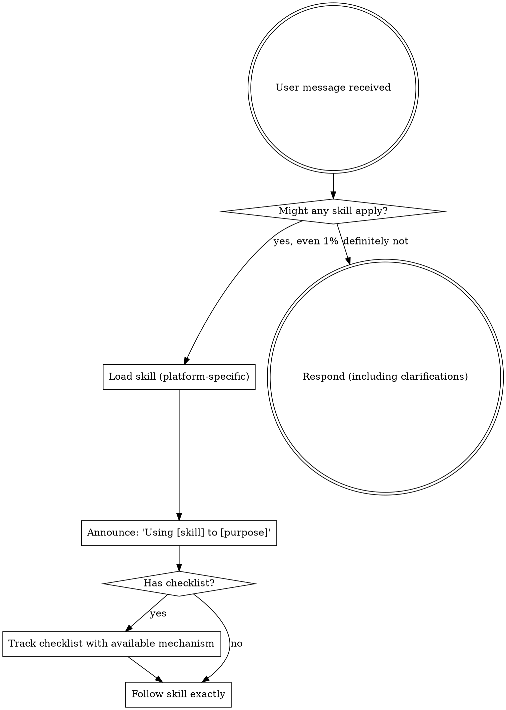

<EXTREMELY-IMPORTANT>
If you think there is even a 1% chance a skill might apply to what you are doing, you ABSOLUTELY MUST load and follow the skill.

IF A SKILL APPLIES TO YOUR TASK, YOU DO NOT HAVE A CHOICE. YOU MUST USE IT.

This is not negotiable. This is not optional. You cannot rationalize your way out of this.
</EXTREMELY-IMPORTANT>

# Skill Loader

## Goal

Ensure relevant skills are loaded and followed before any response, including clarifying questions.

## Required Actions (Must Execute)

1. Inspect available skill names and descriptions in the current environment.
2. Match the user request to skill trigger conditions.
3. Load each applicable skill using the platform-native loading mechanism.
4. Announce loaded skills in one line: `Using <skill-name> to <purpose>`.
5. Follow loaded skills exactly.

## Discovery Rule

Do not hardcode skill directory paths or custom environment-detection heuristics in this skill.
Rely on platform-provided skill discovery and loading behavior.

## The Rule

Load relevant skills BEFORE any response or action. If a loaded skill turns out to be non-applicable, state that briefly and continue with the next best applicable skill.

## Checklist Tracking (No Hard Dependency)

- If `TodoWrite` is available, use it.
- If `TodoWrite` is unavailable, maintain an explicit markdown checklist in the response.
- Do not block execution due to missing checklist tooling.

## Red Flags

These thoughts mean STOP — you're rationalizing:

| Thought | Reality |
|---------|---------|
| "This is just a simple question" | Questions are tasks. Check for skills. |
| "I need more context first" | Skill check comes BEFORE clarifying questions. |
| "Let me explore the codebase first" | Skills tell you HOW to explore. Check first. |
| "I can check git/files quickly" | Files lack conversation context. Check for skills. |
| "Let me gather information first" | Skills tell you HOW to gather information. |
| "This doesn't need a formal skill" | If a skill exists, use it. |
| "I remember this skill" | Skills evolve. Read current version. |
| "This doesn't count as a task" | Action = task. Check for skills. |
| "The skill is overkill" | Simple things become complex. Use it. |
| "I'll just do this one thing first" | Check BEFORE doing anything. |
| "This feels productive" | Undisciplined action wastes time. Skills prevent this. |
| "I know what that means" | Knowing the concept ≠ loading the skill. Load it. |

## Skill Priority

When multiple skills could apply, use this order:

1. **Process skills first** (for example `brainstorming`, `systematic-debugging` if available) — these determine approach.
2. **Implementation skills second** (for example `frontend-conventions`, `backend-conventions`) — these guide execution details.
3. **Quality gates before completion** (`verification-before-completion`, then `requesting-code-review` when applicable).

"Let's build X" -> process skill first, then implementation skill.
"Fix this bug" -> debugging/process skill first, then implementation skill.

## Success Signals (Required)

1. Applicable skills are loaded, or a short explicit statement says none apply.
2. Announcement line is present: `Using <skill-name> to <purpose>`.
3. Checklist tracking is active via `TodoWrite` or markdown fallback when required.
4. First substantive response follows loaded skill constraints.
