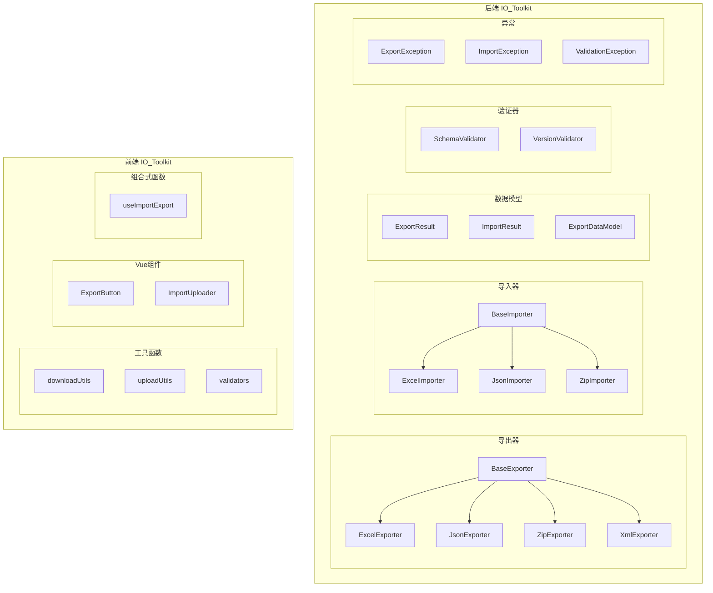

# Design Document

## Overview

本设计文档定义了导入导出工具库（IO_Toolkit）的架构设计，旨在为项目提供统一、可扩展、可复用的导入导出基础设施。工具库分为后端（Python/FastAPI）和前端（TypeScript/Vue3）两部分，采用策略模式实现格式扩展，遵循SOLID原则确保代码质量。

## Architecture

### 🚨 核心原则：优先使用开源社区顶级库，严禁重复造轮子

> **这是本项目最重要的工程原则。** 开源社区的顶级库已经过大量生产环境验证，具有更好的性能、稳定性和安全性。我们的工作是**组合和封装**这些库，而不是重新实现它们的功能。

#### 后端依赖库选择

| 功能领域 | 选用库 | 理由 | 替代方案（不采用） |
|---------|--------|------|------------------|
| **Excel读写** | `openpyxl` | Python社区标准，支持xlsx格式，功能完整 | 自己解析XML |
| **Excel数据处理** | `pandas` | 数据处理事实标准，性能优异 | 手动遍历处理 |
| **JSON序列化** | `pydantic` + `orjson` | 类型安全+高性能JSON | 手动dict转换 |
| **ZIP处理** | `zipfile` (标准库) | Python标准库，稳定可靠 | 自己实现压缩 |
| **XML处理** | `lxml` | C扩展，性能最佳 | xml.etree |
| **数据验证** | `pydantic` | 类型验证事实标准 | 手动if判断 |
| **异步支持** | `aiofiles` | 异步文件IO | 同步阻塞IO |
| **日期处理** | `python-dateutil` | 日期解析标准库 | 手动解析 |

#### 前端依赖库选择

| 功能领域 | 选用库 | 理由 | 替代方案（不采用） |
|---------|--------|------|------------------|
| **文件下载** | `file-saver` | 浏览器兼容性最佳 | 手动创建a标签 |
| **Excel生成** | `xlsx` / `exceljs` | 功能完整，社区活跃 | 自己拼接XML |
| **ZIP处理** | `jszip` | 浏览器端ZIP标准库 | 自己实现 |
| **HTTP请求** | `axios` | 项目已有，功能完整 | fetch封装 |
| **类型验证** | `zod` | TypeScript类型验证最佳 | 手动类型检查 |

#### 我们只做三件事

```
┌─────────────────────────────────────────────────────────────┐
│                    IO_Toolkit 职责边界                       │
├─────────────────────────────────────────────────────────────┤
│  ✅ 我们做的事情：                                           │
│     1. 定义统一的接口和数据模型                              │
│     2. 组合和封装开源库，提供简洁API                         │
│     3. 处理业务特定的转换逻辑（字段映射、版本控制等）         │
├─────────────────────────────────────────────────────────────┤
│  ❌ 我们不做的事情：                                         │
│     1. 不实现Excel/ZIP/XML的底层解析                         │
│     2. 不实现JSON序列化/反序列化                             │
│     3. 不实现文件压缩算法                                    │
│     4. 不实现浏览器文件下载兼容性处理                        │
└─────────────────────────────────────────────────────────────┘
```

#### 代码示例：正确的封装方式

```python
# ✅ 正确：封装openpyxl，提供业务API
class ExcelExporter(ExportStrategy):
    async def export(self, data: List[Dict], **options) -> ExportResult:
        # 使用openpyxl处理Excel
        from openpyxl import Workbook
        from openpyxl.styles import PatternFill, Font
        
        wb = Workbook()
        ws = wb.active
        # ... 使用openpyxl的API
        
        # 使用pandas进行数据转换（如果需要）
        import pandas as pd
        df = pd.DataFrame(data)
        # ...

# ❌ 错误：自己实现Excel格式
class BadExcelExporter:
    def export(self, data):
        # 不要这样做！
        xml_content = '<?xml version="1.0"?><worksheet>...'
        # 手动拼接XML是错误的做法
```

### 设计原则（对标Google工程实践）

本架构设计遵循以下Google级别的工程原则：

| 原则 | 说明 | 实现方式 |
|------|------|---------|
| **Use Existing Libraries** | 优先使用成熟开源库 | openpyxl/pandas/pydantic |
| **SOLID** | 单一职责、开闭原则、里氏替换、接口隔离、依赖倒置 | 策略模式、抽象基类、依赖注入 |
| **DRY** | Don't Repeat Yourself | 统一基类、工厂方法、模板方法 |
| **KISS** | Keep It Simple, Stupid | 简洁API、合理默认值 |
| **YAGNI** | You Aren't Gonna Need It | 按需扩展、避免过度设计 |
| **Composition over Inheritance** | 组合优于继承 | 装饰器模式、组合导出器 |
| **Fail Fast** | 快速失败 | 前置验证、明确异常 |
| **Defensive Programming** | 防御性编程 | 输入验证、边界检查 |

### 核心架构模式

#### 1. 策略模式（Strategy Pattern）
```
┌─────────────────┐
│  ExportStrategy │ ◄── 抽象策略
└────────┬────────┘
         │
    ┌────┴────┬────────┬────────┐
    ▼         ▼        ▼        ▼
┌───────┐ ┌───────┐ ┌───────┐ ┌───────┐
│ Excel │ │ JSON  │ │  ZIP  │ │  XML  │  ◄── 具体策略
└───────┘ └───────┘ └───────┘ └───────┘
```

#### 2. 工厂模式（Factory Pattern）
```python
class ExporterFactory:
    _exporters: Dict[str, Type[ExportStrategy]] = {}
    
    @classmethod
    def register(cls, format_type: str, exporter_class: Type[ExportStrategy]):
        cls._exporters[format_type] = exporter_class
    
    @classmethod
    def create(cls, format_type: str, **options) -> ExportStrategy:
        if format_type not in cls._exporters:
            raise ValueError(f"Unknown format: {format_type}")
        return cls._exporters[format_type](**options)

# 注册导出器
ExporterFactory.register('excel', ExcelExporter)
ExporterFactory.register('json', JsonExporter)
ExporterFactory.register('zip', ZipExporter)

# 使用
exporter = ExporterFactory.create('excel', mapping_dict={...})
```

#### 3. 装饰器模式（Decorator Pattern）
```python
class LoggingExporter(ExportStrategy):
    """日志装饰器"""
    def __init__(self, wrapped: ExportStrategy):
        self._wrapped = wrapped
    
    async def export(self, data, **options) -> ExportResult:
        logger.info(f"Starting export with {self._wrapped.__class__.__name__}")
        start = time.time()
        result = await self._wrapped.export(data, **options)
        logger.info(f"Export completed in {time.time() - start:.2f}s, size: {result.size}")
        return result

class CompressionExporter(ExportStrategy):
    """压缩装饰器"""
    def __init__(self, wrapped: ExportStrategy, compression_level: int = 6):
        self._wrapped = wrapped
        self._compression_level = compression_level
    
    async def export(self, data, **options) -> ExportResult:
        result = await self._wrapped.export(data, **options)
        compressed = gzip.compress(result.content, self._compression_level)
        return ExportResult(
            content=compressed,
            filename=result.filename + '.gz',
            content_type='application/gzip',
            size=len(compressed)
        )

# 组合使用
exporter = LoggingExporter(CompressionExporter(JsonExporter()))
```

#### 4. 建造者模式（Builder Pattern）
```python
class ExcelTemplateBuilder:
    """Excel模板建造者"""
    def __init__(self):
        self._headers: List[ColumnConfig] = []
        self._validations: List[ValidationConfig] = []
        self._sample_data: List[Dict] = []
        self._styles: StyleConfig = StyleConfig()
    
    def add_column(self, key: str, label: str, width: int = 15) -> 'ExcelTemplateBuilder':
        self._headers.append(ColumnConfig(key=key, label=label, width=width))
        return self
    
    def add_dropdown(self, column: str, options: List[str]) -> 'ExcelTemplateBuilder':
        self._validations.append(ValidationConfig(column=column, options=options))
        return self
    
    def add_sample_row(self, data: Dict) -> 'ExcelTemplateBuilder':
        self._sample_data.append(data)
        return self
    
    def with_header_style(self, fill_color: str, font_bold: bool = True) -> 'ExcelTemplateBuilder':
        self._styles.header_fill = fill_color
        self._styles.header_bold = font_bold
        return self
    
    def build(self) -> bytes:
        """构建Excel模板"""
        return ExcelTemplateGenerator(
            headers=self._headers,
            validations=self._validations,
            sample_data=self._sample_data,
            styles=self._styles
        ).generate()

# 使用
template = (ExcelTemplateBuilder()
    .add_column('userName', '用户名称', width=20)
    .add_column('status', '状态', width=10)
    .add_dropdown('status', ['正常', '停用'])
    .add_sample_row({'userName': '示例用户', 'status': '正常'})
    .with_header_style('#f2f2f2')
    .build())
```

#### 5. 管道模式（Pipeline Pattern）
```python
class ImportPipeline:
    """导入处理管道"""
    def __init__(self):
        self._steps: List[PipelineStep] = []
    
    def add_step(self, step: PipelineStep) -> 'ImportPipeline':
        self._steps.append(step)
        return self
    
    async def execute(self, context: ImportContext) -> ImportResult:
        for step in self._steps:
            context = await step.process(context)
            if context.should_abort:
                break
        return context.to_result()

# 定义管道步骤
class FileValidationStep(PipelineStep):
    async def process(self, ctx: ImportContext) -> ImportContext:
        if not ctx.file_content:
            ctx.add_error(ImportError(message="文件内容为空"))
            ctx.should_abort = True
        return ctx

class SchemaValidationStep(PipelineStep):
    async def process(self, ctx: ImportContext) -> ImportContext:
        errors = self._validator.validate(ctx.parsed_data, ctx.target_schema)
        ctx.errors.extend(errors)
        return ctx

class DataTransformStep(PipelineStep):
    async def process(self, ctx: ImportContext) -> ImportContext:
        ctx.transformed_data = self._transformer.transform(ctx.parsed_data)
        return ctx

# 使用
pipeline = (ImportPipeline()
    .add_step(FileValidationStep())
    .add_step(ParseStep())
    .add_step(SchemaValidationStep())
    .add_step(VersionValidationStep())
    .add_step(DataTransformStep()))

result = await pipeline.execute(ImportContext(file_content=content))
```

#### 6. 缓存策略（Caching Strategy）
```python
from functools import lru_cache
from typing import Hashable
import hashlib

class ExportCache:
    """导出结果缓存（LRU策略）"""
    def __init__(self, max_size: int = 100, ttl_seconds: int = 300):
        self._cache: OrderedDict[str, CacheEntry] = OrderedDict()
        self._max_size = max_size
        self._ttl = ttl_seconds
    
    def _compute_key(self, data: Any, options: Dict) -> str:
        """计算缓存键（基于内容哈希）"""
        content = json.dumps(data, sort_keys=True, default=str)
        options_str = json.dumps(options, sort_keys=True)
        return hashlib.sha256(f"{content}:{options_str}".encode()).hexdigest()
    
    def get(self, key: str) -> Optional[ExportResult]:
        """获取缓存（O(1)时间复杂度）"""
        if key not in self._cache:
            return None
        entry = self._cache[key]
        if entry.is_expired(self._ttl):
            del self._cache[key]
            return None
        # LRU: 移动到末尾
        self._cache.move_to_end(key)
        return entry.result
    
    def set(self, key: str, result: ExportResult):
        """设置缓存（O(1)时间复杂度）"""
        if key in self._cache:
            self._cache.move_to_end(key)
        else:
            if len(self._cache) >= self._max_size:
                # 淘汰最久未使用的条目
                self._cache.popitem(last=False)
        self._cache[key] = CacheEntry(result=result, created_at=time.time())

class CachedExporter(ExportStrategy):
    """带缓存的导出器装饰器"""
    def __init__(self, wrapped: ExportStrategy, cache: ExportCache):
        self._wrapped = wrapped
        self._cache = cache
    
    async def export(self, data, **options) -> ExportResult:
        cache_key = self._cache._compute_key(data, options)
        cached = self._cache.get(cache_key)
        if cached:
            return cached
        result = await self._wrapped.export(data, **options)
        self._cache.set(cache_key, result)
        return result
```

#### 7. 流式处理（Streaming for Large Data）
```python
from typing import AsyncIterator, Iterator
import asyncio

class StreamingExporter(ExportStrategy):
    """流式导出器（处理大数据集）"""
    
    async def export_stream(
        self, 
        data_iterator: AsyncIterator[Dict],
        chunk_size: int = 1000
    ) -> AsyncIterator[bytes]:
        """
        流式导出，避免内存溢出
        时间复杂度: O(n)，空间复杂度: O(chunk_size)
        """
        buffer = []
        async for item in data_iterator:
            buffer.append(item)
            if len(buffer) >= chunk_size:
                yield await self._process_chunk(buffer)
                buffer = []
        if buffer:
            yield await self._process_chunk(buffer)
    
    async def _process_chunk(self, chunk: List[Dict]) -> bytes:
        """处理数据块"""
        pass

class StreamingZipExporter:
    """流式ZIP导出（支持超大文件）"""
    
    async def export_stream(
        self,
        entries: AsyncIterator[ZipEntry]
    ) -> AsyncIterator[bytes]:
        """
        流式生成ZIP，无需将整个文件加载到内存
        使用zipfile的增量写入能力
        """
        buffer = BytesIO()
        with ZipFile(buffer, 'w', ZIP_DEFLATED) as zf:
            async for entry in entries:
                zf.writestr(entry.filename, entry.content)
                # 每写入一个文件就yield当前buffer内容
                yield buffer.getvalue()
                buffer.seek(0)
                buffer.truncate()
```

#### 8. 并发处理（Concurrent Processing）
```python
import asyncio
from concurrent.futures import ThreadPoolExecutor

class BatchExporter:
    """批量导出器（并发处理）"""
    
    def __init__(
        self, 
        exporter: ExportStrategy,
        max_concurrency: int = 10
    ):
        self._exporter = exporter
        self._semaphore = asyncio.Semaphore(max_concurrency)
    
    async def export_batch(
        self,
        items: List[Any],
        filename_fn: Callable[[Any, int], str]
    ) -> List[ExportResult]:
        """
        并发批量导出
        时间复杂度: O(n/concurrency)
        """
        async def export_with_semaphore(item, index):
            async with self._semaphore:
                return await self._exporter.export(
                    item, 
                    filename=filename_fn(item, index)
                )
        
        tasks = [
            export_with_semaphore(item, i) 
            for i, item in enumerate(items)
        ]
        return await asyncio.gather(*tasks, return_exceptions=True)

class ParallelImporter:
    """并行导入器"""
    
    def __init__(
        self,
        importer: ImportStrategy,
        max_workers: int = 4
    ):
        self._importer = importer
        self._executor = ThreadPoolExecutor(max_workers=max_workers)
    
    async def import_batch(
        self,
        files: List[bytes],
        model: Type[BaseModel]
    ) -> List[ImportResult]:
        """
        并行批量导入（CPU密集型任务使用线程池）
        """
        loop = asyncio.get_event_loop()
        tasks = [
            loop.run_in_executor(
                self._executor,
                self._sync_import,
                content,
                model
            )
            for content in files
        ]
        return await asyncio.gather(*tasks, return_exceptions=True)
```

#### 9. 数据结构优化
```python
from dataclasses import dataclass, field
from typing import Generic, TypeVar
import bisect

T = TypeVar('T')

@dataclass
class IndexedFieldMapping:
    """
    字段映射索引结构
    使用哈希表实现O(1)查找
    """
    _forward: Dict[str, str] = field(default_factory=dict)  # key -> label
    _reverse: Dict[str, str] = field(default_factory=dict)  # label -> key
    
    def add(self, key: str, label: str):
        self._forward[key] = label
        self._reverse[label] = key
    
    def get_label(self, key: str) -> Optional[str]:
        """O(1) 查找"""
        return self._forward.get(key)
    
    def get_key(self, label: str) -> Optional[str]:
        """O(1) 反向查找"""
        return self._reverse.get(label)

class SortedImportErrors:
    """
    有序错误集合（按行号排序）
    使用二分插入保持有序，O(log n)插入
    """
    def __init__(self):
        self._errors: List[ImportError] = []
    
    def add(self, error: ImportError):
        """O(log n) 插入"""
        if error.row is None:
            self._errors.append(error)
        else:
            bisect.insort(self._errors, error, key=lambda e: e.row or float('inf'))
    
    def get_errors_in_range(self, start_row: int, end_row: int) -> List[ImportError]:
        """O(log n + k) 范围查询，k为结果数量"""
        left = bisect.bisect_left(self._errors, start_row, key=lambda e: e.row or float('inf'))
        right = bisect.bisect_right(self._errors, end_row, key=lambda e: e.row or float('inf'))
        return self._errors[left:right]

class TrieColumnMatcher:
    """
    Trie树实现的列名模糊匹配
    用于Excel导入时的列名自动识别
    """
    def __init__(self):
        self._root: Dict = {}
    
    def add_pattern(self, pattern: str, key: str):
        """添加匹配模式 O(m)，m为模式长度"""
        node = self._root
        for char in pattern.lower():
            if char not in node:
                node[char] = {}
            node = node[char]
        node['$'] = key
    
    def match(self, text: str) -> Optional[str]:
        """匹配文本 O(m)"""
        node = self._root
        for char in text.lower():
            if char not in node:
                return None
            node = node[char]
        return node.get('$')
    
    def fuzzy_match(self, text: str, max_distance: int = 2) -> List[str]:
        """模糊匹配（编辑距离）O(m * n)"""
        # 使用动态规划计算编辑距离
        pass
```

#### 10. 内存优化（Memory Optimization）
```python
from __future__ import annotations
import sys
from typing import TYPE_CHECKING
import weakref

if TYPE_CHECKING:
    from .models import ExportResult

class MemoryEfficientExportResult:
    """
    内存优化的导出结果
    使用__slots__减少内存占用
    """
    __slots__ = ('_content', '_filename', '_content_type', '_size', '_created_at')
    
    def __init__(self, content: bytes, filename: str, content_type: str):
        self._content = content
        self._filename = filename
        self._content_type = content_type
        self._size = len(content)
        self._created_at = time.time()
    
    @property
    def content(self) -> bytes:
        return self._content
    
    def release(self):
        """显式释放大内存对象"""
        self._content = b''

class LazyExportResult:
    """
    延迟加载的导出结果
    适用于大文件，避免一次性加载到内存
    """
    def __init__(self, generator_fn: Callable[[], bytes], filename: str, content_type: str):
        self._generator_fn = generator_fn
        self._content: Optional[bytes] = None
        self._filename = filename
        self._content_type = content_type
    
    @property
    def content(self) -> bytes:
        """延迟生成内容"""
        if self._content is None:
            self._content = self._generator_fn()
        return self._content
    
    def stream(self) -> Iterator[bytes]:
        """流式获取内容"""
        return self._generator_fn()
```

#### 11. 插件架构（Plugin Architecture）
```python
class IOToolkitRegistry:
    """IO工具库注册中心"""
    _instance = None
    
    def __new__(cls):
        if cls._instance is None:
            cls._instance = super().__new__(cls)
            cls._instance._exporters = {}
            cls._instance._importers = {}
            cls._instance._validators = {}
        return cls._instance
    
    def register_exporter(self, format_type: str, exporter: Type[ExportStrategy]):
        self._exporters[format_type] = exporter
    
    def register_importer(self, format_type: str, importer: Type[ImportStrategy]):
        self._importers[format_type] = importer
    
    def register_validator(self, name: str, validator: Type[Validator]):
        self._validators[name] = validator
    
    def get_exporter(self, format_type: str, **options) -> ExportStrategy:
        return self._exporters[format_type](**options)
    
    def get_importer(self, format_type: str, **options) -> ImportStrategy:
        return self._importers[format_type](**options)

# 自动发现和注册（类似Django的autodiscover）
def autodiscover_plugins():
    """自动发现并注册插件"""
    registry = IOToolkitRegistry()
    for module in discover_modules('utils.io_toolkit.plugins'):
        if hasattr(module, 'register'):
            module.register(registry)
```

### 整体架构图



### 目录结构

```
ruoyi-fastapi-backend/
└── utils/
    └── io_toolkit/
        ├── __init__.py
        ├── base.py              # 基础接口和抽象类
        ├── models.py            # 数据模型定义
        ├── exceptions.py        # 异常类定义
        ├── exporters/
        │   ├── __init__.py
        │   ├── base.py          # BaseExporter
        │   ├── excel.py         # ExcelExporter
        │   ├── json.py          # JsonExporter
        │   └── zip.py           # ZipExporter
        ├── importers/
        │   ├── __init__.py
        │   ├── base.py          # BaseImporter
        │   ├── excel.py         # ExcelImporter
        │   ├── json.py          # JsonImporter
        │   └── zip.py           # ZipImporter
        └── validators/
            ├── __init__.py
            ├── schema.py        # SchemaValidator
            └── version.py       # VersionValidator

ruoyi-fastapi-frontend/
└── src/
    └── utils/
        └── io-toolkit/
            ├── index.ts         # 统一导出
            ├── download.ts      # 下载工具
            ├── upload.ts        # 上传工具
            ├── validators.ts    # 文件验证
            └── types.ts         # 类型定义
    └── components/
        └── ImportExport/
            ├── index.ts         # 组件导出
            ├── ExportButton.vue # 导出按钮组件
            └── ImportUploader.vue # 导入上传组件
    └── composables/
        └── useImportExport.ts   # 组合式函数
```

## Components and Interfaces

### 后端核心接口

#### ExportStrategy 接口

```python
from abc import ABC, abstractmethod
from typing import Any, Dict, List, Optional
from .models import ExportResult

class ExportStrategy(ABC):
    """导出策略抽象基类"""
    
    @abstractmethod
    async def export(self, data: Any, **options) -> ExportResult:
        """
        执行导出操作
        
        :param data: 待导出的数据
        :param options: 导出选项
        :return: ExportResult 导出结果
        """
        pass
    
    @property
    @abstractmethod
    def content_type(self) -> str:
        """返回导出内容的MIME类型"""
        pass
    
    @property
    @abstractmethod
    def file_extension(self) -> str:
        """返回导出文件的扩展名"""
        pass
```

#### ImportStrategy 接口

```python
from abc import ABC, abstractmethod
from typing import Any, Type, Optional
from pydantic import BaseModel
from .models import ImportResult

class ImportStrategy(ABC):
    """导入策略抽象基类"""
    
    @abstractmethod
    async def import_data(
        self, 
        content: bytes, 
        model: Optional[Type[BaseModel]] = None,
        **options
    ) -> ImportResult:
        """
        执行导入操作
        
        :param content: 文件内容字节
        :param model: 目标Pydantic模型类
        :param options: 导入选项
        :return: ImportResult 导入结果
        """
        pass
    
    @property
    @abstractmethod
    def supported_extensions(self) -> List[str]:
        """返回支持的文件扩展名列表"""
        pass
```

### 后端导出器实现

#### ExcelExporter

```python
class ExcelExporter(ExportStrategy):
    """Excel导出器"""
    
    def __init__(
        self,
        mapping_dict: Optional[Dict[str, str]] = None,
        sheet_name: str = 'Sheet1',
        header_style: Optional[Dict] = None
    ):
        self.mapping_dict = mapping_dict or {}
        self.sheet_name = sheet_name
        self.header_style = header_style
    
    async def export(
        self, 
        data: List[Dict], 
        filename: Optional[str] = None,
        **options
    ) -> ExportResult:
        """导出数据到Excel"""
        pass
    
    @property
    def content_type(self) -> str:
        return 'application/vnd.openxmlformats-officedocument.spreadsheetml.sheet'
    
    @property
    def file_extension(self) -> str:
        return '.xlsx'
```

#### JsonExporter

```python
class JsonExporter(ExportStrategy):
    """JSON导出器"""
    
    def __init__(
        self,
        ensure_ascii: bool = False,
        indent: Optional[int] = None
    ):
        self.ensure_ascii = ensure_ascii
        self.indent = indent
    
    async def export(
        self, 
        data: Union[BaseModel, Dict, List],
        filename: Optional[str] = None,
        **options
    ) -> ExportResult:
        """导出数据到JSON"""
        pass
    
    @property
    def content_type(self) -> str:
        return 'application/json'
    
    @property
    def file_extension(self) -> str:
        return '.json'
```

#### ZipExporter

```python
class ZipExporter(ExportStrategy):
    """ZIP打包导出器"""
    
    def __init__(self, compression: int = ZIP_DEFLATED):
        self.compression = compression
    
    async def export(
        self, 
        entries: List[ZipEntry],
        filename: Optional[str] = None,
        **options
    ) -> ExportResult:
        """打包多个文件到ZIP"""
        pass
    
    @property
    def content_type(self) -> str:
        return 'application/zip'
    
    @property
    def file_extension(self) -> str:
        return '.zip'
```

### 后端导入器实现

#### ExcelImporter

```python
class ExcelImporter(ImportStrategy):
    """Excel导入器"""
    
    def __init__(
        self,
        header_mapping: Optional[Dict[str, str]] = None,
        sheet_name: Optional[str] = None,
        skip_rows: int = 0
    ):
        self.header_mapping = header_mapping or {}
        self.sheet_name = sheet_name
        self.skip_rows = skip_rows
    
    async def import_data(
        self,
        content: bytes,
        model: Optional[Type[BaseModel]] = None,
        **options
    ) -> ImportResult:
        """从Excel导入数据"""
        pass
    
    @property
    def supported_extensions(self) -> List[str]:
        return ['.xlsx', '.xls']
```

#### JsonImporter

```python
class JsonImporter(ImportStrategy):
    """JSON导入器"""
    
    async def import_data(
        self,
        content: bytes,
        model: Optional[Type[BaseModel]] = None,
        **options
    ) -> ImportResult:
        """从JSON导入数据"""
        pass
    
    @property
    def supported_extensions(self) -> List[str]:
        return ['.json']
```

#### ZipImporter

```python
class ZipImporter(ImportStrategy):
    """ZIP解包导入器"""
    
    def __init__(
        self,
        file_filter: Optional[Callable[[str], bool]] = None,
        inner_importer: Optional[ImportStrategy] = None
    ):
        self.file_filter = file_filter
        self.inner_importer = inner_importer
    
    async def import_data(
        self,
        content: bytes,
        model: Optional[Type[BaseModel]] = None,
        **options
    ) -> ImportResult:
        """从ZIP解包并导入数据"""
        pass
    
    @property
    def supported_extensions(self) -> List[str]:
        return ['.zip']
```

### 前端工具函数

#### download.ts

```typescript
export interface DownloadOptions {
  filename?: string;
  contentType?: string;
  showLoading?: boolean;
  loadingText?: string;
}

export async function downloadBlob(
  blob: Blob,
  filename: string,
  options?: DownloadOptions
): Promise<void>;

export async function downloadFromResponse(
  response: Response | AxiosResponse,
  fallbackFilename: string,
  options?: DownloadOptions
): Promise<void>;

export function extractFilenameFromHeaders(
  headers: Headers | Record<string, string>
): string | null;
```

#### upload.ts

```typescript
export interface FileValidationResult {
  valid: boolean;
  error?: string;
}

export interface FileValidationOptions {
  accept?: string[];
  maxSize?: number;
  minSize?: number;
}

export function validateFile(
  file: File,
  options: FileValidationOptions
): FileValidationResult;

export async function parseJsonFile<T>(file: File): Promise<T>;

export async function uploadFormData(
  url: string,
  formData: FormData,
  options?: AxiosRequestConfig
): Promise<AxiosResponse>;
```

### 前端Vue组件

#### ExportButton.vue Props

```typescript
interface ExportButtonProps {
  exportFn: () => Promise<Blob | Response>;
  filename: string;
  buttonText?: string;
  buttonType?: 'primary' | 'success' | 'warning' | 'danger' | 'info';
  icon?: string;
  disabled?: boolean;
  permission?: string;
}
```

#### ImportUploader.vue Props

```typescript
interface ImportUploaderProps {
  accept: string[];
  maxSize?: number;
  uploadFn: (file: File | FormData) => Promise<any>;
  parseMode?: 'json' | 'formdata' | 'auto';
  showPreview?: boolean;
  previewFn?: (data: any) => void;
  permission?: string;
}

interface ImportUploaderEmits {
  (e: 'success', data: any): void;
  (e: 'error', error: Error): void;
  (e: 'progress', percent: number): void;
  (e: 'validate-error', message: string): void;
}
```

## Data Models

### 后端数据模型

```python
from pydantic import BaseModel, Field
from typing import Any, Dict, List, Optional
from datetime import datetime
from enum import Enum

class ExportResult(BaseModel):
    """导出结果模型"""
    content: bytes = Field(description="导出内容字节")
    filename: str = Field(description="文件名")
    content_type: str = Field(description="MIME类型")
    size: int = Field(description="文件大小(字节)")
    created_at: datetime = Field(default_factory=datetime.now)

class ImportStatus(str, Enum):
    SUCCESS = "success"
    PARTIAL = "partial"
    FAILED = "failed"

class ImportError(BaseModel):
    """导入错误详情"""
    row: Optional[int] = Field(default=None, description="错误行号")
    field: Optional[str] = Field(default=None, description="错误字段")
    message: str = Field(description="错误信息")
    value: Optional[Any] = Field(default=None, description="错误值")

class ImportResult(BaseModel):
    """导入结果模型"""
    status: ImportStatus = Field(description="导入状态")
    total_count: int = Field(default=0, description="总记录数")
    success_count: int = Field(default=0, description="成功数")
    failed_count: int = Field(default=0, description="失败数")
    data: Optional[Any] = Field(default=None, description="导入的数据")
    errors: List[ImportError] = Field(default_factory=list, description="错误列表")

class ExportDataModel(BaseModel):
    """导出数据基类，强制包含版本信息"""
    export_version: str = Field(description="导出格式版本号")
    export_time: datetime = Field(default_factory=datetime.now, description="导出时间")
    
    class Config:
        json_encoders = {
            datetime: lambda v: v.isoformat()
        }

class ZipEntry(BaseModel):
    """ZIP文件条目"""
    filename: str = Field(description="文件名")
    content: bytes = Field(description="文件内容")
    compress_type: Optional[int] = Field(default=None, description="压缩类型")
```

### 前端类型定义

```typescript
// types.ts
export interface ExportResult {
  blob: Blob;
  filename: string;
  contentType: string;
  size: number;
}

export interface ImportResult<T = any> {
  status: 'success' | 'partial' | 'failed';
  totalCount: number;
  successCount: number;
  failedCount: number;
  data?: T;
  errors: ImportError[];
}

export interface ImportError {
  row?: number;
  field?: string;
  message: string;
  value?: any;
}

export interface FileInfo {
  name: string;
  size: number;
  type: string;
  lastModified: number;
}
```

## Correctness Properties

*A property is a characteristic or behavior that should hold true across all valid executions of a system-essentially, a formal statement about what the system should do. Properties serve as the bridge between human-readable specifications and machine-verifiable correctness guarantees.*

### Property 1: Excel Export-Import Round Trip

*For any* list of dictionaries with string keys and primitive values, and any field mapping dictionary, exporting to Excel and then importing back should produce data equivalent to the original (with mapped field names).

**Validates: Requirements 1.1, 2.1**

### Property 2: JSON Export-Import Round Trip

*For any* valid Pydantic model instance, serializing to JSON using JsonExporter and deserializing using JsonImporter should produce an equivalent model instance.

**Validates: Requirements 1.2, 2.2**

### Property 3: ZIP Export-Import Round Trip

*For any* list of ZipEntry objects with valid filenames and content, creating a ZIP using ZipExporter and extracting using ZipImporter should recover all original entries with identical content.

**Validates: Requirements 1.3, 2.3**

### Property 4: ExportResult Structure Completeness

*For any* successful export operation using any exporter, the returned ExportResult should have non-empty content bytes, a non-empty filename, and a valid MIME content_type.

**Validates: Requirements 1.4**

### Property 5: ImportResult Structure Completeness

*For any* successful import operation using any importer, the returned ImportResult should have status SUCCESS, success_count equal to total_count, and an empty errors list.

**Validates: Requirements 2.4**

### Property 6: Export Exception on Invalid Input

*For any* exporter and any invalid input (null data, empty required fields), the export operation should raise an ExportException with a non-empty message.

**Validates: Requirements 1.5**

### Property 7: Import Validation Exception on Invalid Data

*For any* importer and any data that violates the target model schema, the import operation should raise an ImportValidationException with at least one ImportError containing field information.

**Validates: Requirements 2.5**

### Property 8: Version Compatibility Validation

*For any* import data with an export_version field, if the version is not in the supported versions list, the VersionValidator should raise a VersionIncompatibleException.

**Validates: Requirements 3.2, 3.3**

### Property 9: Excel Template Generation Completeness

*For any* template configuration with headers, dropdown columns, and sample data, the generated Excel template should contain all specified headers in the first row, data validation rules for dropdown columns, and sample data in subsequent rows.

**Validates: Requirements 4.1, 4.2, 4.3, 4.4**

### Property 10: Frontend File Validation Correctness

*For any* file and validation options (accept types, max size), the validateFile function should return valid=true only if the file type matches accept and size is within limits.

**Validates: Requirements 6.1, 6.4**

### Property 11: Frontend Filename Extraction

*For any* HTTP response with a Content-Disposition header containing a filename, the extractFilenameFromHeaders function should correctly extract and return the filename.

**Validates: Requirements 5.2**

## Reusability and Extension Guide

### 复用机制说明

本工具库设计的核心目标是**一次开发，处处复用**。以下是具体的复用场景和方式：

### 场景1：新增简单列表导出（如：新增"部门导出"功能）

**只需3行代码：**
```python
# 在 dept_service.py 中
from utils.io_toolkit import ExcelExporter, ExportResult

async def export_dept_list_services(dept_list: List) -> ExportResult:
    mapping = {'deptId': '部门编号', 'deptName': '部门名称', 'status': '状态'}
    return await ExcelExporter(mapping_dict=mapping).export(dept_list, filename='部门列表')
```

### 场景2：新增复杂结构导出（如：新增"任务导出"功能）

**定义数据模型 + 使用导出器：**
```python
# 定义导出模型（继承ExportDataModel自动带版本）
class TaskExportDataModel(ExportDataModel):
    export_version: str = '1.0.0'
    task: TaskModel
    subtasks: List[SubtaskModel]

# 导出为JSON
async def export_task_services(task_id: int) -> ExportResult:
    data = TaskExportDataModel(task=task, subtasks=subtasks)
    return await JsonExporter().export(data, filename=f'task_{task_id}')

# 或导出为ZIP（包含多个文件）
async def export_tasks_zip_services(task_ids: List[int]) -> ExportResult:
    entries = [ZipEntry(filename=f'{t.name}.json', content=t.json().encode()) for t in tasks]
    return await ZipExporter().export(entries, filename='tasks_export')
```

### 场景3：新增导入功能（如：新增"任务导入"功能）

**使用导入器 + 自动验证：**
```python
async def import_task_services(file_bytes: bytes) -> ImportResult:
    # 自动解析JSON并验证模型
    return await JsonImporter().import_data(file_bytes, model=TaskExportDataModel)
```

### 场景4：新增新的导出格式（如：CSV导出）

**只需实现ExportStrategy接口：**
```python
class CsvExporter(ExportStrategy):
    async def export(self, data: List[Dict], **options) -> ExportResult:
        # 实现CSV导出逻辑
        pass
    
    @property
    def content_type(self) -> str:
        return 'text/csv'
    
    @property
    def file_extension(self) -> str:
        return '.csv'
```

### 场景5：前端新增导出按钮

**使用ExportButton组件：**
```vue
<ExportButton
  :export-fn="() => exportTaskApi(taskId)"
  filename="任务导出.json"
  button-text="导出任务"
/>
```

### 场景6：前端新增导入功能

**使用ImportUploader组件：**
```vue
<ImportUploader
  :accept="['.json', '.zip']"
  :upload-fn="importTaskApi"
  @success="onImportSuccess"
  @error="onImportError"
/>
```

### 复用保证机制

| 机制 | 说明 | 好处 |
|------|------|------|
| **策略模式** | 导出/导入器实现统一接口 | 新增格式无需修改现有代码 |
| **工厂模式** | ExporterFactory/ImporterFactory | 统一创建入口，支持配置化 |
| **装饰器模式** | LoggingExporter/CompressionExporter | 灵活添加横切关注点 |
| **建造者模式** | ExcelTemplateBuilder | 流畅API，复杂对象构建 |
| **管道模式** | ImportPipeline | 可配置的处理流程 |
| **插件架构** | IOToolkitRegistry | 运行时扩展，零侵入 |
| **统一返回类型** | ExportResult/ImportResult | 所有导出/导入行为一致 |
| **版本控制** | ExportDataModel强制版本字段 | 格式变更时可向后兼容 |

### 扩展性保证（对标Google级别）

#### 水平扩展：新增导出格式
```python
# 1. 实现ExportStrategy接口
class PdfExporter(ExportStrategy):
    async def export(self, data, **options) -> ExportResult:
        # PDF生成逻辑
        pass

# 2. 注册到工厂（可选，也可直接使用）
ExporterFactory.register('pdf', PdfExporter)

# 3. 使用
exporter = ExporterFactory.create('pdf')
# 或
exporter = PdfExporter()
```

#### 垂直扩展：增强现有功能
```python
# 使用装饰器增强
exporter = LoggingExporter(
    RetryExporter(
        CompressionExporter(
            JsonExporter()
        ),
        max_retries=3
    )
)
```

#### 配置化扩展
```python
# 通过配置文件定义导出行为
export_config = {
    'format': 'excel',
    'options': {
        'mapping': {'userId': '用户ID', 'userName': '用户名'},
        'sheet_name': '用户列表',
        'header_style': {'fill_color': '#f2f2f2', 'bold': True}
    },
    'decorators': ['logging', 'compression']
}

exporter = ExporterFactory.create_from_config(export_config)
```

### 不需要改动的场景

以下场景**不需要修改工具库代码**：
- 新增任何业务模块的导出功能
- 新增任何业务模块的导入功能
- 修改导出文件名格式
- 修改Excel列映射
- 添加导入数据验证规则（通过Pydantic模型）

### 需要扩展工具库的场景

以下场景需要**扩展**（非修改）工具库：
- 新增导出格式（如CSV、PDF）→ 实现新的Exporter类
- 新增导入格式 → 实现新的Importer类
- 新增验证规则类型 → 实现新的Validator类

## Error Handling

### 异常类层次结构

```python
class IOToolkitException(Exception):
    """IO工具库基础异常"""
    def __init__(self, message: str, details: Optional[Dict] = None):
        self.message = message
        self.details = details or {}
        super().__init__(message)

class ExportException(IOToolkitException):
    """导出异常"""
    pass

class ImportException(IOToolkitException):
    """导入异常"""
    pass

class ImportValidationException(ImportException):
    """导入数据验证异常"""
    def __init__(self, message: str, errors: List[ImportError]):
        super().__init__(message, {'errors': [e.dict() for e in errors]})
        self.errors = errors

class VersionIncompatibleException(ImportException):
    """版本不兼容异常"""
    def __init__(self, current_version: str, supported_versions: List[str]):
        message = f"Version {current_version} is not supported. Supported versions: {supported_versions}"
        super().__init__(message, {
            'current_version': current_version,
            'supported_versions': supported_versions
        })

class FileFormatException(ImportException):
    """文件格式异常"""
    def __init__(self, expected_formats: List[str], actual_format: str):
        message = f"Invalid file format: {actual_format}. Expected: {expected_formats}"
        super().__init__(message, {
            'expected_formats': expected_formats,
            'actual_format': actual_format
        })
```

### 错误处理策略

1. **导出错误**: 记录日志并抛出ExportException，由Controller层统一处理返回错误响应
2. **导入验证错误**: 收集所有字段错误，返回ImportResult(status=FAILED)或抛出ImportValidationException
3. **部分成功**: 批量导入时，成功的记录正常处理，失败的记录收集错误信息，返回ImportResult(status=PARTIAL)
4. **版本不兼容**: 在导入前检查版本，不兼容时立即抛出VersionIncompatibleException

## Testing Strategy

### 测试框架选择

- **后端**: pytest + pytest-asyncio + hypothesis (属性测试)
- **前端**: Vitest + @vue/test-utils + fast-check (属性测试)

### 测试金字塔（Google Testing Pyramid）

```
        ╱╲
       ╱  ╲
      ╱ E2E╲        ← 少量端到端测试（导入导出完整流程）
     ╱──────╲
    ╱ 集成测试╲      ← 中等数量集成测试（API层测试）
   ╱──────────╲
  ╱   单元测试  ╲    ← 大量单元测试（各组件独立测试）
 ╱──────────────╲
╱   属性测试     ╲   ← 属性测试覆盖核心逻辑
────────────────────
```

### 双重测试策略

本项目采用单元测试和属性测试相结合的策略：
- **单元测试**: 验证具体示例和边界情况
- **属性测试**: 验证通用属性在所有有效输入上成立

### 属性测试要求

- 每个属性测试必须运行至少100次迭代
- 每个属性测试必须标注对应的设计文档属性编号
- 使用hypothesis(Python)和fast-check(TypeScript)作为属性测试库

### 测试文件组织

```
ruoyi-fastapi-backend/
└── tests/
    └── unit/
        └── io_toolkit/
            ├── test_exporters.py      # 导出器单元测试
            ├── test_importers.py      # 导入器单元测试
            ├── test_validators.py     # 验证器单元测试
            ├── test_factory.py        # 工厂模式测试
            ├── test_pipeline.py       # 管道模式测试
            └── test_properties.py     # 属性测试

ruoyi-fastapi-frontend/
└── tests/
    └── unit/
        └── io-toolkit/
            ├── download.test.ts       # 下载工具测试
            ├── upload.test.ts         # 上传工具测试
            ├── validators.test.ts     # 验证器测试
            ├── components.test.ts     # 组件测试
            └── properties.test.ts     # 属性测试
```

### 测试标注格式

```python
# **Feature: import-export-refactoring, Property 1: Excel Export-Import Round Trip**
# **Validates: Requirements 1.1, 2.1**
@given(st.lists(st.dictionaries(st.text(), st.text())))
def test_excel_round_trip(data):
    ...
```

### 代码质量保证（Google Code Quality Standards）

| 指标 | 目标 | 工具 |
|------|------|------|
| **测试覆盖率** | ≥ 90% | pytest-cov / vitest coverage |
| **代码复杂度** | 圈复杂度 ≤ 10 | radon / eslint-plugin-complexity |
| **类型覆盖率** | 100% | mypy / TypeScript strict mode |
| **文档覆盖率** | 所有公共API | pydoc / TSDoc |
| **代码风格** | 统一规范 | ruff / eslint + prettier |

### 持续集成检查

```yaml
# CI Pipeline 检查项
- lint: ruff check / eslint
- type-check: mypy / tsc --noEmit
- unit-test: pytest / vitest run
- property-test: pytest (hypothesis) / vitest (fast-check)
- coverage: ≥ 90%
- complexity: max 10
```
