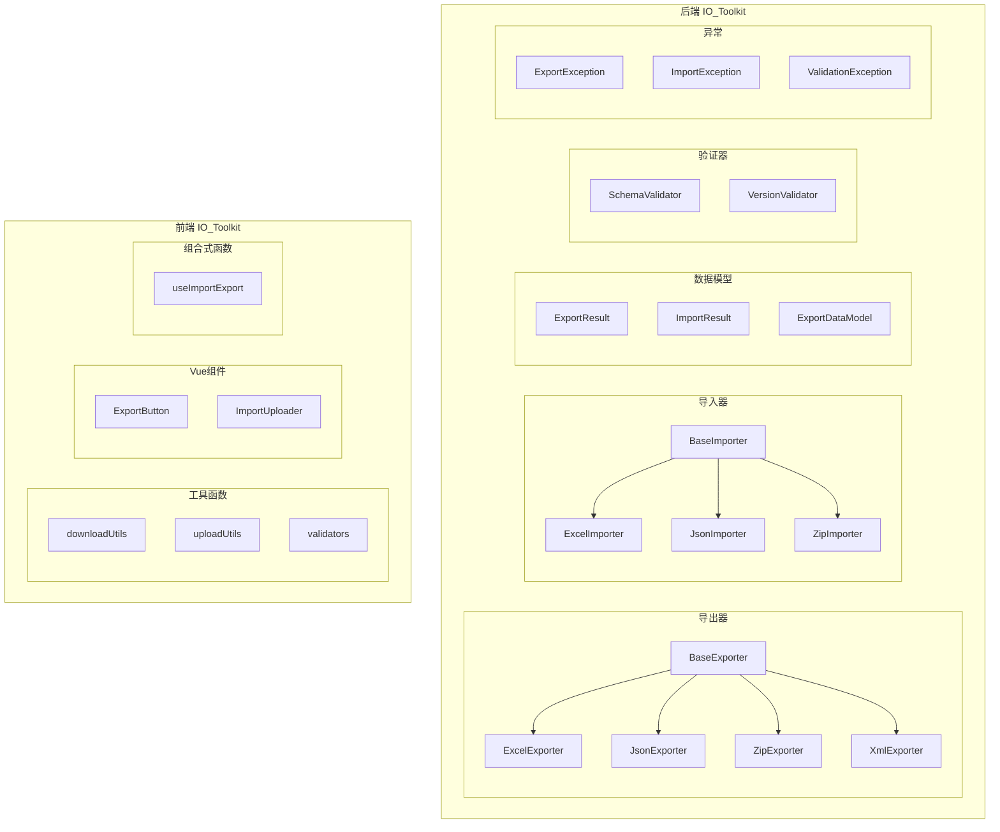

# Design Document

## Overview

本设计文档定义了导入导出工具库（IO_Toolkit）的架构设计，旨在为项目提供统一、可扩展、可复用的导入导出基础设施。工具库分为后端（Python/FastAPI）和前端（TypeScript/Vue3）两部分，采用策略模式实现格式扩展，遵循SOLID原则确保代码质量。

## Architecture

### 整体架构图



### 目录结构

```
ruoyi-fastapi-backend/
└── utils/
    └── io_toolkit/
        ├── __init__.py
        ├── base.py              # 基础接口和抽象类
        ├── models.py            # 数据模型定义
        ├── exceptions.py        # 异常类定义
        ├── exporters/
        │   ├── __init__.py
        │   ├── base.py          # BaseExporter
        │   ├── excel.py         # ExcelExporter
        │   ├── json.py          # JsonExporter
        │   └── zip.py           # ZipExporter
        ├── importers/
        │   ├── __init__.py
        │   ├── base.py          # BaseImporter
        │   ├── excel.py         # ExcelImporter
        │   ├── json.py          # JsonImporter
        │   └── zip.py           # ZipImporter
        └── validators/
            ├── __init__.py
            ├── schema.py        # SchemaValidator
            └── version.py       # VersionValidator

ruoyi-fastapi-frontend/
└── src/
    └── utils/
        └── io-toolkit/
            ├── index.ts         # 统一导出
            ├── download.ts      # 下载工具
            ├── upload.ts        # 上传工具
            ├── validators.ts    # 文件验证
            └── types.ts         # 类型定义
    └── components/
        └── ImportExport/
            ├── index.ts         # 组件导出
            ├── ExportButton.vue # 导出按钮组件
            └── ImportUploader.vue # 导入上传组件
    └── composables/
        └── useImportExport.ts   # 组合式函数
```

## Components and Interfaces

### 后端核心接口

#### ExportStrategy 接口

```python
from abc import ABC, abstractmethod
from typing import Any, Dict, List, Optional
from .models import ExportResult

class ExportStrategy(ABC):
    """导出策略抽象基类"""
    
    @abstractmethod
    async def export(self, data: Any, **options) -> ExportResult:
        """
        执行导出操作
        
        :param data: 待导出的数据
        :param options: 导出选项
        :return: ExportResult 导出结果
        """
        pass
    
    @property
    @abstractmethod
    def content_type(self) -> str:
        """返回导出内容的MIME类型"""
        pass
    
    @property
    @abstractmethod
    def file_extension(self) -> str:
        """返回导出文件的扩展名"""
        pass
```

#### ImportStrategy 接口

```python
from abc import ABC, abstractmethod
from typing import Any, Type, Optional
from pydantic import BaseModel
from .models import ImportResult

class ImportStrategy(ABC):
    """导入策略抽象基类"""
    
    @abstractmethod
    async def import_data(
        self, 
        content: bytes, 
        model: Optional[Type[BaseModel]] = None,
        **options
    ) -> ImportResult:
        """
        执行导入操作
        
        :param content: 文件内容字节
        :param model: 目标Pydantic模型类
        :param options: 导入选项
        :return: ImportResult 导入结果
        """
        pass
    
    @property
    @abstractmethod
    def supported_extensions(self) -> List[str]:
        """返回支持的文件扩展名列表"""
        pass
```

### 后端导出器实现

#### ExcelExporter

```python
class ExcelExporter(ExportStrategy):
    """Excel导出器"""
    
    def __init__(
        self,
        mapping_dict: Optional[Dict[str, str]] = None,
        sheet_name: str = 'Sheet1',
        header_style: Optional[Dict] = None
    ):
        self.mapping_dict = mapping_dict or {}
        self.sheet_name = sheet_name
        self.header_style = header_style
    
    async def export(
        self, 
        data: List[Dict], 
        filename: Optional[str] = None,
        **options
    ) -> ExportResult:
        """导出数据到Excel"""
        pass
    
    @property
    def content_type(self) -> str:
        return 'application/vnd.openxmlformats-officedocument.spreadsheetml.sheet'
    
    @property
    def file_extension(self) -> str:
        return '.xlsx'
```

#### JsonExporter

```python
class JsonExporter(ExportStrategy):
    """JSON导出器"""
    
    def __init__(
        self,
        ensure_ascii: bool = False,
        indent: Optional[int] = None
    ):
        self.ensure_ascii = ensure_ascii
        self.indent = indent
    
    async def export(
        self, 
        data: Union[BaseModel, Dict, List],
        filename: Optional[str] = None,
        **options
    ) -> ExportResult:
        """导出数据到JSON"""
        pass
    
    @property
    def content_type(self) -> str:
        return 'application/json'
    
    @property
    def file_extension(self) -> str:
        return '.json'
```

#### ZipExporter

```python
class ZipExporter(ExportStrategy):
    """ZIP打包导出器"""
    
    def __init__(self, compression: int = ZIP_DEFLATED):
        self.compression = compression
    
    async def export(
        self, 
        entries: List[ZipEntry],
        filename: Optional[str] = None,
        **options
    ) -> ExportResult:
        """打包多个文件到ZIP"""
        pass
    
    @property
    def content_type(self) -> str:
        return 'application/zip'
    
    @property
    def file_extension(self) -> str:
        return '.zip'
```

### 后端导入器实现

#### ExcelImporter

```python
class ExcelImporter(ImportStrategy):
    """Excel导入器"""
    
    def __init__(
        self,
        header_mapping: Optional[Dict[str, str]] = None,
        sheet_name: Optional[str] = None,
        skip_rows: int = 0
    ):
        self.header_mapping = header_mapping or {}
        self.sheet_name = sheet_name
        self.skip_rows = skip_rows
    
    async def import_data(
        self,
        content: bytes,
        model: Optional[Type[BaseModel]] = None,
        **options
    ) -> ImportResult:
        """从Excel导入数据"""
        pass
    
    @property
    def supported_extensions(self) -> List[str]:
        return ['.xlsx', '.xls']
```

#### JsonImporter

```python
class JsonImporter(ImportStrategy):
    """JSON导入器"""
    
    async def import_data(
        self,
        content: bytes,
        model: Optional[Type[BaseModel]] = None,
        **options
    ) -> ImportResult:
        """从JSON导入数据"""
        pass
    
    @property
    def supported_extensions(self) -> List[str]:
        return ['.json']
```

#### ZipImporter

```python
class ZipImporter(ImportStrategy):
    """ZIP解包导入器"""
    
    def __init__(
        self,
        file_filter: Optional[Callable[[str], bool]] = None,
        inner_importer: Optional[ImportStrategy] = None
    ):
        self.file_filter = file_filter
        self.inner_importer = inner_importer
    
    async def import_data(
        self,
        content: bytes,
        model: Optional[Type[BaseModel]] = None,
        **options
    ) -> ImportResult:
        """从ZIP解包并导入数据"""
        pass
    
    @property
    def supported_extensions(self) -> List[str]:
        return ['.zip']
```

### 前端工具函数

#### download.ts

```typescript
export interface DownloadOptions {
  filename?: string;
  contentType?: string;
  showLoading?: boolean;
  loadingText?: string;
}

export async function downloadBlob(
  blob: Blob,
  filename: string,
  options?: DownloadOptions
): Promise<void>;

export async function downloadFromResponse(
  response: Response | AxiosResponse,
  fallbackFilename: string,
  options?: DownloadOptions
): Promise<void>;

export function extractFilenameFromHeaders(
  headers: Headers | Record<string, string>
): string | null;
```

#### upload.ts

```typescript
export interface FileValidationResult {
  valid: boolean;
  error?: string;
}

export interface FileValidationOptions {
  accept?: string[];
  maxSize?: number;
  minSize?: number;
}

export function validateFile(
  file: File,
  options: FileValidationOptions
): FileValidationResult;

export async function parseJsonFile<T>(file: File): Promise<T>;

export async function uploadFormData(
  url: string,
  formData: FormData,
  options?: AxiosRequestConfig
): Promise<AxiosResponse>;
```

### 前端Vue组件

#### ExportButton.vue Props

```typescript
interface ExportButtonProps {
  exportFn: () => Promise<Blob | Response>;
  filename: string;
  buttonText?: string;
  buttonType?: 'primary' | 'success' | 'warning' | 'danger' | 'info';
  icon?: string;
  disabled?: boolean;
  permission?: string;
}
```

#### ImportUploader.vue Props

```typescript
interface ImportUploaderProps {
  accept: string[];
  maxSize?: number;
  uploadFn: (file: File | FormData) => Promise<any>;
  parseMode?: 'json' | 'formdata' | 'auto';
  showPreview?: boolean;
  previewFn?: (data: any) => void;
  permission?: string;
}

interface ImportUploaderEmits {
  (e: 'success', data: any): void;
  (e: 'error', error: Error): void;
  (e: 'progress', percent: number): void;
  (e: 'validate-error', message: string): void;
}
```

## Data Models

### 后端数据模型

```python
from pydantic import BaseModel, Field
from typing import Any, Dict, List, Optional
from datetime import datetime
from enum import Enum

class ExportResult(BaseModel):
    """导出结果模型"""
    content: bytes = Field(description="导出内容字节")
    filename: str = Field(description="文件名")
    content_type: str = Field(description="MIME类型")
    size: int = Field(description="文件大小(字节)")
    created_at: datetime = Field(default_factory=datetime.now)

class ImportStatus(str, Enum):
    SUCCESS = "success"
    PARTIAL = "partial"
    FAILED = "failed"

class ImportError(BaseModel):
    """导入错误详情"""
    row: Optional[int] = Field(default=None, description="错误行号")
    field: Optional[str] = Field(default=None, description="错误字段")
    message: str = Field(description="错误信息")
    value: Optional[Any] = Field(default=None, description="错误值")

class ImportResult(BaseModel):
    """导入结果模型"""
    status: ImportStatus = Field(description="导入状态")
    total_count: int = Field(default=0, description="总记录数")
    success_count: int = Field(default=0, description="成功数")
    failed_count: int = Field(default=0, description="失败数")
    data: Optional[Any] = Field(default=None, description="导入的数据")
    errors: List[ImportError] = Field(default_factory=list, description="错误列表")

class ExportDataModel(BaseModel):
    """导出数据基类，强制包含版本信息"""
    export_version: str = Field(description="导出格式版本号")
    export_time: datetime = Field(default_factory=datetime.now, description="导出时间")
    
    class Config:
        json_encoders = {
            datetime: lambda v: v.isoformat()
        }

class ZipEntry(BaseModel):
    """ZIP文件条目"""
    filename: str = Field(description="文件名")
    content: bytes = Field(description="文件内容")
    compress_type: Optional[int] = Field(default=None, description="压缩类型")
```

### 前端类型定义

```typescript
// types.ts
export interface ExportResult {
  blob: Blob;
  filename: string;
  contentType: string;
  size: number;
}

export interface ImportResult<T = any> {
  status: 'success' | 'partial' | 'failed';
  totalCount: number;
  successCount: number;
  failedCount: number;
  data?: T;
  errors: ImportError[];
}

export interface ImportError {
  row?: number;
  field?: string;
  message: string;
  value?: any;
}

export interface FileInfo {
  name: string;
  size: number;
  type: string;
  lastModified: number;
}
```

## Correctness Properties

*A property is a characteristic or behavior that should hold true across all valid executions of a system-essentially, a formal statement about what the system should do. Properties serve as the bridge between human-readable specifications and machine-verifiable correctness guarantees.*

### Property 1: Excel Export-Import Round Trip

*For any* list of dictionaries with string keys and primitive values, and any field mapping dictionary, exporting to Excel and then importing back should produce data equivalent to the original (with mapped field names).

**Validates: Requirements 1.1, 2.1**

### Property 2: JSON Export-Import Round Trip

*For any* valid Pydantic model instance, serializing to JSON using JsonExporter and deserializing using JsonImporter should produce an equivalent model instance.

**Validates: Requirements 1.2, 2.2**

### Property 3: ZIP Export-Import Round Trip

*For any* list of ZipEntry objects with valid filenames and content, creating a ZIP using ZipExporter and extracting using ZipImporter should recover all original entries with identical content.

**Validates: Requirements 1.3, 2.3**

### Property 4: ExportResult Structure Completeness

*For any* successful export operation using any exporter, the returned ExportResult should have non-empty content bytes, a non-empty filename, and a valid MIME content_type.

**Validates: Requirements 1.4**

### Property 5: ImportResult Structure Completeness

*For any* successful import operation using any importer, the returned ImportResult should have status SUCCESS, success_count equal to total_count, and an empty errors list.

**Validates: Requirements 2.4**

### Property 6: Export Exception on Invalid Input

*For any* exporter and any invalid input (null data, empty required fields), the export operation should raise an ExportException with a non-empty message.

**Validates: Requirements 1.5**

### Property 7: Import Validation Exception on Invalid Data

*For any* importer and any data that violates the target model schema, the import operation should raise an ImportValidationException with at least one ImportError containing field information.

**Validates: Requirements 2.5**

### Property 8: Version Compatibility Validation

*For any* import data with an export_version field, if the version is not in the supported versions list, the VersionValidator should raise a VersionIncompatibleException.

**Validates: Requirements 3.2, 3.3**

### Property 9: Excel Template Generation Completeness

*For any* template configuration with headers, dropdown columns, and sample data, the generated Excel template should contain all specified headers in the first row, data validation rules for dropdown columns, and sample data in subsequent rows.

**Validates: Requirements 4.1, 4.2, 4.3, 4.4**

### Property 10: Frontend File Validation Correctness

*For any* file and validation options (accept types, max size), the validateFile function should return valid=true only if the file type matches accept and size is within limits.

**Validates: Requirements 6.1, 6.4**

### Property 11: Frontend Filename Extraction

*For any* HTTP response with a Content-Disposition header containing a filename, the extractFilenameFromHeaders function should correctly extract and return the filename.

**Validates: Requirements 5.2**

## Error Handling

### 异常类层次结构

```python
class IOToolkitException(Exception):
    """IO工具库基础异常"""
    def __init__(self, message: str, details: Optional[Dict] = None):
        self.message = message
        self.details = details or {}
        super().__init__(message)

class ExportException(IOToolkitException):
    """导出异常"""
    pass

class ImportException(IOToolkitException):
    """导入异常"""
    pass

class ImportValidationException(ImportException):
    """导入数据验证异常"""
    def __init__(self, message: str, errors: List[ImportError]):
        super().__init__(message, {'errors': [e.dict() for e in errors]})
        self.errors = errors

class VersionIncompatibleException(ImportException):
    """版本不兼容异常"""
    def __init__(self, current_version: str, supported_versions: List[str]):
        message = f"Version {current_version} is not supported. Supported versions: {supported_versions}"
        super().__init__(message, {
            'current_version': current_version,
            'supported_versions': supported_versions
        })

class FileFormatException(ImportException):
    """文件格式异常"""
    def __init__(self, expected_formats: List[str], actual_format: str):
        message = f"Invalid file format: {actual_format}. Expected: {expected_formats}"
        super().__init__(message, {
            'expected_formats': expected_formats,
            'actual_format': actual_format
        })
```

### 错误处理策略

1. **导出错误**: 记录日志并抛出ExportException，由Controller层统一处理返回错误响应
2. **导入验证错误**: 收集所有字段错误，返回ImportResult(status=FAILED)或抛出ImportValidationException
3. **部分成功**: 批量导入时，成功的记录正常处理，失败的记录收集错误信息，返回ImportResult(status=PARTIAL)
4. **版本不兼容**: 在导入前检查版本，不兼容时立即抛出VersionIncompatibleException

## Testing Strategy

### 测试框架选择

- **后端**: pytest + pytest-asyncio + hypothesis (属性测试)
- **前端**: Vitest + @vue/test-utils + fast-check (属性测试)

### 双重测试策略

本项目采用单元测试和属性测试相结合的策略：
- **单元测试**: 验证具体示例和边界情况
- **属性测试**: 验证通用属性在所有有效输入上成立

### 属性测试要求

- 每个属性测试必须运行至少100次迭代
- 每个属性测试必须标注对应的设计文档属性编号
- 使用hypothesis(Python)和fast-check(TypeScript)作为属性测试库

### 测试文件组织

```
ruoyi-fastapi-backend/
└── tests/
    └── unit/
        └── io_toolkit/
            ├── test_exporters.py      # 导出器单元测试
            ├── test_importers.py      # 导入器单元测试
            ├── test_validators.py     # 验证器单元测试
            └── test_properties.py     # 属性测试

ruoyi-fastapi-frontend/
└── tests/
    └── unit/
        └── io-toolkit/
            ├── download.test.ts       # 下载工具测试
            ├── upload.test.ts         # 上传工具测试
            ├── validators.test.ts     # 验证器测试
            └── properties.test.ts     # 属性测试
```

### 测试标注格式

```python
# **Feature: import-export-refactoring, Property 1: Excel Export-Import Round Trip**
# **Validates: Requirements 1.1, 2.1**
@given(st.lists(st.dictionaries(st.text(), st.text())))
def test_excel_round_trip(data):
    ...
```
