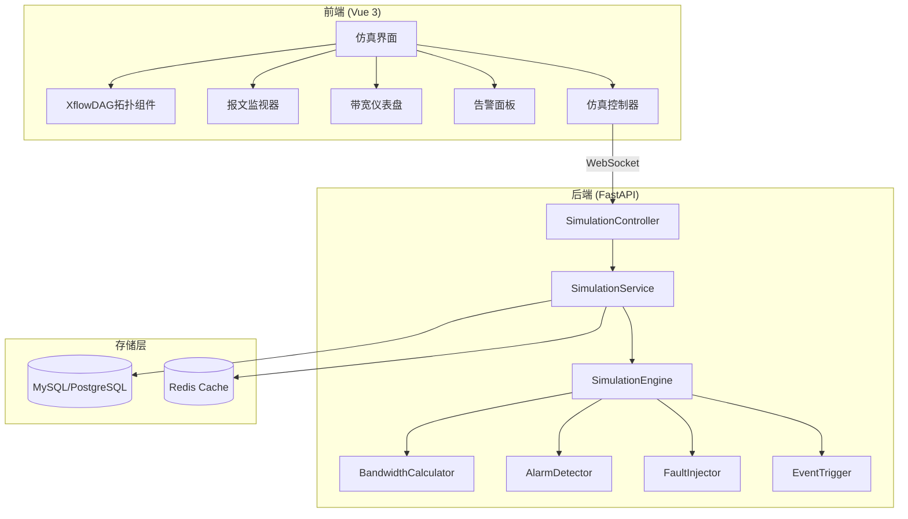

# Design Document: 仿真功能重构

## Overview

本设计文档描述多总线混合设计仿真管理系统的仿真功能重构方案。重构目标是解决用户反馈的核心问题：可观测性不足、告警功能缺失、性能问题等，同时保持与现有系统的兼容性。

### 设计原则

1. **可观测性优先**：所有仿真过程必须可视化，消除"黑盒效应"
2. **即时反馈**：用户操作后立即看到响应，延迟控制在100ms以内
3. **渐进增强**：基于现有XflowDAG组件增强，不破坏已有功能
4. **性能优先**：采用虚拟滚动、增量推送、数据清理等策略确保长时间运行流畅

### 技术栈

#### 前端技术栈
- **前端框架**: Vue 3 + Composition API + TypeScript
- **UI组件库**: Element Plus + 自定义ZX组件库
- **CSS框架**: Tailwind CSS 4.x（优先使用，深色主题通过Tailwind实现）
- **图形引擎**: AntV X6 (通过XflowDAG封装)
- **图表库**: ECharts (带宽仪表盘和趋势图)
- **虚拟滚动**: vue-virtual-scroller

#### 后端技术栈
- **Web框架**: FastAPI + asyncio
- **仿真内核**: SimPy（离散事件仿真框架）
  - 使用 `simpy.rt.RealtimeEnvironment` 实现实时同步
  - 为每个设备创建独立进程，为每条总线创建资源（Resource）
- **协议仿真库**:
  - **python-can**: CAN总线虚拟仿真，支持虚拟通道和错误注入
  - **自定义协议模型**: 1553B、RS422/RS485、LAN协议仿真
- **实时通信**: WebSocket（毫秒级推送）
- **数据库**: MySQL/PostgreSQL + Redis缓存

## Architecture

### 系统架构图



### 前端界面布局

```
┌─────────────────────────────────────────────────────────────────────┐
│  [◀ 返回]  仿真控制台 - 工程名称                    00:05:23.456    │
│  ┌─────────────────────────────────────────────────────────────┐   │
│  │  [⏸ 暂停] [▶ 继续] [⏹ 停止] [⏭ 单步]  速度: [====●===] 2x  │   │
│  └─────────────────────────────────────────────────────────────┘   │
├─────────────────────────────────────────────┬───────────────────────┤
│                                             │   带宽监控            │
│                                             │  ┌─────────────────┐  │
│                                             │  │   1553B: 45%    │  │
│           拓扑画布 (XflowDAG)               │  │   CAN: 78%      │  │
│                                             │  │   RS422: 23%    │  │
│           [设备节点] ──光点动画──> [设备节点]│  └─────────────────┘  │
│                                             │   告警信息            │
│                                             │  ┌─────────────────┐  │
│                                             │  │ ⚠ 带宽超限      │  │
│                                             │  │ ❌ 报文冲突      │  │
│                                             │  └─────────────────┘  │
├─────────────────────────────────────────────┴───────────────────────┤
│  协议分析器 (虚拟滚动列表)                                          │
│  ┌─────────────────────────────────────────────────────────────────┐│
│  │ 时间戳      │ 源节点  │ 目标节点 │ 协议  │ 大小 │ 数据         ││
│  │ 00:05:23.123│ BC_01   │ RT_04    │ 1553B │ 32B  │ 0x1234...    ││
│  │ 00:05:23.125│ Node_A  │ Node_B   │ CAN   │ 8B   │ 0xABCD...    ││
│  └─────────────────────────────────────────────────────────────────┘│
└─────────────────────────────────────────────────────────────────────┘
```

## Components and Interfaces

### 前端组件结构

```
src/views/project/simulation/
├── index.vue                    # 仿真主页面（重构）
├── components/
│   ├── SimulationHeader.vue     # 顶部控制条（新增）
│   ├── SimulationCanvas.vue     # 拓扑画布容器（重构）
│   ├── BandwidthDashboard.vue   # 带宽仪表盘（重构）
│   ├── AlarmPanel.vue           # 告警面板（增强）
│   ├── MessageMonitor.vue       # 报文监视器（新增）
│   ├── ProtocolAnalyzer.vue     # 协议分析器（新增）
│   ├── FaultInjectorMenu.vue    # 故障注入菜单（新增）
│   ├── EventTriggerPanel.vue    # 事件触发面板（新增）
│   └── SimulationReport.vue     # 仿真报告（增强）
├── composables/
│   ├── useSimulationControl.js  # 仿真控制逻辑
│   ├── useSimulationData.js     # 数据管理
│   ├── useTopologyAnimation.js  # 拓扑动画（新增）
│   ├── useFaultInjection.js     # 故障注入（新增）
│   ├── useEventTrigger.js       # 事件触发（新增）
│   └── useVirtualScroll.js      # 虚拟滚动（新增）
└── utils/
    ├── protocolParser.js        # 协议解析器（新增）
    └── dataExporter.js          # 数据导出（新增）
```

### 后端服务结构

```
module_admin/
├── controller/
│   └── simulation_controller.py  # 仿真控制器（增强）
├── service/
│   ├── simulation_service.py     # 仿真服务（增强）
│   ├── simulation_runner.py      # SimPy仿真运行器（新增）
│   ├── simulation_engine.py      # 仿真引擎（重构为SimPy架构）
│   ├── bandwidth_calculator.py   # 带宽计算器（保持）
│   ├── alarm_detector.py         # 告警检测器（增强）
│   ├── fault_injector.py         # 故障注入器（新增）
│   ├── event_trigger.py          # 事件触发器（新增）
│   └── protocol_models/          # 协议仿真模型（新增）
│       ├── __init__.py
│       ├── base_protocol.py      # 协议基类
│       ├── mil1553b_model.py     # 1553B协议模型（BC/RT进程）
│       ├── can_model.py          # CAN协议模型（python-can集成）
│       ├── rs485_model.py        # RS422/RS485协议模型
│       └── lan_model.py          # LAN/以太网协议模型
├── dao/
│   └── simulation_dao.py         # 数据访问层（增强）
└── entity/
    └── vo/
        └── simulation_vo.py      # 视图对象（增强）
```

### SimPy 仿真架构设计

#### 核心设计理念

基于迭代方案文档，采用 **SimPy 离散事件仿真（DES）** 作为仿真内核，相比传统的时间步进循环，具有以下优势：

1. **精确的时序模拟**：SimPy 基于事件驱动，可精确模拟微秒级的协议时序
2. **资源竞争模拟**：使用 `simpy.Resource` 模拟总线仲裁和竞争
3. **实时同步**：`RealtimeEnvironment` 将仿真时钟与墙钟时间同步

#### SimulationRunner 多线程架构

```python
import simpy
import threading
import asyncio
from queue import Queue

class SimulationRunner(threading.Thread):
    """
    仿真运行器 - 在独立线程中运行SimPy环境
    解决SimPy阻塞运行与FastAPI异步服务的冲突
    """
    
    def __init__(self, topology_data, message_callback):
        super().__init__(daemon=True)
        # 使用实时环境，factor=1.0表示1:1实时同步
        self.env = simpy.rt.RealtimeEnvironment(factor=1.0, strict=False)
        self.topology = topology_data
        self.callback = message_callback  # WebSocket推送回调
        
        # 线程安全的控制信号
        self.paused = threading.Event()
        self.stopped = threading.Event()
        self.paused.set()  # 初始为运行状态
        
        # 指令队列（线程安全）
        self.command_queue = Queue()
        
        # 仿真对象
        self.devices = {}      # 设备进程
        self.buses = {}        # 总线资源
        self.links = []        # 链路配置
        
    def run(self):
        """主运行循环"""
        self._setup_world()  # 解析拓扑，创建SimPy进程和资源
        
        while not self.stopped.is_set():
            self.paused.wait()  # 等待暂停信号解除
            self._process_commands()  # 处理控制指令
            
            try:
                # 步进模式：每次推进100ms，允许插入暂停检查
                self.env.run(until=self.env.now + 0.1)
                self._collect_and_emit_metrics()
            except Exception as e:
                self._handle_error(e)
                break
    
    def pause(self):
        """暂停仿真"""
        self.paused.clear()
    
    def resume(self):
        """继续仿真"""
        self.paused.set()
    
    def stop(self):
        """停止仿真"""
        self.stopped.set()
        self.paused.set()  # 确保线程不会卡在wait
```

#### 协议仿真模型

##### 1. MIL-STD-1553B 模型

```python
class MIL1553BModel:
    """
    1553B协议仿真模型
    - BC（总线控制器）：主导调度，维护指令帧列表
    - RT（远程终端）：监听并响应BC指令
    """
    
    def __init__(self, env, bus_resource, config):
        self.env = env
        self.bus = bus_resource  # simpy.Resource(capacity=1)
        self.config = config
        
    def bc_process(self, schedule):
        """BC进程 - 按调度表发送指令"""
        while True:
            for frame in schedule:
                # 申请总线独占
                with self.bus.request() as req:
                    yield req
                    # 发送命令字
                    yield self.env.timeout(frame['command_time'])
                    self._emit_command_word(frame)
                    
                    # 等待RT响应（12-32μs）
                    yield self.env.timeout(frame['response_gap'])
                    
            # 主帧周期
            yield self.env.timeout(self.config['major_frame_time'])
    
    def rt_process(self, rt_address, data_store):
        """RT进程 - 监听并响应"""
        while True:
            # 等待匹配的命令
            command = yield data_store.get(
                lambda x: x['rt_address'] == rt_address
            )
            # 生成状态字响应
            yield self.env.timeout(0.000012)  # 12μs响应时间
            self._emit_status_word(rt_address, command)
```

##### 2. CAN 总线模型（集成 python-can）

```python
import can

class CANBusModel:
    """
    CAN总线仿真模型
    - 利用python-can的virtual接口创建虚拟CAN通道
    - 支持非破坏性位仲裁模拟
    - 支持错误帧注入
    """
    
    def __init__(self, env, channel_name='vcan0'):
        self.env = env
        # 创建虚拟CAN总线
        self.bus = can.interface.Bus(channel_name, bustype='virtual')
        self.notifier = None
        self.message_queue = asyncio.Queue()
        
    def start_listener(self):
        """启动CAN消息监听器"""
        self.notifier = can.Notifier(self.bus, [self._on_message])
    
    def _on_message(self, msg):
        """CAN消息回调"""
        self.message_queue.put_nowait({
            'arbitration_id': msg.arbitration_id,
            'data': msg.data.hex(),
            'timestamp': msg.timestamp,
            'is_error_frame': msg.is_error_frame,
        })
    
    def device_process(self, device_id, message_config):
        """设备CAN发送进程"""
        while True:
            for msg_cfg in message_config:
                msg = can.Message(
                    arbitration_id=msg_cfg['can_id'],
                    data=bytes.fromhex(msg_cfg['data']),
                    is_extended_id=msg_cfg.get('extended', False)
                )
                self.bus.send(msg)
                yield self.env.timeout(msg_cfg['interval'])
    
    def inject_error_frame(self):
        """注入错误帧"""
        error_msg = can.Message(is_error_frame=True)
        self.bus.send(error_msg)
```

##### 3. RS422/RS485 模型

```python
class RS485Model:
    """
    RS485半双工总线仿真模型
    - 使用Resource模拟总线独占
    - 支持冲突检测和模拟
    """
    
    def __init__(self, env, baud_rate=9600):
        self.env = env
        self.bus = simpy.Resource(env, capacity=1)
        self.baud_rate = baud_rate
        
    def device_process(self, device_id, tx_config):
        """设备发送进程"""
        while True:
            for frame in tx_config:
                # 尝试获取总线
                if self.bus.count > 0:
                    # 总线忙，记录冲突
                    self._emit_collision(device_id)
                    yield self.env.timeout(0.001)  # 退避
                    continue
                
                with self.bus.request() as req:
                    yield req
                    # 计算传输时间
                    tx_time = (len(frame['data']) * 10) / self.baud_rate
                    yield self.env.timeout(tx_time)
                    self._emit_frame(device_id, frame)
                
                yield self.env.timeout(frame['interval'])
```

### 核心接口定义

#### 1. 仿真控制接口

```typescript
// 前端 API 接口
interface SimulationAPI {
  // 会话管理
  createSession(projectId: number, versionId?: number): Promise<SessionInfo>
  startSession(sessionId: string, options?: StartOptions): Promise<void>
  pauseSession(sessionId: string): Promise<void>
  resumeSession(sessionId: string): Promise<void>
  stopSession(sessionId: string): Promise<void>
  
  // 仿真控制
  setSpeed(sessionId: string, speed: number): Promise<void>
  stepForward(sessionId: string): Promise<void>
  
  // 故障注入
  injectFault(sessionId: string, fault: FaultConfig): Promise<void>
  clearFault(sessionId: string, faultId: string): Promise<void>
  
  // 事件触发
  createEvent(sessionId: string, event: EventConfig): Promise<string>
  triggerEvent(sessionId: string, eventId: string): Promise<void>
  
  // 数据导出
  exportMessages(sessionId: string, format: 'csv' | 'json' | 'pcap'): Promise<Blob>
  exportBandwidth(sessionId: string): Promise<Blob>
  generateReport(sessionId: string): Promise<Blob>
}

interface StartOptions {
  speed?: number           // 仿真速度 0.5-4.0
  duration?: number        // 仿真时长（秒）
  injectionStrategy?: string
  injectionParams?: object
}

interface FaultConfig {
  type: 'disconnect' | 'error_frame' | 'device_failure' | 'packet_loss' | 'delay'
  targetId: string         // 链路ID或节点ID
  params?: {
    errorCount?: number    // 错误帧数量
    lossRate?: number      // 丢包率 0-1
    delayMs?: number       // 延迟毫秒数
  }
}

interface EventConfig {
  name: string
  condition: EventCondition
  action: EventAction
}

interface EventCondition {
  type: 'time' | 'message_count' | 'bandwidth_threshold' | 'message_content'
  value: any
}

interface EventAction {
  type: 'send_message' | 'inject_fault' | 'pause' | 'log'
  params: any
}
```

#### 2. WebSocket 消息协议

```typescript
// 客户端 -> 服务端
interface ClientMessage {
  action: 'start' | 'pause' | 'resume' | 'stop' | 'step' | 'set_speed' | 'inject_fault' | 'trigger_event' | 'ping'
  sessionId: string
  params?: any
}

// 服务端 -> 客户端
interface ServerMessage {
  type: 'status' | 'messages' | 'bandwidth' | 'alarms' | 'animation' | 'event' | 'pong'
  data: any
  timestamp: number
}

// 动画事件（新增）
interface AnimationEvent {
  type: 'traffic' | 'error' | 'node_active'
  edgeId?: string
  nodeId?: string
  protocol?: string
  duration?: number
}
```

## Data Models

### 前端数据模型

```typescript
// 仿真状态
interface SimulationState {
  sessionId: string
  status: 'idle' | 'running' | 'paused' | 'stopped'
  elapsedTime: number      // 已运行时间（秒）
  speed: number            // 当前速度
  messageCount: number     // 报文总数
  alarmCount: number       // 告警总数
}

// 报文数据
interface MessageData {
  messageId: string
  timestamp: number
  senderNodeId: string
  senderNodeName: string
  senderPortId: string
  receiverNodeId: string
  receiverNodeName: string
  receiverPortId: string
  protocolType: string
  sizeBytes: number
  payloadHex: string
  fieldValues?: Record<string, any>
  isError?: boolean
  errorType?: string
}

// 带宽数据
interface BandwidthData {
  nodeId: string
  portId: string
  portName: string
  protocolType: string
  timestamp: number
  bandwidthMbps: number
  loadPercent: number
  messageCount: number
}

// 告警数据
interface AlarmData {
  alarmId: string
  timestamp: number
  level: 'error' | 'warning' | 'info'
  type: 'congestion' | 'collision' | 'packet_loss' | 'bandwidth_exceed' | 'value_overflow'
  title: string
  description: string
  targetId?: string
  targetName?: string
  suggestion?: string
}

// 故障配置
interface FaultState {
  faultId: string
  type: string
  targetId: string
  targetName: string
  status: 'active' | 'cleared'
  createTime: number
}

// 事件配置
interface EventState {
  eventId: string
  name: string
  condition: EventCondition
  action: EventAction
  status: 'pending' | 'triggered' | 'disabled'
  triggerCount: number
  lastTriggerTime?: number
}
```

### 后端数据模型

```python
# Pydantic 模型
class SimulationSessionModel(BaseModel):
    session_id: str
    project_id: int
    version_id: Optional[int]
    status: str  # created/running/paused/stopped
    speed: float = 1.0
    elapsed_time: float = 0.0
    message_count: int = 0
    alarm_count: int = 0
    create_by: Optional[str]
    create_time: datetime
    end_time: Optional[datetime]

class FaultConfigModel(BaseModel):
    fault_id: str
    session_id: str
    fault_type: str  # disconnect/error_frame/device_failure/packet_loss/delay
    target_id: str
    target_type: str  # edge/node
    params: Dict[str, Any] = {}
    status: str = 'active'
    create_time: datetime

class EventConfigModel(BaseModel):
    event_id: str
    session_id: str
    name: str
    condition_type: str
    condition_value: Any
    action_type: str
    action_params: Dict[str, Any] = {}
    status: str = 'pending'
    trigger_count: int = 0
    last_trigger_time: Optional[datetime]
    create_time: datetime

class AlarmModel(BaseModel):
    alarm_id: str
    session_id: str
    timestamp: float
    level: str  # error/warning/info
    alarm_type: str
    title: str
    description: str
    target_id: Optional[str]
    target_name: Optional[str]
    suggestion: Optional[str]
    create_time: datetime
```


## Correctness Properties

*A property is a characteristic or behavior that should hold true across all valid executions of a system-essentially, a formal statement about what the system should do. Properties serve as the bridge between human-readable specifications and machine-verifiable correctness guarantees.*

基于需求分析，以下是本系统需要验证的核心正确性属性：

### Property 1: 时间格式化一致性
*For any* 仿真时间值（非负浮点数），格式化函数应返回符合 `HH:MM:SS.mmm` 格式的字符串，且解析后能还原为原始时间值（误差小于1毫秒）
**Validates: Requirements 1.2**

### Property 2: 协议颜色映射完整性
*For any* 协议类型字符串（1553B、CAN、RS422、RS485、LAN），颜色映射函数应返回预定义的颜色值，且不同协议类型映射到不同颜色
**Validates: Requirements 2.1**

### Property 3: 报文过滤正确性
*For any* 报文列表和过滤条件组合，过滤结果中的每条报文都应满足所有过滤条件，且原列表中满足条件的报文都应出现在结果中
**Validates: Requirements 3.2**

### Property 4: 十六进制转换往返一致性
*For any* 字节数组，转换为十六进制字符串后再解析回字节数组，应得到与原始数组相同的结果
**Validates: Requirements 3.4**

### Property 5: 数据导出格式正确性
*For any* 报文数据列表，导出为CSV格式后，CSV行数应等于报文数量加1（表头），且每行字段数应一致
**Validates: Requirements 3.5, 8.2, 8.3**

### Property 6: 负载率计算正确性
*For any* 带宽数据（字节数、时间窗口、物理带宽上限），计算的负载率应在0-100%范围内，且与手动计算结果一致
**Validates: Requirements 4.1**

### Property 7: 告警阈值触发正确性
*For any* 负载率值，当负载率超过80%时应触发警告状态，超过95%时应触发危险状态和拥塞告警
**Validates: Requirements 4.3, 4.4, 5.1**

### Property 8: 告警分类排序正确性
*For any* 告警列表，按严重程度排序后，error级别告警应排在warning之前，warning应排在info之前
**Validates: Requirements 5.7**

### Property 9: 输入范围验证正确性
*For any* 字节字段输入值，验证函数应正确判断是否在0-255范围内，超出范围时返回错误
**Validates: Requirements 5.6**

### Property 10: 丢包率统计正确性
*For any* 设定的丢包率和足够大的报文样本，实际丢包率应在设定值的±5%误差范围内
**Validates: Requirements 6.4**

### Property 11: 事件条件匹配正确性
*For any* 事件条件配置和仿真状态，条件匹配函数应正确判断是否满足触发条件
**Validates: Requirements 7.4**

### Property 12: 仿真速度范围验证
*For any* 速度设置值，系统应将其限制在0.5-4.0范围内，超出范围时应自动调整到最近的有效值
**Validates: Requirements 9.3**

### Property 13: 数据清理阈值正确性
*For any* 数据列表，当数据量超过阈值时，清理后的数据量应等于阈值，且保留的是最新的数据
**Validates: Requirements 10.4**

### Property 14: 增量数据提取正确性
*For any* 数据列表和上次推送索引，增量提取应返回索引之后的所有新数据，且不遗漏不重复
**Validates: Requirements 10.3**

### Property 15: 1553B协议解析正确性
*For any* 有效的1553B协议帧字节数组，解析函数应正确提取RT地址、子地址、T/R位和字计数，且重新编码后应得到原始字节数组
**Validates: Requirements 11.1**

### Property 16: CAN协议解析正确性
*For any* 有效的CAN协议帧字节数组，解析函数应正确提取帧ID、DLC和数据内容，且重新编码后应得到原始字节数组
**Validates: Requirements 11.2**

### Property 17: 拓扑验证正确性
*For any* 拓扑数据，验证函数应正确检测节点数量不足、缺少连接、未配置端口和协议不兼容等问题
**Validates: Requirements 12.1, 12.2, 12.3**

### Property 18: 仿真状态转换正确性
*For any* 仿真状态和控制操作，状态转换应遵循状态机规则：idle可转running，running可转paused/stopped，paused可转running/stopped
**Validates: Requirements 9.1, 9.2**

## Error Handling

### 前端错误处理

```typescript
// 错误类型定义
enum SimulationErrorType {
  NETWORK_ERROR = 'NETWORK_ERROR',           // 网络连接错误
  WEBSOCKET_ERROR = 'WEBSOCKET_ERROR',       // WebSocket连接错误
  SESSION_EXPIRED = 'SESSION_EXPIRED',       // 会话过期
  TOPOLOGY_INVALID = 'TOPOLOGY_INVALID',     // 拓扑数据无效
  PERMISSION_DENIED = 'PERMISSION_DENIED',   // 权限不足
  DATA_PARSE_ERROR = 'DATA_PARSE_ERROR',     // 数据解析错误
  EXPORT_ERROR = 'EXPORT_ERROR',             // 导出错误
}

// 错误处理策略
const errorHandlers: Record<SimulationErrorType, ErrorHandler> = {
  NETWORK_ERROR: {
    message: '网络连接失败，请检查网络后重试',
    action: 'retry',
    retryCount: 3,
    retryDelay: 1000,
  },
  WEBSOCKET_ERROR: {
    message: 'WebSocket连接断开，正在尝试重连...',
    action: 'reconnect',
    retryCount: 5,
    retryDelay: 2000,
  },
  SESSION_EXPIRED: {
    message: '仿真会话已过期，请重新启动仿真',
    action: 'redirect',
    redirectTo: 'simulation-start',
  },
  TOPOLOGY_INVALID: {
    message: '拓扑数据无效，请检查设备配置',
    action: 'show-details',
  },
  PERMISSION_DENIED: {
    message: '您没有执行此操作的权限',
    action: 'notify',
  },
  DATA_PARSE_ERROR: {
    message: '数据解析失败，部分数据可能显示异常',
    action: 'continue',
  },
  EXPORT_ERROR: {
    message: '数据导出失败，请稍后重试',
    action: 'retry',
    retryCount: 2,
  },
}
```

### 后端错误处理

```python
# 自定义异常类
class SimulationException(Exception):
    """仿真相关异常基类"""
    def __init__(self, message: str, error_code: str, details: dict = None):
        self.message = message
        self.error_code = error_code
        self.details = details or {}
        super().__init__(self.message)

class SessionNotFoundException(SimulationException):
    """会话不存在异常"""
    def __init__(self, session_id: str):
        super().__init__(
            message=f'仿真会话不存在: {session_id}',
            error_code='SESSION_NOT_FOUND',
            details={'session_id': session_id}
        )

class TopologyInvalidException(SimulationException):
    """拓扑数据无效异常"""
    def __init__(self, errors: list):
        super().__init__(
            message='拓扑数据验证失败',
            error_code='TOPOLOGY_INVALID',
            details={'errors': errors}
        )

class FaultInjectionException(SimulationException):
    """故障注入异常"""
    def __init__(self, fault_type: str, target_id: str, reason: str):
        super().__init__(
            message=f'故障注入失败: {reason}',
            error_code='FAULT_INJECTION_FAILED',
            details={'fault_type': fault_type, 'target_id': target_id}
        )

# 全局异常处理器
@app.exception_handler(SimulationException)
async def simulation_exception_handler(request: Request, exc: SimulationException):
    return JSONResponse(
        status_code=400,
        content={
            'code': 400,
            'msg': exc.message,
            'error_code': exc.error_code,
            'details': exc.details
        }
    )
```

### WebSocket 断线重连策略

```typescript
// 重连配置
const reconnectConfig = {
  maxRetries: 5,
  baseDelay: 1000,      // 初始延迟1秒
  maxDelay: 30000,      // 最大延迟30秒
  backoffMultiplier: 2, // 指数退避倍数
}

// 重连逻辑
function calculateReconnectDelay(retryCount: number): number {
  const delay = reconnectConfig.baseDelay * Math.pow(reconnectConfig.backoffMultiplier, retryCount)
  return Math.min(delay, reconnectConfig.maxDelay)
}
```

## Testing Strategy

### 测试框架选择

- **前端单元测试**: Vitest + Vue Testing Library
- **前端属性测试**: fast-check (Property-Based Testing)
- **后端单元测试**: pytest + pytest-asyncio
- **后端属性测试**: Hypothesis

### 单元测试覆盖

#### 前端单元测试

```typescript
// 示例：时间格式化函数测试
describe('formatSimulationTime', () => {
  it('should format 0 seconds correctly', () => {
    expect(formatSimulationTime(0)).toBe('00:00:00.000')
  })
  
  it('should format hours correctly', () => {
    expect(formatSimulationTime(3661.123)).toBe('01:01:01.123')
  })
})

// 示例：报文过滤函数测试
describe('filterMessages', () => {
  it('should filter by protocol type', () => {
    const messages = [
      { protocolType: 'CAN', ... },
      { protocolType: '1553B', ... },
    ]
    const result = filterMessages(messages, { protocolType: 'CAN' })
    expect(result).toHaveLength(1)
    expect(result[0].protocolType).toBe('CAN')
  })
})
```

#### 后端单元测试

```python
# 示例：告警检测器测试
@pytest.mark.asyncio
async def test_detect_congestion_alarm():
    """测试拥塞告警检测"""
    detector = AlarmDetector()
    bandwidth_data = {'load_percent': 96.0, 'port_id': 'port-1'}
    
    alarms = detector.detect_bandwidth_alarms(bandwidth_data)
    
    assert len(alarms) == 1
    assert alarms[0]['alarm_type'] == 'congestion'
    assert alarms[0]['level'] == 'error'
```

### 属性测试策略

属性测试用于验证系统在各种输入下的正确性。每个属性测试必须：
1. 配置至少100次迭代
2. 使用注释标注对应的正确性属性
3. 生成智能的测试数据，覆盖边界情况

#### 前端属性测试示例

```typescript
import * as fc from 'fast-check'

// **Feature: simulation-refactoring, Property 1: 时间格式化一致性**
// **Validates: Requirements 1.2**
describe('Property: Time Format Round Trip', () => {
  it('should round-trip time values correctly', () => {
    fc.assert(
      fc.property(
        fc.float({ min: 0, max: 86400, noNaN: true }), // 0-24小时
        (timeValue) => {
          const formatted = formatSimulationTime(timeValue)
          const parsed = parseSimulationTime(formatted)
          return Math.abs(parsed - timeValue) < 0.001 // 误差小于1毫秒
        }
      ),
      { numRuns: 100 }
    )
  })
})

// **Feature: simulation-refactoring, Property 3: 报文过滤正确性**
// **Validates: Requirements 3.2**
describe('Property: Message Filter Correctness', () => {
  it('should filter messages correctly', () => {
    const messageArb = fc.record({
      messageId: fc.uuid(),
      protocolType: fc.constantFrom('1553B', 'CAN', 'RS422', 'LAN'),
      senderNodeId: fc.string({ minLength: 1, maxLength: 20 }),
      receiverNodeId: fc.string({ minLength: 1, maxLength: 20 }),
      sizeBytes: fc.integer({ min: 1, max: 1500 }),
    })
    
    const filterArb = fc.record({
      protocolType: fc.option(fc.constantFrom('1553B', 'CAN', 'RS422', 'LAN')),
      senderNodeId: fc.option(fc.string({ minLength: 1, maxLength: 20 })),
    })
    
    fc.assert(
      fc.property(
        fc.array(messageArb, { minLength: 0, maxLength: 100 }),
        filterArb,
        (messages, filter) => {
          const result = filterMessages(messages, filter)
          // 验证结果中每条消息都满足过滤条件
          return result.every(msg => matchesFilter(msg, filter))
        }
      ),
      { numRuns: 100 }
    )
  })
})

// **Feature: simulation-refactoring, Property 4: 十六进制转换往返一致性**
// **Validates: Requirements 3.4**
describe('Property: Hex Conversion Round Trip', () => {
  it('should round-trip byte arrays correctly', () => {
    fc.assert(
      fc.property(
        fc.uint8Array({ minLength: 0, maxLength: 1500 }),
        (bytes) => {
          const hex = bytesToHex(bytes)
          const restored = hexToBytes(hex)
          return arraysEqual(bytes, restored)
        }
      ),
      { numRuns: 100 }
    )
  })
})
```

#### 后端属性测试示例

```python
from hypothesis import given, strategies as st, settings

# **Feature: simulation-refactoring, Property 6: 负载率计算正确性**
# **Validates: Requirements 4.1**
@given(
    bytes_count=st.integers(min_value=0, max_value=1_000_000),
    time_window=st.floats(min_value=0.001, max_value=10.0),
    max_bandwidth_mbps=st.floats(min_value=0.1, max_value=1000.0)
)
@settings(max_examples=100)
def test_load_percent_calculation(bytes_count, time_window, max_bandwidth_mbps):
    """测试负载率计算正确性"""
    calculator = BandwidthCalculator()
    
    load_percent = calculator.calculate_load_percent(
        bytes_count, time_window, max_bandwidth_mbps
    )
    
    # 验证结果在有效范围内
    assert 0 <= load_percent <= 100
    
    # 验证计算正确性
    expected_bandwidth_mbps = (bytes_count * 8) / (time_window * 1_000_000)
    expected_load = (expected_bandwidth_mbps / max_bandwidth_mbps) * 100
    expected_load = min(100, max(0, expected_load))
    
    assert abs(load_percent - expected_load) < 0.01

# **Feature: simulation-refactoring, Property 7: 告警阈值触发正确性**
# **Validates: Requirements 4.3, 4.4, 5.1**
@given(load_percent=st.floats(min_value=0, max_value=100))
@settings(max_examples=100)
def test_alarm_threshold_trigger(load_percent):
    """测试告警阈值触发正确性"""
    detector = AlarmDetector()
    
    status, alarms = detector.check_load_status(load_percent)
    
    if load_percent > 95:
        assert status == 'danger'
        assert any(a['alarm_type'] == 'congestion' for a in alarms)
    elif load_percent > 80:
        assert status == 'warning'
    else:
        assert status == 'normal'

# **Feature: simulation-refactoring, Property 15: 1553B协议解析正确性**
# **Validates: Requirements 11.1**
@given(
    rt_address=st.integers(min_value=0, max_value=31),
    sub_address=st.integers(min_value=0, max_value=31),
    tr_bit=st.booleans(),
    word_count=st.integers(min_value=1, max_value=32)
)
@settings(max_examples=100)
def test_1553b_parse_round_trip(rt_address, sub_address, tr_bit, word_count):
    """测试1553B协议解析往返一致性"""
    parser = Protocol1553BParser()
    
    # 编码
    command_word = parser.encode_command_word(rt_address, sub_address, tr_bit, word_count)
    
    # 解析
    parsed = parser.parse_command_word(command_word)
    
    # 验证往返一致性
    assert parsed['rt_address'] == rt_address
    assert parsed['sub_address'] == sub_address
    assert parsed['tr_bit'] == tr_bit
    assert parsed['word_count'] == word_count
```

### 测试覆盖率要求

- 核心业务逻辑：≥ 80%
- 数据转换函数：≥ 90%
- 协议解析器：≥ 95%
- UI组件：≥ 60%

### 性能测试

```typescript
// 虚拟滚动性能测试
describe('Virtual Scroll Performance', () => {
  it('should render 10000 messages without lag', async () => {
    const messages = generateMockMessages(10000)
    const startTime = performance.now()
    
    const wrapper = mount(MessageMonitor, {
      props: { messages }
    })
    
    await wrapper.vm.$nextTick()
    const renderTime = performance.now() - startTime
    
    expect(renderTime).toBeLessThan(100) // 渲染时间小于100ms
  })
})
```
