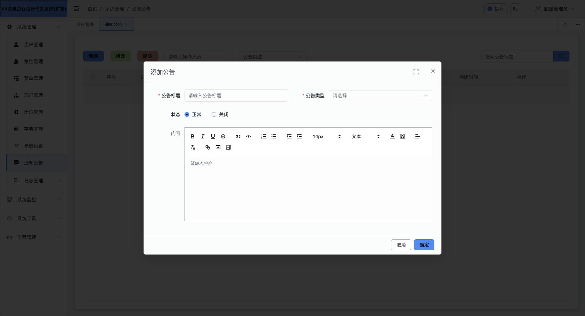
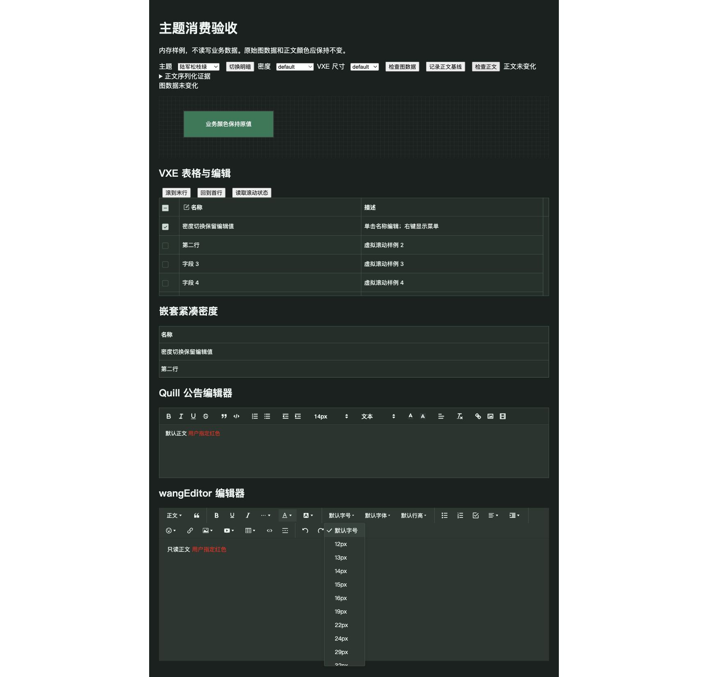

# 第三方组件 density 接入验收

日期：2026-09-27。范围：非仿真 VXE 表格、Quill 与 wangEditor 的操作界面。

## 结论与责任归属

本批缺口属于业务接入层。ZXUI 已公开 `semantic.spacing.control-y`、`useThemeAdapter` 和嵌套 Provider 能力，足以完成接入；本批没有修改组件库源码，也没有增加另一份 density 状态。

- VXE 行高、单元格纵向间距、输入高度消费同一 ZXUI token。保留 default/medium/small/mini 的尺寸差值；显式单表高度契约不改。
- 新增 `src/plugins/vxe-density.ts`：在 VXE 公开 created interceptor 中订阅最近的 Host scope；挂载后和 spacing 变化后调用公开 `recalculate(true)`，同步虚拟滚动的测量与缓存。按 Vue app 隔离，随组件作用域清理订阅，app 卸载/HMR 清理 interceptor。
- Quill、wangEditor 的工具栏、选择面板和弹层纵向间距接入 density。wangEditor 固定高度分隔线一并调整，避免撑住紧凑工具栏；下拉面板定位改为跟随父项底部。
- 编辑器正文的字号、行距、段落排版、用户指定颜色及保存 HTML 不随 density 改写；编辑器显式内容高度保留。

VXE 接入点覆盖四个协议模板原生表格及共享 VxeSchemaTable；未逐个打开所有协议业务弹框。长表虚拟滚动在业务工程中的内存验收页验证，使用真实共享组件、插件和主题 Host，不写业务数据。

## 验收证据

详见 [机器可读结果](evidence/2026-09-27-third-party-density/matrix.json)。通过 CUA 浏览器操作真实 UI，DOM 只用于读取几何和状态。

| 场景 | 结果 |
| --- | --- |
| 陆军松枝绿深色、默认浅色 × 3 density × 4 VXE size | 24/24 通过 |
| 200 行虚拟滚动 | 每组 scrollHeight = 实际行高 × 200；滚至底部可见第 200 行 |
| 嵌套 compact Provider | 外层切换 density 时内部保持 compact；主题切换仍采用相应主题基线 |
| VXE 编辑值与勾选 | 切换 compact/comfortable 后保留，未 remount |
| Quill / wangEditor HTML | 全部 24 组序列化内容与基线一致 |
| wangEditor 下拉 | compact、comfortable 均与触发项底部对齐 |
| Quill 字号下拉 | compact 下锚定工具栏，保留原有 1px 边框重叠 |
| 真实业务通知公告 → 新增 | 默认浅色主题下，紧凑工具栏 62px、宽松 86px；取消关闭，无业务保存 |

默认浅色下，VXE default size 行高为 44/48/52px；陆军松枝绿深色为 42/46/50px。两套主题 wangEditor 工具项高度分别为 34/40/46px、31/37/43px。工具栏可正常换行，整条高度还取决于可用宽度。

开发过程中格式化/构建触发过热更新，旧正文基线因此作废；此外 Vite 忽略 tests 目录监听，修改 fixture 后仅刷新不足以失效转换缓存。最终结果在重启 Vite、重新记录基线、停止源码编辑后采集，24/24 通过。旧观测未作为通过证据。

初版 fixture 的 `show-overflow=true` 会触发已有 VXE Tooltip 注册缺失诊断，且现有 i18n 对点分路径直接索引导致日志正文为空。最终 fixture 使用 `show-overflow="title"`，这是测试入口选择，不表示已修复业务已有 Tooltip/i18n 问题；本轮不扩展到该无关配置缺口。

## 工程检查

- `yarn type-check`：通过。
- 定向 ESLint：0 errors，6 条已有 warning（原有未用参数、any）。
- `yarn ui:standards`：499 文件、0 violations；已有 14 项测试通过。未新增测试套件。
- `VITE_ZXUI_LOCAL=true VITE_ZXIO_REPO_ROOT=/Users/hqz/Downloads/element-plus yarn build:prod --outDir /tmp/ruoyi-density-source-build`：通过。
- `VITE_ZXUI_LOCAL=false yarn build:prod --outDir /tmp/ruoyi-density-installed-build`：通过。
- 两条构建保留已有大 chunk 提示；构建日志存于同一 evidence 目录。
- `git diff --check`：通过。未提交、未发布 npm。

## 完成边界

全局偏好 → Host/Provider → 表单/ElTable/GridList 的已有链路，加上本批 VXE 与两种编辑器操作界面，已覆盖本轮识别出的非仿真 density 接入缺口。这不是全站每个像素随 density 缩放的承诺。

TableV2 唯一实际消费者位于 simulation，仍按约定排除。字体、横向空间及整体显示缩放属于独立 [Display Scaling spec](../specs/zxui-display-scaling/tasks.md)，本批未实施，不能宣称这一独立需求已完成。

最后恢复陆军松枝绿、深色、default density。真实公告弹框已取消，无业务数据写入。开发服务保持源码直连运行。

