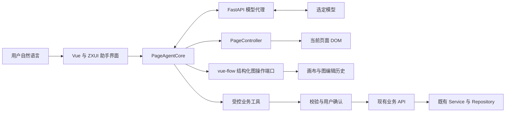

# Page Agent 系统接入评估与规划

初版日期：2026-10-14。更新日期：2026-10-15。当前目标是规划后续能力；主题工作已停止，本轮只更新评估文档。

用户已明确：`/Users/hqz/dev/ai/vue-flow` 当前尚未接入业务，后续系统的拖拽能力统一采用该项目。本文据此采用 ZXUI、vue-flow 与业务系统共同组成的目标架构，不将未来接入写成当前已有实现。

## 建议方向

将这项能力定义为“用户用自然语言驱动当前系统页面完成业务操作”。推荐以 **PageAgentCore + PageController + Vue/ZXUI 助手界面 + vue-flow 图操作工具 + FastAPI 模型代理** 组成目标架构，并将重要写操作接入受控业务工具。用户应能看见操作进度、核对即将提交的内容、停止执行和接管页面。

Page Agent 的核心、DOM 控制器和界面可以独立组合，官方提供了自定义界面的组装方式。框架无关的核心可由 Vue 管理生命周期；Vue 接入方式仍需在本项目试点验证。[官方自定义界面源码](https://github.com/alibaba/page-agent/blob/9eb6b6646500264d9034dd466a4270cb9fc1ef1e/packages/website/src/pages/docs/advanced/custom-ui/page.tsx)

## 已核实的能力边界

评估基线为官方源码版本 1.12.4，提交 `9eb6b6646500264d9034dd466a4270cb9fc1ef1e`，许可证 MIT。[包清单](https://github.com/alibaba/page-agent/blob/9eb6b6646500264d9034dd466a4270cb9fc1ef1e/packages/page-agent/package.json)、[许可证](https://github.com/alibaba/page-agent/blob/9eb6b6646500264d9034dd466a4270cb9fc1ef1e/LICENSE)

| 已核实事实 | 规划影响 |
| --- | --- |
| 核心每步提取 DOM 文本，由模型决定工具，再执行点击、输入、选择和滚动。 | 常规后台页面适合接入；控件名称、标签、状态和弹层语义直接影响可靠性。 |
| 页内 SDK 为 SPA 设计，支持单层同源 iframe；官方列出拖拽、右键、键盘快捷键、跨域及嵌套 iframe 的限制。 | 当前 Vue Router 应用适合试点。跨浏览器标签页和外部系统另行规划。 |
| 没有视觉理解能力，无法理解 Canvas、WebGL 和 SVG 中的视觉内容。 | 拓扑、仿真和 3D 后续应提供领域操作工具。不能根据常规表单效果推断画布操作能力。 |
| `selectOptionElement()` 要求原生 `HTMLSelectElement`。 | ZXUI/Element Plus Select、树和日期控件需要验证多步点击，必要时使用组件公开控制接口。 |
| 内置 Panel 和反馈样式有自己的配色与生命周期。 | 助手界面由 ZXUI 组件组装，复用现有 Provider、弹层和反馈入口。Controller 的遮罩/指针反馈需要单独验证。 |

依据：[DOM 控制器](https://github.com/alibaba/page-agent/blob/9eb6b6646500264d9034dd466a4270cb9fc1ef1e/packages/page-controller/src/PageController.ts)、[交互实现](https://github.com/alibaba/page-agent/blob/9eb6b6646500264d9034dd466a4270cb9fc1ef1e/packages/page-controller/src/actions.ts)、[官方限制](https://github.com/alibaba/page-agent/blob/9eb6b6646500264d9034dd466a4270cb9fc1ef1e/packages/website/src/pages/docs/introduction/limitations/page.tsx)、[内置界面样式](https://github.com/alibaba/page-agent/blob/9eb6b6646500264d9034dd466a4270cb9fc1ef1e/packages/ui/src/panel/Panel.module.css)。

## 接入方案比较

| 方案 | 复杂度 | 优势 | 主要风险与适用阶段 |
| --- | --- | --- | --- |
| 完整 `page-agent` 与内置 Panel | 低 | 最快展示自然语言操作页面 | 界面、动作确认与复杂控件适配需额外处理；适合技术演示。 |
| **Core + Controller + ZXUI 界面 + 模型代理** | 中 | 保留可见页面操作，适配现有 Vue 生命周期、界面和鉴权 | 必须建立动作入口控制并验证组件；推荐首期正式接入。 |
| 上述方案加业务工具目录 | 中高 | 全量查询、写入和领域操作有明确契约，可核验结果 | 需要维护工具与业务接口映射；作为第二、三阶段扩展。 |

推荐第二种起步，并按关键业务扩展到第三种。业务工具负责查询、草稿、校验和确认提交；DOM 操作负责导航、展示和已有页面交互。无需把所有页面重写为工具，也不让模型通过随机 DOM 点击承担全部重要写操作。

## 本项目的装配位置

建议的模块位置如下，均为后续实施入口，本轮没有创建这些模块：

- 前端新增 `src/agent/` 管理 SDK、事件到 Vue 状态的适配、页面上下文、动作策略和工具注册；助手界面放在 `src/components/business/PageAssistant/`。
- 在现有 `src/App.tsx` 的 `ZxConfigProvider` 内装配助手，使其与路由页面共享主题、反馈和应用生命周期。按用户会话创建实例，退出登录时停止并销毁；路由切换后更新上下文并等待页面就绪。
- 页面上下文来自当前路由、实体类型、查询条件和已授权能力，避免从显示文案猜测全部业务规则。利用 SDK 的 `getPageInstructions` 提供当前页面说明。
- 后端按现有 `modules/registry.py` 的模块注册方式接入助手 API，保持 controller → service → repository 分层。供应商密钥、模型选择、用量与任务记录由后端管理。
- SDK 请求经专用 `customFetch` 适配器携带现有应用鉴权；代理返回 SDK 需要的 Chat Completions 原始结构。现有 `@/utils/request` 的业务响应转换与原生 Fetch `Response` 不同，需明确适配边界。

默认客户端请求 `${baseURL}/chat/completions`，支持 `customFetch`；响应包含工具调用等 SDK 契约。模型须验证实际的工具调用兼容性。[模型客户端](https://github.com/alibaba/page-agent/blob/9eb6b6646500264d9034dd466a4270cb9fc1ef1e/packages/llms/src/OpenAIClient.ts)

## 业务与 ZXUI 的职责

| 归属 | 应承担的工作 |
| --- | --- |
| ZXUI | 原生输入语义；`label/id` 关联；按钮名称；disabled/readonly 和展开状态；Dialog 焦点与名称；Select/树/日期/虚拟表格的公开控制能力；通用反馈与界面组件。 |
| vue-flow | 系统统一的拖拽与图编辑底座；节点、端口、连线、分组、布局和画布交互；图命令、结构化变更、编辑历史及文档协议；模型无关的图操作端口。 |
| 业务前端 | 助手入口、会话生命周期、页面上下文、实体字段和 ID、任务模式、草稿与提交摘要、动作范围、结果展示。 |
| FastAPI | 模型代理、登录与原有业务权限、数据访问规则、确认凭证、幂等、操作记录和用量控制。 |
| Page Agent 适配层 | 将 SDK 事件映射为界面状态；控制模型输入与执行工具；承接停止和接管；隔离上游实验性 API。 |

SDK 依赖先放在业务助手模块。若在两个真实业务中验证出共同契约，再提取可选 Vue 集成包；ZXUI 核心组件保持通用 UI 职责。组件级问题修 ZXUI，实体名称、路由和领域操作修业务。

当前源码提供了可复用基础：`src/views/system/role/index.vue` 已采用 ZxGridList、ZxListToolbar 和统一表单弹框；`src/directive/permission/hasPermi.js` 负责隐藏未授权入口；后端 `modules/system/api/role_controller.py` 有接口权限依赖。`middlewares/idempotency_middleware.py` 仅在请求携带 `Idempotency-Key` 时启用回放保护。前端一秒内重复提交拦截不能覆盖 Agent 的任务级重试。

当前也有需要评估的语义缺口：业务 Hamburger 使用可点击 `div`；折叠导航依赖隐藏的文字；表格操作和选择控件存在重复名称。它们是后续 Agent 可操作性审计候选，本轮不修改。

## 将 vue-flow 纳入统一拖拽底座

该目录的实际项目为基于 AntV X6 的 **X6 DevKit**，公开核心包名为 `@zxio/x6-devkit`，并有 DAG、workflow-dsl、diff、version-history 和 MCP 等配套包。后续的画布、节点拖拽和图编排通过这一平台接入。业务当前的本地 `ZxFlow`、`Dag` 封装仍属旧实现；本轮不进行替换或迁移。

### 已有基础与待补能力

| 当前核实到的基础 | 可以复用的部分 | 仍需补充或由宿主承担的部分 |
| --- | --- | --- |
| 公开 `useXFlowCommands` 和 `XFlowGraphApi` | 发现命令、检查可执行状态、执行导航及注册命令；读取选区、就绪与只读状态。 | 当前命令执行参数是命令 ID 与触发来源，不能直接当作带完整业务参数的 Agent 工具接口。 |
| 根入口公开 `buildXFlowMutationPatch`、`commitXFlowMutationPatch` 和历史会话 | 将节点/边变更表达为结构化 patch，通过历史会话提交；使用 `expectedRevisionId` 检查编辑版本，复用 undo/redo。 | 为 Agent 增加稳定的场景操作端口，统一读取、计划、校验、预览和提交；提交需要绑定具体文档与图实例。 |
| 拓扑快照和 patch 投影、authoring 与语义预检实现 | 可以作为图操作端口的库内基础。 | 部分预检和 authoring apply 仅在 `/internal`，明确保留给官方场景适配器；应由库补公开契约，业务不导入内部实现。 |
| workflow-dsl 的解析、校验、编译、发布准备和定义比较 | 从自然语言生成受限的结构化草稿，校验后投影为图；流程定义场景可以复用。 | 定义里的 agentTask/serviceTask 不代表已有生产调度器。任务执行、外部接口、凭证和持久化由业务后端提供。普通拓扑不必强行转成工作流 DSL。 |
| diff 包和 version-history 包 | 复用差异展示、只读预览、版本 Host 合同、恢复协调及操作结果查询合同。 | `DiffGraph` 当前变化标记主要基于 ID 增删与 `data` 比较，不能覆盖全部位置/端点/表现变更；版本 compare 明确 `patchTruth: false`，比较结果不能直接作为变更执行。 |
| MCP 文档/API/示例查询工具 | 帮助开发 Agent 查组件契约、类型与示例。 | 当前 MCP 是只读知识服务，运行中画布操作需要另行提供显式运行时桥接。 |

代码依据：[核心公开入口](/Users/hqz/dev/ai/vue-flow/packages/core/src/index.ts)、[命令契约](/Users/hqz/dev/ai/vue-flow/packages/core/src/components/xflow-graph/command.contract.ts)、[patch 提交实现](/Users/hqz/dev/ai/vue-flow/packages/core/src/components/xflow-history/mutation-patch-materializer.ts)、[内部边界声明](/Users/hqz/dev/ai/vue-flow/packages/core/src/internal/index.ts)、[DSL 入口](/Users/hqz/dev/ai/vue-flow/packages/workflow-dsl/src/index.ts)、[图差异实现](/Users/hqz/dev/ai/vue-flow/packages/diff/src/utils.ts)、[版本 Host 合同](/Users/hqz/dev/ai/vue-flow/packages/version-history/src/contract/port.ts)、[MCP 说明](/Users/hqz/dev/ai/vue-flow/packages/mcp/README.md)。这些是当前工作副本的源码事实，尚未进行业务接入验证。

### 三方具体分工

| 能力 | 归属与分工 |
| --- | --- |
| 助手对话、步骤、确认摘要、状态与接管界面 | ZXUI 提供通用呈现；业务装配会话与内容。 |
| 页面输入、选择、弹框和常规操作 | ZXUI 保证控件语义；DOM 工具适配负责页面操作；业务提供字段含义与操作范围。 |
| 拖动、创建/移动节点、连接端口、分组、对齐、自动布局 | vue-flow 提供统一图编辑能力；Agent 调用结构化端口，复用人工操作的图状态和历史提交路径。 |
| 图读取、变更计划、结构预检、预览和本地提交 | vue-flow 补公开场景端口；通用 Agent 适配层将其注册为工具。端口保持模型无关。 |
| 设备模板、协议与端口兼容、容量约束、仿真规则 | 业务提供领域元数据与校验规则，vue-flow 消费公开的规则/能力接口。 |
| 文档保存、版本持久化、权限、发布和仿真执行 | 业务 FastAPI 实现 Host；vue-flow 提供文档、版本与运行态呈现协议。 |

ZXUI 核心不直接依赖图平台；vue-flow 核心不直接依赖 Page Agent 或具体模型。可选集成包通过公开端口组合它们，业务提供领域工具、模型请求与授权策略。

### 人工拖拽与 Agent 操作的共同提交路径

以“添加两个设备节点，连接指定端口，再自动布局”为例，建议先读取当前文档和图实例，将业务模板转换为明确的节点/端口 ID，生成可检查的变更计划，经图结构及业务规则校验后预览，再按任务授权提交。布局能力由图平台处理，持久化由业务处理。

人工拖拽与 Agent 变更应使用同一编辑状态与历史机制。Agent 等待模型或确认期间，用户可能继续编辑；因此应捕获并在提交时显式传入编辑 `expectedRevisionId`，变化后重新读取/规划，避免静默套用旧计划。拓扑版本、编辑历史 revision 与服务端文档 head 各有职责，不能混用。

图操作端口的概念职责包括：读取当前图、定位并聚焦节点、准备变更计划、校验/预览计划、提交计划及读取执行结果。这些是待设计的能力边界，不是声称已有一套同名 API。应复用现有 patch/history/scene 实现，再由公开端口收敛。

本地画布已提交、服务器文档已保存、后端任务执行成功应分别展示实际状态。图内 undo/redo 处理编辑历史；数据库保存或外部任务的补偿由业务流程定义。

### 接入顺序调整

1. 先明确 vue-flow 的公开图操作端口与业务首次接入边界。当前业务 X6 依赖为 `^2.18.1`，目标图平台使用 `^3.1.8`，接入时验证依赖、图序列化、节点/端口 ID 和事件契约；当前不进行迁移。
2. 用一个代表性拖拽页面验证人工编辑与程序化编辑共享历史、只读/加载限制及版本冲突处理。
3. 将图操作端口与常规 DOM 工具接入同一个助手，验证查询/填表和创建节点/连线/布局两类任务。
4. 接入文档保存、确认提交、持久版本和实际业务执行，再扩展到其他拖拽页面。

## 必须落实的执行边界

1. **执行模式由程序落实。** 查询模式允许已定义的查询与导航；草稿模式可填写和校验；提交模式在摘要确认后执行。审核点击目标及输入副作用，不只检查按钮文案。原有状态开关、行操作、批量按钮也可能直接写入。
2. **确认与具体操作绑定。** 重要写工具应等待用户确认，确认内容包括实体 ID、版本和字段差异；提交前重新校验。原有页面提交入口也需要覆盖，避免通过普通 DOM 点击绕过工具确认。后端仍执行原有权限和数据范围规则。
3. **重试沿用同一操作身份。** 幂等键按一次确认的业务操作生成并复用；服务端已成功但客户端失联时先查询结果，不重复创建。SDK 的工具执行错误可触发重试。[重试实现](https://github.com/alibaba/page-agent/blob/9eb6b6646500264d9034dd466a4270cb9fc1ef1e/packages/llms/src/index.ts)、[错误类型](https://github.com/alibaba/page-agent/blob/9eb6b6646500264d9034dd466a4270cb9fc1ef1e/packages/llms/src/errors.ts)
4. **停止语义清楚。** `stop()` 协作取消后续执行，已成功的业务提交保持成功；界面用服务器实际状态说明结果。SDK 没有通用暂停/恢复接口，等待确认可通过被等待的工具或问答回调承接。
5. **模型请求与任务记录有明确数据范围。** `transformPageContent` 只处理当前 DOM 内容，用户任务、历史和页面头部也会进入模型上下文。对完整请求做数据策略，并对日志保存字段单独约束。默认不开放任意脚本执行工具。
6. **完成由业务结果核验。** 保存后核验实体 ID、服务端返回及列表/详情刷新状态；批量任务记录每项结果。SDK 返回 completed 时也可能包含 `success: false`，不能仅凭状态文字显示业务成功。

两个容易误用的 SDK 行为已经核实：`interactiveWhitelist` 仅将列出的元素强制识别为可交互，其他元素仍会正常检测；`onBeforeStep` 位于模型选动作之前，`activity` 是普通事件通知。动作控制与提交确认应放在被等待的执行路径上。[交互识别实现](https://github.com/alibaba/page-agent/blob/9eb6b6646500264d9034dd466a4270cb9fc1ef1e/packages/page-controller/src/dom/dom_tree/index.js#L700)、[执行循环与工具调用](https://github.com/alibaba/page-agent/blob/9eb6b6646500264d9034dd466a4270cb9fc1ef1e/packages/core/src/PageAgentCore.ts)、[扩展配置](https://github.com/alibaba/page-agent/blob/9eb6b6646500264d9034dd466a4270cb9fc1ef1e/packages/core/src/types.ts)。

## 实施阶段与验收

| 阶段 | 交付内容 | 验收依据 |
| --- | --- | --- |
| 1 页面与图助手基础 | Core/Controller、ZXUI 界面、FastAPI 代理和执行策略；vue-flow 首次接入与公开图端口；设备列表查询/草稿及图中定位/创建节点/连线/布局。 | 两类任务在真实页面运行；人工与 Agent 共用图编辑历史；草稿没有服务端写入；停止/接管可用；版本冲突有明确结果。 |
| 2 受控写操作 | 草稿校验、字段/图变更摘要、确认提交、编辑与文档版本、稳定幂等键及结果核验；扩展到普通 CRUD 与图文档保存。 | 未确认不提交；越权被拒绝；失败重试不重复创建；界面分别显示画布和服务端实际结果。 |
| 3 跨页与领域流程 | 工程/设备配置等多步骤任务、全量查询工具、批量结果；为拓扑与仿真提供专门业务工具。 | 跨页上下文准确；当前分页与全量数据区分清楚；批量部分失败可恢复；领域流程由公开工具完成。 |

以上阶段共同覆盖目标。第一阶段验证接入与组件可操作性；后续阶段补齐写操作、跨页和复杂业务，第一阶段不代表全部能力完成。

首批少量真实任务应覆盖 ZxInput、Select、日期选择、分页表格、Dialog、Teleport、内嵌滚动容器，以及 vue-flow 的节点、端口、连线、布局与编辑历史。先记录识别、交互或图契约失败的实际原因，在对应库修通用问题；稳定后仅为有价值的回归点增加测试。

建议记录任务完成率、错误实体操作、人工接管次数、步骤数、耗时和模型用量。比较模型时使用同一任务和权限，具体上线阈值在试点数据出来后确定。

## 尚待决定和验证的事项

- 采用公司内网模型还是云端模型，以及允许发送哪些页面/任务数据；这影响代理与数据策略，当前不指定供应商。
- 实际首发范围和写操作授权等级。推荐设备管理作为首个代表性流程，角色权限变更后置。
- ZXUI Select、树、日期、VXE/虚拟表格和历史状态在 SDK 中的可靠性；源码支持 DOM 识别不等于实际任务已通过。
- 同源 iframe 与 open Shadow DOM 有源码处理路径，完整兼容性仍需实际场景验证；虚拟列表未渲染记录需借助翻页、滚动或业务查询工具。
- 自定义工具与生命周期 hooks 是实验性 API。接入时固定依赖版本，将变动集中在适配层；不推断跨版本稳定性。

## 评估依据与后续入口

事实依据为官方版本源码，本项目 App、路由、权限、HTTP、表单与后端模块注册源码，以及 vue-flow 工作副本的公开入口与相关实现。Vue/ZXUI/vue-flow 组合方式、业务工具与阶段安排是基于这些事实的架构建议。当前未安装 SDK、未调用模型执行任务、未修改三个仓库的实现，也未运行 lint/build 或新增测试。

探索交接：

- `goal`：自然语言驱动系统页面，覆盖查询、草稿、确认写入及跨页领域流程。
- `constraints`：先查后改；以真实业务验证通用组件；复用 Vue3/FastAPI/ZXUI 与现有权限；vue-flow 尚未接入且承担未来统一拖拽底座；当前仅调研。
- `evidence_basis`：上方官方固定版本链接及本地源码；复杂组件可靠性待实测。
- `approaches_considered`：内置 Panel；Core 与自定义界面；增加业务工具的混合执行。
- `selected_approach`：建议采用 Core + Controller + ZXUI + vue-flow 公开图操作端口 + FastAPI，扩展受控工具；统一拖拽底座由用户确定，具体接入方案仍为建议。
- `rejected_approaches`：内置 Panel 作为正式长期界面不作为首选；全量关键写操作依赖 DOM 点击不作为首选。
- `risks`：复杂组件识别、图平台首次接入与公开端口缺口、编辑版本冲突、写入确认、错误重试、数据范围和上游实验性接口变动。
- `open_questions`：模型部署方式、首发页面和授权等级。
- `scope_boundaries`：本轮评估；跨页、写入、画布能力分阶段交付。
- `eval_anchors`：真实筛选、草稿无写入、人工拖拽与图工具共用编辑历史、过期计划不静默提交、确认后单次保存、越权拒绝、停止与接管、服务端结果核验。
- `next_artifact`：以常规页面任务和 vue-flow 结构化图编辑任务为输入，先收敛图平台接入与公开操作端口，再生成正式 spec；本轮停在评估交付。
