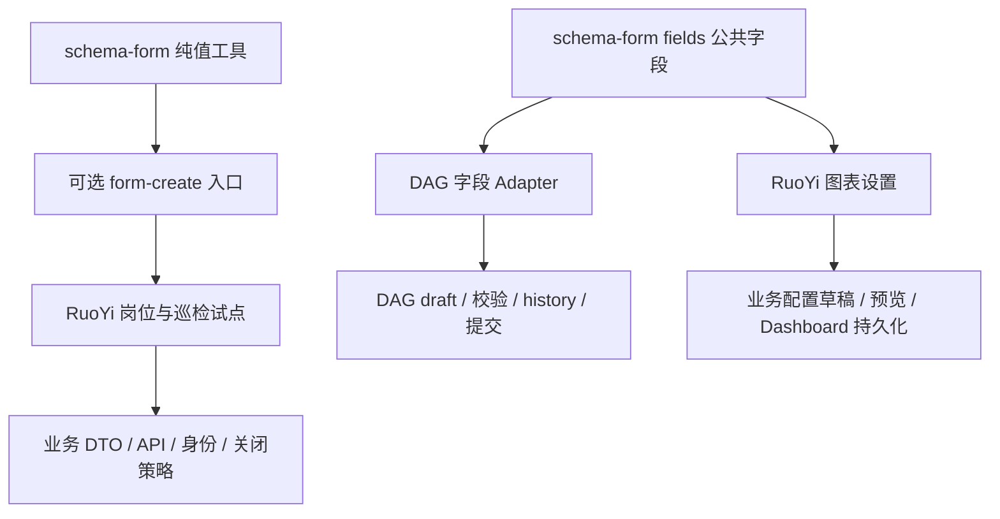

# Schema package 企业业务能力与架构评估

评估日期：2026-10-20。对象：ZXUI 的 `@zxio/schema-form@0.1.0`，以及 RuoYi、`/Users/hqz/dev/ai/vue-flow` 中实际使用它的代码。后者本次接入的是 `@zxio/x6-devkit-dag/zxui`，不能将目录名称等同于已经验证所有 Vue Flow 场景。

**结论：当前是边界清楚、已有真实消费基础的早期组件包，可以继续用于受控场景；还不足以作为复杂企业表单和配置编辑的通用标准全面推广。** 最值得保留的是“公共字段呈现、可选 CRUD 会话、领域独立状态”三者分离。最需要投入的是错误与编辑生命周期的正确性、嵌套数据契约和复杂字段扩展能力。

本轮确认两个 SchemaForm 实现缺陷：服务端错误经过 reset 后残留；写入服务端错误时覆盖原有 `wrap` 配置。另外发现 DAG 的部分多选策略公开类型与实现不一致。这些与尚未交付的扩展能力分开列出。没有发现需要把当前方案推倒重建的依据，也没有发现应定为 P0 的问题。

## 当前能支持到什么程度

| 场景 | 当前判断 | 能力与限制 |
| --- | --- | --- |
| 常规管理表单 | 可继续使用，先修已知错误生命周期问题 | RuoYi 岗位覆盖读取、校验、保存、冲突反馈、关闭保护；完整 SchemaForm 消费者目前只有这一张五字段表单 |
| 带异步校验、附件、重复行的代码定义表单 | 已有可行性，通用交付尚不完整 | 巡检试点通过真实引擎和字段组合完成这些行为；重复行、上传、DTO 等由试点自定义实现，服务使用替身 |
| DAG 单节点配置 | 已有较完整的领域运行时 | 对象、数组、原始文本、manual/auto、stale、history 已有实现；通用字段的局部替换能力不足 |
| Dashboard 单图表设置 | 单一真实场景已有闭环 | CPU 时序设置使用 `/fields`；嵌套草稿、条件校验、预览和保存由业务与 Dashboard 自己负责 |
| 多业务复用关系选择、表达式、权限树、复杂明细 | 基础可组合，标准化不足 | CRUD 有 `bindings`，但复合字段契约与错误定位需要完善；DAG 默认 renderer 缺少逐字段扩展口 |
| 服务端下发表单定义 | 仅支持受限 profile | `parseDefinition` 限制字段数量、规则键和组件 props，不是完整的动态企业表单平台 |
| 多人协作、审批、审计、权限与领域版本冲突 | 应由宿主与后端承担 | Schema package 应提供必要交互契约，不应吸收这些领域系统；不能以没有这些系统判定组件包架构失败 |

**三个消费场景验证的是组合方式，不是同一套完整表单引擎已经覆盖三个复杂领域。** DAG 与 Dashboard 场景主要共享 `ZxField`、数字文本输入及少量纯值工具，未使用 CRUD 的 FormCreate 会话。Dashboard 的复用发生在 RuoYi CPU 设置面板，`@zxio/dashboard` 通用 settings renderer 仍使用自身实现。

证据入口：[包 README](/Users/hqz/Downloads/element-plus/packages/schema-form/README.md)、[岗位调用](/Users/hqz/dev/RuoYi-Vue3-FastAPI/ruoyi-fastapi-frontend/src/views/system/post/components/PostDlg.vue:59)、[巡检规则](/Users/hqz/Downloads/element-plus/docs/research/schema-form-pilot/pilot/inspection/definition.ts:94)、[Dashboard 草稿](/Users/hqz/dev/RuoYi-Vue3-FastAPI/ruoyi-fastapi-frontend/src/components/business/Dashboard/use-time-series-settings.ts:9)。

## 架构设计评价

这里把一个具有公开使用契约的单元称为 Module，调用者需要知道的全部规则称为 Interface，可替换接入点称为 Seam，连接领域与公共能力的实现称为 Adapter。评估重点是这些设计是否减少调用者必须维护的约束。

**状态所有权设计较好。** FormCreate 独占 CRUD 可写值和客户端校验；session 保存快照和成功基线。DAG 保留 draft、输入缓冲和图提交。Dashboard 保留自己的配置与持久化。删除 session 后，防重提交、迟到结果过滤、dirty 与保存基线会重新散落到消费者中，说明该 Module 有实际价值。[会话实现](/Users/hqz/Downloads/element-plus/packages/schema-form/src/session.ts:35)、[图字段动作](/Users/hqz/dev/ai/vue-flow/packages/dag/src/zxui/useFieldEditor.ts:53)。

**包依赖方向较好。** 根入口、`/fields`、`/form-create` 分开；FormCreate 是 optional peer，UI runtime 由宿主提供，构建 external 明确。图场景无需安装第二个可写表单模型，公共字段也不依赖图模型。应继续保持这种分层。[公开导出与 peers](/Users/hqz/Downloads/element-plus/packages/schema-form/package.json:9)、[构建边界](/Users/hqz/Downloads/element-plus/packages/schema-form/vite.config.ts:16)。

**直接复用 FormCreate 原生规则是合理取舍。** 这减少了维护另一套规则语言和翻译器的成本，代价是 CRUD 消费者明确耦合 FormCreate。当前只有一个 CRUD 引擎，没有证据支持再造一个“可换任意引擎”的抽象层。图和 Dashboard 的 Adapter 也不必转成 FormCreate 规则。

**公共字段层仍然较薄。** `/fields` 当前提供标签、消息、ARIA 关联、数字文本输入；它尚未沉淀复杂字段的稳定接入方式。但字段 UI 薄本身并非问题，关键是上层 Adapter 能否在保留既有状态与提交机制的情况下替换字段。DAG 当前在这个 Seam 上存在实际限制。

**最明显的质量问题来自运行时状态泄漏到规则。** 规则被用于承载服务端临时错误，而 reset 只清会话错误列表、不清被修改的规则，导致两个错误状态失去一致性。应深化错误处理 Module，隐藏这条同步约束；业务不应知道需要手动修复 FormCreate 的 `wrap.error`。

## 按优先级排序的优化清单

P0 指当前必须停止使用的严重问题；本轮未确认。P1 是下一轮应先处理的问题或复杂场景推广前置；P2 是后续完善；P3 仅在出现明确产品需求时投入。“缺陷”与“能力扩展”不是同一类结论。

| 顺序 | 优先级 | 优化项 | 性质与责任 | 收益与成本 |
| --- | --- | --- | --- | --- |
| 1 | P1 | 修复 reset 后服务端错误残留，并保留原生 wrap 配置 | 已复现缺陷；SchemaForm | 修复所有消费者共享的正确性问题；成本小 |
| 2 | P1 | 明确嵌套对象、明细数组及服务端错误定位契约 | 复杂表单推广前置；SchemaForm 与领域 Adapter | 支撑主从表、重复组、批量校验；成本中 |
| 3 | P1 | 打开复杂字段的局部扩展口，规范复合字段接入 | 真实扩展瓶颈；DAG Adapter 优先，SchemaForm 复用契约 | 避免每种业务 fork 整个 renderer；成本中 |
| 4 | P1 | 收敛 DAG 未兑现的多选公开策略 | 已确认契约缺口；DAG | 避免配置无效；收窄契约成本小，完整批量编辑成本较大 |
| 5 | P1 | 选一个复杂真实业务完成端到端验证，并固定少量关键回归 | 成熟度前置；库与业务共同负责 | 让后续抽象来自真实需求；成本中 |
| 6 | P2 | 支持接受服务端权威保存结果作为新基线 | 会话能力扩展；SchemaForm | 支持保存后继续编辑、服务端规范化；成本中 |
| 7 | P2 | 补齐布局接入和复合字段无障碍语义 | 公共 UI 契约；SchemaForm 与业务布局策略 | 支撑多列、分组、错误导航；成本中 |
| 8 | P2 | 加强类型与异步生命周期契约 | 开发者契约；SchemaForm 与具体 Adapter | 减少接入误用和重复处理；成本小至中 |
| 9 | P2 | 建立有边界的规模验证与可重复交付检查 | 工程质量；SchemaForm | 避免复杂数据量、升级和打包出现退化；成本小至中 |
| 10 | P3 | 持久化动态定义、可视化设计器、跨引擎兼容 | 新产品能力；需单独立项 | 当前收益证据不足，长期维护成本高 |

### 1 修复服务端错误的生命周期

**证据强度：已用真实 FormCreate 3.3.5 和 Vue 内存 renderer 复现。** 结构 UI 使用 stub，结论针对引擎规则和会话状态，不是浏览器像素验收。

触发过程：

1. 原生规则包含 `wrap={labelWidth:'200px', class:'business-wrap'}`。
2. 保存返回已知字段错误，`applyIssues()` 调用 `updateRule(field, {wrap:{error}})`；原有 wrap 属性消失。
3. 调用 `reset()`，会话 `issues=[]`、`dirty=false`，重新挂载的引擎却保留 `wrap.error='duplicate'`。
4. 继续编辑并成功保存，最终 `submit=true`、`status='已保存'`，规则中的旧错误依然存在。

根因是 `updateRule` 的浅层覆盖，以及 reset 复用已经被修改的规则、同时丢失旧错误字段索引。普通“未经过 reset 的修改后清错”有效，不能据此推断 reset 链路也有效。[错误写入](/Users/hqz/Downloads/element-plus/packages/schema-form/src/session.ts:54)、[reset](/Users/hqz/Downloads/element-plus/packages/schema-form/src/session.ts:99)、[规则生命周期](/Users/hqz/Downloads/element-plus/packages/schema-form/src/SchemaForm.vue:65)。

建议由 SchemaForm 错误 Module 只修改自己拥有的 error 属性，并在 reset、销毁及重新绑定时完整清理。保留调用者的其他 wrap 配置；对调用者自己设置的 error 也应明确所有权。不要要求业务重建规则来绕过问题。原生 wrap 覆盖单独为 P2，因同一根因一并修复。

验收只需锁定“返回字段错误 → reset → 修改 → 成功保存”与“原有 wrap 属性保留”两条关键行为。保存基线、公开规则和实际字段错误应一致。[探针](/Users/hqz/dev/RuoYi-Vue3-FastAPI/docs/reports/evidence/schema-enterprise-assessment-2026-10-20/session-error-replay.ts)、[实际输出](/Users/hqz/dev/RuoYi-Vue3-FastAPI/docs/reports/evidence/schema-enterprise-assessment-2026-10-20/session-error-output.txt)。

### 2 建立嵌套数据与明细错误契约

当前 `FieldIssue.field` 是普通字符串；会话用 `api.getRule(field)` 定位，用 `previous[field]` 比较变化。没有公开约定说明如何定位 `items[3].quantity`、如何跨子表单找到字段、行重排后错误对应哪个实体。未知字段退回表单级，虽不会静默丢失，但复杂表单难以直接纠错。[类型](/Users/hqz/Downloads/element-plus/packages/schema-form/src/form-create/types.ts:16)、[错误关联](/Users/hqz/Downloads/element-plus/packages/schema-form/src/session.ts:78)。

这不等于 FormCreate 不支持嵌套。其原生 group/subForm 已提供数组、子表单与独立子表单 API，应先复用并验证当前固定版本。JSON Forms 的外部错误使用路径定位，VeeValidate 的重复行把稳定 key 与位置索引分开；两者值得借鉴这一设计，而非为此引入完整第二引擎。[FormCreate 数组](https://www.form-create.com/en/v3/guide/group)、[JSON Forms 外部错误](https://jsonforms.io/docs/validation/)、[VeeValidate 行身份](https://vee-validate.logaretm.com/v4/api/use-field-array/)。

建议明确四件事：

- 字段路径怎样表示，并由 FormCreate Adapter 映射到原生子表单；不要把路径字符串规则散落业务。
- 重复行怎样保持编辑身份；后端错误若针对某条记录，不能只依赖易变化的数组下标。
- 隐藏、禁用、删除、unset、null 分别如何影响值保留、校验和提交；由业务声明具体策略，库保证执行一致。
- 字段错误如何定位、清理和聚焦；保留表单级错误作为真正无法归属的反馈。

巡检试点已经用稳定 `row.id` 做重复行，但相关编辑与校验仍是定制实现，不能视作包已交付通用明细协议。[重复行实现](/Users/hqz/Downloads/element-plus/docs/research/schema-form-pilot/pilot/inspection/MeasurementRows.vue:14)、[整字段校验](/Users/hqz/Downloads/element-plus/docs/research/schema-form-pilot/pilot/inspection/definition.ts:125)。

建议用真实主从表锁定“第二行服务端错误 → 行移动/删除 → 修改正确行 → 重试”的行为。收益是把路径与错误一致性集中在一个 Module；代价是需要定义领域错误到 UI 字段的 Adapter，不能单靠增加控件解决。

### 3 增强复杂字段的扩展能力

CRUD 的 `bindings` 是可用的 Seam，已支持自定义检查项和附件；内置只有 Input、InputNumber、Radio、Select、Tags 并不是架构缺陷。应优先定义复合字段如何遵守值更新、disabled/readonly、原始文本、pending、错误、焦点和卸载取消契约。[Binding](/Users/hqz/Downloads/element-plus/packages/schema-form/src/types.ts:12)、[内置注册](/Users/hqz/Downloads/element-plus/packages/schema-form/src/zxui/index.ts:11)。

**DAG Adapter 的扩展更紧迫。** `DagSchemaFields` 的公开 props 只有 inspector，字段渲染固定分支。替换一个字段为设备关系选择器、资源引用或表达式编辑器，不能方便地保留其余默认字段。应增加有类型的字段 slot 或 resolver，让自定义字段继续调用现有 inspector actions。[公开 props](/Users/hqz/dev/ai/vue-flow/packages/dag/src/zxui/contract.ts:3)、[字段分支](/Users/hqz/dev/ai/vue-flow/packages/dag/src/zxui/DagSchemaField.vue:102)。

实现顺序宜从 DAG 的领域 Adapter 开始；CRUD 通过现有 bindings 做第二个消费者。只有两边真正重复的字段契约再提升到 `/fields`。公共层不解释图路径、不提交 history，也不请求业务 API。

验收可选两个有明显差异的控件：带异步选项的设备选择器、带未完成文本的表达式编辑器。应能只替换一个字段，保留默认字段、主题、错误展示与宿主提交保护。这会提高复用能力，并减少后续业务维护独立 renderer 的成本。

### 4 收敛 DAG 多选契约

公开类型包含 `shared-fields`、`readonly-summary`，实际 selection 分支对非单节点只处理 `close`，其余直接返回。消费者配置这些策略，并不能得到共享字段编辑或只读汇总。[类型](/Users/hqz/dev/ai/vue-flow/packages/dag/src/contracts/capabilities/authoring/contract.ts:87)、[实现](/Users/hqz/dev/ai/vue-flow/packages/dag/src/composables/inspector-runtime/selection-sync/index.ts:43)。

这是 DAG 契约完整度问题。当前在研阶段可以直接收窄未实现策略；如果已有明确批量编辑需求，再实现混合值、字段交集、逐目标权限和原子 history 事务。不要为了消除类型缺口而草率循环单节点保存，也不要让 schema-form 接管图事务。

现有单节点的 undo/redo 同步、脏草稿保护和数组 raw buffer 重映射均已存在，不应重复列为缺失。[历史同步](/Users/hqz/dev/ai/vue-flow/packages/dag/src/composables/inspector-runtime/inspector-session/history-sync.ts:28)、[输入缓冲重映射](/Users/hqz/dev/ai/vue-flow/packages/dag/src/composables/inspector-runtime/inspector-session/editors.ts:55)。

### 5 用一个复杂真实业务推动公共能力成熟

RuoYi 当前岗位成功说明基础 CRUD 可用。更复杂的需求已经在仓库中：用户表单包含部门、角色、岗位、异步选项与创建条件字段；角色编辑包含权限树；生成器包含主子表、上传、日期及富文本。[用户表单](/Users/hqz/dev/RuoYi-Vue3-FastAPI/ruoyi-fastapi-frontend/src/views/system/user/components/UserFormDialog.vue:27)、[权限树](/Users/hqz/dev/RuoYi-Vue3-FastAPI/ruoyi-fastapi-frontend/src/views/system/role/components/RoleFormDrawer.vue:65)、[主子表模板](/Users/hqz/dev/RuoYi-Vue3-FastAPI/ruoyi-fastapi-backend/module_generator/templates/vue/v3/index.vue.jinja2:254)。

建议下一轮优先选用户编辑完成关系字段和异步流程验证；嵌套数组契约再选实际主子表消费者落实。后者仅在模板中存在不等于已经找到真实业务页面，不应先编造一张“全能测试表单”就宣布企业级验收。

验收覆盖真正有风险的链路：异步响应乱序、记录替换、条件字段切换、无效原始输入、复合字段 pending、字段错误、失败重试和关闭保护。先用 `VITE_ZXUI_LOCAL=true` 与指定 ZXUI 源码目录联调，再核对打包消费。

测试应跟随缺陷和关键不变量。现有包级 4 项测试都是 node 会话/工具测试；巡检 7 项挂载了真实引擎；岗位反馈测试整体 mock SchemaForm。三者各有价值，但不能互相替代。应优先把本轮错误 reset 回归纳入真实引擎边界，复用现有巡检场景，避免增加大量只能证明 mock 行为的测试。

### 6 支持服务端权威值成为新基线

`SaveResult` 的成功结果只有 `{ok:true}`。会话总把客户端 submitted 当作新 baseline，saved 也发出该值。后端若规范化名称、补默认值、生成标识，长驻编辑页无法通过公开 Interface 接受服务器结果为新的干净基线，只能由宿主重建会话。[成功类型](/Users/hqz/Downloads/element-plus/packages/schema-form/src/form-create/types.ts:21)、[保存基线](/Users/hqz/Downloads/element-plus/packages/schema-form/src/session.ts:134)。

建议支持由业务转换后的权威编辑值回填，并定义它与保存中编辑、旧请求结果的关系。版本号、ETag、409 和领域合并策略仍归宿主；SchemaForm 不自动合并服务器 DTO，也不承担后端并发控制。

当前岗位保存后关闭，因此没有暴露这一限制。它对“保存后继续编辑”更有价值，列为 P2；如下一真实消费者就是长驻复杂编辑器，应提升为该消费者的前置要求。

### 7 完善布局与复合字段无障碍

`schemaFormDialog({columns})` 目前只按列数选择弹框尺寸，给 SchemaForm 的属性只有标签宽度和位置；SchemaForm 本身没有公开列数或布局配置。原生 Rule 可以写 col，因此这里是统一布局策略尚未接通，不是引擎无法多列。[业务策略](/Users/hqz/dev/RuoYi-Vue3-FastAPI/ruoyi-fastapi-frontend/src/components/ui/FormDialog/index.ts:84)、[SchemaForm props](/Users/hqz/Downloads/element-plus/packages/schema-form/src/SchemaForm.vue:21)。

建议业务继续声明列数、整行字段和响应式策略，SchemaForm 提供最小布局接入点并复用原生布局。分组、分步、错误导航按真实页面补齐，不预先建另一套布局 DSL。

`ZxField` 已有单控件 label/help/error 的关联，但固定使用 `<label for>`；DAG 对象和数组对应的是 div，且未完整传递描述/错误关联属性。复合组应采用合适的 group 或 fieldset/legend 语义。这个结论来自 DOM 模板，尚未进行屏幕阅读器验收。[Field 模板](/Users/hqz/Downloads/element-plus/packages/schema-form/src/fields/Field.vue:30)、[复合组](/Users/hqz/dev/ai/vue-flow/packages/dag/src/zxui/DagSchemaField.vue:142)。

### 8 加强类型和异步生命周期契约

`RuleFor<T>` 仅限制顶层 field 名；`Save`、`BusinessContext.read()` 和公开 ref 都返回通用 `Values`。它能避免一部分拼写错误，却不能表达嵌套路径、字段编辑值与 save 值的一致类型。[公开类型](/Users/hqz/Downloads/element-plus/packages/schema-form/src/form-create/types.ts:5)。

建议优先让编辑值类型贯穿初始值、read、save 和 saved，并把状态暴露为稳定的机器可读类型。DTO 解码与领域校验继续在业务边界执行；不要把所有 FormCreate 组件 props 再复制成一套类型体系。

`createRules` 每会话只调用一次；reset 会替换 AbortSignal。若初始化工厂启动一次性、绑定旧 signal 的资源加载，reset 会终止它而不会重启工厂。应明确资源属于应用、记录还是字段，并提供对应示例；只有真实调用需要时才增加小型生命周期接入点。[规则工厂](/Users/hqz/Downloads/element-plus/packages/schema-form/src/SchemaForm.vue:65)、[signal 更新](/Users/hqz/Downloads/element-plus/packages/schema-form/src/session.ts:93)。

异步选项应先复用 ZxSelect 和宿主已有取消/版本机制；图侧已有 provider token 与提交修订检查。不要为了 schema 接入另建缓存层或通用任务调度框架。国际化也应将状态码与当前硬编码中文消息分离，复用 ZXUI 既有 locale 机制。

### 9 验证规模上限与可重复交付

会话在每次观察值时递归规范化、复制、比较，并再复制一份 current，成本随整个值树增长。当前没有证据证明它已经成为瓶颈。本轮最小内存测量如下：

| 明细行数 | JSON 大小 | observe 加 dirty 的 P50 | P95 |
| --- | --- | --- | --- |
| 50 | 8,913 字节 | 0.136 ms | 0.340 ms |
| 200 | 35,813 字节 | 0.428 ms | 0.561 ms |
| 1,000 | 179,813 字节 | 2.249 ms | 2.749 ms |

这是当前机器 Node 22.22.1 下，预热 10 次、采样 50 次的会话测量，不包含 FormCreate、DOM、校验和网络，不能用于承诺页面帧率。它支持“暂不重写状态引擎”，同时要求真实大表单做整体验证。[探针与测量](/Users/hqz/dev/RuoYi-Vue3-FastAPI/docs/reports/evidence/schema-enterprise-assessment-2026-10-20/session-cost-result.json)。

建议按真实业务规模测首屏、字段编辑、整表校验和错误定位；出现瓶颈后再减少重复复制或采用字段级更新，不先构建复杂增量框架。

交付方面已有 ESM/CJS、类型、CSS、peer 和源码插件支持。当前 schema tarball 的 27 个文件与 ZXUI dist、RuoYi 已安装包一致，没有已证实的发行漂移。后续将关键真实引擎场景接到固定入口，保证源码和发行包两种消费都能重复检查。普通 RuoYi vitest 没有使用源码插件，单设 `VITE_ZXUI_LOCAL=true` 不会自动把这些测试改成源码验证。[源码集成](/Users/hqz/dev/RuoYi-Vue3-FastAPI/ruoyi-fastapi-frontend/vite/zxui-theme-packages.ts:54)、[测试配置](/Users/hqz/dev/RuoYi-Vue3-FastAPI/ruoyi-fastapi-frontend/vitest.config.ts:6)。

### 10 动态配置平台按需求另行评估

`parseDefinition` 有 engine/contract/revision 标识，限制最多 40 字段、100,000 个字符串码元和 40 层嵌套，允许受限规则键并拒绝执行性内容。它是功能准入，不是运行不可信代码的沙箱；原生 TS 规则也不受该导入 profile 的 40 字段限制。[导入实现](/Users/hqz/Downloads/element-plus/packages/schema-form/src/definition.ts:15)、[JSON 边界](/Users/hqz/Downloads/element-plus/packages/schema-form/src/json.ts:6)。

如果未来要做管理员发布动态定义、版本迁移、跨租户配置或可视化设计器，需要补定义校验、组件属性值约束、能力清单、迁移与发布流程。应由明确产品需求驱动，不能仅凭 package 名含 schema 就把这些全部视为本轮缺陷。

## 成熟方案的取舍

| 方案 | 本次建议 | 理由 |
| --- | --- | --- |
| FormCreate 原生规则、group/subForm、联动与校验 | 继续直接采用，按固定版本验证 | 已集成且有真实消费者；原生机制已覆盖大量需求，先补 Adapter 契约与正确性 |
| VeeValidate 的稳定行身份、嵌套路径 | 借鉴设计 | 有助于复杂明细的身份与位置分离；没有必要为此增加第二个值 owner |
| JSON Forms 的外部路径错误与数据/UI 分离 | 借鉴设计；有服务端标准 JSON Schema 需求时再评估采用 | 可改善错误契约；直接替换会带来规则、渲染和验证体系迁移 |
| 自建统一 Schema DSL、多引擎层、万能编辑会话 | 当前不推荐 | 会把图命令、CRUD 保存、Dashboard 持久化的差异压进一个高复杂度 Interface，收益证据不足 |

官方对照依据：[FormCreate 联动](https://www.form-create.com/en/v3/guide/control)、[子表单与数组](https://www.form-create.com/en/v3/guide/group)、[VeeValidate 重复字段](https://vee-validate.logaretm.com/v4/api/use-field-array/)、[JSON Forms 外部校验](https://jsonforms.io/docs/validation/)。这些资料用于设计对照，不将在线文档的新能力直接认定为本地 3.3.5 已通过验收。

架构改进候选的相对排序如下。0/1/2 分别代表低/中/高，风险越高代价越大；这是候选取舍，不是产品质量评分。

| 候选 Module 或 Seam | 摩擦 | 复用收益 | 变更集中度 | 验证收益 | 风险 | 信心 |
| --- | --- | --- | --- | --- | --- | --- |
| 会话错误生命周期 Module | 2 | 2 | 2 | 2 | 0 | 高，已复现 |
| 嵌套字段与错误定位 Adapter | 2 | 2 | 2 | 2 | 1 | 高，公开契约不足明确 |
| DAG 字段扩展 Seam | 2 | 2 | 2 | 1 | 1 | 高，真实替换能力受限 |
| 跨引擎万能会话 Module | 0 | 0 | 0 | 0 | 2 | 不推荐，缺少需求证据 |

第一项依赖真实第三方引擎，应通过当前固定 FormCreate 验证；第二、三项依赖 Vue 与领域生命周期，应保留领域 owner，通过公开 Interface 验证。三者都有当前消费者收益，优先级高于新建基础设施。

## 建议的下一阶段交付顺序

1. 修复 SchemaForm 错误生命周期；同时在 DAG 收窄未实现的多选契约。结束条件是公开契约与真实行为一致。
2. 用真实用户编辑推动复合字段与异步契约，同时为 DAG 增加局部字段替换能力。结束条件是业务无需复制 renderer、无需双模型。
3. 找到真实主从表消费者，完成路径、行身份、服务端错误和隐藏字段语义；根据该页面需要补权威保存值和布局。
4. 对实际复杂页面验证规模、无障碍和打包消费，再决定扩大迁移范围。持续保留业务领域规则与图事务的原 owner。

这几个阶段不要求先发布 npm。通用机制在 ZXUI 修复，图领域扩展在 DAG 实现，业务负责领域适配和真实页面验收。

## 本轮验证范围

| 验证 | 本轮结果 | 能证明的范围 |
| --- | --- | --- |
| Schema package test | 2 文件、4 项通过 | 会话与纯值工具，Api 为替身 |
| Schema package typecheck | exit 0 | 当前源码类型检查 |
| 既有巡检 pilot | 1 文件、7 项通过 | 真实 FormCreate 与字段挂载；模拟 DOM、服务替身；包含条件/异步校验、上传、重复行与替换/reset |
| RuoYi 精准回归 | 3 文件、21 项通过 | 岗位 DTO、业务反馈、Dashboard 状态；包含组件和保存 adapter mock |
| 错误生命周期探针 | 两个缺陷复现 | 真实引擎规则与会话；结构 UI 为 stub |
| 会话规模探针 | 50/200/1,000 行完成 | 仅 observe 与 dirty 成本 |
| schema 打包文件比较 | 27 文件一致 | 当前 tarball、ZXUI dist、RuoYi 安装包一致；不是本轮重新构建结果 |

本轮合计 32 项现有测试通过；pilot 有预期的必填验证 stderr，RuoYi 有 Browserslist 数据过旧提示，不能称为零警告。

没有使用 computer use，没有进行本轮真实浏览器或业务 API 写入，也没有修改产品代码或新增测试套件。2026-10-19 的岗位、DAG、Dashboard 页面/API 验收保留为历史证据，不冒领为本次复验。图仓本轮只做源码审阅，未运行其测试套件；未重复整仓构建。

源码指纹、仓库基线和准确命令见 [验证清单](/Users/hqz/dev/RuoYi-Vue3-FastAPI/docs/reports/evidence/schema-enterprise-assessment-2026-10-20/verification.json)。历史现场证据见 [跨场景交付](/Users/hqz/Downloads/element-plus/docs/reports/2026-10-19-schema-cross-scenario-delivery.md)、[Dashboard 单卡片验收](/Users/hqz/Downloads/element-plus/docs/reports/2026-10-19-dashboard-schema-card.md)。
