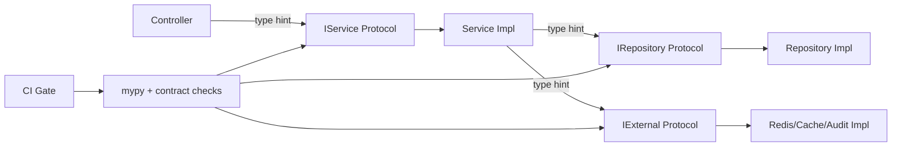

# Protocol 接口契约技术设计

## 架构概述

P1 采用“契约先行 + 直接切换”模式：

- 统一在 `ports/` 下定义 Repository、Service、Infrastructure Protocol。
- 业务代码只依赖 Protocol，不再依赖具体实现类型。
- 现有抽象接口（如基于 `ABC` 的仓储接口）直接替换为 Protocol，不保留双体系。
- CI 强制执行类型与契约一致性检查，禁止回退到实现耦合导入。

## 数据流图

## 组件与接口定义

- `ports/repositories.py`
: 仓储契约定义（`IUserRepository`、`IProjectRepository` 等）。
- `ports/services.py`
: 服务契约定义（`IUserService`、`IProtocolService` 等）。
- `ports/external.py`
: 基础设施契约定义（`IRedisClient`、`ICacheProvider`、`IAuditLogger`、`IEventBus`）。
- `ports/__init__.py`
: 统一导出，作为唯一导入入口。
- `scripts/check_protocol_coverage.py`
: 校验公开实现类的 Protocol 覆盖率。
- `scripts/check_protocol_updates.py`
: 校验“公开方法变更是否同步更新 Protocol”。

强约束：

- 不再新增 `ABC` 风格业务接口。
- 不允许控制器与服务直接依赖实现类类型。
- 每个 Protocol 方法必须具备类型标注与 docstring。

## 命名与检索规则

- 接口命名统一为 `I` 前缀 + 领域能力后缀（例如 `IUserRepository`、`IUserService`）。
- 跨上下文公共契约统一放在 `ports`，上下文私有契约在 P3 后放入 `modules/<context>/ports.py`。
- `ports/__init__.py` 是唯一入口导出文件，新增契约必须同步导出。
- 检索规则执行“一次跳转可达”：
  - 第 1 跳：`ports/__init__.py` 找到导出符号；
  - 第 2 跳：进入具体定义文件（`ports/repositories.py`、`ports/services.py`、`ports/external.py`）。
- 规范文档落地在 `ruoyi-fastapi-backend/docs/PROTOCOL_CONTRACT_GUIDE.md`。

## API 接口设计

P1 不新增业务 HTTP API，仅新增工程治理入口：

- `python scripts/check_protocol_updates.py`
- `python scripts/check_protocol_coverage.py --format=json`

返回码：

- `0`：通过。
- `1`：契约缺失、签名不一致或覆盖率未达标。

## 数据模型与数据库变更

P1 无数据库 schema 变更。

新增对象：

- Protocol 类型定义文件。
- CI 报告产物（覆盖率 JSON）。

## 安全考量

- 契约层不暴露敏感字段语义（token/secret）与底层客户端危险接口。
- `external` 契约按最小能力暴露，避免越权访问底层 SDK。
- 契约检查脚本限定扫描目录，避免误扫生成文件与临时文件。

## 测试策略

- 类型检查：
  - mypy 对变更模块严格执行并阻断新增错误。
- 单元测试：
  - 使用 Protocol mock 验证依赖替换能力。
- CI 门禁：
  - `check_protocol_updates` 与 `check_protocol_coverage` 必须通过。
- 回归测试：
  - 现有业务测试全量通过，确保仅类型边界变化不破坏行为。
