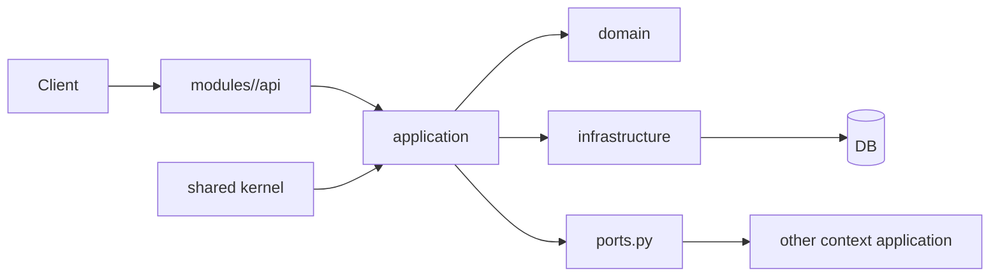

# 垂直切片与 DDD 模块边界技术设计

## 架构概述

P3 采用“按上下文一次切换、切换即删除旧结构”的实践策略：

- 目录从横向分层切换到 `modules/<context>` 垂直结构。
- 上下文内按 `api/application/domain/infrastructure` 分层。
- 跨上下文只通过 `ports.py` 协议交互。
- 旧 `module_admin/controller|service|repository|entity` 在切换完成后立即删除。
- 本轮切换范围聚焦 `system/identity/project`；`simulation/protocol/device` 暂不切换，后续批次独立推进。

## 数据流图

## 组件与接口定义

标准目录：

- `modules/<context>/api/`
- `modules/<context>/application/`
- `modules/<context>/domain/`
- `modules/<context>/infrastructure/`
- `modules/<context>/ports.py`
- `modules/<context>/tests/`
- `shared/kernel/`（仅无业务语义共享能力，如响应模型/通用类型）

注册机制：

- `modules/registry.py`
: 作为唯一模块注册表。
- `server.py`
: 只通过 registry 加载路由与容器扩展。

边界规则：

- `domain` 不依赖外部上下文实现。
- 禁止导入他人上下文 `infrastructure/repository`。
- 共享层仅存放无业务语义公共能力。
- shared 变更需执行 `shared-impact-test-matrix.md` 中的回归清单。

## API 接口设计

- 对外 API 路径保持稳定，但实现直接迁移到新上下文。
- 不引入旧路由转发适配层；迁移窗口内一次完成同一 API 分组切换。
- 模块加载入口：`register_modules(app, container, registry)`。

## 数据模型与数据库变更

- P3 以代码结构重组为主，不因目录迁移修改表结构。
- 若拆分后需要读优化结构，在 P4 引入 ReadModel/投影表。
- 迁移映射表（旧 -> 新）作为审查与发布资料。

## 安全考量

- 跨上下文内部导入视为架构违规，CI 必须阻断。
- registry 显式注册，禁止隐式扫描加载未审计模块。
- 模块切换必须保留原权限校验语义（鉴权点不下沉丢失）。

## 测试策略

- 架构测试：
  - 校验目录结构与边界导入规则。
- 回归测试：
  - 每个上下文切换后执行 API 与权限回归。
- 启动测试：
  - registry 装载与路由可用性检查。
- 验收标准：
  - 切换上下文对应旧目录代码已删除且测试通过。
