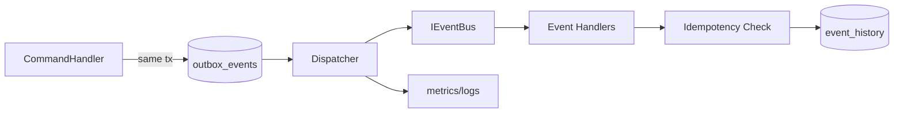

# 事件驱动架构技术设计

## 架构概述

P5 采用“事务 Outbox + 异步分发 + 幂等消费 + 历史审计”的标准实践：

- CommandHandler 在业务事务中写入 Outbox。
- Dispatcher 扫描 Outbox 并发布事件。
- Consumer 以 `event_id + handler` 幂等消费。
- 事件历史独立入库，支持审计与回放。

该架构定义为默认跨模块协作机制，不保留跨模块直接函数调用路径。

## 数据流图

## 组件与接口定义

- `events/domain_events.py`
- `events/event_bus.py`
- `events/outbox_repository.py`
- `events/outbox_dispatcher.py`
- `events/history_repository.py`
- `events/handler_registry.py`

关键接口：

- `publish(event)`
- `subscribe(event_type, handler)`
- `dispatch_batch(limit)`
- `mark_published/mark_failed(event_id)`

## API 接口设计

新增运维 API：

- `GET /health/events`
- `GET /events/history`
- `POST /events/replay`

约束：

- 接口必须接入统一权限与审计机制。
- 错误响应需包含 `event_id`、`handler`、`retry_count`、`trace_id`。

## 数据模型与数据库变更

新增表：

- `outbox_events`
- `event_history`
- `event_consumption_log`（去重日志）

关键索引：

- `outbox_events(status, next_retry_at)`
- `event_history(aggregate_id, occurred_at)`
- `event_consumption_log(event_id, handler_name)` unique

## 安全考量

- 事件 payload 不允许敏感明文。
- 回放接口必须管理员权限 + 审计。
- 事件超限（64KB）拒绝入队并告警。

## 测试策略

- 单元测试：Outbox 状态机、幂等、重试退避。
- 集成测试：事务写 outbox -> 异步发布 -> handler 执行闭环。
- 运维测试：回放、失败告警、积压清理。
- 监控验证：`/metrics` 暴露 backlog/失败率/延迟指标。
