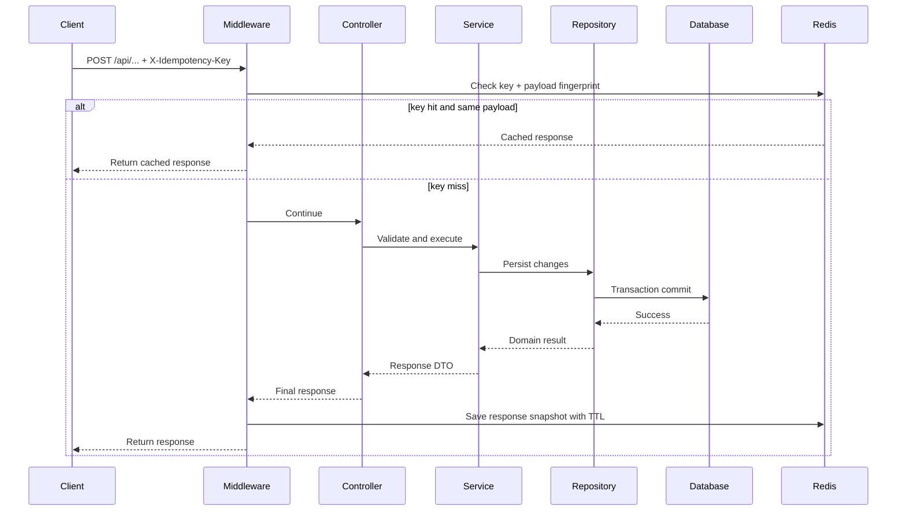

# Backend Architecture P0 Foundation Design

## Overview

This design introduces a stable architecture baseline for the backend:
- One persistence abstraction (`repository`)
- Constructor-based service dependency injection
- Thin controller boundary
- Shared runtime state for simulation sessions
- Standard observability stack (JSON logs, OTel traces, Prometheus metrics)
- Release guardrails (idempotency, rate limiting, migration checks)

## Current Pain Points

1. DAO and repository coexistence increases maintenance complexity.
2. Classmethod-oriented services make dependency injection and unit testing harder.
3. Business logic leaks into controllers, reducing boundary clarity.
4. Simulation runtime state in process memory breaks under multi-worker deployment.
5. Non-standard observability limits cross-system incident analysis.
6. Missing migration drift checks allow schema mismatch risk.

## Target Architecture

```mermaid
flowchart LR
  A[Client] --> B[FastAPI Controller]
  B --> C[Service Instance]
  C --> D[Repository]
  D --> E[(PostgreSQL/MySQL)]
  C --> F[(Redis)]
  B --> G[Idempotency Middleware]
  B --> H[Rate Limit Middleware]
  B --> I[Observability Middleware]
  I --> J[JSON Logs]
  I --> K[OTel Traces]
  I --> L[/metrics]
```

## Key Design Decisions

## 1) Repository Unification

- Keep all query/command persistence in `module_admin/repository`.
- Freeze DAO expansion immediately.
- Gradually replace DAO references in services with repository calls.

## 2) Service Dependency Injection

- Convert service methods from global class state patterns to instance methods.
- Use FastAPI `Depends` providers to build service instances with explicit dependencies.
- Keep service constructors small and explicit for testability.

## 3) Thin Controllers

- Controllers only do:
  - request parsing and validation
  - permission/auth pre-checks
  - service invocation
  - response shaping
- Move all domain decisions to services.

## 4) Shared Simulation Runtime State

- Externalize session state from process memory to Redis.
- Suggested keys:
  - `sim:session:{session_id}:meta`
  - `sim:session:{session_id}:state`
  - `sim:session:{session_id}:events`
- Use session-level single producer coordination to prevent duplicate websocket push loops.

## 5) Idempotency and Rate Limiting

- Idempotency middleware on write endpoints:
  - key: `X-Idempotency-Key`
  - store first successful response by key + request fingerprint
  - return cached result for retried equivalent requests
  - return conflict for mismatched payload on same key
- Rate limiting middleware:
  - policy tiers by endpoint class (auth, write, read)
  - per-IP and per-user enforcement

## 6) Observability Standardization

- Structured logs in JSON.
- OTel instrumentation for FastAPI, SQLAlchemy, and Redis clients.
- Prometheus endpoint `/metrics` for request and dependency metrics.
- Correlate by `trace_id` and `request_id`.

## 7) Migration Safety in CI

- Add migration drift check in CI:
  - validate Alembic head state
  - fail pipeline on model/migration mismatch

## Request Flow (Write API with Idempotency)



## Data Contracts

1. Request header: `X-Idempotency-Key` (required for selected write APIs)
2. Log fields:
   - `timestamp`
   - `level`
   - `message`
   - `request_id`
   - `trace_id`
   - `user_id`
   - `path`
   - `method`
   - `status_code`
   - `duration_ms`
3. Metrics examples:
   - `http_requests_total`
   - `http_request_duration_seconds`
   - `db_query_duration_seconds`
   - `redis_operation_duration_seconds`
   - `simulation_active_sessions`

## Rollout Plan

1. Introduce middleware and instrumentation behind config flags.
2. Migrate one bounded module first (`simulation` and one system module).
3. Expand to remaining modules after compatibility checks.
4. Remove obsolete DAO code paths once parity is verified.

## Risks and Mitigations

1. Risk: Migration volume causes merge conflicts.
   - Mitigation: module-by-module refactor with short-lived branches.
2. Risk: Observability overhead increases latency.
   - Mitigation: sample rate tuning and benchmark gate in CI.
3. Risk: Idempotency cache growth.
   - Mitigation: TTL and per-key size limits.
4. Risk: Redis dependency outage.
   - Mitigation: explicit degraded mode and operational runbook.

## Out of Scope

- Distributed event bus and outbox delivery semantics
- Full domain model refactor for all modules
- Read/write database separation
