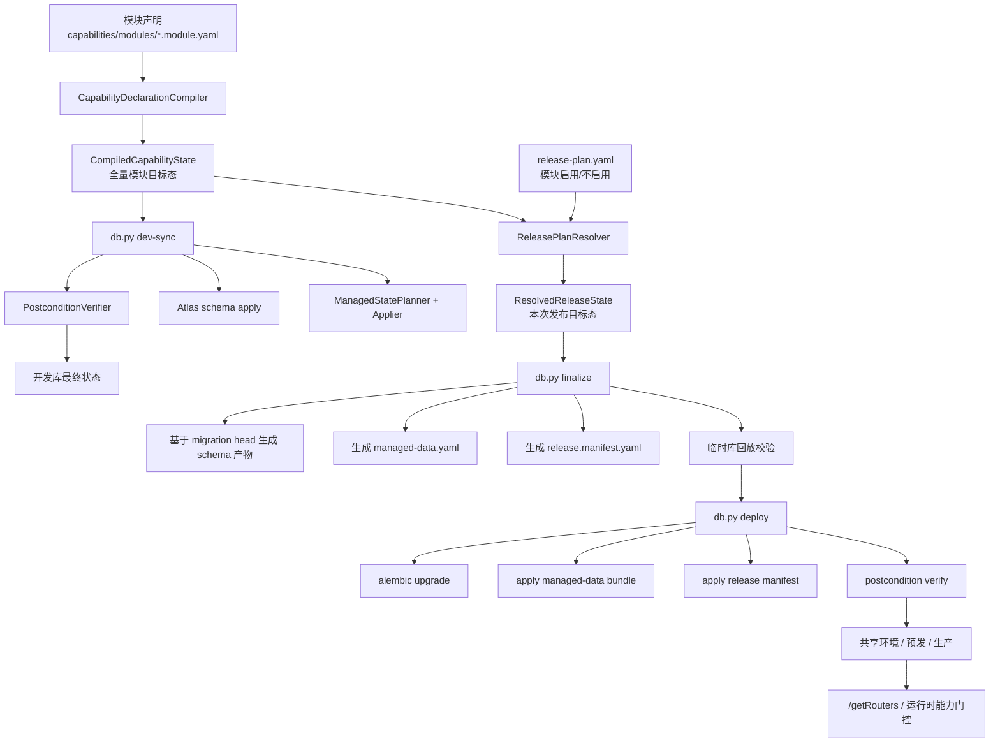
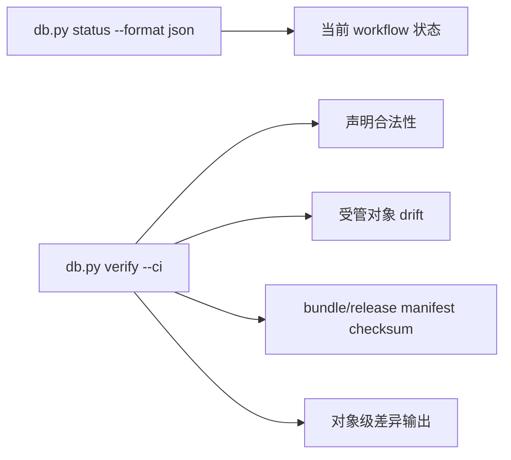

# 能力纳管与发布选择 技术设计

## 架构概述

本设计在现有统一数据库工作流基础上演进，不新增第二套面向人的平台体系。对开发和运维暴露的长期稳态概念只有三类：

- 模块声明：描述某个业务模块拥有的菜单、授权、字典、配置与运行时启停能力。
- 发布选择：通过单一 `release-plan.yaml` 选择本次版本启用哪些模块。
- 统一执行入口：继续使用 [db.py](/Users/hqz/dev/RuoYi-Vue3-FastAPI/ruoyi-fastapi-backend/scripts/db.py) 的 `dev-sync/finalize/deploy/status/verify/bootstrap-seed`。

现有仓库已经具备统一入口和 release bundle 骨架：
- [db.py](/Users/hqz/dev/RuoYi-Vue3-FastAPI/ruoyi-fastapi-backend/scripts/db.py#L694) 已统一公开子命令。
- [ManagedDataDeclarationLoader](/Users/hqz/dev/RuoYi-Vue3-FastAPI/ruoyi-fastapi-backend/scripts/internal/db_workflow/managed_data_declaration_loader.py#L113) 已能把菜单、角色授权、字典、配置和 `release-plan` 装载成统一目标态。
- [build_release_candidate_state](/Users/hqz/dev/RuoYi-Vue3-FastAPI/ruoyi-fastapi-backend/scripts/internal/db_workflow/finalize_release_service.py#L171) 已具备“从全量声明投影到发布选择”的基础能力。
- [DbWorkflowObjectDO](/Users/hqz/dev/RuoYi-Vue3-FastAPI/ruoyi-fastapi-backend/module_admin/entity/do/db_workflow_do.py#L31) 已提供受管对象元数据表，可作为单一 ownership 源的落点。

当前最大问题不是入口分散，而是声明源与发布控制粒度太接近数据库对象：
- `release-plan.yaml` 目前选择的是 `menu_ids / role_grants / dict_types / config_keys`。
- `menus.registry.yaml` 仍以中心化对象列表存在。
- `dev-sync` 的成功条件还是“apply 没异常”，而不是“最终数据库状态 = 目标态”。

本设计的收口原则如下：

1. 不改人类主入口。
   - 继续使用 `db.py` 和单一 `release-plan.yaml`。
   - 不把 `profile`、套餐矩阵、多态模块状态暴露成日常主概念。

2. 内部增加编译层，但不增加人类概念。
   - 模块声明先编译成规范化 capability target state。
   - 发布选择再从 capability target state 投影出 release target state。
   - 之后统一下沉成现有 `ManagedDataTargetState` 与 release bundle。

3. ownership 单源化。
   - `sys_db_workflow_object` 成为 prune 与 verify 的唯一 authority。
   - `sys_menu.managed_by_seed` 仅保留兼容标记，不再参与删除决策。

4. 成功定义提升为后置校验通过。
   - `dev-sync`、`deploy`、`verify` 都必须能证明“最终受管状态 = 目标态”。
   - 不再接受“脚本执行成功但页面仍旧可见”的假成功语义。

5. 发布控制只做模块启用，不做授权临时覆盖。
   - 角色授权跟随模块声明编译。
   - 发布选择不承担“本次版本顺手改一把角色权限”的职责。

推荐的长期目录形态如下：

```text
ruoyi-fastapi-backend/
  capabilities/
    modules/
      datasource.module.yaml
      monitor.module.yaml
      generator.module.yaml
  scripts/
    db.py
    menu.py
    seed_data/
      release-plan.yaml
      manifest.yaml
      base/
      overlays/
```

其中：
- `capabilities/modules/*.module.yaml` 是长期稳态的人类声明入口。
- `scripts/seed_data/release-plan.yaml` 是长期稳态的唯一发布选择入口。
- `scripts/seed_data/base/*` 与 `menus.registry.yaml` 不再参与正式编译链路，只保留为空壳占位和一次性迁移来源。

## 数据流图





## 组件与接口定义

### 1. `db.py` 继续作为唯一高层入口

[db.py](/Users/hqz/dev/RuoYi-Vue3-FastAPI/ruoyi-fastapi-backend/scripts/db.py#L694) 保持现有命令面不变：

- `status`
- `dev-sync`
- `finalize`
- `deploy`
- `verify`
- `wait-db`
- `bootstrap-seed`

新增能力全部以下沉方式进入上述命令，不新增第二套面向人的 CLI。

各命令的责任调整如下：

- `dev-sync`
  - 调用 capability 编译器得到全量目标态。
  - 调用 Atlas 完成 schema 收敛。
  - 调用 planner/applier 完成受管对象全量收敛。
  - 调用后置校验器确认数据库最终状态与目标态一致。

- `finalize`
  - 编译全量 capability target state。
  - 解析单一 `release-plan.yaml` 生成本次 release target state。
  - 生成 schema migration、`managed-data.yaml`、`release.manifest.yaml`。
  - 在临时库 replay 并校验。

- `deploy`
  - 继续执行 Alembic 正式迁移。
  - 顺序应用正式 release bundle。
  - 追加 postcondition verify。

- `status` / `verify`
  - 增强结构化输出，返回 capability 编译 checksum、release-plan checksum、对象级 drift。

### 2. `CapabilityDeclarationCompiler`

新增内部组件 `CapabilityDeclarationCompiler`，负责把模块声明编译为统一 capability target state。

职责：
- 扫描 `capabilities/modules/*.module.yaml`。
- 将人类概念“模块”下沉为对象级 target state。
- 计算稳定排序与 checksum。
- 对重复 ownership、冲突 `menu_key`、循环依赖、缺失父菜单做声明阶段阻断。

编译结果的规范化结构：

```text
CompiledCapabilityState
  modules: dict[module_key, ModuleCapability]
  resources:
    menus
    role_grants
    dict_types
    dict_data
    configs
  runtime_gates:
    module_key -> config_key / default_enabled
  checksums:
    source_checksum
    compiled_checksum
```

### 3. `ModuleManifestAdapter`

正式编译层只保留 `ModuleManifestAdapter`：

- 读取长期稳态的 `*.module.yaml`
- 这是唯一人类维护入口
- 旧 `menus.registry.yaml` 与 `base/*.yaml` 只允许通过一次性迁移脚本导出到模块声明
- 仓库中若仍残留非空 legacy 声明，校验链路直接失败，阻止双写

### 4. `ReleasePlanResolver`

新增内部 `ReleasePlanResolver`，但继续复用现有 [release-plan.yaml](/Users/hqz/dev/RuoYi-Vue3-FastAPI/ruoyi-fastapi-backend/scripts/seed_data/release-plan.yaml) 文件名和入口位置。

新的 release plan 只做模块级选择，示例：

```yaml
version: '2'
release_key: standard-2026-04-05
modules:
  datasource: false
  monitor: true
  generator: true
```

设计约束：
- 对人只保留一个 `release-plan.yaml`。
- 值只允许两态：`true/false`。
- 未来若存在套餐或 profile，也只能作为生成该文件的模板，不进入日常操作心智。
- 解析阶段自动展开：
  - 模块依赖
  - 父级菜单依赖
  - 运行时 gate 配置

不再允许：
- 手工维护 `menu_ids`
- 手工维护 `role_grants`
- 手工维护 `dict_types`
- 手工维护 `config_keys`

### 5. `ManagedStatePlanner`、`ManagedStateApplier`、`PostconditionVerifier`

现有 `ManagedDataPlanner` / `ManagedDataApplier` 继续复用，但上层语义从“managed data”提升到“capability state reconcile”。

调整要点：

- planner 输入从当前 `ManagedDataTargetState` 扩展为由编译器生成的规范化 target state。
- applier 只允许在 `sys_db_workflow_object` 标记为受管的对象上做 prune。
- postcondition verifier 在 apply 后重新读库并再次规划：
  - 若仍有操作待执行，则本次 `dev-sync` / `deploy` 判定失败。
  - 若元数据对象仍为 `active_flag=Y` 但数据库对象已不在目标态，也判定失败。

这解决当前 `dev-sync` “apply 返回成功但菜单残留仍在”的 correctness 问题。

### 6. `sys_db_workflow_object` 作为单一 ownership 源

[DbWorkflowObjectDO](/Users/hqz/dev/RuoYi-Vue3-FastAPI/ruoyi-fastapi-backend/module_admin/entity/do/db_workflow_do.py#L31) 成为唯一受管 ownership authority。

推荐扩展字段：

- `module_key VARCHAR(64) NOT NULL`
  - 标识对象属于哪个模块
- `object_domain VARCHAR(32) NOT NULL`
  - `menus / role_grants / dict_types / dict_data / configs / runtime_gate`
- `source_checksum VARCHAR(128) NOT NULL`
  - 当前对象来源声明内容 checksum

沿用现有字段：
- `object_type`
- `object_key`
- `last_bundle_id`
- `active_flag`

设计约束：
- `managed_by_seed` 仅保留兼容，不再作为 prune 判定依据。
- 删除判定只读取 `sys_db_workflow_object`。
- verify 以该表和编译目标态做一一比对。

### 7. `CapabilityGateService`

为了支持“代码保留但本次不启用”与“运行时关闭”，新增运行时门控组件 `CapabilityGateService`。

设计选择：
- 不新增业务表。
- 使用现有 `sys_config` 持久化运行时 gate，例如：
  - `capability.datasource.enabled=true`
  - `capability.monitor.enabled=false`

运行时接入方式：
- 模块级接口在 controller/router 层声明 `module_key`
- `CapabilityGateService` 在请求进入时检查该模块 gate
- 若模块未启用，返回明确的禁用错误

这样即使代码仍在仓库里，也能保证：
- 菜单不显示
- 授权不落库
- API 不对外生效

### 8. `menu.py` 演进为模块声明脚手架

[menu.py](/Users/hqz/dev/RuoYi-Vue3-FastAPI/ruoyi-fastapi-backend/scripts/menu.py#L30) 保留，因为它是当前最低心智的菜单操作入口。

演进方向：
- 仍保留 `add/remove/check`
- 增加 `--module <module_key>`，把菜单写入对应模块声明
- 增加 `--parent-key` / `--menu-key` 等面向模块声明的参数
- `menu_id` 继续由工具自动分配与维护，不作为发布控制概念暴露
- 旧中心化声明的导出改为一次性人工工具，不再作为 `menu.py` 主入口

这样开发者不需要再学一套新脚手架命令。

### 9. 运行时菜单消费链保持不变

前端仍通过 [permission.ts](/Users/hqz/dev/RuoYi-Vue3-FastAPI/ruoyi-fastapi-frontend/src/store/modules/permission.ts#L99) 调用 `/getRouters`，后端仍由 [login_controller.py](/Users/hqz/dev/RuoYi-Vue3-FastAPI/ruoyi-fastapi-backend/modules/identity/api/login_controller.py#L299) 返回当前用户菜单。

设计不修改这一消费方式，只修改其上游数据库状态来源：
- 数据库中不存在未启用模块的菜单与角色授权
- `/getRouters` 自然不会返回这些菜单
- 页面不会再依赖前端额外隐藏逻辑修正数据库残留

## API 接口设计

本设计不新增必须让业务方理解的公共 HTTP API，外部稳定接口仍以 CLI 和现有运行时接口为主。

### 1. CLI 接口

#### `python scripts/db.py dev-sync`

输入：
- 当前代码中的 ORM
- capability 模块声明

输出：
- `workflow_command=dev-sync`
- `compiled_checksum=<sha256>`
- `release_plan_checksum=<sha256 or none>`
- `managed_data_affected_objects=<csv>`
- `postcondition_result=passed|failed`
- `postcondition_remaining_objects=<csv>`

失败条件：
- 声明非法
- schema apply 失败
- capability reconcile 失败
- 后置校验失败

#### `python scripts/db.py finalize --message "<message>"`

输入：
- capability 模块声明
- 单一 `release-plan.yaml`
- 当前 migration head

输出：
- `bundle_id`
- `bundle_file`
- `managed_data_file`
- `release_manifest_file`
- `compiled_checksum`
- `release_plan_checksum`

#### `python scripts/db.py deploy --revision head`

输入：
- Alembic revisions
- 已冻结 release bundle

输出：
- `deploy_result`
- `applied_bundle_ids`
- `postcondition_result`

#### `python scripts/db.py verify --ci`

输出：
- 声明合法性
- bundle chain
- managed object drift
- release-plan / artifact checksum drift
- 对象级差异

### 2. 文件接口

#### `capabilities/modules/*.module.yaml`

推荐示例：

```yaml
version: '1'
module: datasource
name: 数据源中心
dependencies:
  modules: ['admin-core']
menus:
  - menu_key: datasource.root
    menu_id: 5
    parent_key: system.root
    menu_name: 数据源中心
    menu_type: M
    path: datasource
    component: Layout
  - menu_key: datasource.manage
    menu_id: 120
    parent_key: datasource.root
    menu_name: 数据源管理
    menu_type: C
    path: index
    component: datasource/index
role_grants:
  common:
    - datasource.root
    - datasource.manage
dict_types: []
dict_data: []
configs:
  - config_key: capability.datasource.enabled
    config_value: 'true'
runtime:
  gate_config_key: capability.datasource.enabled
  default_enabled: true
```

说明：
- `menu_key` 是人类主要引用键。
- `menu_id` 由脚手架维护，用于兼容现有 DB 模型。
- `role_grants` 使用 `menu_key`，不在发布阶段单独编辑。

#### `scripts/seed_data/release-plan.yaml`

推荐示例：

```yaml
version: '2'
release_key: standard-2026-04-05
modules:
  datasource: false
  monitor: true
  generator: true
```

### 3. 运行时 HTTP 接口

不新增必须对外公开的新业务 HTTP API。

受影响接口：
- [GET /getRouters](/Users/hqz/dev/RuoYi-Vue3-FastAPI/ruoyi-fastapi-backend/modules/identity/api/login_controller.py#L299)
  - 返回结果继续来自数据库
  - 但数据库状态必须已由 capability 工作流收敛

可选的内部诊断接口不在本期强制范围内；统一使用 `db.py status/verify --format json` 满足自动化和 AI harness 消费需求。

## 数据模型与数据库变更

### 1. 业务表保持不变

继续复用现有表：
- `sys_menu`
- `sys_role_menu`
- `sys_dict_type`
- `sys_dict_data`
- `sys_config`

不新增菜单、权限、字典、配置的业务表，避免扩大迁移面。

### 2. 元数据表扩展

扩展 [sys_db_workflow_object](/Users/hqz/dev/RuoYi-Vue3-FastAPI/ruoyi-fastapi-backend/module_admin/entity/do/db_workflow_do.py#L34)：

- `module_key`
- `object_domain`
- `source_checksum`

目标：
- 明确每个对象属于哪个模块
- 明确对象属于菜单、授权、字典、配置还是运行时 gate
- 支持 postcondition verify 和 AI harness 对象溯源

`sys_db_workflow_artifact` 可保持现状，编译 checksum 与 release-plan checksum 优先写入 `details_json`；后续若查询压力明显，再补显式列。

### 3. `managed_by_seed` 降级

`sys_menu.managed_by_seed` 的语义调整为：
- 兼容字段
- 可用于现有 SQL/后台页面展示
- 不再作为删除权限依据

prune 规则改为：
- 只要 `sys_db_workflow_object.active_flag='Y'` 且对象不在目标态，就允许统一流程清理
- 不在 `sys_db_workflow_object` 的对象一律视为非受管对象，禁止自动删除

### 4. runtime gate 持久化

运行时 gate 继续落在 `sys_config`：

- `capability.<module_key>.enabled=true|false`

这样：
- 不新增表
- 能被现有配置体系查询
- dev-sync / deploy / verify 都能统一处理

## 安全考量

1. 发布控制走 Git 审查。
   - 模块声明与 `release-plan.yaml` 都是仓库文件。
   - `finalize` 产物也进入 Git。

2. 运行时默认不做隐式放行。
   - 对显式声明需要 gate 的模块，若 `sys_config` 缺失或状态非法，运行时按禁用处理。

3. 删除只作用于受管对象。
   - 统一流程永远不能依靠 `managed_by_seed` 或模糊条件删除数据。
   - 必须经 `sys_db_workflow_object` 确认为受管对象。

4. 部署产物做 checksum 校验。
   - `deploy` 只执行 checksum 匹配的 release bundle。
   - `verify --ci` 校验 release-plan 与 bundle 对齐关系。

5. 授权不在发布面临时覆盖。
   - 避免运维直接通过发布文件扩大或缩小角色权限，降低误配风险。

## 测试策略

### 1. 单元测试

- `CapabilityDeclarationCompiler`
  - 模块声明解析
  - 新旧输入源冲突检测
  - 模块依赖展开
  - `menu_key -> menu_id` 映射稳定性

- `ReleasePlanResolver`
  - 两态模块开关解析
  - 模块依赖补全
  - 非法模块名校验

- `ManagedStatePlanner`
  - disabled 模块对象 prune
  - 未受管对象保护
  - 授权跟随模块声明编译

### 2. 集成测试

- `dev-sync`
  - 关闭 `datasource` 模块后，`sys_menu` / `sys_role_menu` / `sys_config` 中对应对象被清理
  - postcondition verify 失败时整体返回失败

- `finalize + deploy`
  - 从 release-plan 生成 bundle 后回放
  - disabled 模块不进入正式产物
  - checksum 与 artifact history 正常写入

- 运行时联动
  - `/getRouters` 不再返回 disabled 模块菜单
  - 开启 runtime gate 的模块接口在关闭时返回禁用错误

### 3. 迁移回归测试

- 旧 `menus.registry.yaml` 与 `base/*.yaml` 残留非空内容时直接失败
- 一次性迁移脚本导出到 `*.module.yaml` 时，冲突和双写直接失败
- `menu.py add/remove/check` 在稳态下只操作 `*.module.yaml`

### 4. AI Harness 适配测试

- `status --format json` 输出稳定字段
- `verify --ci` 输出对象级 diff
- release bundle checksum、compiled checksum 可重复计算

### 5. 非功能回归

- `dev-sync` 在无差异时应接近当前耗时，不允许明显恶化
- `deploy` 在无新 bundle 时保持 no-op 幂等
- `scripts/start.sh` 继续只依赖 `db.py`，不引入额外手工前置步骤
