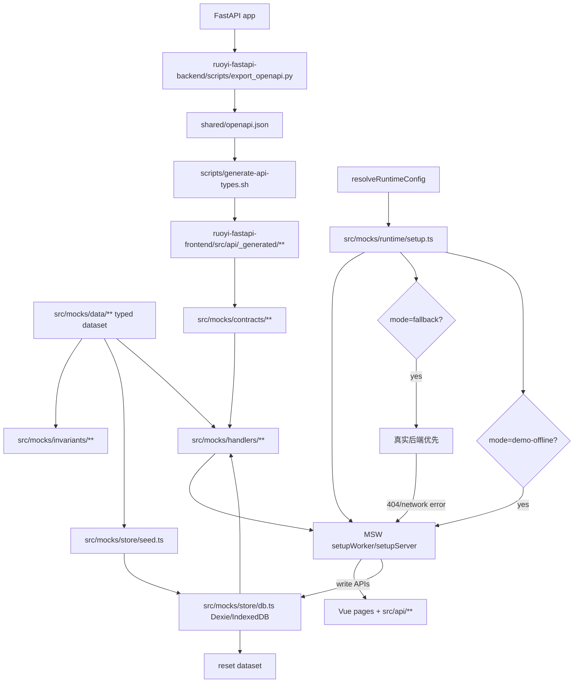
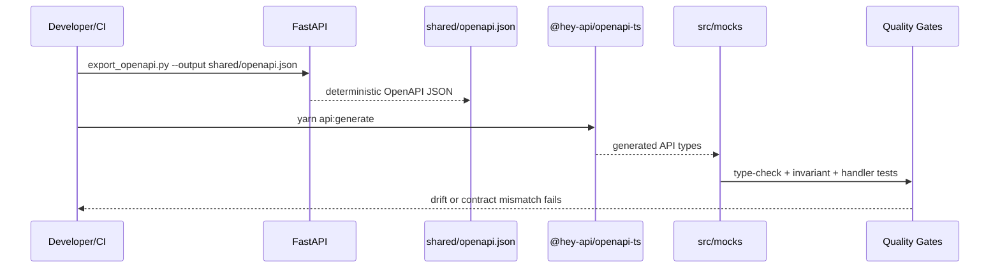

# Contract-first 单套 Mock 数据平台技术设计

## 架构概述

本设计把当前 mock 主线收敛为一条 contract-first、single-dataset、MSW-first 的目标架构：

1. 后端 FastAPI 通过确定性脚本导出 `shared/openapi.json`，该文件作为仓库内 OpenAPI artifact 提交。
2. 前端 `api:generate` 从 `shared/openapi.json` 生成 `src/api/_generated/**` 类型和客户端，不再默认依赖运行中的后端拉取契约。
3. `src/mocks/data/**` 按业务域维护唯一 typed mock dataset，`src/mocks/factories/**` 只负责确定性生成或补齐派生记录。
4. `src/mocks/handlers/**` 是唯一网络虚拟化层，`fallback` 和 `demo-offline` 复用同一套 handler 注册入口。
5. `demo-offline` 写操作使用 `src/mocks/store/**` 下的新轻量 Dexie/IndexedDB store，刷新后保留项目、版本、拓扑等演示修改，并提供 reset dataset 能力。
6. 旧 `src/demo/**`、`tools/demo-offline-mcp/**`、`DemoScenarioPackage`、`ScenarioRepository`、active/candidate/promote 不进入新主线扩展；它们在迁移期只作为 legacy 参考和逐域退场对象。

### 设计目标映射

| 需求 | 设计响应 |
| --- | --- |
| R1/R2 | 新增 `data`、`factories`、`handlers`、`store`、`invariants` 分层，并按 auth/system/project/simulation 域拆分。 |
| R3 | 增加后端 OpenAPI artifact 导出和 CI drift check，前端从 artifact 生成类型。 |
| R4 | `setupMockRuntime()` 统一 fallback 与 demo-offline 的 MSW 启动路径。 |
| R5 | 首批迁移 auth、system 菜单、project、version、topology；simulation 只读展示。 |
| R6/R7 | 固定 seed/refDate，并用 invariant 测试覆盖跨实体关系。 |
| R8 | 新建轻量 Dexie store，不复用旧 scenario runtime。 |
| R9/R10 | 固化本地和 CI 门禁，并更新 docs/runbook 标记 legacy 边界。 |

## 数据流图





## 组件与接口定义

### OpenAPI artifact 组件

新增或调整文件：

```text
ruoyi-fastapi-backend/scripts/export_openapi.py
shared/openapi.json
scripts/generate-api-types.sh
ruoyi-fastapi-frontend/src/api/_generated/**
```

`export_openapi.py` 负责从 `server.app` 读取 `app.openapi()`，稳定排序并写入 `shared/openapi.json`。建议支持：

```bash
cd ruoyi-fastapi-backend
python scripts/export_openapi.py --output ../shared/openapi.json
python scripts/export_openapi.py --output ../shared/openapi.json --check
```

`scripts/generate-api-types.sh` 改为默认读取 `shared/openapi.json`。如需从运行中后端临时抓取，可通过显式参数或单独命令保留 `BACKEND_URL/openapi.json` 调试路径，但 CI 不使用 live 后端抓取作为事实源。

### Mock runtime 组件

目标结构：

```text
ruoyi-fastapi-frontend/src/mocks/
  runtime/
    setup.ts
    unhandled.ts
    mode.ts
  handlers/
    auth.ts
    system.ts
    project.ts
    simulation.ts
    index.ts
  data/
    _shared/
      ids.ts
      time.ts
      constants.ts
    auth/
      accounts.ts
      roles.ts
      index.ts
    system/
      menus.ts
      dicts.ts
      depts.ts
      index.ts
    project/
      projects.ts
      versions.ts
      topologies.ts
      index.ts
    simulation/
      sessions.ts
      frames.ts
      index.ts
    index.ts
  factories/
    _shared/
      faker.ts
      sequence.ts
    project/
      project.factory.ts
      version.factory.ts
      topology.factory.ts
  store/
    db.ts
    seed.ts
    reset.ts
    datasource.ts
    repositories/
      auth.ts
      project.ts
      version.ts
      topology.ts
  contracts/
    response.ts
    local.ts
  invariants/
    auth.test.ts
    system.test.ts
    project.test.ts
    simulation.test.ts
    dataset.test.ts
```

`src/mocks/runtime/setup.ts` 对外提供唯一启动入口：

```ts
export interface MockRuntimeSetupOptions {
  mode: 'fallback' | 'demo-offline';
  apiPrefix: string;
  debug?: boolean;
}

export async function setupMockRuntime(options: MockRuntimeSetupOptions): Promise<void>;
```

启动规则：

| runtime mode | MSW strategy | 数据源 | 未覆盖 API |
| --- | --- | --- | --- |
| `real` | 不启动 | 真实后端 | 不适用 |
| `fallback` | `fallback` | 真实后端优先，失败后使用同一 dataset 派生 mock 响应 | 非 mock 请求旁路；API 合约测试可设为 error |
| `demo-offline` | `pure` | `src/mocks/store` 持久 store + typed dataset seed | 关键 `/api/**` 返回确定性错误并让验收暴露缺口 |

现有 `MockScenario = 'default' | 'pure'` 只表达 handler 组合，不再符合目标术语。设计上移除业务 scenario 概念，保留 `MockStrategy = 'fallback' | 'pure'` 或重命名为 `MockNetworkStrategy`。

### Data source 接口

Handlers 不直接操作 Dexie 表，也不直接散读静态数组；它们依赖统一 data source：

```ts
export interface MockDataSource {
  init(): Promise<void>;
  reset(): Promise<void>;
  auth: MockAuthRepository;
  system: MockSystemRepository;
  project: MockProjectRepository;
  version: MockProjectVersionRepository;
  topology: MockTopologyRepository;
  simulation: MockSimulationReadRepository;
}
```

首批 repository 职责：

| Repository | 首批能力 |
| --- | --- |
| `auth` | 登录账号、稳定 token/session、getInfo、logout、CSRF 占位。 |
| `system` | 菜单、角色权限、字典、部门树只读。 |
| `project` | 列表、详情、新增、编辑、删除、导出占位。 |
| `version` | 列表、详情、克隆、锁定、解锁、删除、导出占位。 |
| `topology` | 按 project/version 读取和保存拓扑。 |
| `simulation` | 会话状态、消息、带宽、告警、事件只读；首批不实现控制写操作。 |

### Legacy 边界

禁止新主线 import：

```text
@/demo/scenarios
@/demo/repositories/scenario
DemoScenarioPackage
ScenarioRepository
generatedScenarioRegistry
candidateScenarioRegistry
tools/demo-offline-mcp/**
```

允许短期只读参考旧测试或旧 service 行为，但迁移后的代码必须落在 `src/mocks/**`。

## API 接口设计

本 spec 不新增后端业务 HTTP API，不改变生产接口路径。API 设计分为三类：契约生成命令、前端 mock runtime 内部接口、浏览器演示调试接口。

### 契约生成命令

| 命令 | 说明 |
| --- | --- |
| `cd ruoyi-fastapi-backend && python scripts/export_openapi.py --output ../shared/openapi.json` | 导出确定性 OpenAPI artifact。 |
| `cd ruoyi-fastapi-backend && python scripts/export_openapi.py --output ../shared/openapi.json --check` | CI 检查当前后端契约是否与 artifact 漂移。 |
| `cd ruoyi-fastapi-frontend && yarn api:generate` | 从 `../shared/openapi.json` 生成前端 API 类型。 |

### MSW handler API

`handlers/index.ts` 目标接口：

```ts
export interface CreateMockHandlersOptions {
  strategy: MockNetworkStrategy;
  dataSource: MockDataSource;
  apiPrefix?: string;
  onMissingCapability?: 'error' | 'passthrough';
}

export function createMockHandlers(options: CreateMockHandlersOptions): MockRuntimeHandler[];
```

`withBackendFallback()` 保留核心语义：`fallback` 模式真实后端优先，非 404 透传，404 或网络异常回退 mock；`pure` 模式直接使用 mock response。

### Demo-offline reset API

为了满足持久可写后的重置需求，设计一个浏览器本地调试入口，默认只在 `demo-offline` 且 debug 开启时暴露：

```ts
declare global {
  interface Window {
    __MOCK_RUNTIME__?: {
      getMode(): 'fallback' | 'demo-offline';
      getDatasetVersion(): string;
      resetDataset(): Promise<void>;
      exportDatasetSnapshot(): Promise<unknown>;
    };
  }
}
```

该入口替代旧 `__DEMO_RUNTIME__` 的 scenario reset/export 语义，不暴露 MCP、AI provider 或远程写能力。

### 未覆盖 API 响应

`demo-offline` 对关键 `/api/**` 未覆盖请求返回确定性错误：

```json
{
  "code": 501,
  "msg": "MOCK_API_NOT_IMPLEMENTED: GET /api/example 尚未在单套 mock 主线中实现",
  "data": null
}
```

`fallback` 默认旁路非 API 请求；测试环境可配置 `onUnhandledRequest: 'error'`。

## 数据模型与数据库变更

### 后端数据库

无后端数据库变更。OpenAPI artifact 导出只读取 FastAPI app schema，不写业务数据库。

### 浏览器 IndexedDB

新增独立 Dexie DB，避免复用旧 `ruoyi-demo-offline` 和旧 scenario import 模型：

```ts
export const MOCK_DEMO_DB_NAME = 'ruoyi-mock-demo';

export class MockDemoDb extends Dexie {
  meta!: Table<MockMetaRecord, string>;
  accounts!: Table<MockAccount, string>;
  authSessions!: Table<MockAuthSession, string>;
  roles!: Table<MockRole, number>;
  menus!: Table<MockMenu, number>;
  dicts!: Table<MockDictData, number>;
  departments!: Table<MockDepartment, number>;
  projects!: Table<MockProject, number>;
  projectVersions!: Table<MockProjectVersion, number>;
  topologies!: Table<MockTopology, string>;
  simulationSessions!: Table<MockSimulationSession, string>;
  simulationMessages!: Table<MockSimulationMessage, string>;
  simulationEvents!: Table<MockSimulationEvent, string>;
  sequences!: Table<MockSequence, string>;
}
```

建议索引：

```ts
this.version(1).stores({
  meta: '&key',
  accounts: '&username, userId',
  authSessions: '&token, username, expiresAt',
  roles: '&roleId, roleKey, status',
  menus: '&menuId, parentId, path, menuName, menuType, *roles',
  dicts: '&id, dictType, dictValue, status',
  departments: '&deptId, parentId, status',
  projects: '&projectId, projectName, status, createTime',
  projectVersions: '&versionId, projectId, versionName, locked, createTime',
  topologies: '&id, projectId, versionId',
  simulationSessions: '&sessionId, projectId, versionId, status',
  simulationMessages: '&id, sessionId, timestamp',
  simulationEvents: '&eventId, sessionId, triggerTime',
  sequences: '&name',
});
```

### Meta 记录

`meta` 至少包含：

| key | value |
| --- | --- |
| `schemaVersion` | Dexie schema 版本。 |
| `datasetVersion` | typed dataset 版本。 |
| `datasetFingerprint` | 数据内容指纹，用于判断是否需要 reset 提示。 |
| `seededAt` | 首次 seed 时间。 |
| `lastResetAt` | 最近 reset 时间。 |

启动策略：

1. DB 不存在时，从 typed dataset seed。
2. `schemaVersion` 不兼容时执行设计中定义的迁移或 reset。
3. `datasetVersion` 更新但 schema 兼容时，不自动覆盖用户演示修改；通过提示或 debug reset 手动恢复。
4. `resetDataset()` 清空首批表并重新从 typed dataset seed。

### Typed dataset 模型

```ts
export interface MockDataset {
  version: string;
  referenceTime: string;
  auth: AuthMockData;
  system: SystemMockData;
  project: ProjectMockData;
  simulation: SimulationMockData;
}
```

所有 factory 必须接收或使用统一 deterministic context：

```ts
export interface MockFactoryContext {
  seed: string;
  referenceTime: string;
}
```

禁止稳定 dataset 直接使用 `Date.now()`、未固定 `faker.date.recent()` 或未 seed 的随机数。

## 安全考量

1. 生产模式 `real` 不启动 MSW，不初始化 `src/mocks/store`，不暴露 `__MOCK_RUNTIME__`。
2. demo-offline token、CSRF、WebSocket ticket 仅为浏览器本地演示凭据，不代表真实生产身份。
3. IndexedDB 数据受浏览器 origin 隔离，但仍是本地可读数据；不得写入真实客户 secret、API key 或生产 token。
4. OpenAPI artifact 只允许包含接口契约，不应包含环境变量、密钥、内部主机凭据或示例敏感数据。
5. `tools/demo-offline-mcp/**` 不得被前端 runtime import，也不得进入 `dist` 或 `dist-demo-offline` bundle。
6. reset/export debug 能力只在 `demo-offline` 或测试环境启用，生产构建必须不可用。
7. CI 应扫描 `dist-demo-offline`，确认不包含 MCP server、AI provider SDK、API key 或模型调用配置。

## 测试策略

### 契约与类型

```bash
cd ruoyi-fastapi-backend
python scripts/export_openapi.py --output ../shared/openapi.json --check

cd ../ruoyi-fastapi-frontend
yarn api:generate
yarn type-check
```

检查点：

- OpenAPI artifact 与后端当前契约一致。
- `src/api/_generated/**` 与 artifact 同步。
- mock data、handler response、local contracts 无类型漂移。

### Dataset invariant

新增测试：

```text
src/mocks/invariants/dataset.test.ts
src/mocks/invariants/auth.test.ts
src/mocks/invariants/system.test.ts
src/mocks/invariants/project.test.ts
src/mocks/invariants/simulation.test.ts
```

必须覆盖：

- 账号、角色、权限、菜单引用有效。
- project/version/topology 外键有效。
- version lock/unlock 后状态一致。
- topology 按 projectId/versionId 可追溯。
- simulation 只读数据引用存在的 project/version。
- 必填展示字段不为空，枚举值合法，关键 ID 唯一。

### Store 测试

新增测试：

```text
src/mocks/store/db.test.ts
src/mocks/store/seed.test.ts
src/mocks/store/reset.test.ts
src/mocks/store/repositories/project.test.ts
src/mocks/store/repositories/topology.test.ts
```

必须覆盖：

- 首次启动 seed。
- 刷新后持久记录仍可读。
- reset 后恢复 typed dataset。
- datasetVersion/schemaVersion 变化路径。
- 不 import `@/demo/scenarios`、`ScenarioRepository`、`DemoScenarioPackage`。

### Handler 测试

新增或迁移测试：

```text
src/mocks/handlers/auth.test.ts
src/mocks/handlers/system.test.ts
src/mocks/handlers/project.test.ts
src/mocks/handlers/simulation.test.ts
src/mocks/runtime/setup.test.ts
```

必须覆盖：

- `fallback`：上游成功透传、上游 404 回退、网络异常回退。
- `demo-offline`：关键 API 全部由 MSW 返回。
- project/version/topology 写操作刷新后仍可读。
- simulation 控制写操作首批返回明确不支持，simulation 只读接口正常。
- 未覆盖关键 `/api/**` 返回确定性 `501`。

### 构建验收

```bash
cd ruoyi-fastapi-frontend
yarn lint:check
yarn type-check
yarn test:run
yarn build:prod
yarn build:demo-offline
```

验收点：

- `build:prod` 不启动 mock runtime，不包含 demo-only debug 暴露。
- `build:demo-offline` 可在静态 HTTP 服务下启动 MSW，并使用 `src/mocks/store`。
- 文档更新后，`src/mocks/README.md` 不再把 MCP 或多场景 runtime package 描述为当前主线。

### 静态规则

建议新增脚本 `scripts/check-mock-mainline.sh`：

- 禁止 `src/mocks/**` import `@/demo/scenarios`。
- 禁止 `src/mocks/**` 出现 `@ts-nocheck`。
- 禁止稳定 data/factory 中出现未封装的 `Date.now()`。
- 禁止新文档把 MCP/candidate/promote 写成当前验收主路径。
