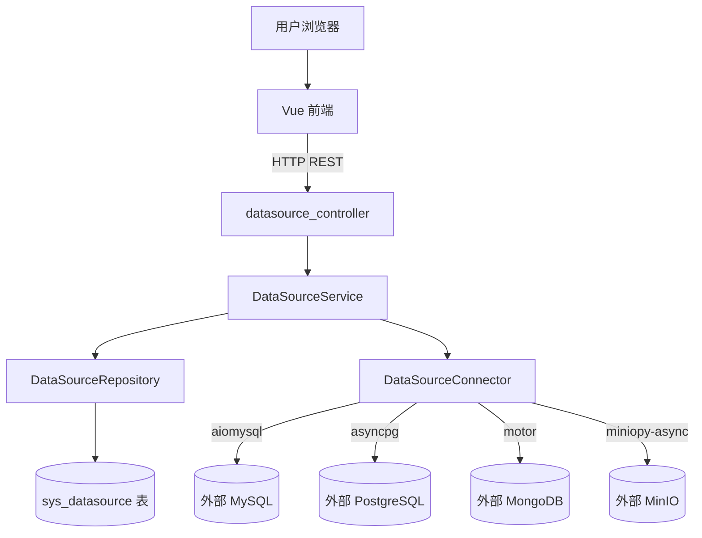
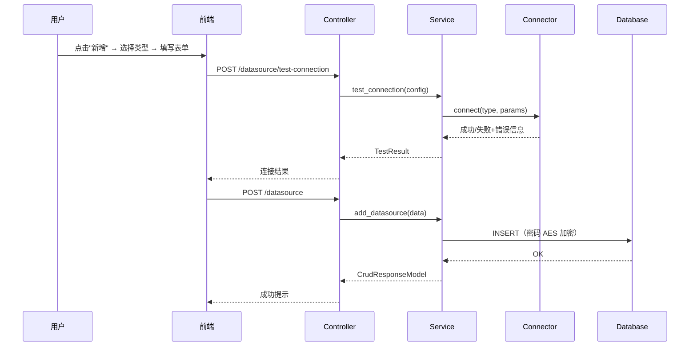

# 数据源接入管理 技术设计

## 架构概述

本模块沿用项目已有的分层架构：Controller → Service → Repository → Entity，通过 DI 容器（`container/providers.py`）装配依赖。新增一组完整的数据源管理链路，不影响现有模块。

**后端新增文件清单：**
- `module_admin/entity/do/datasource_do.py` — SQLAlchemy 模型
- `module_admin/entity/vo/datasource_vo.py` — Pydantic VO
- `module_admin/repository/datasource_repository.py` — 数据访问层
- `module_admin/service/datasource_service.py` — 业务逻辑层
- `module_admin/service/datasource_connector.py` — 连通性测试工具
- `module_admin/controller/datasource_controller.py` — API 路由
- `alembic/versions/xxxxxxxx_add_datasource_table.py` — 数据库迁移

**前端新增文件清单：**
- `src/api/datasource/datasource.ts` — API 调用
- `src/views/datasource/index.vue` — 入口页
- `src/views/datasource/components/DataSourceList.vue` — 列表组件
- `src/views/datasource/components/DataSourceWizard.vue` — 新增向导（两步）
- `src/views/datasource/components/DataSourceForm.vue` — 编辑表单

## 数据流图





## 组件与接口定义

### 1. 数据源实体（DO）

文件：`module_admin/entity/do/datasource_do.py`

继承 `BaseModel`（含 id、时间戳、审计字段、软删除），参考 `device_category_do.py`（`module_admin/entity/do/device_category_do.py:7`）。

```python
class DataSourceDO(BaseModel):
    __tablename__ = 'sys_datasource'

    name         # String(100), unique, not null
    type         # String(20), not null — mysql/mongodb/minio/postgresql
    host         # String(255), not null
    port         # Integer, not null
    username     # String(100)
    password     # sensitive_string() — 使用 EncryptedString 透明加解密
    database_name # String(100) — MySQL/PG 为库名，MinIO 为 bucket
    description  # String(500)
    status       # String(10), default='offline'
    extra_config # JSON — 各类型独有配置
```

密码字段使用项目已有的 `sensitive_string()` 类型（`utils/sensitive/types.py:31`），入库时自动 AES-GCM 加密，读取时自动解密。

### 2. 视图对象（VO）

文件：`module_admin/entity/vo/datasource_vo.py`

继承 `CamelModelBase`，参考 `device_category_vo.py`（`module_admin/entity/vo/device_category_vo.py:1`）。

- `DataSourceQueryModel` — 列表查询参数（名称、类型、状态、分页）
- `DataSourceModel` — 新增/编辑请求体
- `DataSourceDetailModel` — 详情返回（密码字段返回空字符串）
- `TestConnectionModel` — 连通性测试请求体（不含 id，只含连接参数）

### 3. Repository

文件：`module_admin/repository/datasource_repository.py`

继承 `BaseRepository[DataSourceDO]`（`module_admin/repository/base_repository.py:97`），新增方法：
- `paginate_with_filters(page, page_size, name, type, status)` — 带条件分页查询
- `find_by_name(name)` — 名称唯一性校验

同时在 `ports/repositories.py` 新增 `IDataSourceRepository` 接口。

### 4. Service

文件：`module_admin/service/datasource_service.py`

构造函数注入 `IDataSourceRepository` + `AsyncSession`，参考 `DeviceCategoryService`（`module_admin/service/device_category_service.py:13`）。

核心方法：
- `get_datasource_list_services(query)` — 分页查询
- `datasource_detail_services(id)` — 详情（密码脱敏）
- `add_datasource_services(data, current_user)` — 新增（名称唯一校验）
- `edit_datasource_services(data, current_user)` — 编辑（密码未修改则跳过）
- `delete_datasource_services(ids)` — 软删除
- `test_connection_services(config)` — 连通性测试代理

### 5. 连通性测试工具

文件：`module_admin/service/datasource_connector.py`

纯工具类，不依赖数据库会话。根据 `type` 字段分发到具体的连接测试函数：

```python
async def test_connection(type: str, host: str, port: int,
                          username: str, password: str,
                          database_name: str, extra_config: dict) -> TestResult:
    match type:
        case 'mysql':      return await _test_mysql(...)
        case 'postgresql':  return await _test_postgresql(...)
        case 'mongodb':     return await _test_mongodb(...)
        case 'minio':       return await _test_minio(...)
        case _:             raise ValueError(f'不支持的数据源类型: {type}')
```

各测试函数设置 5 秒超时，捕获所有异常并转换为结构化 `TestResult(success: bool, message: str, latency_ms: int)`。

### 6. Controller

文件：`module_admin/controller/datasource_controller.py`

路由前缀 `/datasource`，参考 `device_category_controller.py`（`module_admin/controller/device_category_controller.py:16`）。权限标识前缀 `datasource:`。

### 7. DI 容器注册

在 `container/providers.py`（`container/providers.py:402`）新增 `_datasource_service_factory` 工厂函数，并注册到 `SERVICE_FACTORY_REGISTRY`。

### 8. 前端组件

**API 模块**（`src/api/datasource/datasource.ts`）：参考 `api/system/post.ts`（`src/api/system/post.ts:1`）。

```typescript
export function listDataSource(query?)          // GET /datasource/list
export function getDataSource(id)               // GET /datasource/{id}
export function addDataSource(data)             // POST /datasource
export function updateDataSource(data)          // PUT /datasource
export function delDataSource(ids)              // DELETE /datasource/{ids}
export function testDataSourceConnection(data)  // POST /datasource/test-connection
```

**页面组件结构**：参考 `views/system/post/` 的 `index.vue` + `PostList.vue` + `PostDlg.vue` 模式。

- `DataSourceList.vue` — 使用 `ZxGridList` 展示列表，操作列含编辑/测试/删除按钮，搜索栏含名称输入框 + 类型下拉
- `DataSourceWizard.vue` — 两步向导 Dialog：
  - Step 1：四张类型卡片（MySQL/MongoDB/MinIO/PostgreSQL），卡片含图标 + 名称，选中高亮
  - Step 2：动态表单，根据所选类型渲染通用字段 + 特有字段，底部"测试连接"按钮
- `DataSourceForm.vue` — 编辑时复用的表单组件，类型只读

## API 接口设计

### 列表查询
```
GET /datasource/list?name=&type=&status=&pageNum=1&pageSize=10
权限: datasource:list
响应: { code: 200, rows: [...], total: number }
```

### 详情
```
GET /datasource/{id}
权限: datasource:query
响应: { code: 200, data: { ...datasource, password: "" } }
```

### 新增
```
POST /datasource
权限: datasource:add
请求体: DataSourceModel（含 password 明文，服务层加密后存储）
响应: { code: 200, msg: "新增成功" }
```

### 编辑
```
PUT /datasource
权限: datasource:edit
请求体: DataSourceModel（password 为空字符串表示不修改）
响应: { code: 200, msg: "修改成功" }
```

### 删除
```
DELETE /datasource/{ids}
权限: datasource:remove
ids: 逗号分隔的 ID 列表
响应: { code: 200, msg: "删除成功，共删除N条记录" }
```

### 连通性测试
```
POST /datasource/test-connection
权限: datasource:query
请求体: TestConnectionModel（type, host, port, username, password, database_name, extra_config）
响应: { code: 200, data: { success: bool, message: str, latencyMs: int } }
```

## 数据模型与数据库变更

新增表 `sys_datasource`：

| 列名 | 类型 | 约束 | 说明 |
|------|------|------|------|
| id | BIGINT | PK, AUTO_INCREMENT | 主键 |
| name | VARCHAR(100) | UNIQUE, NOT NULL | 数据源名称 |
| type | VARCHAR(20) | NOT NULL | 类型枚举 |
| host | VARCHAR(255) | NOT NULL | 主机地址 |
| port | INT | NOT NULL | 端口 |
| username | VARCHAR(100) | | 用户名 |
| password | VARCHAR(500) | | 密码（AES-GCM 加密） |
| database_name | VARCHAR(100) | | 数据库名/存储桶 |
| description | VARCHAR(500) | | 描述 |
| status | VARCHAR(10) | DEFAULT 'offline' | 连接状态 |
| extra_config | JSON | | 类型独有配置 |
| create_by | VARCHAR(64) | | 创建者 |
| update_by | VARCHAR(64) | | 更新者 |
| create_time | DATETIME | | 创建时间 |
| update_time | DATETIME | | 更新时间 |
| is_deleted | BOOLEAN | DEFAULT FALSE | 软删除标记 |
| deleted_at | DATETIME | | 删除时间 |

通过 Alembic 迁移脚本创建，无需修改现有表。

**`extra_config` 各类型结构示例：**

- MySQL: `{}`（无额外配置）
- PostgreSQL: `{}`（无额外配置）
- MongoDB: `{ "auth_source": "admin" }`
- MinIO: `{ "use_ssl": false }`

## 安全考量

- **密码加密存储**：使用项目已有的 `EncryptedString` 类型（`utils/sensitive/types.py:12`），基于 AES-GCM 算法，master key 来自 `SENSITIVE_DATA_KEY` 配置。密码字段入库自动加密、读取自动解密，对上层透明。
- **密码脱敏返回**：详情接口在 Service 层将 password 字段置为空字符串后返回，避免前端拿到明文。
- **连通性测试安全**：测试连接时临时创建连接并立即关闭，不维持长连接池。测试超时设为 5 秒，避免长时间阻塞。
- **权限控制**：所有接口通过 `CheckUserInterfaceAuth` 校验 `datasource:*` 权限，需在菜单表中配置对应权限标识。
- **软删除**：删除操作执行软删除（`is_deleted` + `deleted_at`），数据可恢复。

## 测试策略

### 后端单元测试

| 测试文件 | 覆盖内容 |
|---------|---------|
| `tests/unit/services/test_datasource_service.py` | Service 层：CRUD 逻辑、名称唯一校验、密码跳过更新、软删除 |
| `tests/unit/services/test_datasource_connector.py` | Connector：各类型连接成功/失败/超时场景（mock 外部连接库） |
| `tests/unit/repositories/test_datasource_repository.py` | Repository：分页查询、按名称查找、软删除过滤 |

### 前端测试

| 测试文件 | 覆盖内容 |
|---------|---------|
| `src/views/datasource/__tests__/DataSourceWizard.spec.ts` | 向导两步流程：类型选择 → 表单动态渲染 → 字段校验 |
| `src/views/datasource/__tests__/DataSourceList.spec.ts` | 列表加载、搜索筛选、删除确认 |

### 关键测试场景
- 新增 MySQL 数据源 → 密码加密存储 → 详情返回密码为空（R2.AC6, R6.AC1）
- 编辑时不修改密码 → 密码字段不被覆盖（R3.AC3）
- 名称重复 → 返回错误（R2.AC7）
- 连通性测试成功/失败/超时各一用例（R5.AC1~AC4）
- 软删除后列表不可见（R4.AC1）
