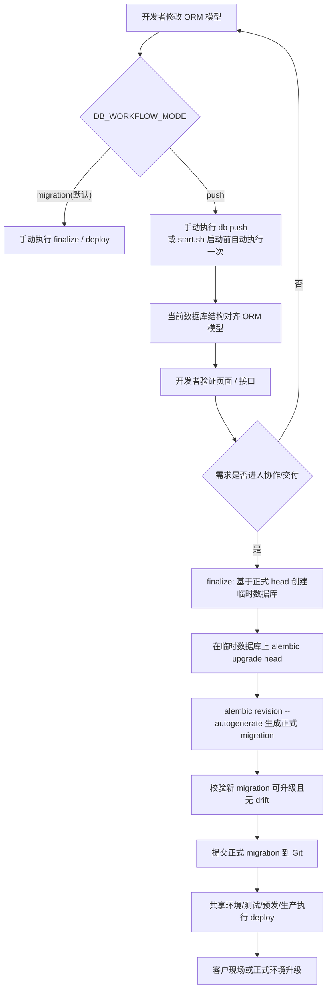

# 数据库双阶段工作流 技术设计

> 注：当前仓库的公开 CLI 已进一步收敛为 `python scripts/db.py dev-sync/finalize/deploy/status/verify`，公开 `push` 命令已移除。本文保留为历史双阶段方案记录。

## 架构概述
当前仓库的数据库 schema 变更入口同时存在三条路径：
- 根目录启动脚本在启动后端前执行 `alembic upgrade head`，见 `scripts/start.sh:124`
- Docker 入口在容器启动阶段执行 `alembic upgrade head`，见 `ruoyi-fastapi-backend/docker-entrypoint.sh:27`
- FastAPI 生命周期在应用启动时调用 `Base.metadata.create_all()`，见 `ruoyi-fastapi-backend/server.py:164` 和 `ruoyi-fastapi-backend/config/get_db.py:60`

这三条路径并存会导致职责冲突：
- 开发者无法明确判断“本次 schema 是靠 migration 还是靠运行时补表生效”
- `create_all()` 只能补齐缺失表，无法承担正式演进已有表结构
- 一旦尝试快速迭代，就会持续向正式 `alembic/versions` 里写入试错型 migration

本设计将数据库工作流收敛为两条显式路径：
- `push` 路径：只用于个人快速验证阶段，通过显式环境变量开启；手动执行 `db push` 或由 `scripts/start.sh` 在启动前执行一次；目标是让当前数据库结构快速对齐 ORM 模型，不生成正式 migration 历史
- `migration` 路径：默认路径，也是共享环境、测试、预发、生产和客户升级的唯一正式路径；通过 `finalize` 生成正式 Alembic migration，并通过 `deploy` 或现有 `alembic upgrade head` 完成升级

为避免再次引入第四条隐式路径，本设计要求：
- 非测试环境下移除运行时 `create_all()` 对 schema 的直接修改职责
- 所有 schema 变更都只能来自显式工作流命令或启动脚本模式分发
- 正式 migration 继续保留 Alembic 为唯一事实来源
- `db push` 引擎作为开发态适配层存在，不接管正式交付链路

推荐实现上采用“开发态 `push` 适配器 + 正式态 Alembic”的组合：
- `push` 适配器推荐使用 Atlas SQLAlchemy provider 承担 state-based schema apply
- Alembic 继续负责 `finalize` 产出和 `deploy` 执行
- 如果未来替换 `push` 引擎，只影响适配器实现，不影响正式 migration 历史与交付流程

## 数据流图

## 组件与接口定义
### 1. `config/env.py`
新增数据库工作流配置项，保持“默认 migration、显式开启 push”的约束：
- `db_workflow_mode: Literal['migration', 'push'] = 'migration'`
- `db_push_on_startup: bool = True`
- `db_push_engine: str = 'atlas'`

设计约束：
- `migration` 为默认值，保证现有环境不改配置时继续走正式迁移流程
- `push` 只是一种显式 opt-in 模式，不通过 `APP_ENV` 自动推断
- `db_push_on_startup` 只影响 `scripts/start.sh`，不影响 Docker 入口和正式部署流程

### 2. `ruoyi-fastapi-backend/scripts/db.py`
新增 Python CLI，作为高层数据库工作流入口，统一暴露 4 类能力：
- 历史快速同步阶段（`push`）
- `finalize --message "<描述>"`
- `deploy [--revision head]`
- `status`

采用 Python 实现而不是纯 shell，原因是：
- 可以直接复用 `ruoyi-fastapi-backend/config/env.py` 的配置加载逻辑
- 可以复用当前统一 verify service 的数据库准备与校验逻辑
- 便于输出结构化模式信息和错误提示

子命令职责：
- 历史快速同步阶段
  - 读取当前 `DB_*` 连接
  - 输出目标库、当前模式、是否允许破坏性变更
  - 调用 `push` 适配器把当前数据库结构同步到 `Base.metadata`
  - 不生成正式 migration 文件
- `finalize`
  - 创建临时 finalize 数据库
  - 在临时数据库上先执行正式 `alembic upgrade head`
  - 再对该临时数据库执行 `alembic revision --autogenerate`
  - 生成正式 migration 后再次校验升级链和 drift
  - 成功后删除临时数据库
- `deploy`
  - 包装现有 `alembic upgrade <revision>`
  - 用于共享环境、测试、预发、生产和客户升级流程
- `status`
  - 输出当前 `DB_WORKFLOW_MODE`
  - 输出当前 `DB_*` 目标库
  - 输出本次启动是否会在启动前自动执行一次 `db push`

### 3. `push` 适配器
本设计将 `push` 视为可替换适配器，而不是正式迁移系统。

推荐实现：
- 新增 `ruoyi-fastapi-backend/scripts/db_push_atlas.py`
- 新增 `ruoyi-fastapi-backend/atlas.hcl`
- 使用 `atlas-provider-sqlalchemy` 的 Script Mode 读取 `Base.metadata`
- 由历史快速同步子命令调用 `atlas schema apply --auto-approve`

这样做的原因：
- `push` 需要 state-based schema apply，而 Alembic 的优势在 versioned migrations
- 将 Atlas 限定在开发态 `push`，不会让其成为生产 migration 唯一真相源
- 即使未来替换为其他 `push` 引擎，高层 `db.py` 和正式 Alembic 链路仍可保持不变

### 4. `scripts/start.sh`
将现有数据库初始化分发逻辑改为模式驱动：
- 保留数据库连通性检查
- 保留虚拟环境激活
- 在启动后端前调用 `python scripts/db.py status`
- 若 `DB_WORKFLOW_MODE=push` 且 `DB_PUSH_ON_STARTUP=true`，执行一次历史快速同步子命令
- 否则执行现有正式迁移路径 `python scripts/db.py deploy --revision head`

现有 `scripts/start.sh:124` 中直接调用 `alembic upgrade head` 的逻辑将被收敛到 `db.py deploy`。

### 5. `config/get_db.py` 与 `server.py`
当前运行时 `create_all()` 是第三条隐式 schema 修改路径，见 `ruoyi-fastapi-backend/config/get_db.py:68`。

设计调整：
- `init_create_table()` 改名或保留但只在测试环境生效
- 非测试环境下，该函数只做连接可用性检查，不再修改 schema
- `ruoyi-fastapi-backend/server.py:164` 仍可调用该入口，但其语义变为“初始化数据库运行时连接”，而不是“自动补表”

这样可以保证：
- 开发态 schema 修改来自 `push` / `deploy`
- 正式环境 schema 修改只来自 `deploy`
- 测试环境仍可保留内存 SQLite + `create_all()` 的现有模式

### 6. Docker 与正式部署
正式部署链路保持 migration-only：
- `ruoyi-fastapi-backend/docker-entrypoint.sh:27` 继续只执行 `alembic upgrade head`
- 不在容器或生产启动链路中引入 `push`
- 如果需要统一入口，可让 Docker 改为调用 `python scripts/db.py deploy --revision head`，但行为不变

### 7. CI 漂移校验
复用现有统一 verify 能力，作为团队治理闸门：
- PR、主干、发布分支继续校验正式 migration 与 ORM 模型是否漂移
- 该检查只针对正式 migration 历史，不感知个人开发期的 `push`
- `finalize` 成功后应保证 `command.check()` 可通过

## API 接口设计
本特性不新增 HTTP API，对外接口为 CLI 与环境变量约定。

### CLI 约定
#### 历史 `push` 快速同步阶段
用途：
- 在显式 `push` 模式下，将当前 `DB_*` 指向的数据库同步到 ORM 模型状态

输出约定：
- 当前模式
- 目标数据库连接摘要（host、port、database）
- 是否由启动脚本触发
- 执行结果摘要
- 若包含破坏性变更，明确输出风险提示

失败语义：
- `DB_WORKFLOW_MODE` 非 `push` 时返回非零
- `push` 适配器缺失或命令失败时返回非零

#### `python scripts/db.py finalize --message "<描述>"`
用途：
- 为当前代码状态生成正式 Alembic migration

关键约束：
- `finalize` 不直接基于已 `push` 的个人库 autogenerate
- 必须先创建临时 finalize 数据库，并将其升级到当前正式 head
- 然后在临时 finalize 数据库上执行 autogenerate，确保生成的是“正式 head -> 当前 models”的差异

输出约定：
- 临时数据库名称
- 当前正式 head
- 新生成 revision 文件路径
- 校验结果

#### `python scripts/db.py deploy --revision head`
用途：
- 在共享环境和正式环境执行正式 migration

行为：
- 内部调用现有 Alembic `upgrade`
- 失败时返回非零并保留 Alembic 错误信息

#### `python scripts/db.py status`
用途：
- 输出当前工作流模式与启动行为

输出字段：
- `workflow_mode`
- `db_target`
- `db_push_on_startup`
- `deploy_path`

### 环境变量约定
- `DB_WORKFLOW_MODE`
  - `migration`
  - `push`
- `DB_PUSH_ON_STARTUP`
  - `true`
  - `false`
- `DB_PUSH_ENGINE`
  - 初始值为 `atlas`
- 继续沿用现有 `DB_TYPE/DB_HOST/DB_PORT/DB_USERNAME/DB_PASSWORD/DB_DATABASE`

兼容策略：
- 现有 `RUN_ALEMBIC_MIGRATION` 保留一个过渡版本，但内部映射到 `db.py deploy`
- 新逻辑稳定后可废弃 `RUN_ALEMBIC_MIGRATION`

## 数据模型与数据库变更
本特性不引入新的业务表，也不改变业务域模型；变更集中在 schema 工作流与工具层。

数据库层约束：
- 正式环境仍以 `alembic_version` 作为正式 migration 历史表
- `push` 模式不要求新增数据库元数据表来追踪个人开发历史
- `finalize` 使用临时 finalize 数据库，而不是污染个人开发库或共享环境数据库

正式 migration 生成策略：
- 起点：当前 Git 中正式 `alembic/versions` 的 head
- 终点：当前代码中的 ORM 元数据
- 生成位置：正式 `ruoyi-fastapi-backend/alembic/versions/`

这意味着：
- 个人开发阶段可以反复 `push`
- 但真正进入 Git 历史和客户升级链路的，只是 `finalize` 产出的最终 migration

运行时行为变更：
- 测试环境继续允许 `create_all()`
- 非测试环境不再依赖 `create_all()` 自动补表

## 安全考量
本特性最大的风险不是 HTTP 面暴露，而是开发者对错误数据库执行 `push`。

基于已确认需求，本设计不引入额外的共享库识别或 host 规则拦截，因此安全边界来自显式工作流约束：
- 默认模式为 `migration`
- 只有显式设置 `DB_WORKFLOW_MODE=push` 才允许 `push`
- `push` 只通过本地 CLI 或启动脚本触发，不通过 HTTP 暴露
- 输出中必须清晰展示当前目标数据库，降低误操作隐性风险
- 破坏性变更执行前必须给出明确日志提示

正式环境保护：
- Docker 与生产部署链路保持 migration-only
- 正式发布前仍依赖 CI drift check
- 未 `finalize` 的 schema 变更不得进入客户交付链路

## 测试策略
### 单元测试
- `db.py` 模式分发测试
- 环境变量解析测试
- `push` / `finalize` / `deploy` 命令参数校验测试
- `status` 输出字段测试

### 集成测试
- `DB_WORKFLOW_MODE=migration` 时，`scripts/start.sh` 走 deploy 路径
- `DB_WORKFLOW_MODE=push` 且 `DB_PUSH_ON_STARTUP=true` 时，`scripts/start.sh` 在启动前执行一次 push
- 非测试环境下，应用启动不再执行 `create_all()`
- `finalize` 能在临时数据库上生成正式 migration
- 新生成 migration 应用于临时数据库后，`command.check()` 无 drift

### 回归测试
- Docker 入口仍能完成正式 migration + seed
- 现有 `db.py verify` 在 PR 阶段继续可用
- 现有 Alembic upgrade/downgrade 流程不被 `push` 适配器污染

### 人工验收
- 个人开发者在 `push` 模式下修改模型，重启 `scripts/start.sh` 后页面和接口立即可验证
- 切回 `migration` 模式后，共享环境仍只依赖正式 migration
- 某需求经历“push -> finalize -> deploy”后，客户升级链路可重复执行
