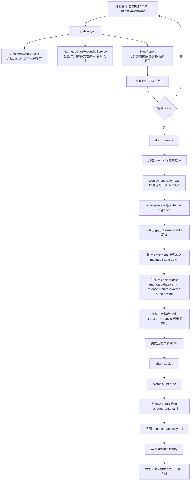
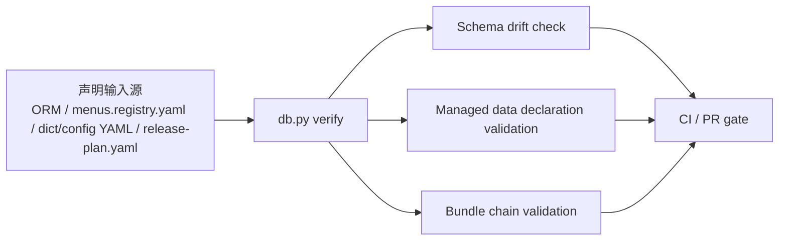

# 统一数据库交付工作流 技术设计

> 注：当前仓库公开 CLI 已收敛为 `python scripts/db.py dev-sync/finalize/deploy/status/verify/bootstrap-seed`，`push` 兼容别名已删除。本文中的过渡期描述仅保留为设计历史。

## 架构概述
当前仓库已经完成了数据库工作流的统一入口收敛，但这份设计文档记录的是“从分散链路收口”的演进背景：
- `ruoyi-fastapi-backend/scripts/db.py` 现已统一 `status/dev-sync/finalize/deploy/verify/bootstrap-seed` 等公开子命令。
- `scripts/start.sh` 通过轻量 `status` 结果在启动前分发到 `dev-sync` 或 `deploy`。
- 菜单声明由统一数据库工作流与开发态同步运行时共同消费，但不再暴露独立旧脚本入口。
- Docker/正式链路已经收敛为 `wait-db -> deploy -> bootstrap-seed`。
- 统一校验入口为 `python scripts/db.py verify`，不再保留独立 drift 检查脚本。

这意味着当前系统已经具备“开发态 schema 快速同步”和“正式态 migration-only”的基础，但还没有实现“数据库所有变化统一纳管”。因此会出现：
- 开发态 schema 已经同步，但菜单/权限/字典/配置没有同步。
- 菜单声明非法时，运行时热同步失败，旧数据继续残留在库里。
- 部署者理解的是 `deploy + bootstrap-seed`，开发者理解的是 `dev-sync + 热同步 + 增量 SQL`，两套心智并存。

目标架构收敛为一个统一数据库工作流系统，在内部维护三类受管域，但对开发者和部署者只暴露一套命令模型：
- `schema`
- `managed reference data`
- `release visibility`

统一后的原则如下：
- 开发态和部署态共享同一个 `db.py` 入口，只允许阶段不同，不允许机制不同。
- 正式环境继续只依赖 Git 中的正式产物，不运行开发态快速同步。
- `menus.registry.yaml` 保留为声明输入源，但不再单独形成运行时流程。
- `bootstrap-seed` 保留 bootstrap 职责，但退出日常菜单/字典/配置发布链。
- `DEV_MENU_SYNC`、`apply_sql_updates` 这类旁路不再作为面向开发者的独立生效路径存在。

统一后的工作流命令模型为：
- `dev-sync`：开发态唯一同步入口，统一处理 schema 与受管引用数据。
- `finalize`：冻结阶段唯一正式化入口，同时产出 schema migration、受管数据产物、release manifest。
- `deploy`：正式环境唯一部署入口，顺序执行 schema -> managed data -> release manifest。
- `status`：统一状态查询入口。
- `verify`：统一校验入口，供 CI、本地检查、发布前检查复用。

为保证上线零破坏，本设计采用“收口而不推翻”的兼容策略：
- 现有 `db.py deploy --revision head` 保持不变，先继续作为 deploy 主入口。
- 当前实现已完成硬切，不再保留 `push` 兼容别名。
- Docker 入口先保持 `deploy` 调用方式不变，只把受管数据发布接到 deploy 后半段，未生成产物时按 no-op 通过。
- `bootstrap-seed` 先拆分职责，再逐步退出菜单/字典/配置日常发布链。

## 数据流图


补充的状态与治理流如下：


## 组件与接口定义
### 1. `ruoyi-fastapi-backend/scripts/db.py`
该文件继续作为唯一高层 CLI 入口，但需要从“schema 工作流入口”升级为“统一数据库工作流入口”。

目标子命令：
- `dev-sync`
- `finalize --message "<描述>"`
- `deploy [--revision head]`
- `status [--format shell|json]`
- `verify [--ci]`

内部编排职责：
- 读取 `config/env.py` 中现有 `DataBaseWorkflowStatus` 和新增的统一工作流配置。
- 统一调度 schema、managed data、release visibility 三个阶段。
- 输出统一的结构化状态与错误信息，供 `scripts/start.sh`、Docker、CI 和人工运行共享。

推荐拆分为以下内部 service：
- `SchemaSyncService`
- `ManagedDataSyncService`
- `ReleaseBundleService`
- `WorkflowStatusService`
- `WorkflowVerifyService`

### 2. `SchemaSyncService`
该组件继续复用现有 Atlas + Alembic 双引擎模型，不改变已验证的 schema 设计。

职责分工：
- 开发态：复用现有 `_load_schema_apply_runner()` 和 `schema_apply_atlas.py`，执行 state-based schema apply。
- 冻结态：复用现有临时库 finalize 逻辑，基于正式 migration head 生成 Alembic revision。
- 部署态：复用现有 `command.upgrade()`。

设计约束：
- `SchemaSyncService` 不再单独对开发者暴露为 `push` 概念，而作为 `dev-sync` 的第一阶段。
- `finalize` 允许出现三种结果：
  - schema-only
  - data-only
  - schema + data
- 若 schema 无差异，则不生成空 migration；若 data 也无差异，则 `finalize` 明确返回 no-op。

### 3. `ManagedDataDeclarationLoader`
新增统一声明加载器，负责把“受管引用数据”从分散实现中抽离出来，形成统一 target state。

第一阶段受管范围：
- 菜单与角色菜单：继续读取 `scripts/seed_data/menus.registry.yaml`
- 字典类型 / 字典项：读取 `scripts/seed_data/base/dict_types.yaml`、`dict_data.yaml`
- 系统配置：读取 `scripts/seed_data/base/configs.yaml`
- 发布计划输入：读取固定路径 `scripts/seed_data/release-plan.yaml`

不在第一阶段日常发布链中的 bootstrap 数据：
- 用户
- 部门
- 岗位
- 用户岗位
- 角色部门

加载器输出三个视图：
- `dev target state`：开发态全量目标态，用于 `dev-sync`
- `formal candidate state`：冻结态候选目标态，用于和正式基线比对
- `release selection`：本次发布范围，用于生成 `release.manifest.yaml`

### 4. `ManagedDataPlanner`
新增统一 diff/planner 组件，负责把声明态差异转成可审计、可部署的正式数据操作。

职责：
- 比对“正式基线数据库状态”和“当前受管声明目标态”
- 生成规范化操作序列，而不是直接操作数据库
- 支持以下操作类型：
  - `upsert-row`
  - `delete-row`
  - `ensure-link`
  - `remove-link`

第一阶段支持的实体类型：
- `sys_menu`
- `sys_role_menu`
- `sys_dict_type`
- `sys_dict_data`
- `sys_config`

设计说明：
- 现有 `DevMenuReconcileService` 中关于菜单 diff 与 prune 的逻辑可下沉复用，但不再直接作为运行时热同步入口。
- 字典与配置沿用同样的 planner/applier 模型，不再依赖 `bootstrap-seed` 的“表为空才初始化”语义。

### 5. `ManagedDataApplier`
新增受管数据执行器，负责在 `dev-sync` 与 `deploy` 中以同一套规则写库。

职责：
- `dev-sync`：对个人开发库应用“全量目标态”，失败则整个同步失败。
- `deploy`：对正式环境按 release bundle 顺序应用“正式操作序列”，失败即停。
- 只操作“受管对象”，不修改 bootstrap 数据。

实现要求：
- 必须支持幂等执行。
- 必须支持 dry-run，以便 `status` 和 `verify` 输出可预期差异。
- 必须把“声明非法 / 依赖缺失 / 父子关系缺失 / 选择范围冲突”作为执行前失败，而不是写库中途失败。

### 6. `ReleaseBundleService`
新增 release bundle 生成与消费组件，统一冻结态产物和部署态输入。

推荐目录结构：
```text
ruoyi-fastapi-backend/db_artifacts/releases/
  20260402_001_datasource/
    bundle.yaml
    managed-data.yaml
    release.manifest.yaml
```

其中：
- `bundle.yaml`：本次 bundle 的元信息，含 `bundle_id`、生成时间、关联 schema revision、checksum 摘要。
- `managed-data.yaml`：本次发布允许进入正式链路的引用数据操作序列。
- `release.manifest.yaml`：本次发布允许生效的菜单/权限可见性集合。

`finalize` 阶段职责：
- 读取 `release-plan.yaml`
- 对候选差异与发布选择做交集
- 生成 bundle
- 在 finalize 临时数据库上校验 bundle 可执行且幂等

`deploy` 阶段职责：
- 发现尚未执行的 bundle
- 校验 checksum
- 顺序应用 `managed-data.yaml`
- 再应用 `release.manifest.yaml`

### 7. `scripts/start.sh`
开发启动入口要从“混合脚本”收敛为“统一工作流脚本”。

调整后行为：
- 删除 `apply_sql_updates` 调用，不再扫描根目录 `sql/*.sql` 作为启动旁路。
- 不再依赖 `DEV_MENU_SYNC` 运行时热同步作为功能生效机制。
- 启动前统一执行：
  - `python scripts/db.py status`
  - 若为开发态，则执行 `python scripts/db.py dev-sync`
  - 若为正式迁移态，则执行 `python scripts/db.py deploy --revision head`
- 任一步失败即阻断后端启动。

兼容策略：
- 过渡期可保留环境变量打印，但其含义仅限“兼容旧逻辑”，不再决定最终是否同步菜单。

### 8. `ruoyi-fastapi-backend/docker-entrypoint.sh`
Docker/共享环境入口继续保持 deploy-first，不运行开发态快速同步。

调整后行为：
- 保持 `python scripts/db.py deploy --revision head` 为唯一数据库升级入口。
- `deploy` 内部追加 managed data / release manifest 步骤。
- `bootstrap-seed` 仅保留 bootstrap 初始化职责，可替换为 `bootstrap-seed --bootstrap-only`。

这样可以保证：
- 生产链路不跑历史快速同步路径
- 部署者仍然只记一个入口
- 没有 managed-data bundle 时按 no-op 通过，不破坏已有上线链路

### 9. bootstrap seed
该文件从“初始化 + 日常引用数据交付混合器”收缩为“bootstrap 初始化工具”。

保留范围：
- 用户
- 部门
- 岗位
- 角色
- 用户角色 / 用户岗位 / 角色部门等初始化关系

退出范围：
- 菜单
- 角色菜单
- 字典
- 系统配置

迁移方式：
- 先抽离受管部分到 `ManagedDataDeclarationLoader`
- 再将 `bootstrap-seed` 的相关逻辑改为仅供 bootstrap 使用
- 最终 Docker fresh install 通过“schema migration + 历史 bundles + bootstrap seed”恢复完整状态

### 10. `ruoyi-fastapi-backend/server.py` 与运行时同步
运行时不再承担数据库声明同步职责。

具体调整：
- 保留 `init_create_table()` 的现有语义，即非测试环境只做连接探活，见 `ruoyi-fastapi-backend/config/get_db.py:61-77` 与 `ruoyi-fastapi-backend/server.py:165-165`。
- `DevMenuSyncRuntime` 和 `DEV_MENU_SYNC` 运行时监听逻辑进入弃用路径。
- 若未来需要“边改边同步”，只能以统一工作流 watch 形式重新纳入主入口，而不是继续挂在应用生命周期里。

### 11. `WorkflowVerifyService`
新增统一校验服务，取代“只有 schema drift check”的现状。

本地与 CI 统一检查项：
- schema drift
- managed data 声明合法性
- release-plan 与声明一致性
- release bundle 可执行性
- 正式产物是否缺失

兼容策略：
- 当前统一校验入口为 `python scripts/db.py verify`，不再保留独立 schema drift 脚本。

## API 接口设计
本设计不新增 HTTP API，对外接口统一为 CLI。

### 1. `python scripts/db.py dev-sync`
用途：
- 开发态唯一同步入口。

执行顺序：
1. 校验声明输入源。
2. 执行 schema sync。
3. 执行受管引用数据 reconcile。
4. 输出分步骤报告。

建议输出字段：
- `workflow_mode`
- `db_target`
- `trigger`
- `schema_sync_result`
- `managed_data_result`
- `visibility_policy=dev-full`
- `duration_ms`

失败语义：
- 任一步失败即返回非零。
- 不允许部分成功后继续启动应用。

### 2. `python scripts/db.py finalize --message "<描述>"`
用途：
- 冻结阶段唯一正式化入口。

固定输入：
- ORM models
- 受管声明文件
- `scripts/seed_data/release-plan.yaml`

执行顺序：
1. 创建 finalize 临时数据库。
2. 应用正式 schema head。
3. 若存在 schema drift，则生成 Alembic migration 并校验。
4. 应用历史 release bundle 形成正式数据基线。
5. 计算本次 managed data patch。
6. 生成 `bundle.yaml`、`managed-data.yaml`、`release.manifest.yaml`。
7. 在临时数据库校验 bundle 幂等与依赖完整性。

输出约定：
- `formal_head_before`
- `revision_file` 或 `schema_finalize=no-op`
- `bundle_id` 或 `data_finalize=no-op`
- `release_manifest_file` 或 `visibility_finalize=no-op`
- `finalize_validation=passed`

### 3. `python scripts/db.py deploy --revision head`
用途：
- 正式环境唯一部署入口。

执行顺序：
1. `alembic upgrade <revision>`
2. 发现并应用未执行的 `managed-data.yaml`
3. 应用对应 `release.manifest.yaml`
4. 记录 artifact history

失败边界：
- 任一步失败即停止。
- 不做跨步骤全局自动回滚。
- 已成功步骤依靠幂等产物和恢复指引继续处理。

### 4. `python scripts/db.py status`
用途：
- 输出当前工作流模式与受管状态。

建议支持：
- `--format shell`：兼容 `start.sh`
- `--format json`：供 CI 与排障工具读取

最小输出字段：
- `workflow_mode`
- `db_target`
- `startup_action`
- `schema_drift`
- `managed_data_drift`
- `pending_release_bundle`
- `last_successful_action`

### 5. `python scripts/db.py verify`
用途：
- 统一校验入口。

建议子模式：
- `verify --ci`
- `verify --schema-only`
- `verify --managed-data-only`

最小失败信息要求：
- 必须定位到文件、对象或 bundle，而不是只输出“校验失败”。

## 数据模型与数据库变更
### 1. 新增正式产物目录
新增目录：
```text
ruoyi-fastapi-backend/db_artifacts/releases/<bundle_id>/
```

其中 `<bundle_id>` 推荐格式：
- `YYYYMMDD_NNN_<slug>`

该目录进入 Git，作为正式部署输入的一部分。

### 2. 新增发布计划输入文件
新增固定输入文件：
```text
ruoyi-fastapi-backend/scripts/seed_data/release-plan.yaml
```

作用：
- 仅声明“本次发布允许进入正式链路的 feature / selector”
- 不直接被部署环境读取
- 只供 `finalize` 生成正式 `release.manifest.yaml`

建议结构：
```yaml
version: 1
release_key: 2026-04-datasource
include:
  menu_ids: [120, 121]
  role_grants:
    - role_key: common
      menu_ids: [120, 121]
  dict_types: ['sys_datasource_status']
  config_keys: ['datasource.default.timeout']
```

### 3. 新增元数据表 `sys_db_workflow_artifact`
该表用于记录 managed data / release manifest 的正式执行历史。

建议字段：
- `artifact_id` bigint PK
- `bundle_id` varchar(64) NOT NULL
- `artifact_type` varchar(32) NOT NULL
- `artifact_checksum` varchar(128) NOT NULL
- `apply_status` varchar(16) NOT NULL
- `applied_at` datetime NOT NULL
- `applied_by` varchar(64) NULL
- `details_json` text NULL

约束：
- UNIQUE(`bundle_id`, `artifact_type`)

作用：
- 确保 deploy 幂等
- 支持 no-op 判断
- 为失败恢复和审计提供正式记录

### 4. 新增元数据表 `sys_db_workflow_object`
该表用于标记“哪些业务对象由统一工作流管理”，避免误删手工数据，同时把管理范围从 `sys_menu.managed_by_seed` 扩展到字典和配置。

建议字段：
- `object_id` bigint PK
- `object_type` varchar(32) NOT NULL
- `object_key` varchar(191) NOT NULL
- `owner_scope` varchar(32) NOT NULL
- `last_bundle_id` varchar(64) NULL
- `last_source_path` varchar(255) NULL
- `checksum` varchar(128) NOT NULL
- `active_flag` char(1) NOT NULL
- `updated_at` datetime NOT NULL

约束：
- UNIQUE(`object_type`, `object_key`)

作用：
- `dev-sync` 只 prune 受管对象
- `deploy` 只修改受管对象
- 为受管 dict/config 提供和菜单一致的所有权语义

### 5. 现有业务表的处理策略
- `sys_menu.managed_by_seed` 在过渡期保留，用于兼容现有逻辑。
- `sys_role_menu`、`sys_dict_type`、`sys_dict_data`、`sys_config` 的受管边界由 `sys_db_workflow_object` 接管。
- bootstrap 数据表不增加日常发布字段。

### 6. 迁移与基线策略
为了不破坏当前线上链路，需要先做一次“受管数据基线冻结”：
- 基于当前已发布的菜单/字典/配置生成首个 baseline bundle。
- baseline bundle 合入后，新环境通过“schema migration + baseline bundle + bootstrap seed”恢复完整状态。
- baseline 之后，`bootstrap-seed` 不再负责日常菜单/字典/配置交付。

## 安全考量
本设计的主要风险不是 HTTP 暴露，而是错误环境写库和旁路重新生长。

控制策略：
- `dev-sync` 只允许在显式开发模式下执行；默认仍是 migration 模式。
- `deploy` 不执行开发态快速同步。
- `finalize` 与 `deploy` 只认 Git 中正式产物，不认运行时内存状态。
- `release-plan.yaml` 只在 `finalize` 中使用，正式环境只认冻结后的 `release.manifest.yaml`。
- 所有正式 bundle 在应用前必须校验 checksum。
- 声明非法时在工作流阶段失败，不允许应用继续启动并保留旧状态。

针对误删风险：
- prune 只能作用于 `sys_db_workflow_object` 已登记的受管对象。
- bootstrap 数据和人工维护数据不进入自动删除范围。

针对双轨回流风险：
- `apply_sql_updates`、`DEV_MENU_SYNC`、直接运行 `bootstrap-seed` 处理日常变更等行为需要在稳态后被禁用或包装到统一入口。
- CI 必须对“新增数据库旁路入口”做规则检查，避免旧问题回流。

## 测试策略
### 1. 单元测试
- `db.py` 子命令分发测试：
  - `dev-sync`
  - `finalize`
  - `deploy`
  - `status`
  - `verify`
- `ManagedDataDeclarationLoader` 对菜单/字典/配置/release-plan 的解析与校验测试。
- `ManagedDataPlanner` 对新增、更新、删除、关联增删的 diff 测试。
- `ReleaseBundleService` 对 bundle 生成、checksum、重复执行判断测试。

### 2. 集成测试
- 开发模式下 `scripts/start.sh` 在启动前自动执行 `dev-sync`，失败时阻断启动。
- `dev-sync` 能同时对齐 schema 与菜单/字典/配置。
- 非测试环境下应用启动仍只做连接探活，不执行 `create_all()`，见 `ruoyi-fastapi-backend/config/get_db.py:61-77`。
- `finalize` 可分别覆盖 schema-only、data-only、schema+data 三种路径。
- `deploy` 在没有 release bundle 时可 no-op 通过。
- `deploy` 在 bundle 应用失败时立即停止后续步骤。

### 3. 回归测试
- Docker 入口继续以 `db.py deploy --revision head` 为唯一正式升级入口。
- `bootstrap-seed` 在 bootstrap-only 模式下仍可完成 fresh install 初始化。
- 现有 migration-only 环境在未生成 managed-data bundle 时行为不变。
- 开发态统一使用 `dev-sync`，不再保留公开 `push` 命令。

### 4. CI / 发布门禁
- PR 阶段执行 `python scripts/db.py verify --ci`。
- 当声明发生变化但未生成正式 bundle 或 migration 时，CI 必须失败。
- 当 release-plan 引用了不存在的菜单、权限、字典或配置时，CI 必须失败。
- 当 bundle 链无法在临时数据库重放时，CI 必须失败。

### 5. 迁移实施顺序
推荐按以下顺序落地，降低对现有上线链路的扰动：
1. 扩展 `db.py`，引入 `dev-sync/status/verify` 新语义，并完成旧命令面收口。
2. 抽离 `ManagedDataDeclarationLoader`、`ManagedDataPlanner`、`ManagedDataApplier`。
3. 新增 `db_artifacts/releases/` 与两张元数据表，完成 baseline bundle。
4. 修改 `scripts/start.sh`，移除 `apply_sql_updates` 与运行时菜单同步依赖。
5. 修改 `docker-entrypoint.sh` 与 `bootstrap-seed`，完成 bootstrap-only 收口。
6. 以 `python scripts/db.py verify --ci` 作为统一校验入口。
