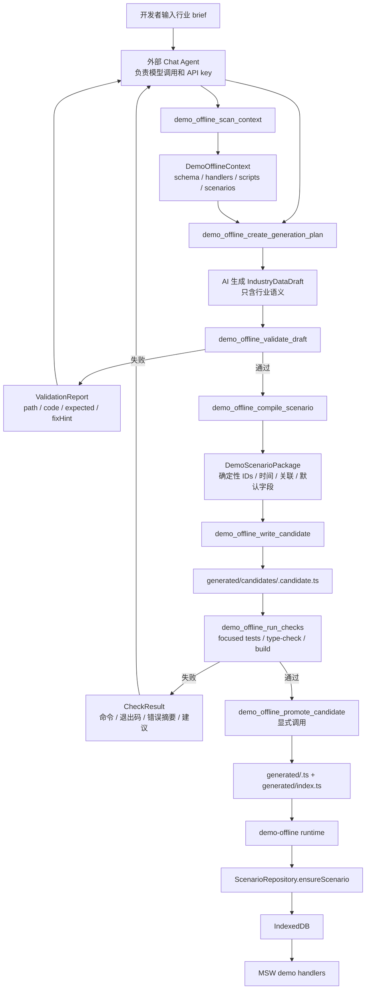

# Demo Offline Data MCP 技术设计

## 架构概述

`Demo Offline Data MCP` 是仓库根目录下的本地开发期工具，放在 `tools/demo-offline-mcp/`，以 TypeScript 实现，并通过 `stdio` 暴露 MCP tools。它不进入 `ruoyi-fastapi-frontend/src/**` 业务运行时，不进入 `ruoyi-fastapi-backend/**`，不保存任何 AI provider/API key。外部 Chat Agent 负责模型调用，MCP 负责读取 demo-offline 上下文、校验 AI 语义草稿、确定性编译场景包、受限写入候选场景、执行 allowlist 检查和显式 promote。

现有 demo-offline 链路保持不变：`DemoScenarioPackage` 是唯一运行时数据合同；`getDemoScenarioPackage(config.scenarioId)` 负责按场景 ID 取包；`ScenarioRepository.ensureScenario()` 校验并导入 IndexedDB；MSW demo handlers 从 service/repository 读取数据；未覆盖 API 继续由 `DEMO_API_NOT_IMPLEMENTED` catch-all 明确暴露。

P0 架构只覆盖 `project + simulation` 数据切片，`auth/system` 从 `defaultDemoScenario` 复制。扫描范围限定为 `ruoyi-fastapi-frontend/src/demo/**`、前端 demo 相关脚本和测试，不扫描 `src/views/**`、`src/api/**` 或后端业务代码来推断模块缺口。

建议目录结构：

```text
tools/demo-offline-mcp/
├── package.json
├── tsconfig.json
├── README.md
├── src/
│   ├── index.ts
│   ├── project-paths.ts
│   ├── demo-scan.ts
│   ├── generation-plan.ts
│   ├── draft-schema.ts
│   ├── validator.ts
│   ├── compiler.ts
│   ├── writer.ts
│   ├── checks.ts
│   ├── errors.ts
│   └── tools/
└── tests/
```

前端只做一次性 generated registry 接入：

```text
ruoyi-fastapi-frontend/src/demo/scenarios/
├── index.ts
└── generated/
    ├── index.ts
    ├── candidates/
    │   ├── index.ts
    │   └── <scenario-id>.candidate.ts
    ├── <scenario-id>.ts
    └── <scenario-id>.test.ts
```

`src/demo/scenarios/index.ts` 应从直接 import 单个 generated scenario 改为一次性合并 `generatedScenarioRegistry`。候选场景写入 `generated/candidates/**`，可在验证模式下按候选 ID 显式加载；promote 后才写入正式 `generated/<scenario-id>.ts` 并更新 `generated/index.ts`。后续 MCP 不再频繁修改主注册入口。

技术选型：

- MCP server：TypeScript + 官方 MCP TypeScript SDK，工具使用 `registerTool`、Zod input schema、`structuredContent` 输出和 tool annotations。
- 传输方式：本地 `stdio`，适配 Cherry Studio、Codex、Claude、Cursor 等 MCP client。
- 数据校验：Zod 校验 `IndustryDataDraft`；compiler 输出后调用或对齐前端 `validateDemoScenarioPackage` 结构规则；最终通过 focused tests、`type-check` 和 `build:demo-offline` 验证。
- 写入格式：生成 TypeScript scenario 文件，导出 `DemoScenarioPackage`，文件头标记 generated by MCP，并保留 plan/check metadata。
- 命令执行：只暴露 named check profile，不提供任意 shell 工具。

## 数据流图



## 组件与接口定义

### MCP Server Entry

`src/index.ts` 初始化 MCP server，注册所有 `demo_offline_*` tools。server 只向 `stderr` 写日志，`stdout` 仅用于 stdio MCP 协议。启动参数支持 `--repo-root <path>`；未传入时从当前工作目录向上解析仓库根。

所有 tool 返回统一 envelope：

```ts
interface ToolEnvelope<T> {
  ok: boolean;
  summary: string;
  data?: T;
  errors?: ValidationIssue[];
  artifacts?: DemoOfflineArtifact[];
  nextActions?: string[];
}
```

### ProjectPaths

职责：

- 解析并固定 `repoRoot`、`frontendRoot`、`demoRoot`、`generatedRoot`、`candidateRoot`。
- 所有读取路径必须在 `repoRoot` 内。
- 所有写入路径必须在 `ruoyi-fastapi-frontend/src/demo/scenarios/generated/**` 内。
- 拒绝 `..` path traversal、符号链接逃逸、绝对路径注入和 allowlist 外写入。

### DemoScanner

职责：

- 读取 `src/demo/scenarios/schema.ts`，识别 `DemoScenarioPackage` 切片和 `validateDemoScenarioPackage` 规则。
- 读取 `src/demo/scenarios/default.ts`，识别可复制的 `auth/system` 默认数据来源。
- 读取 `src/demo/scenarios/index.ts` 与 `generated/**`，区分默认、正式 generated、候选 generated 场景。
- 读取 `src/demo/handlers/http.ts` 及 handlers 入口，识别 P0 已覆盖 `auth/system/system-admin/project/simulation`，保留 catch-all 风险。
- 读取 `package.json` 中 `build:demo-offline`、`preview:demo-offline`、`type-check`、`test:run` 等脚本。

输出 `DemoOfflineContext`：

```ts
interface DemoOfflineContext {
  repoRoot: string;
  frontendRoot: string;
  generatedRoot: string;
  schemaVersion: 1;
  safeSlices: Array<'project' | 'simulation'>;
  copiedSlices: Array<'auth' | 'system'>;
  handlers: Array<{ name: string; source: string; covered: boolean }>;
  scenarios: Array<{
    id: string;
    name: string;
    kind: 'default' | 'generated' | 'candidate';
    path: string;
  }>;
  scripts: {
    buildDemoOffline: string;
    previewDemoOffline: string;
    typeCheck: string;
    testRun: string;
  };
  risks: Array<{ code: string; message: string; source?: string }>;
}
```

### GenerationPlanner

职责：

- 根据 brief 和扫描结果生成可审阅计划。
- P0 默认 `scope = ['project', 'simulation']`，`auth/system` 标记为 copied。
- 对未在 `src/demo/**` 发现覆盖依据的切片输出 `unsupported`，不承诺生成。
- 给每个计划项保留 `trace`，说明依据来自哪个 schema、handler 或测试文件。

输出 `GenerationPlan`：

```ts
interface GenerationPlan {
  scenarioId: string;
  scenarioName: string;
  industry: string;
  brief: string;
  scope: Array<'project' | 'simulation'>;
  copiedSlices: Array<'auth' | 'system'>;
  targetCounts: {
    projects: number;
    versionsPerProject: number;
    sessionsPerProject: number;
  };
  trace: Array<{ slice: string; status: 'generate' | 'copy' | 'unsupported'; evidence: string[] }>;
}
```

### DraftSchema 与 DraftValidator

`IndustryDataDraft` 是跨行业语义草稿，不直接等同最终 `DemoScenarioPackage`：

```ts
interface IndustryDataDraft {
  industry: {
    id: string;
    name: string;
    keywords?: string[];
  };
  scenario: {
    id: string;
    name: string;
    version?: string;
    seed?: string;
    description?: string;
  };
  projects: Array<{
    key: string;
    name: string;
    region?: string;
    stage: string;
    ownerRole: string;
    ownerName?: string;
    riskLevel: 'low' | 'medium' | 'high';
    risk: string;
    remark: string;
    keyMetrics?: Array<{ name: string; value: string; trend?: string }>;
    versions?: Array<{
      name: string;
      locked?: boolean;
      summary?: string;
    }>;
    topology?: {
      nodes?: Array<{ name: string; type: string; status?: string }>;
      links?: Array<{ source: string; target: string; label?: string }>;
    };
    simulation?: {
      status?: 'idle' | 'running' | 'paused' | 'completed' | 'failed';
      messages?: string[];
      alarms?: Array<{ severity: 'low' | 'medium' | 'high'; message: string }>;
      events?: string[];
    };
  }>;
}
```

校验分层：

- 结构校验：Zod 类型、必填字段、数组数量、字符串长度、枚举合法性。
- 上下文校验：draft scope 必须属于扫描出的 safe slices；P0 只允许 `project + simulation`。
- 语义质量：禁止 `测试项目`、`示例数据`、`张三`、`李四`、`TODO`、`xxx` 等占位词；控制重复度；项目名、阶段、风险、备注必须贴合行业 brief。
- 关系校验：project key 唯一；版本、拓扑、仿真语义必须能关联到项目。
- 可自动修复：空白 trim、重复空格、缺失 version 默认值、缺失 ownerName 的行业化默认补齐、数量不足时可返回修复建议或自动扩展模板。

错误模型：

```ts
interface ValidationIssue {
  path: string;
  code: string;
  severity: 'error' | 'warning';
  actual?: unknown;
  expected?: string;
  fixHint: string;
  autoRepairable: boolean;
}
```

### ScenarioCompiler

职责：

- 从 `defaultDemoScenario` 复制 `auth` 与 `system`。
- 确定性生成 `schemaVersion`、`scenario.id`、`version`、`fingerprint`、ID、时间、状态、版本、拓扑、仿真数据和关联关系。
- 使用固定 seed，保证相同 draft + plan 输出稳定。
- 生成项目 ID、版本 ID、session ID、topology ID、message/alarm/fault/event/frame ID。
- 输出前运行最终结构校验，确保 `project.projects`、`project.versions`、`project.topologies`、`simulation.sessions/messages/bandwidth/alarms/faults/events/streamFrames` 全部为数组。

### ScenarioWriter

职责：

- `writeCandidate` 写入 `generated/candidates/<scenario-id>.candidate.ts` 和候选 metadata。
- `promoteCandidate` 在 checks 通过且显式确认后写入 `generated/<scenario-id>.ts`，更新 `generated/index.ts` 的 `generatedScenarioRegistry`。
- 若同名正式场景已存在，默认拒绝覆盖；只有传入 `replaceExisting: true` 才允许替换。
- 格式化生成文件，保持导出名稳定，例如 `realEstateProjectDemoScenario`。
- 不写 `src/demo/handlers/**`、`src/mocks/**`、Vue routes、业务页面、真实 API、后端代码。

### CheckRunner

职责：

- 只接受 named profile，不接受自由命令字符串。
- 所有命令在 `ruoyi-fastapi-frontend/` 下执行。
- 使用 `child_process.spawn` 的 `env` 参数设置 `VITE_APP_RUNTIME_MODE`、`VITE_DEMO_SCENARIO_ID` 等变量，不拼 shell 字符串。
- 返回退出码、耗时、关键日志摘要、错误片段和下一步建议。

P0 profiles：

```ts
type CheckProfile =
  | 'candidate-focused-tests'
  | 'frontend-type-check'
  | 'candidate-demo-offline-build'
  | 'promoted-demo-offline-build';
```

命令模板：

- `candidate-focused-tests`：`yarn test:run` 加候选场景测试、`src/demo/repositories/scenario.test.ts`、`src/demo/services/project.test.ts`、`src/demo/services/simulation.test.ts`、`src/demo/handlers/project.test.ts`、`src/demo/handlers/simulation.test.ts`。
- `frontend-type-check`：`yarn type-check`。
- `candidate-demo-offline-build`：设置 `VITE_APP_RUNTIME_MODE=demo-offline`、`VITE_DEMO_ALLOW_CANDIDATE_SCENARIOS=true`、`VITE_DEMO_SCENARIO_ID=<candidate-id>` 后运行 `yarn build:demo-offline`。
- `promoted-demo-offline-build`：设置 `VITE_APP_RUNTIME_MODE=demo-offline`、`VITE_DEMO_SCENARIO_ID=<scenario-id>` 后运行 `yarn build:demo-offline`。

## API 接口设计

本设计中的 API 是 MCP tools，不是 HTTP API。所有 tools 使用 Zod input schema、结构化输出和 annotations。annotations 仅用于客户端展示和决策提示，实际安全仍由服务端路径守卫和 allowlist 强制执行。

### `demo_offline_scan_context`

- 用途：扫描当前 demo-offline 能力和 generated 场景状态。
- annotations：`readOnlyHint: true`、`destructiveHint: false`、`idempotentHint: true`、`openWorldHint: false`。
- 输入：

```ts
{
  includeGenerated?: boolean;
  includeCandidates?: boolean;
  responseFormat?: 'json' | 'markdown';
}
```

- 输出：`ToolEnvelope<DemoOfflineContext>`。

### `demo_offline_create_generation_plan`

- 用途：根据行业 brief 和扫描结果生成可审阅计划。
- annotations：`readOnlyHint: true`、`destructiveHint: false`、`idempotentHint: true`、`openWorldHint: false`。
- 输入：

```ts
{
  brief: string;
  industry?: string;
  scenarioId?: string;
  scenarioName?: string;
  scope?: Array<'project' | 'simulation'>;
  targetCounts?: Partial<GenerationPlan['targetCounts']>;
}
```

- 输出：`ToolEnvelope<GenerationPlan>`。

### `demo_offline_validate_draft`

- 用途：校验 AI 生成的 `IndustryDataDraft`，返回结构化修复报告。
- annotations：`readOnlyHint: true`、`destructiveHint: false`、`idempotentHint: true`、`openWorldHint: false`。
- 输入：

```ts
{
  plan: GenerationPlan;
  draft: IndustryDataDraft;
  autoRepair?: boolean;
}
```

- 输出：`ToolEnvelope<{ valid: boolean; repairedDraft?: IndustryDataDraft; issues: ValidationIssue[] }>`。

### `demo_offline_compile_scenario`

- 用途：将已通过校验的 draft 编译为候选 `DemoScenarioPackage`，不写文件。
- annotations：`readOnlyHint: true`、`destructiveHint: false`、`idempotentHint: true`、`openWorldHint: false`。
- 输入：

```ts
{
  plan: GenerationPlan;
  draft: IndustryDataDraft;
  repairedDraft?: IndustryDataDraft;
}
```

- 输出：`ToolEnvelope<{ scenarioPackage: DemoScenarioPackage; summary: CompileSummary }>`。

### `demo_offline_write_candidate`

- 用途：把编译结果写入 generated candidate 区域。
- annotations：`readOnlyHint: false`、`destructiveHint: false`、`idempotentHint: true`、`openWorldHint: false`。
- 输入：

```ts
{
  scenarioPackage: DemoScenarioPackage;
  plan: GenerationPlan;
  overwriteCandidate?: boolean;
}
```

- 输出：`ToolEnvelope<{ candidateId: string; paths: string[]; metadataPath: string }>`。

### `demo_offline_run_checks`

- 用途：运行固定 allowlist 检查。
- annotations：`readOnlyHint: false`、`destructiveHint: false`、`idempotentHint: false`、`openWorldHint: false`。
- 输入：

```ts
{
  candidateId?: string;
  scenarioId?: string;
  profiles: CheckProfile[];
  maxLogLines?: number;
}
```

- 输出：`ToolEnvelope<{ runId: string; passed: boolean; results: CheckResult[] }>`。

### `demo_offline_promote_candidate`

- 用途：在 checks 通过后显式提升候选场景。
- annotations：`readOnlyHint: false`、`destructiveHint: true`、`idempotentHint: false`、`openWorldHint: false`。
- 输入：

```ts
{
  candidateId: string;
  scenarioId: string;
  checksRunId: string;
  confirm: true;
  replaceExisting?: boolean;
  cleanupCandidate?: boolean;
}
```

- 输出：`ToolEnvelope<{ scenarioId: string; paths: string[]; registryUpdated: boolean }>`。

## 数据模型与数据库变更

不做后端数据库变更，不做 FastAPI migration，不改变 IndexedDB schema version。现有 IndexedDB 表已经覆盖 P0 所需数据：`projects`、`projectVersions`、`topologies`、`simulationSessions`、`simulationMessages`、`simulationBandwidth`、`simulationAlarms`、`simulationFaults`、`simulationEvents`、`simulationFrames`。

新增或调整的数据文件只在开发工具和 demo-only generated 区域：

- 新增 `tools/demo-offline-mcp/**`：MCP server 源码、测试和文档。
- 新增 `ruoyi-fastapi-frontend/src/demo/scenarios/generated/index.ts`：正式 generated 场景注册表。
- 新增 `ruoyi-fastapi-frontend/src/demo/scenarios/generated/candidates/index.ts`：候选场景注册表，仅用于验证模式。
- 新增 `ruoyi-fastapi-frontend/src/demo/scenarios/generated/candidates/*.candidate.ts`：候选场景。
- 新增 `ruoyi-fastapi-frontend/src/demo/scenarios/generated/*.ts`：promote 后的正式场景。
- 不提供 `dev:demo-offline` 或等价 dev server 入口；MCP 生成数据必须通过 `build:demo-offline` 后的 `dist-demo-offline` 与 `preview:demo-offline` 验证，避免开发服务器返回 bundle default 数据造成误判。

`IndustryDataDraft`、`GenerationPlan`、`ValidationIssue`、`CheckResult` 只属于 MCP 工具层，不进入客户离线包运行时合同。客户离线包只消费 promote 后的 `DemoScenarioPackage`。

## 安全考量

- 密钥边界：MCP 不读取、不保存、不要求 DeepSeek、Kimi、OpenAI、Gemini 等 provider API key；模型调用只发生在外部 Chat Agent。
- 路径边界：读路径限制在仓库内；写路径限制在 `ruoyi-fastapi-frontend/src/demo/scenarios/generated/**`；所有路径使用 `realpath` 校验后再执行。
- 命令边界：不暴露通用 shell；`run_checks` 只接受 named profile；命令和参数由程序模板生成。
- 生产隔离：MCP 目录不被 Vite 业务入口、FastAPI 后端或生产构建引用；`build:prod` 不依赖 MCP。
- 运行时隔离：MCP 不改 MSW handlers、Vue routes、业务页面、真实 API 和后端代码；demo-offline 继续通过 `ScenarioRepository` 和既有 handlers 工作。
- 候选保护：candidate 未通过校验和检查不得 promote；checks 通过也不自动 promote；同名正式场景默认拒绝覆盖。
- 错误可修复：校验失败返回 `path/code/expected/actual/fixHint/autoRepairable`，让 Chat Agent 按确定性报告修复，而不是随机重试。
- 输出最小化：扫描结果返回结构化摘要和 evidence path，不把大文件全文塞给模型。

## 测试策略

### MCP 单元测试

- `ProjectPaths`：仓库根解析、generated 写入 allowlist、path traversal、符号链接逃逸。
- `DemoScanner`：能识别 schema、default scenario、handler 覆盖、package scripts、generated/candidate 场景。
- `DraftValidator`：非法枚举、占位词、重复内容、scope 不匹配、数量不足、可自动修复字段。
- `ScenarioCompiler`：相同 seed 输出稳定；ID、时间、版本、拓扑、simulation 关联一致；最终满足 `DemoScenarioPackage` 数组结构。
- `ScenarioWriter`：candidate 写入、冲突拒绝、promote 更新 registry、cleanup candidate。
- `CheckRunner`：拒绝 allowlist 外 profile；spawn 参数不经 shell 拼接；失败日志摘要可读。

### 前端集成测试

- 新增或复用 generated scenario 测试：导入 candidate/official scenario，调用 `validateDemoScenarioPackage`。
- 使用 `fake-indexeddb` + `ScenarioRepository.ensureScenario()` 验证场景能导入 IndexedDB。
- 复用 `DemoProjectService`、`DemoSimulationService` 验证 project/simulation 数据可查询。
- 复用 `src/demo/handlers/project.test.ts`、`src/demo/handlers/simulation.test.ts` 验证 MSW handlers 能读到生成数据。

### 验证命令

P0 acceptance 至少执行：

```text
yarn test:run <generated scenario test> src/demo/repositories/scenario.test.ts src/demo/services/project.test.ts src/demo/services/simulation.test.ts src/demo/handlers/project.test.ts src/demo/handlers/simulation.test.ts
yarn type-check
VITE_APP_RUNTIME_MODE=demo-offline VITE_DEMO_SCENARIO_ID=<scenario-id> yarn build:demo-offline
```

首个验收样例使用房地产行业 brief，生成 `project + simulation` candidate。验收通过标准是：draft 校验通过、compiler 输出稳定、candidate tests 通过、promote 后正式 scenario 可被 `getDemoScenarioPackage` 加载、`build:demo-offline` 成功，且输出不包含 AI provider 配置、API key 或 MCP server 代码。
