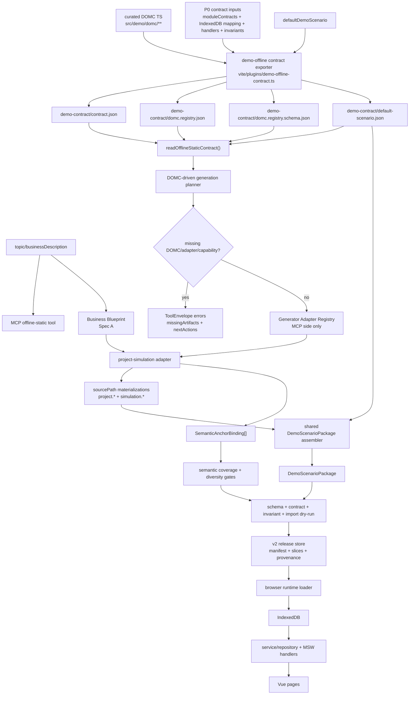
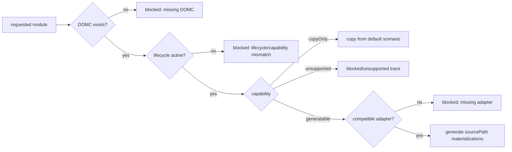

# Demo Offline DOMC Registry and Generator Adapters 技术设计

## 架构概述

本设计采用“DOMC Registry 作为模块接入事实源、Generator Adapter 只在 MCP 侧执行、Adapter 只输出 sourcePath 级物化结果、共享 assembler 统一组装 runtime package”的方案。它比继续扩展 `project + simulation` 专用 compiler 更长期可维护：新增模块时先补齐 DOMC、mapping、handler、UI journey、invariant 和 adapter，再进入生成计划；缺任一关键能力时 MCP 返回结构化 blocker，不用 prompt 或 generic fallback 假装支持。

现有实现中的事实基础如下：

| 现有能力 | 当前落点 | 本设计处理方式 |
| --- | --- | --- |
| P0 contract manifest | `ruoyi-fastapi-frontend/src/demo/scenarios/contract.ts` 的 `DemoOfflineContractManifest`、`DEMO_INDEXED_DB_MAPPING`、`DEMO_MODULE_CONTRACTS`、`DEMO_HANDLER_COVERAGE` | DOMC 从这些 summary 演进，保留 contract fingerprint 作为外壳兼容根 |
| build 导出 contract | `ruoyi-fastapi-frontend/vite/plugins/demo-offline-contract.ts` 在 `closeBundle()` 写 `demo-contract/**` | 同一插件增加 DOMC JSON 与 DOMC schema 导出，仍只在 `demo-offline` build 启用 |
| MCP contract reader | `tools/demo-offline-mcp/src/offline-static/contract.ts` 读取 `contract.json`、`scenario.schema.json`、`default-scenario.json` | 增加 `domc.registry.json` 读取、fingerprint 校验和兼容性诊断 |
| 当前生成链路 | `tools/demo-offline-mcp/src/offline-static/generate.ts` 固定 `project/simulation` generate、`auth/system` copy | 改为由 DOMC planner + adapter registry 选择；首批 adapter 仍复用现有 Blueprint 语义能力 |
| v2 release store | `tools/demo-offline-mcp/src/offline-static/release-store.ts` 和前端 counterpart 支持 manifest、slice、provenance、hash | provenance/manifest 增加 DOMC fingerprint、module fingerprint、adapter version 审计字段，不改变 pointer/slice 读取模型 |

外部资料对设计边界的约束：

- Vite plugin 已支持 `apply: 'build'` 这类 build-only 插件配置，且 output generation hooks 在 dev 中不执行；DOMC exporter 应保持 build-only，避免 dev runtime 意外依赖构建产物。
- JSON Schema 2020-12 适合作为 exported JSON contract 的结构与校验说明；DOMC schema 必须是本地 schema，不能依赖远程 `$ref`。
- MCP tool 执行错误适合通过 tool result 表达业务 blocker；本设计沿用当前 `ToolEnvelope`/`ValidationIssue` 风格，并为缺 DOMC/adapter 等业务 blocker 增加结构化字段。

### 总体决策

1. 前端源码侧新增 curated DOMC registry：`ruoyi-fastapi-frontend/src/demo/domc/**`。这里是模块契约事实源，只包含类型、静态声明、校验和导出辅助，不包含可执行生成器。
2. build/exporter 生成 `dist-demo-offline/demo-contract/domc.registry.json` 和 `domc.registry.schema.json`，并把 `domcRegistryFingerprint`、`moduleContractFingerprints`、`adapterReferences` 纳入 `contractFingerprint` 输入。
3. MCP 侧新增 `tools/demo-offline-mcp/src/adapters/**`。Adapter 实现只存在 MCP 侧；前端 DOMC 只声明 `adapterId`、`adapterVersionRange` 和 capability。
4. MCP 生成计划从 DOMC Registry 读取模块 lifecycle/capability，不再以 `DemoGeneratableSlice = 'project' | 'simulation'` 作为长期事实源。首批迁移结果仍是 `project`、`simulation` 为 `generatable`，`auth`、`system` 为 `copyOnly`。
5. Adapter 不直接写 v2 release、不直接拼完整 `DemoScenarioPackage`。它只返回 sourcePath 级 `AdapterMaterialization[]` 与 `SemanticAnchorBinding[]`；共享 assembler 合并 copyOnly 默认数据与 generated records，再进入现有 schema、contract、invariant、semantic、import dry-run 和 v2 release gates。
6. 缺 DOMC、缺 adapter、adapter capability 不匹配、DOMC/sourcePath/handler/UI journey 漂移均为 strict blocker。唯一非阻塞例外是 DOMC 明确声明 `copyOnly` 且默认场景通过校验。

## 数据流图



模块状态决策流：



## 组件与接口定义

### 1. Frontend DOMC Registry

建议新增文件结构：

```text
ruoyi-fastapi-frontend/src/demo/domc/
  types.ts
  registry.ts
  fingerprint.ts
  schema.ts
  validate.ts
  modules/
    project.domc.ts
    simulation.domc.ts
    auth.domc.ts
    system.domc.ts
```

核心类型：

```ts
export type DemoDomcModuleId = string;
export type DemoDomcLifecycle = 'active' | 'deprecated' | 'experimental';
export type DemoDomcCapability = 'generatable' | 'copyOnly' | 'unsupported';

export interface DemoDomcRegistry {
  schemaVersion: 1;
  registryVersion: string;
  generatedAt: string;
  domcFingerprint: string;
  contractVersion: 1;
  modules: DemoDomcModuleContract[];
  qualityGates: readonly DemoDomcQualityGate[];
  migrationSources: readonly string[];
}

export interface DemoDomcModuleContract {
  moduleId: DemoDomcModuleId;
  moduleVersion: string;
  lifecycle: DemoDomcLifecycle;
  capability: DemoDomcCapability;
  sourcePaths: readonly string[];
  indexedDbTables: readonly DemoDomcIndexedDbTableRef[];
  handlerCoverage: readonly DemoDomcHandlerCoverageRef[];
  uiJourneys: readonly DemoDomcUiJourney[];
  entities: readonly DemoDomcEntityContract[];
  invariants: readonly DemoDomcInvariantRef[];
  diversityRules: readonly DemoDomcDiversityRule[];
  semanticAnchors?: readonly DemoDomcSemanticAnchorRule[];
  adapterRef?: DemoDomcAdapterReference;
  copyOnly?: DemoDomcCopyOnlyPolicy;
  unsupportedReason?: string;
}
```

实体契约应比当前 `DemoModuleEntityContract` 更完整：

```ts
export interface DemoDomcEntityContract {
  entity: string;
  sourcePath: string;
  primaryKey: string;
  minItems: number;
  fields: readonly DemoDomcFieldContract[];
  references: readonly DemoDomcReferenceContract[];
  ownership: {
    recordOwner: 'adapter' | 'default-scenario' | 'runtime-required';
    mergePolicy: 'replace-sourcePath' | 'append-shards' | 'copy-only';
  };
}

export interface DemoDomcFieldContract {
  name: string;
  required: boolean;
  nullable: boolean;
  semanticKind:
    | 'identifier'
    | 'displayName'
    | 'description'
    | 'status'
    | 'enum'
    | 'timestamp'
    | 'owner'
    | 'department'
    | 'metric'
    | 'risk'
    | 'money'
    | 'quantity'
    | 'foreignKey'
    | 'opaquePayload';
  enumValues?: readonly string[];
  defaultRepair?: 'derive' | 'copy-default' | 'block';
}
```

`DemoDomcModuleId` 使用稳定字符串而不是只允许当前四个 union；首批 registry 只声明 `auth`、`system`、`project`、`simulation`，未来新增模块仍必须先补 scenario slice/schema、IndexedDB mapping、handler/service/repository 和 adapter。

`project.domc.ts` 首批覆盖：

- `project.projects`
- `project.versions`
- `project.topologies`

`simulation.domc.ts` 首批覆盖：

- `simulation.sessions`
- `simulation.messages`
- `simulation.bandwidth`
- `simulation.alarms`
- `simulation.faults`
- `simulation.events`
- `simulation.streamFrames`

`auth.domc.ts` 和 `system.domc.ts` 首批标记为 `copyOnly`，声明复制来源、minItems、handler coverage、UI navigation 支撑关系和“不允许语义生成”的原因。

### 2. Contract Exporter

`createDemoOfflineContractPlugin()` 继续只在 `command === 'build' && mode === 'demo-offline'` 时启用。新增导出步骤：

```ts
const domcRegistry = createDemoDomcRegistry(generatedAt);
const contract = await createDemoOfflineContractManifest(generatedAt, { domcRegistry });

await writeJson(path.join(contractDir, 'contract.json'), contract);
await writeJson(path.join(contractDir, 'domc.registry.json'), domcRegistry);
await writeJson(path.join(contractDir, 'domc.registry.schema.json'), demoDomcRegistryJsonSchema);
```

`DemoOfflineContractManifest` 增加审计摘要字段：

```ts
export interface DemoOfflineContractManifest {
  // existing fields...
  domcRegistryFingerprint: string;
  domcRegistryPath: 'demo-contract/domc.registry.json';
  moduleContractFingerprints: Record<string, string>;
  adapterReferences: Array<{
    moduleId: string;
    adapterId: string;
    adapterVersionRange: string;
    capability: 'generatable' | 'copyOnly' | 'unsupported';
  }>;
}
```

`contractFingerprint` 的稳定输入必须包含 DOMC registry fingerprint 和 adapter references，但继续排除 `generatedAt`。这样 DOMC 或 adapter capability 变化会自然阻止旧 release 与新 shell 混用。

### 3. MCP Contract Reader 与 DOMC Validator

`OfflineStaticContractBundle` 扩展：

```ts
export interface OfflineStaticContractBundle {
  contract: DemoOfflineContractManifest;
  domcRegistry: DemoDomcRegistry;
  scenarioSchema: unknown;
  defaultScenario: CompiledDemoScenarioPackage;
}
```

新增校验：

- `domc.schemaVersion` 与 MCP 支持范围一致。
- `domcFingerprint` 由 canonical JSON 重算后匹配。
- `contract.domcRegistryFingerprint` 与 registry 匹配。
- 每个 DOMC `sourcePath` 存在于 `indexedDbMapping.tables[].sourcePath` 或明确 `copyOnly`。
- 每个 `generatable` 模块有 `adapterRef`；每个 `copyOnly` 模块有 `copyOnly.sourcePath` 与默认场景支撑。
- DOMC handler coverage 与 `DEMO_HANDLER_COVERAGE` 迁移结果一致。
- UI journey 引用的 primary/support sourcePath 均存在。

### 4. Adapter Registry

建议新增 MCP 侧结构：

```text
tools/demo-offline-mcp/src/adapters/
  types.ts
  registry.ts
  project-simulation/
    adapter.ts
    materialize-project.ts
    materialize-simulation.ts
```

核心接口：

```ts
export interface DemoGeneratorAdapter {
  adapterId: string;
  adapterVersion: string;
  priority: number;
  supportedModules: readonly string[];
  supportedDomcVersions: readonly string[];
  capabilities: readonly DemoAdapterCapability[];
  inputKinds: readonly ('business-blueprint' | 'default-scenario' | 'domc-registry')[];
  outputSourcePaths: readonly string[];

  canGenerate(input: DemoAdapterCanGenerateInput): DemoAdapterDecision;
  plan(input: DemoAdapterPlanInput): DemoAdapterPlan;
  compile(input: DemoAdapterCompileInput): Promise<DemoAdapterCompileResult>;
  validate(input: DemoAdapterValidateInput): DemoAdapterValidationResult;
  explainBlocker(input: DemoAdapterCanGenerateInput): DemoOfflineBlockerIssue;
}

export interface DemoAdapterCompileResult {
  adapterId: string;
  adapterVersion: string;
  moduleIds: readonly string[];
  materializations: readonly AdapterMaterialization[];
  semanticBindings: readonly SemanticAnchorBinding[];
  summary: Record<string, unknown>;
}

export interface AdapterMaterialization {
  moduleId: string;
  sourcePath: string;
  order: number;
  materializationReason: 'semantic-generated' | 'copied-default' | 'runtime-required';
  records: readonly Record<string, unknown>[];
  domcModuleVersion: string;
  adapterId: string;
  adapterVersion: string;
}
```

首批 `project-simulation` adapter 可以先包装现有 `generateDeterministicBusinessBlueprint()`、`compileBlueprintToIndustryDraft()` 和当前 compiler 内的 sourcePath 映射逻辑，但输出边界必须改成 materializations。这样后续 adapter 可以独立扩展，而不污染 v2 writer 或 browser runtime。

### 5. Shared Assembler

新增 MCP 侧 assembler，或把现有 `compileScenarioPackage()` 拆出 sourcePath merge 能力：

```ts
export interface AssembleDemoScenarioPackageInput {
  scenario: CompiledDemoScenarioPackage['scenario'];
  defaultScenarioPackage: CompiledDemoScenarioPackage;
  domcRegistry: DemoDomcRegistry;
  generatedMaterializations: readonly AdapterMaterialization[];
  copyOnlyModules: readonly string[];
}
```

Assembler 职责：

- 从 `defaultScenarioPackage` 复制 `copyOnly` sourcePath。
- 按 DOMC 和 adapter `order` 写入 generated sourcePath。
- 禁止写入 DOMC 未声明的 sourcePath。
- 校验 minItems、primaryKey、references、requiredFields。
- 输出完整 `DemoScenarioPackage`，再交给既有 schema/contract/invariant/import dry-run。

### 6. Blocker Issue

在现有 `ValidationIssue` 基础上扩展业务 blocker，不破坏旧工具返回：

```ts
export interface DemoOfflineBlockerIssue extends ValidationIssue {
  gate:
    | 'domc-schema'
    | 'domc-registry-integrity'
    | 'adapter-registry'
    | 'adapter-capability'
    | 'module-blocker'
    | 'ui-journey-coverage'
    | 'handler-mapping-coverage'
    | 'contract-drift'
    | 'domc-provenance'
    | 'adapter-regression';
  missingArtifacts: readonly string[];
  nextActions: readonly string[];
}
```

示例：

```json
{
  "path": "domc.modules[customer]",
  "code": "domc_adapter_missing",
  "severity": "error",
  "actual": "module has DOMC but no compatible adapter",
  "expected": "compatible adapter registered in tools/demo-offline-mcp/src/adapters/**",
  "fixHint": "Implement a MCP-side adapter and declare adapterRef in DOMC.",
  "autoRepairable": false,
  "gate": "adapter-registry",
  "missingArtifacts": [
    "tools/demo-offline-mcp/src/adapters/customer/adapter.ts",
    "ruoyi-fastapi-frontend/src/demo/domc/modules/customer.domc.ts"
  ],
  "nextActions": [
    "Create the customer DOMC contract.",
    "Implement and register a compatible generator adapter.",
    "Regenerate dist-demo-offline so demo-contract/domc.registry.json is updated."
  ]
}
```

## API 接口设计

本 spec 不新增后端 HTTP API，不新增浏览器 runtime API。所有 API 均为 build/MCP 内部 TypeScript 接口和 MCP tool 结果契约。

### Frontend Build API

```ts
export function createDemoDomcRegistryDraft(generatedAt?: string): DemoDomcRegistryDraft;
export function createDemoDomcRegistry(generatedAt?: string): Promise<DemoDomcRegistry>;
export function computeDomcRegistryFingerprint(registry: DemoDomcRegistryDraft): Promise<string>;
export function validateDemoDomcRegistry(registry: unknown): DemoDomcValidationResult;
```

`createDemoOfflineContractManifest()` 增加可选参数：

```ts
export async function createDemoOfflineContractManifest(
  generatedAt?: string,
  options?: { domcRegistry?: DemoDomcRegistry }
): Promise<DemoOfflineContractManifest>;
```

兼容策略：

- `demo-offline` build 必须提供 DOMC registry。
- 单元测试可以显式传入 fixture registry。
- 非 demo-offline 模式不运行 contract exporter，不影响 `build:prod`。

### MCP Planner API

```ts
export interface CreateDomcGenerationPlanInput {
  brief: string;
  industry?: string;
  scenarioId?: string;
  scenarioName?: string;
  requestedModules?: readonly string[] | 'default' | 'all';
  targetCounts?: Partial<GenerationPlan['targetCounts']>;
}

export interface DomcGenerationPlan {
  scenarioId: string;
  scenarioName: string;
  industry: string;
  brief: string;
  moduleTrace: Array<{
    moduleId: string;
    capability: 'generatable' | 'copyOnly' | 'unsupported';
    status: 'generate' | 'copy' | 'blocked' | 'unsupported';
    sourcePaths: readonly string[];
    adapterId?: string;
    adapterVersion?: string;
    evidence: readonly string[];
    blocker?: DemoOfflineBlockerIssue;
  }>;
}
```

`createGenerationPlan()` 可保留旧签名做过渡，但内部应委托 DOMC planner。旧 `scope: DemoGeneratableSlice[]` 不再作为长期扩展入口。

### MCP Adapter Selection API

```ts
export function registerDemoGeneratorAdapter(adapter: DemoGeneratorAdapter): void;

export function resolveDemoGeneratorAdapters(input: {
  domcRegistry: DemoDomcRegistry;
  requestedModules: readonly string[];
  adapters: readonly DemoGeneratorAdapter[];
}): {
  selected: readonly DemoGeneratorAdapter[];
  blockers: readonly DemoOfflineBlockerIssue[];
};
```

选择规则：

- `adapterId` 必须匹配 DOMC `adapterRef.adapterId`。
- `adapterVersion` 必须满足 DOMC version range。
- `capabilities` 必须覆盖目标，例如 `semantic-blueprint`、`sourcePath-materialization`、`deterministic-seed`。
- 多 adapter 同时匹配时按 `priority` 和明确 version constraint 选择；仍无法唯一选择时 blocker。

### MCP Generation API

`generateOfflineStaticRuntimePackage()` 的外部输入可保持不变，内部流程改成：

```ts
const contractBundle = await readOfflineStaticContract(paths);
const plan = createDomcGenerationPlan(input, contractBundle.domcRegistry);
if (plan has error blockers) return errorEnvelope(...);
const adapters = resolveDemoGeneratorAdapters(...);
const adapterResults = await compile adapters;
const scenarioPackage = assembleDemoScenarioPackage(...);
```

MCP 返回结果新增审计摘要：

```ts
interface OfflineStaticActivationResult {
  // existing fields...
  domcRegistryFingerprint?: string;
  adapterVersions?: Record<string, string>;
  moduleTrace?: DomcGenerationPlan['moduleTrace'];
}
```

## 数据模型与数据库变更

### 新增/变更 artifact

| 路径 | 类型 | 说明 |
| --- | --- | --- |
| `demo-contract/domc.registry.json` | JSON artifact | DOMC Registry 的 build 输出；MCP 读取，browser runtime 不主动加载 |
| `demo-contract/domc.registry.schema.json` | JSON Schema artifact | 本地 schema；禁止远程 `$ref` |
| `demo-contract/contract.json` | 现有 artifact 扩展 | 增加 DOMC fingerprint、module fingerprints、adapter references |
| `demo-scenarios/releases/<release-id>/provenance.json` | 现有 artifact 扩展 | 增加 DOMC/adapter materials 和 fingerprints |
| `demo-scenarios/releases/<release-id>/manifest.json` | 现有 artifact 扩展 | 增加可选审计字段；不改变 pointer、descriptor、slice 语义 |

### v2 Provenance 扩展

`RuntimePackageV2Provenance.materials[].kind` 增加：

```ts
type RuntimePackageV2ProvenanceMaterialKind =
  | 'demo-contract'
  | 'default-scenario'
  | 'semantic-report'
  | 'generator'
  | 'domc-registry'
  | 'domc-module-contract'
  | 'generator-adapter';
```

建议同时增加结构化摘要：

```ts
interface RuntimePackageV2Provenance {
  // existing fields...
  domcRegistryFingerprint?: string;
  moduleContractFingerprints?: Record<string, string>;
  adapterVersions?: Record<string, string>;
  adapterCapabilitySummary?: Array<{
    moduleId: string;
    adapterId: string;
    adapterVersion: string;
    outputSourcePaths: readonly string[];
  }>;
}
```

### 数据库变更

无真实数据库迁移；无 IndexedDB version bump 的硬要求。DOMC 只描述现有 IndexedDB table/sourcePath、field semantics 和 UI journey，不改变 runtime 导入后页面、MSW、service/repository 的消费模型。若实现中发现必须新增 IndexedDB table，必须另开 spec，因为这会越过本 spec 的非目标。

## 安全考量

- Adapter 实现只允许位于 `tools/demo-offline-mcp/src/adapters/**`，不得被 `ruoyi-fastapi-frontend/src/**` runtime import。build 产物中不能包含 adapter 源码、AI provider SDK、API key 或 MCP server 代码。
- DOMC JSON 和 schema 可以随 `demo-contract/**` 输出，但它们是 contract artifact，不是浏览器运行所需输入；runtime loader、页面、MSW、service/repository 不得读取 DOMC 或 adapter。
- DOMC schema、contract manifest、provenance 和 quality report 必须复用/强化现有 export safety：拒绝本机绝对路径、secret-like 值、路径穿越、远程 `$ref`。
- Adapter 编译必须使用 seed、contractFingerprint、domcFingerprint、adapterVersion 参与可复现输入；随机 faker、当前时间和 AI 输出不得直接进入最终 records。
- AI 或业务描述只允许影响 Business Blueprint；最终 records 必须通过 DOMC schema、adapter validate、semantic gates、contract gates 和 import dry-run。
- `copyOnly` 模块只能从已验证默认场景复制，不能被 adapter 改写认证、权限、菜单等基础数据。
- `real`、`fallback`、`build:prod`、普通开发模式不应受到 DOMC/adapter 改造影响。

## 测试策略

### Frontend contract/exporter tests

- `src/demo/domc/**` 单元测试：DOMC registry schema、module IDs、sourcePaths、field semantics、UI journeys、copyOnly policy。
- `src/demo/scenarios/contract.test.ts` 扩展：`domcRegistryFingerprint` 稳定、DOMC 参与 `contractFingerprint`、`project/simulation` 为 generatable、`auth/system` 为 copyOnly。
- `vite/plugins/demo-offline-contract` 测试或 build fixture：`build:demo-offline` 输出 `demo-contract/domc.registry.json`、`domc.registry.schema.json`，且无远程 `$ref`、无 adapter 实现进入 browser bundle。
- 前端 runtime tests 保持关注 v2 loader、manifest、provenance、IndexedDB import，不要求 runtime 读取 DOMC。

### MCP adapter/planner tests

- DOMC reader tests：缺 `domc.registry.json`、fingerprint mismatch、sourcePath/table mismatch、handler coverage mismatch、UI journey missing 均 error。
- Adapter registry tests：注册成功、版本兼容、capability 匹配、多 adapter 冲突、缺 adapter blocker、adapter 试图输出未声明 sourcePath blocker。
- Planner tests：默认 `project/simulation` generate，`auth/system` copy；`all`/全模块请求对未接入模块返回 `blocked` 或 `unsupported`，并包含 `missingArtifacts` 和 `nextActions`。
- Project-simulation adapter regression：同一输入可复现；不同主题仍通过 Spec A diversity/semantic coverage；输出 sourcePath materializations 与 DOMC minItems/references 对齐。

### Release/provenance tests

- v2 release tests：provenance 记录 `domcRegistryFingerprint`、`moduleContractFingerprints`、`adapterVersions`；descriptor sourcePath 可追溯 DOMC；contract drift 阻止 activation。
- export safety tests：DOMC/provenance 中绝对路径、secret-like 值、远程 `$ref` 均失败。
- import dry-run：assembled `DemoScenarioPackage` 继续通过 schema、contract、invariant 和 IndexedDB import dry-run。

### 回归命令

实现验收至少运行：

```bash
cd tools/demo-offline-mcp && npm test -- --run
cd ruoyi-fastapi-frontend && yarn test:run src/demo/runtime/scenario-package-loader.test.ts src/demo/scenarios/contract.test.ts src/demo/repositories/scenario.test.ts src/demo/runtime/devtools.test.ts
cd ruoyi-fastapi-frontend && yarn type-check
```

如果当前分支仍存在 `tools/demo-offline-mcp/src/offline-static/writer.ts` 中 `loaded` 重复声明导致的 esbuild 编译失败，必须先修复该 P1 编译 blocker，再把 MCP 全套测试作为 Spec C 验收证据。
