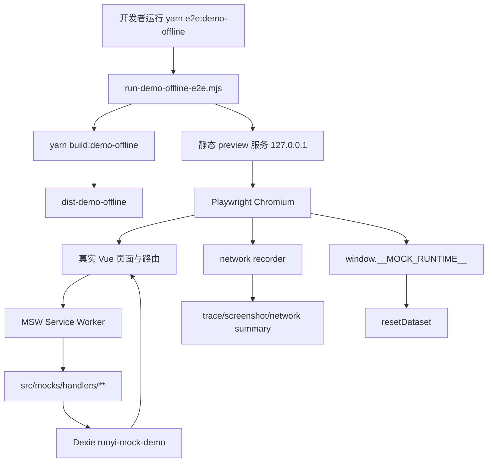

# Demo Offline E2E 验证技术设计

## 架构概述

本设计为 demo-offline 增加一条 build 后黑盒验收链路：本地 CLI 先生成 `dist-demo-offline`，再启动静态 preview，最后用 Playwright Chromium 打开真实页面完成核心演示闭环。E2E 不直接调用 MSW handler、Dexie repository 或 mock store，而是通过真实页面、真实路由、真实 Service Worker 和真实 `/api/**` 请求验证离线演示包。

现有前端已经提供 `build:demo-offline` 和 `preview:demo-offline` 脚本，demo-offline 配置通过 `.env.demo-offline` 固定 `VITE_APP_RUNTIME_MODE='demo-offline'` 和 `VITE_APP_BASE_API='/api'`。mock runtime 在 demo-offline 下使用 pure MSW，并在 debug 开启时暴露 `window.__MOCK_RUNTIME__`，其中包含 `getMode()`、`resetDataset()` 和 `exportDatasetSnapshot()`。本设计复用这些能力，不新增独立 mock server，不接入 CI，不恢复旧 demo runtime。

新增内容分为四层：

| 层级 | 设计职责 | 主要文件 |
| --- | --- | --- |
| 本地 runner | 构建产物、启动 preview、运行 Playwright、清理进程 | `ruoyi-fastapi-frontend/scripts/run-demo-offline-e2e.mjs` |
| Playwright 配置 | Chromium only、artifact、单 worker、baseURL | `ruoyi-fastapi-frontend/playwright.demo-offline.config.ts` |
| E2E 测试与 helpers | 登录、项目、版本、拓扑、simulation、reset、网络诊断 | `ruoyi-fastapi-frontend/tests/e2e/demo-offline/**` |
| 稳定定位点 | 最小补充关键页面的 role/label/`data-testid` | `src/views/login.vue`、`src/views/project/**` |

不修改 GitLab CI、GitHub workflow、后端 API、OpenAPI artifact、mock contract registry 的核心语义。若 E2E 暴露主链路 API 未被 registry 标记为 critical，设计只要求本地命令输出可定位提示，registry 同步由后续实现任务处理。

## 数据流图



## 组件与接口定义

### 本地 runner

新增 `ruoyi-fastapi-frontend/scripts/run-demo-offline-e2e.mjs`，作为 `yarn e2e:demo-offline` 的唯一默认入口。

职责：

- 默认执行 `yarn build:demo-offline`。
- 校验 `dist-demo-offline/index.html` 存在。
- 启动 `yarn preview:demo-offline` 或等价 Vite preview，默认监听 `127.0.0.1:4173`，端口被占用时允许显式 `--port` 覆盖。
- 等待 preview HTTP 可访问后运行 Playwright。
- 透传 `--headed`、`--debug`、`--grep` 等常用 Playwright 参数。
- 支持 `--skip-build` 复用已有 `dist-demo-offline`。
- 支持 `--base-url` 复用已有 preview 服务，但该模式必须显式传参。
- 测试结束后清理 runner 自己启动的 preview 进程。

建议脚本：

```json
{
  "e2e:demo-offline": "node scripts/run-demo-offline-e2e.mjs",
  "e2e:demo-offline:reuse": "node scripts/run-demo-offline-e2e.mjs --skip-build --base-url=http://127.0.0.1:4173"
}
```

### Playwright 配置

新增 `ruoyi-fastapi-frontend/playwright.demo-offline.config.ts`。

关键配置：

- `testDir: 'tests/e2e/demo-offline'`
- `projects: [{ name: 'chromium', use: { ...devices['Desktop Chrome'] } }]`
- `workers: 1`，避免多个测试并行竞争同一个 IndexedDB 数据库。
- `baseURL` 从 `DEMO_OFFLINE_E2E_BASE_URL` 读取，默认 `http://127.0.0.1:4173`。
- `trace: 'retain-on-failure'`
- `screenshot: 'only-on-failure'`
- `video: 'retain-on-failure'`
- `outputDir: 'tests/reports/demo-offline-e2e'`
- `reporter` 使用 `list` 和 `html`，HTML 输出到 `tests/reports/demo-offline-e2e-html`。

不在 Playwright config 中使用 `webServer` 做默认构建和 preview 启动，避免构建、服务和测试清理逻辑分散；这些由 runner 统一管理。后续接 CI 时仍复用 runner。

### E2E 目录

新增目录：

```text
ruoyi-fastapi-frontend/tests/e2e/demo-offline/
  fixtures.ts
  network.ts
  runtime.ts
  selectors.ts
  specs/
    demo-offline-core.spec.ts
```

`fixtures.ts` 提供：

- `demoAccount = { username: 'admin', password: 'admin123' }`
- `uniqueName(prefix)`，基于固定前缀和测试运行 id 生成可定位名称。
- `goToHashPath(page, path)`，兼容 demo-offline hash route。

`network.ts` 提供：

- `attachMockNetworkRecorder(page)`：监听 `/api/**` request/response。
- `waitForMockResponse(tag)`：等待带 `X-Mock-Handler` 的响应。
- `assertNoRealBackendRequests()`：拒绝非当前 preview origin 的关键业务 API。
- `assertCriticalResponsesTagged()`：关键 API 必须携带 `X-Mock-Response` 和 `X-Mock-Handler`。
- `probeUnhandledApi()`：在页面上下文执行 `fetch('/api/__demo_e2e_missing_probe')`，断言 `501 MOCK_API_NOT_IMPLEMENTED` 和 `unhandled-api`。

`runtime.ts` 提供：

- `expectDemoOfflineRuntime(page)`：断言 `window.__MOCK_RUNTIME__.getMode() === 'demo-offline'`。
- `resetDataset(page)`：调用 `window.__MOCK_RUNTIME__.resetDataset()`，清理 storage 后刷新页面。
- `exportDatasetSnapshot(page)`：仅用于断言 reset 前后数据存在性，不作为主业务验证入口。

`selectors.ts` 维护临时选择器映射，优先使用 role、label、placeholder、稳定文本和 `data-testid`。新增稳定定位点后，测试应逐步移除深层 CSS selector。

### 稳定定位点

为降低 E2E 脆弱度，需要补充最小 `data-testid` 或等价可访问定位：

| 页面/组件 | 建议定位点 |
| --- | --- |
| `src/views/login.vue` | `demo-login-username`、`demo-login-password`、`demo-login-submit` |
| `src/views/project/index.vue` | `project-list-page`、`project-add-button`、`project-card-{projectId}`、`project-edit-{projectId}` |
| `src/views/project/components/ProjectFormDialog.vue` | `project-form-name`、`project-form-desc`、`project-form-confirm` |
| `src/views/project/components/VersionList.vue` | `version-list`、`version-row-{versionId}`、`version-clone-{versionId}`、`version-lock-{versionId}`、`version-simulation-{versionId}`、`version-topology-{versionId}` |
| `src/views/project/topo.vue` | `topology-page`、`topology-save-button`、`topology-canvas` |
| `src/views/project/simulation/index.vue` | `simulation-page`、`simulation-header`、`simulation-message-list` 或等价业务可见区域 |

对 ZxUI 组件无法直接透传 `data-testid` 的位置，优先使用包裹元素或 `aria-label`。不为样式结构增加多余 DOM，定位点只服务关键验收路径。

## API 接口设计

本规格不新增后端 API。E2E 使用现有前端 API wrapper 和现有 mock handler：

| 链路 | 关键 API | 期望 handler tag |
| --- | --- | --- |
| 登录 | `GET /api/captchaImage`、`POST /api/login`、`POST /api/auth/csrf-token` | `user:captcha`、`user:login`、`user:csrf-token` |
| 用户与菜单 | `GET /api/getInfo`、`GET /api/getRouters` | `user:getInfo`、`system:getRouters` |
| 项目 | `GET /api/project/list`、`POST /api/project`、`PUT /api/project` | `project:list`、`project:create`、`project:update` |
| 版本 | `GET /api/project/version/list`、`POST /api/project/version/clone`、`PUT /api/project/version/lock` | `project:version:list`、`project:version:clone`、`project:version:lock` |
| 拓扑 | `GET /api/project/topology/{projectId}`、`POST /api/project/topology/save` | `project:topology:get`、`project:topology:save` |
| simulation 只读 | `POST /api/simulation/sessions`、`GET /api/simulation/sessions/{sessionId}/status`、messages/bandwidth/alarms/events | `simulation:session:create-readonly`、`simulation:status`、`simulation:*` |
| 未覆盖探测 | `GET /api/__demo_e2e_missing_probe` | `unhandled-api`，HTTP 501 |

网络断言策略：

- 只对 `/api/**` 业务请求做 mock header 强断言。
- 静态资源、Vite preview 资源、Service Worker 文件和浏览器内部请求不纳入业务 API 断言。
- 任一关键业务 API 如果缺少 `X-Mock-Response` 或 `X-Mock-Handler`，测试失败并输出 method、URL、status、handler tag、当前步骤。
- 如果出现非 preview origin 的关键业务 API 请求，测试失败。
- 如果 simulation 控制类请求被页面触发，允许 501 unsupported，但必须带可定位 handler tag。

## 数据模型与数据库变更

不新增后端数据库表，不修改 Alembic 迁移，不修改 OpenAPI artifact。

浏览器侧沿用现有 Dexie 数据库 `ruoyi-mock-demo` 和当前 `MockDataSource` seed/reset 机制。E2E 数据策略：

- 每次测试从新 browser context 开始。
- 登录后调用 `window.__MOCK_RUNTIME__.resetDataset()` 确保 seed 状态。
- 项目新增/编辑、版本克隆/固化、拓扑保存必须从页面触发，并通过页面刷新或重新进入路由验证可读回。
- 测试结束再次调用 reset，确认测试创建的数据消失，seed 数据恢复。
- 不直接导入 Dexie、不直接操作 repository、不直接写 IndexedDB。

新增的唯一“数据”是 E2E 测试运行时使用的唯一名称，例如 `E2E演示工程-<runId>`。该名称只存在于浏览器本地 IndexedDB，reset 后必须消失。

## 安全考量

- E2E 使用 mock dataset 中的演示账号 `admin/admin123`，不得新增真实账号、真实 token 或真实后端凭据。
- Playwright artifact 中可能包含页面文本和网络摘要，但不得输出 Authorization token、Cookie、CSRF token 或完整敏感 header。
- `network.ts` 输出失败摘要时只保留 method、URL pathname、status、handler tag 和业务步骤；header 白名单只允许 mock 诊断 header。
- 本地 runner 不读取 `.env.production`、后端数据库配置或任何真实服务凭据。
- demo-offline E2E 不接入 CI，本阶段不改变远端流水线安全边界。
- `window.__MOCK_RUNTIME__` 只在 demo-offline debug 或 test 模式使用；测试不得引入新全局调试入口替代它。

## 测试策略

首期只提供一个核心 E2E spec，保持单 worker 串行执行：

1. 启动与登录
   - 打开 preview 根路径。
   - 等待登录页。
   - 输入 `admin/admin123`。
   - 登录后断言 runtime mode 为 `demo-offline`，菜单和 landing 可用。

2. 项目持久写
   - 进入项目列表。
   - 新增唯一项目并断言 `project:create`。
   - 回到列表断言项目可见。
   - 编辑项目并断言 `project:update`。
   - 刷新页面或重新进入列表，断言修改仍可见。

3. 版本与拓扑
   - 打开项目详情版本列表。
   - 克隆版本并断言 `project:version:clone`。
   - 固化克隆版本并断言 `project:version:lock`。
   - 进入拓扑页，对已有拓扑触发保存，断言 `project:topology:save`。
   - 重新打开拓扑页，断言页面可读回已有拓扑或至少保存后状态可加载。

4. simulation 只读
   - 从版本或项目入口进入 simulation 页面。
   - 断言 simulation 主视图可见。
   - 等待至少一个 `simulation:*` mock 响应，断言页面出现业务可见信号。
   - 不主动测试启动/暂停/停止；若页面自动触发控制请求，按 unsupported 501 断言。

5. 网络隔离与未覆盖探测
   - 全程记录 `/api/**` 请求。
   - 断言关键 API 都带 mock debug header。
   - 页面上下文发起 missing probe，断言 501 和 `unhandled-api`。
   - 断言没有真实后端域名或端口访问。

6. reset 与隔离
   - 调用 `window.__MOCK_RUNTIME__.resetDataset()`。
   - 刷新并重新进入项目列表。
   - 断言 E2E 创建/编辑数据消失，seed 项目仍存在。

本地验收命令顺序：

```bash
cd ruoyi-fastapi-frontend
yarn mock:contracts
yarn build:demo-offline
cd ..
scripts/check-mock-mainline.sh --require-dist
cd ruoyi-fastapi-frontend
yarn e2e:demo-offline --skip-build
```

默认 `yarn e2e:demo-offline` 可以自包含运行 build + preview + Playwright；上面的拆分顺序用于完整本地验收报告。
