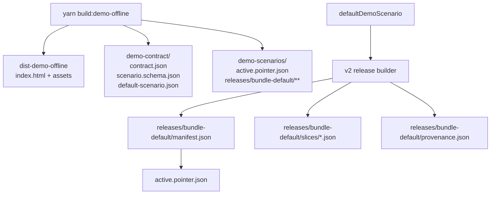
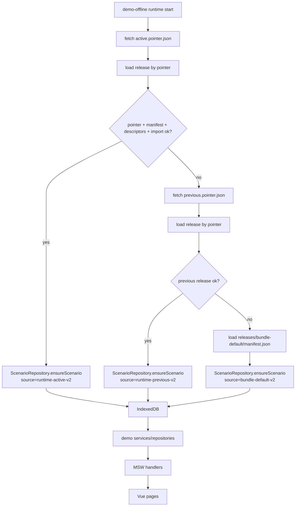
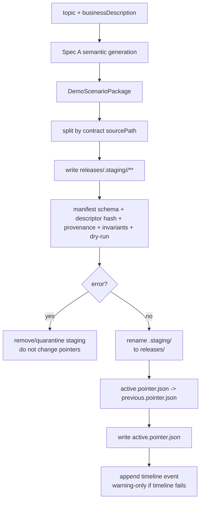

# Demo Offline Runtime Package v2 Release Store 技术设计

## 架构概述

本设计落实 `demo-offline-runtime-package-v2-manifest-slices` 的 hard-cut v2-only 需求：新 `demo-offline` 外部 runtime package 不再读取或生成 v1 `active.json`、`previous.json`、`active.meta.json`。v1 P0 只作为实现参考，保留的稳定边界是：runtime 仍最终组装为现有 `DemoScenarioPackage`，再通过 `ScenarioRepository.ensureScenario()` 导入 IndexedDB；页面、MSW handler、service/repository 继续只消费 IndexedDB 或服务层。

当前 P0 证据：

| 现状 | 代码落点 | v2 设计动作 |
| --- | --- | --- |
| runtime loader 读取 `active.json`、`active.meta.json`、`previous.json` | `ruoyi-fastapi-frontend/src/demo/runtime/scenario-package-loader.ts` | 替换为 pointer -> manifest -> slices loader，移除 v1 fallback |
| Vite 插件 build 后写 `active.json`、`active.meta.json` | `ruoyi-fastapi-frontend/vite/plugins/demo-offline-contract.ts` | 改为写 `releases/bundle-default/**` 和 `active.pointer.json` |
| MCP writer 写 `active.next.json` 并 rename 为 `active.json` | `tools/demo-offline-mcp/src/offline-static/writer.ts` | 改为 `.staging/<release-id>` -> `releases/<release-id>`，激活只切 pointer |
| MCP path guard 已限制写 `demo-scenarios/**` | `tools/demo-offline-mcp/src/offline-static/paths.ts` | 扩展 release store 路径，继续禁止 `assets/**`、`index.html`、路径穿越和 symlink escape |
| import dry-run 已能把 `DemoScenarioPackage` 导入 fake-indexeddb | `tools/demo-offline-mcp/src/offline-static/import-dry-run.ts` | 先由 v2 release 组装出 package，再复用 dry-run |
| canonical JSON / sha256 已存在 | `ruoyi-fastapi-frontend/src/demo/scenarios/fingerprint.ts`、`tools/demo-offline-mcp/src/hash.ts` | 复用并扩展到 descriptor、manifest root、pointer hash |

设计核心：

```text
外部格式硬切 v2 Release Store
  -> active.pointer.json
  -> releases/<release-id>/manifest.json
  -> descriptor 指向 slices/artifacts/provenance
  -> 组装 DemoScenarioPackage
  -> IndexedDB import
```

Release Store 原则：

- release 不可变：`releases/<release-id>/` 发布后不得就地修改。
- 激活只切 pointer：`active.pointer.json` 是当前正式 release 的唯一入口。
- default 也是 release：`demo-scenarios/releases/bundle-default/manifest.json` 是固定路径文件型 fallback，不使用 JS 内置 default 数据旁路。
- timeline 非关键路径：`timeline.json` 只服务审计和诊断，runtime 启动不读取它。
- descriptor 可扩展：本 spec 实现 slice、artifact、provenance；预留 blueprint、scenario-graph、recipe mediaType，但不实现 recipe 展开。

## 数据流图

Build 后输出结构：



Runtime 加载：



MCP 生成与激活：



Release 校验细节：

```mermaid
flowchart LR
  Pointer["pointer"] --> PSchema["pointer schema/path safety"]
  PSchema --> Manifest["manifest"]
  Manifest --> MSchema["manifest schema"]
  MSchema --> Descriptors["descriptors"]
  Descriptors --> Hash["sha256 + size + rootSha256"]
  Hash --> Assemble["assemble DemoScenarioPackage"]
  Assemble --> ScenarioSchema["validateDemoScenarioPackage / JSON Schema"]
  ScenarioSchema --> Invariants["cross-entity invariants"]
  Invariants --> ImportDryRun["IndexedDB import dry-run"]
```



## 组件与接口定义

### 前端 release store 类型

新增或重构 `ruoyi-fastapi-frontend/src/demo/scenarios/release-store.ts`，集中定义 v2 文件模型、校验和组装工具。MCP 侧在 `tools/demo-offline-mcp/src/offline-static/release-store.ts` 镜像同名模型，避免跨 workspace 打包耦合。

```ts
export type RuntimeScenarioSource =
  | 'runtime-active-v2'
  | 'runtime-previous-v2'
  | 'bundle-default-v2';

export type RuntimeScenarioLoadStage =
  | 'fetch'
  | 'parse'
  | 'pointer'
  | 'manifest'
  | 'descriptor'
  | 'hash'
  | 'schema'
  | 'contract'
  | 'import';

export interface RuntimePackagePointer {
  formatVersion: 2;
  releaseId: string;
  manifestPath: string;
  manifestSha256: string;
  activatedAt: string;
  contractFingerprint: string;
  scenarioFingerprint: string;
}

export interface RuntimePackageV2Manifest {
  formatVersion: 2;
  releaseId: string;
  scenarioId: string;
  schemaVersion: 1;
  contractFingerprint: string;
  generatorVersion: string;
  seed: string;
  generatedAt: string;
  scenarioFingerprint: string;
  rootSha256: string;
  descriptors: RuntimePackageDescriptor[];
}

export type RuntimePackageDescriptor =
  | RuntimeSliceDescriptor
  | RuntimeArtifactDescriptor
  | RuntimeProvenanceDescriptor
  | RuntimeFutureDescriptor;

export interface RuntimeDescriptorBase {
  kind: string;
  name: string;
  mediaType: string;
  path: string;
  sha256: string;
  sizeBytes: number;
  schemaVersion: 1;
}

export interface RuntimeSliceDescriptor extends RuntimeDescriptorBase {
  kind: 'slice';
  sourcePath: string;
  module: 'auth' | 'system' | 'project' | 'simulation';
  recordCount: number;
  materializationReason:
    | 'copied-default'
    | 'semantic-generated'
    | 'runtime-required'
    | 'reviewability'
    | 'recipe-not-yet-supported';
  order?: number;
}
```

约束：

- `releaseId` 只允许 `bundle-default` 或 `/^[a-z0-9][a-z0-9._-]{1,79}$/`。
- `manifestPath` 必须等于 `demo-scenarios/releases/<release-id>/manifest.json`。
- descriptor `path` 必须位于同一 release 目录内，拒绝绝对路径、`..`、跨 release 路径和 URL。
- JSON descriptor 的 `sha256` 使用 canonical JSON 计算；`sizeBytes` 使用 canonical JSON 的 UTF-8 字节数，避免格式化空白影响复现。
- `rootSha256` = `sha256CanonicalJson(manifestWithoutRootSha256)`；pointer 的 `manifestSha256` 必须等于 manifest `rootSha256`。

### v2 RuntimeScenarioPackageLoader

重构 `ruoyi-fastapi-frontend/src/demo/runtime/scenario-package-loader.ts`：

```ts
const ACTIVE_POINTER_PATH = 'demo-scenarios/active.pointer.json';
const PREVIOUS_POINTER_PATH = 'demo-scenarios/previous.pointer.json';
const BUNDLE_DEFAULT_MANIFEST_PATH = 'demo-scenarios/releases/bundle-default/manifest.json';
```

加载顺序：

1. `tryLoadPointerRelease('runtime-active-v2', ACTIVE_POINTER_PATH)`
2. 失败后 `tryLoadPointerRelease('runtime-previous-v2', PREVIOUS_POINTER_PATH)`
3. 再失败 `tryLoadManifestRelease('bundle-default-v2', BUNDLE_DEFAULT_MANIFEST_PATH)`

每次 release load 都执行：

1. fetch pointer 或固定 default manifest。
2. 校验 pointer schema、manifest path、manifest hash、contract fingerprint、scenario fingerprint。
3. fetch manifest text，parse JSON，校验 `rootSha256`。
4. fetch descriptors，校验 hash、size、mediaType 和 path safety。
5. 按 `sourcePath` 组装 `DemoScenarioPackage`。
6. 调用 `validateDemoScenarioPackage()`。
7. 调用 `importScenario(selection)`，由 `initializeDemoRuntimeState()` 继续委托 `ScenarioRepository.ensureScenario()`。

v1 文件处理：

- loader 不定义 `ACTIVE_SCENARIO_PATH`、`ACTIVE_META_PATH`、`PREVIOUS_SCENARIO_PATH`。
- 即使 `demo-scenarios/active.json` 存在，也不 fetch、不 parse、不 fallback。
- 测试通过 `fetchJson/fetchText` fixture 验证 v1 residue 被忽略。

### ScenarioRepository 边界

`ScenarioRepository` 不理解 v2 manifest/slices。它只接收组装后的 `DemoScenarioPackage` 和 import context。需要更新的只是 source 类型：

```ts
export interface DemoScenarioImportContext {
  source: 'runtime-active-v2' | 'runtime-previous-v2' | 'bundle-default-v2';
  contractFingerprint?: string;
  fallbackReason?: RuntimeScenarioLoadIssue;
  validationSummary?: RuntimeValidationSummary;
}
```

`sameScenario()` 仍以 `schemaVersion + scenarioId + scenarioVersion + scenario.fingerprint` 判断内容身份。

### Build-time default release exporter

重构 `ruoyi-fastapi-frontend/vite/plugins/demo-offline-contract.ts`：

- 继续写 `demo-contract/contract.json`、`scenario.schema.json`、`default-scenario.json`。
- 不再写 `demo-scenarios/active.json` 或 `active.meta.json`。
- 调用 shared release builder，把 `defaultDemoScenario` 拆为：

```text
demo-scenarios/
  active.pointer.json
  releases/
    bundle-default/
      manifest.json
      provenance.json
      slices/
        auth.json
        system.json
        project.projects.json
        project.versions.json
        project.topologies.json
        simulation.sessions.json
        simulation.messages.json
        simulation.bandwidth.json
        simulation.alarms.json
        simulation.faults.json
        simulation.events.json
        simulation.streamFrames.json
```

`active.pointer.json` 指向 `bundle-default`。构建后执行 hard-cut-v1-absence 检查：dist runtime 输出不得包含 v1 `active.json`、`previous.json`、`active.meta.json`。

### MCP release writer

新增 `tools/demo-offline-mcp/src/offline-static/release-writer.ts` 或替换现有 writer 中 offline-static 路径。推荐保留公共函数名语义，但返回 v2 字段：

```ts
export async function writeRuntimeReleaseCandidate(input): Promise<ToolEnvelope<OfflineStaticActivationResult>>;
export async function activateRuntimeRelease(paths, releaseId): Promise<ToolEnvelope<OfflineStaticActivationResult>>;
export async function validateRuntimeRelease(paths, releaseIdOrPointer): Promise<ToolEnvelope<RuntimeValidationSummary>>;
```

写入流程：

1. `resolveOfflineStaticTargetPaths()` 扩展出：
   - `activePointerPath`
   - `previousPointerPath`
   - `timelinePath`
   - `releasesRoot`
   - `stagingRoot`
   - `bundleDefaultManifestPath`
2. `writeRuntimeReleaseCandidate()` 写 `.staging/<release-id>/**`，包括 manifest、provenance、slices、semantic report artifact。
3. `validateRuntimeRelease()` 从 staging release 组装 package，执行 schema、contract、invariant、semantic report summary、hash 和 import dry-run。
4. 校验通过后 rename `.staging/<release-id>` 到 `releases/<release-id>`。
5. `activateRuntimeRelease()` 把当前 active pointer 写为 previous pointer，再写新的 active pointer。
6. 追加 timeline 事件；timeline 失败只产生 warning。

失败原则：

- error 级 gate 失败不得改变 active/previous pointer。
- 已发布 release 不得覆盖。
- staging 失败可删除或隔离为 `.failed/<release-id>`；具体由实现选择，但必须返回结构化 issue。

### Hash 与 canonical JSON

前端和 MCP 已分别有 canonical JSON 实现。v2 统一使用以下规则：

```ts
descriptorSha256 = sha256CanonicalJson(descriptorJsonValue);
descriptorSizeBytes = utf8ByteLength(canonicalJson(descriptorJsonValue));
manifestRootSha256 = sha256CanonicalJson({ ...manifest, rootSha256: undefined });
pointer.manifestSha256 = manifest.rootSha256;
```

注意：

- `scenario.fingerprint` 仍是组装后 `DemoScenarioPackage` 的场景内容身份。
- `rootSha256` 是 release manifest root，不替代 `scenario.fingerprint`。
- semantic report hash 是 artifact descriptor hash，不进入浏览器运行必需语义判断。

### Provenance 与 timeline

`provenance.json` 是 release 必需 artifact，manifest 也要有 provenance descriptor。它记录生成证明，不作为 runtime 业务数据。

`timeline.json` 位于 `demo-scenarios/timeline.json`，以 JSON array 或 JSONL 均可，design 建议 JSONL 风格便于 append；如果为了浏览器或人工查看选择 JSON array，写入必须使用临时文件再 rename，避免半写。runtime 不读取 timeline。

## API 接口设计

### 静态文件读取接口

| Method | Path | Consumer | 行为 |
| --- | --- | --- | --- |
| GET | `/demo-scenarios/active.pointer.json` | runtime loader | active v2 第一入口 |
| GET | `/demo-scenarios/previous.pointer.json` | runtime loader | active v2 失败后尝试 |
| GET | `/demo-scenarios/releases/<release-id>/manifest.json` | runtime loader / MCP validate | release root metadata |
| GET | `/demo-scenarios/releases/<release-id>/slices/*.json` | runtime loader / MCP validate | 组装 `DemoScenarioPackage` |
| GET | `/demo-scenarios/releases/<release-id>/provenance.json` | MCP validate / 人工审计 | runtime 可校验 hash，但页面不消费 |
| GET | `/demo-scenarios/releases/bundle-default/manifest.json` | runtime loader | fixed bundle default fallback |
| GET | `/demo-contract/contract.json` | runtime / MCP | contract fingerprint、mapping、invariants |
| GET | `/demo-contract/scenario.schema.json` | MCP validate | JSON Schema 校验 |
| GET | `/demo-contract/default-scenario.json` | MCP / build | 复制默认 auth/system 或审计 |

不再定义：

- `/demo-scenarios/active.json`
- `/demo-scenarios/previous.json`
- `/demo-scenarios/active.meta.json`
- `/demo-scenarios/active.next.json`
- `/demo-scenarios/active.next.meta.json`

### MCP 工具接口

现有工具保持 customer-facing 名称优先，行为切换到 v2-only：

| Tool | 变化 |
| --- | --- |
| `demo_offline_generate_demo` | `target.kind=offline-static` 默认 v2；`packageFormat` 省略或为 `v2`，其他值返回 blocker |
| `demo_offline_generate_runtime_demo` | 返回 releaseId、activePointerPath、manifestPath、provenancePath、semanticReportPath、validationSummary |
| `demo_offline_validate_runtime_package` | 改为校验 active pointer、previous pointer、指定 releaseId 或 staging release |
| `demo_offline_dry_run_runtime_package` | 从 v2 release 组装 package 后复用 import dry-run |
| `demo_offline_activate_runtime_package` | 输入 releaseId 或 staging releaseId；成功后只切 pointer |

返回 envelope 保持 P0 风格：

```ts
interface OfflineStaticActivationResult {
  phase:
    | 'staged'
    | 'validation_failed'
    | 'dry_run_failed'
    | 'published'
    | 'activated';
  targetKind: 'offline-static';
  packageFormat: 'v2';
  targetRoot: string;
  releaseId: string;
  scenarioId: string;
  topicKey: string;
  seed: string;
  contractFingerprint: string;
  scenarioFingerprint: string;
  activePointerPath?: string;
  previousPointerPath?: string;
  manifestPath?: string;
  provenancePath?: string;
  semanticReportPath?: string;
  validationSummary?: RuntimeValidationSummary;
  dryRunSummary?: ImportDryRunSummary;
  warnings?: ValidationIssue[];
  paths: string[];
}
```

### Browser API 和后端 API

不新增浏览器业务 API，不新增后端 API。MSW handlers 不解析 release store；它们继续通过 demo service/repository 读取 IndexedDB。

## 数据模型与数据库变更

不修改后端数据库，不修改 IndexedDB schema，不修改 `DemoScenarioPackage` schemaVersion。v2 Release Store 是外部静态文件模型。

### 文件结构

```text
dist-demo-offline/
  demo-contract/
    contract.json
    scenario.schema.json
    default-scenario.json
  demo-scenarios/
    active.pointer.json
    previous.pointer.json        # optional
    timeline.json                # audit only
    releases/
      bundle-default/
        manifest.json
        provenance.json
        slices/*.json
      <release-id>/
        manifest.json
        provenance.json
        quality-report.json       # optional artifact
        slices/*.json
      .staging/
        <release-id>/
          manifest.json
          provenance.json
          slices/*.json
```

### Pointer

```json
{
  "formatVersion": 2,
  "releaseId": "drone-inspection-20260429-153000",
  "manifestPath": "demo-scenarios/releases/drone-inspection-20260429-153000/manifest.json",
  "manifestSha256": "sha256...",
  "activatedAt": "2026-04-29T15:30:00.000Z",
  "contractFingerprint": "sha256...",
  "scenarioFingerprint": "sha256..."
}
```

### Manifest

```json
{
  "formatVersion": 2,
  "releaseId": "drone-inspection-20260429-153000",
  "scenarioId": "drone-inspection-runtime-demo",
  "schemaVersion": 1,
  "contractFingerprint": "sha256...",
  "generatorVersion": "demo-offline-generator-p0.1+semantic",
  "seed": "seed...",
  "generatedAt": "2026-04-29T15:30:00.000Z",
  "scenarioFingerprint": "sha256...",
  "rootSha256": "sha256...",
  "descriptors": [
    {
      "kind": "slice",
      "name": "project.projects",
      "mediaType": "application/vnd.ruoyi.demo.slice+json;version=2",
      "path": "slices/project.projects.json",
      "sha256": "sha256...",
      "sizeBytes": 10240,
      "schemaVersion": 1,
      "sourcePath": "project.projects",
      "module": "project",
      "recordCount": 4,
      "materializationReason": "semantic-generated",
      "order": 10
    }
  ]
}
```

### Slice

slice 文件建议为纯 array：

```json
[
  { "projectId": 7001, "projectName": "..." }
]
```

组装规则：

- descriptor `sourcePath` 决定写回 `DemoScenarioPackage` 的位置。
- `auth` 和 `system` 可按模块整包 slice，也可按 contract table 粒度拆分；manifest 必须能映射到 `DemoScenarioPackage` 对应路径。
- 多 shard 情况使用相同 `sourcePath` + 不同 `order`，组装时按 `order` 拼接。

### Provenance

```ts
interface RuntimePackageV2Provenance {
  formatVersion: 1;
  releaseId: string;
  scenarioId: string;
  topicKey: string;
  topicSummary: string;
  businessDescriptionSha256?: string;
  seed: string;
  contractFingerprint: string;
  generatorVersion: string;
  semanticGeneratorVersion?: string;
  semanticReportSha256?: string;
  generatedAt: string;
  validationSummary: RuntimeValidationSummary;
  materials: Array<{
    kind: 'demo-contract' | 'default-scenario' | 'semantic-report' | 'generator';
    name: string;
    sha256?: string;
  }>;
}
```

### Timeline event

```ts
interface RuntimePackageTimelineEvent {
  eventId: string;
  eventType: 'staged' | 'verified' | 'activated' | 'rolled_back' | 'gc_warning';
  releaseId: string;
  time: string;
  actor: 'mcp' | 'build' | 'manual';
  manifestSha256?: string;
  result: 'success' | 'warning' | 'error';
  summary: string;
}
```

## 安全考量

- Runtime 不加载 MCP server、AI provider SDK、API key、远程 registry 或签名服务。
- Pointer、manifest、descriptor path 必须拒绝绝对路径、`..`、URL、跨 release 引用和 symlink escape。
- MCP 写权限继续限制在 `demo-scenarios/**`，并继续拒绝 `index.html`、`assets/**` 和系统路径。
- `demo-contract/**`、manifest、provenance、semantic report 不得包含用户私密数据、本机绝对路径、token、API key 或远程 `$ref`。
- `active.pointer.json` 切换是唯一激活动作；error 级 gate 失败不得改变 active/previous pointer。
- Timeline 不进入 runtime 启动关键路径，避免审计日志损坏导致演示不可用。
- hard-cut-v1-absence 检查防止新 dist 悄悄回落到 v1 外部包格式。
- 已发布 release 不可变，防止 pointer 指向内容被现场手工修改后仍被信任。

## 测试策略

### 前端 runtime tests

重点文件：

- `ruoyi-fastapi-frontend/src/demo/runtime/scenario-package-loader.test.ts`
- `ruoyi-fastapi-frontend/src/demo/runtime/state.ts`
- `ruoyi-fastapi-frontend/src/demo/scenarios/contract.test.ts`

覆盖：

- active v2 release 成功加载并导入。
- active pointer schema 无效，回退 previous pointer。
- active manifest root hash 不匹配，回退 previous pointer。
- previous 也失败，读取固定 `releases/bundle-default/manifest.json`。
- `timeline.json` 缺失或损坏不影响加载。
- v1 `active.json`、`previous.json`、`active.meta.json` fixture 存在但不会被 fetch。
- source 诊断值为 `runtime-active-v2`、`runtime-previous-v2`、`bundle-default-v2`。

### Build/exporter tests

覆盖：

- `build:demo-offline` 输出 `demo-contract/**`。
- 输出 `demo-scenarios/active.pointer.json`。
- 输出 `demo-scenarios/releases/bundle-default/manifest.json`、`provenance.json` 和 slices。
- 不输出 v1 `active.json`、`previous.json`、`active.meta.json`。
- default release manifest hash、descriptor hash、contractFingerprint 可校验。

### MCP tests

重点文件：

- `tools/demo-offline-mcp/tests/offline-static.test.ts`
- `tools/demo-offline-mcp/src/offline-static/paths.ts`
- `tools/demo-offline-mcp/src/offline-static/writer.ts`
- `tools/demo-offline-mcp/src/tools/validate-runtime-package.ts`
- `tools/demo-offline-mcp/src/tools/dry-run-runtime-package.ts`

覆盖：

- `.staging/<release-id>` 写入和发布 rename。
- 已存在 releaseId blocker。
- manifest/root hash、descriptor hash、provenance hash 错误失败。
- active pointer 原子切换，旧 active pointer 保存为 previous pointer。
- semantic report artifact hash 错误失败。
- warning-only 可激活且进入 result/provenance/timeline。
- path guard 拒绝 `assets/**`、`index.html`、绝对路径、`..`、symlink escape。
- legacy v1 residue 只 warning/ignored，不作为输入。

### 回归命令

```bash
cd tools/demo-offline-mcp && npm test -- --run
cd ruoyi-fastapi-frontend && yarn test:run src/demo/runtime/scenario-package-loader.test.ts src/demo/scenarios/contract.test.ts
cd ruoyi-fastapi-frontend && yarn type-check
```

设计阶段轻量检查：

```bash
test -f docs/specs/demo-offline-runtime-package-v2-manifest-slices/design.md
rg -n "^## 架构概述$" docs/specs/demo-offline-runtime-package-v2-manifest-slices/design.md
rg -n "^## 数据流图$" docs/specs/demo-offline-runtime-package-v2-manifest-slices/design.md
rg -n "^## 组件与接口定义$" docs/specs/demo-offline-runtime-package-v2-manifest-slices/design.md
rg -n "^## API 接口设计$" docs/specs/demo-offline-runtime-package-v2-manifest-slices/design.md
rg -n "^## 数据模型与数据库变更$" docs/specs/demo-offline-runtime-package-v2-manifest-slices/design.md
rg -n "^## 安全考量$" docs/specs/demo-offline-runtime-package-v2-manifest-slices/design.md
rg -n "^## 测试策略$" docs/specs/demo-offline-runtime-package-v2-manifest-slices/design.md
```

## 需求追溯

| 需求 | 设计覆盖 |
| --- | --- |
| R1 | 架构概述、v2 RuntimeScenarioPackageLoader、Build-time default release exporter、API 接口设计 |
| R2 | MCP release writer、数据流图、文件结构、安全考量 |
| R3 | Pointer、Runtime 加载、静态文件读取接口、数据模型 |
| R4 | Descriptor manifest、Hash 与 canonical JSON、Manifest 数据模型 |
| R5 | Slice 模型、组装规则、测试策略 |
| R6 | ScenarioRepository 边界、数据流图、Browser API 和后端 API |
| R7 | Provenance、manifest artifact descriptor、MCP 返回结果 |
| R8 | Timeline event、timeline 非关键路径、安全考量 |
| R9 | MCP 工具接口、release writer、path guard、测试策略 |
| R10 | Build-time default release exporter、固定 `bundle-default` 路径、build/exporter tests |
| R11 | 文件结构、Release Store 原则、MCP warnings 和 future GC 边界 |
| R12 | 测试策略、回归命令、hard-cut-v1-absence 覆盖 |
