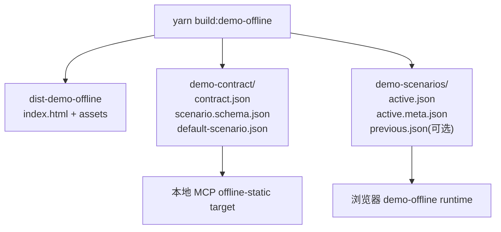
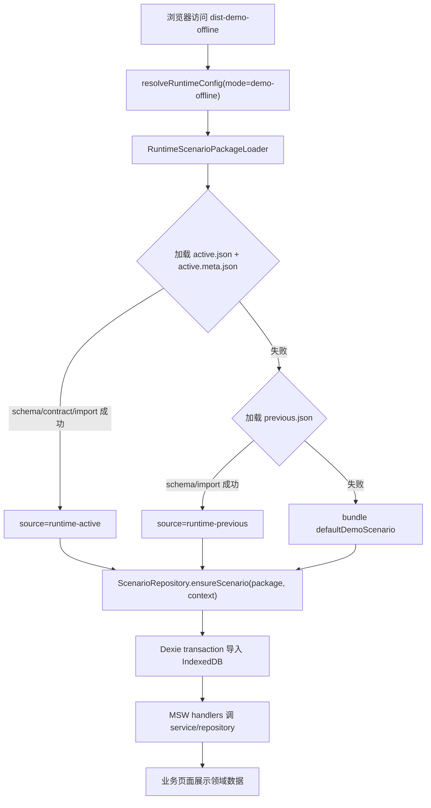
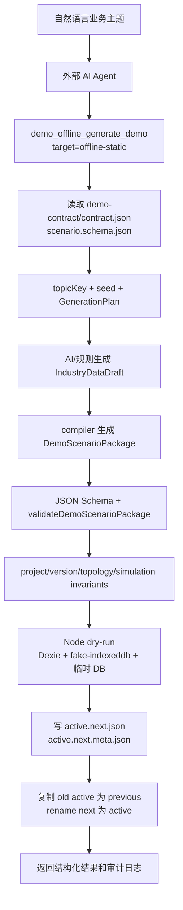
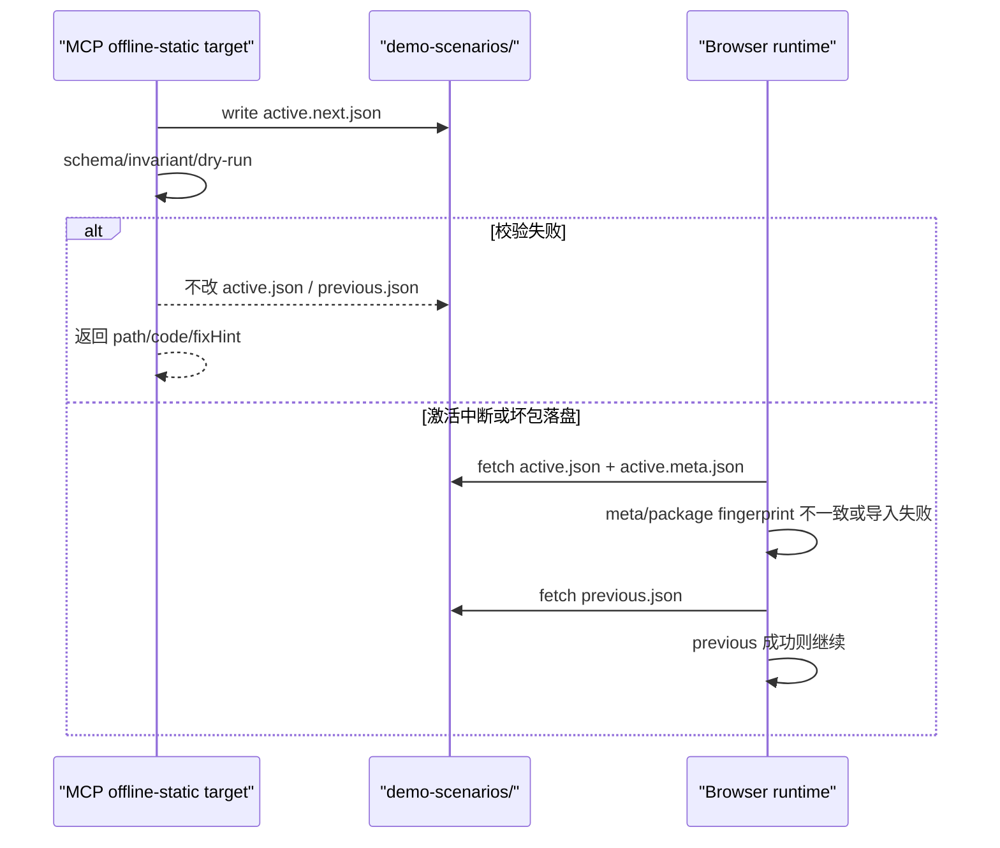

# Demo Offline Runtime Scenario Package 技术设计

## 架构概述

本设计在既有 `frontend-demo-offline-runtime` 和 `demo-offline-data-mcp` 基础上新增一条客户交付主路径：`offline-static target`。核心变化是把客户行业数据从编译期 `src/demo/scenarios/generated/*.ts` 迁移到 build 后可替换的 `dist-demo-offline/demo-scenarios/*.json`，同时保留现有 source-generated 流程作为开发、回归和场景固化能力。

P0 架构分为四层：

| 层 | 责任 | 主要落点 |
| --- | --- | --- |
| 通用离线壳 | Vue 页面、路由、MSW、Dexie schema、bundle default scenario、runtime loader | `ruoyi-fastapi-frontend/src/demo/**`、`vite.config.ts` |
| 随包契约 | 机器可读 module contract、JSON Schema、default scenario、contract fingerprint 输入 | `dist-demo-offline/demo-contract/**` |
| Runtime 数据包 | build 后可替换的纯 JSON `DemoScenarioPackage` 与元信息 | `dist-demo-offline/demo-scenarios/**` |
| MCP offline-static target | 从业务主题生成、校验、dry-run、原子激活 runtime package | `tools/demo-offline-mcp/src/**` |

现有实现证据：

- `DemoScenarioPackage` 目前定义在 `ruoyi-fastapi-frontend/src/demo/scenarios/schema.ts`，包含 `auth/system/project/simulation` 四大切片。
- `ScenarioRepository.ensureScenario()` 已经通过 Dexie transaction 清空并导入场景数据，是 runtime import 的核心复用点。
- `initializeDemoRuntimeState()` 当前仍调用 `getDemoScenarioPackage(config.scenarioId)`，因此数据仍来自编译期 registry。
- MCP 当前 `ProjectPaths` 只允许写 `src/demo/scenarios/generated/**`，`writer.ts` 的 candidate/promote 也只生成 TS 场景。

外部参考对设计的约束：

- JSON Schema Draft 2020-12 是当前正式规格之一，支持 schema bundling 与更明确的 vocabulary，但现代 JSON Schema 的动态引用会显著增加复杂度，因此 P0 的 `scenario.schema.json` 只使用固定、静态、可本地解析的基础关键字，不使用 `$dynamicRef`。
- MSW 官方定位是浏览器和 Node.js 的网络拦截层，适合保持独立 API mock layer；本设计继续让 MSW handler 做薄适配，不让 MCP 通过 MSW 写数据。
- Dexie 官方 transaction 模型适合场景导入的全量清空再写入，现有 repository 已经采用该模式。
- `fake-indexeddb` 官方 README 明确其主要用途是 Node.js 中测试 IndexedDB 依赖代码，并提供 Dexie 集成方式；P0 dry-run 使用它隔离候选包导入。

新增能力采用增量设计：

1. 前端新增 `RuntimeScenarioPackageLoader`，按 `active -> previous -> bundle default` 选择场景。
2. 构建新增 `DemoOfflineContractExporter`，在 `build:demo-offline` 后写出 `demo-contract/**` 和默认 `demo-scenarios/**` 骨架。
3. MCP 新增 target adapter，复用现有语义生成、draft validation、compiler，并把 source-generated writer 扩展为 offline-static JSON writer。
4. MCP 新增 contract/invariant/runtime-import dry-run，只有全部通过才激活 `active.json`。

P0 不引入后端数据库迁移，不改变真实后端模式，不把 MCP 或 AI provider 打进浏览器运行时。

## 数据流图

Build 后交付结构：



Runtime 启动加载：



MCP offline-static 生成激活：



失败路径：



## 组件与接口定义

### 前端 RuntimeScenarioPackageLoader

新增 `ruoyi-fastapi-frontend/src/demo/runtime/scenario-package-loader.ts`：

```ts
export type RuntimeScenarioSource = 'runtime-active' | 'runtime-previous' | 'bundle-default';

export interface RuntimeScenarioMeta {
  scenarioId: string;
  topicKey: string;
  schemaVersion: 1;
  contractFingerprint: string;
  generatorVersion: string;
  seed: string;
  generatedAt: string;
  validationSummary: RuntimeValidationSummary;
  sourceTarget: 'offline-static';
  scenarioFingerprint: string;
  packageSha256: string;
}

export interface RuntimeScenarioSelection {
  source: RuntimeScenarioSource;
  package: DemoScenarioPackage;
  meta?: RuntimeScenarioMeta;
  fallbackReason?: RuntimeScenarioLoadIssue;
}

export interface RuntimeScenarioLoadIssue {
  source: RuntimeScenarioSource;
  stage: 'fetch' | 'parse' | 'schema' | 'contract' | 'import';
  message: string;
  code: string;
}

export interface RuntimeValidationSummary {
  schemaValid: boolean;
  contractValid: boolean;
  invariantValid: boolean;
  dryRunValid?: boolean;
  issueCount: number;
}
```

加载规则：

- `active.json` 必须是纯 `DemoScenarioPackage`，不得包 `{ meta, package }`。
- `active.meta.json` 必须与 `active.json.scenario.fingerprint`、`packageSha256`、`contractFingerprint` 对齐。
- `previous.json` 仍是纯 `DemoScenarioPackage`；若将来存在 `previous.meta.json`，runtime 可以使用它增强诊断，但 P0 不依赖该文件。
- `fetch` 使用 `cache: 'no-store'`，并可追加 `?v=<Date.now()>` 避免静态服务器或浏览器缓存旧 active。
- 任一阶段失败只记录诊断并尝试下一来源，不抛到页面导致白屏。

`initializeDemoRuntimeState()` 从当前的 `getDemoScenarioPackage(config.scenarioId)` 调整为：

```ts
const selection = await loadRuntimeScenarioPackage(config, logger);
const result = await scenarioRepository.ensureScenario(selection.package, {
  source: selection.source,
  contractFingerprint: selection.meta?.contractFingerprint,
  fallbackReason: selection.fallbackReason,
  validationSummary: selection.meta?.validationSummary,
});
```

`getDemoScenarioPackage()` 和 generated registry 保留，用于：

- bundle default fallback；
- source-generated 开发流程；
- candidate-focused-tests；
- 未来将某个客户数据固化进源码的开发任务。

### ScenarioRepository 导入扩展

现有 `ScenarioRepository` 保持唯一 IndexedDB 导入入口，但扩展导入上下文：

```ts
export interface DemoScenarioImportContext {
  source: RuntimeScenarioSource;
  contractFingerprint?: string;
  fallbackReason?: RuntimeScenarioLoadIssue;
  validationSummary?: RuntimeValidationSummary;
}

export interface DemoActiveScenarioMeta extends DemoScenarioDescriptor {
  importedAt: string;
  source: RuntimeScenarioSource;
  contractFingerprint?: string;
  fallbackReason?: RuntimeScenarioLoadIssue;
  validationSummary?: RuntimeValidationSummary;
}
```

`ScenarioRepository.importScenario()` 继续使用 Dexie transaction 全量清空并写入表。新增约束：

- `sameScenario()` 比较时仍以 `schemaVersion + scenarioId + scenarioVersion + scenario.fingerprint` 为内容身份，不把 `contractFingerprint` 写进 `active.json`。
- `meta` 表保存 source、contract fingerprint 和 fallback reason，供 `window.__DEMO_RUNTIME__`、logger、测试和现场排障使用。
- 如果导入失败，异常必须被 loader 捕获并转为 fallback reason。

### DemoOfflineContractExporter

新增 `ruoyi-fastapi-frontend/vite/plugins/demo-offline-contract.ts`，只在 `mode === 'demo-offline' && command === 'build'` 时启用。`closeBundle` 后写出：

```text
dist-demo-offline/
  demo-contract/
    contract.json
    scenario.schema.json
    default-scenario.json
  demo-scenarios/
    active.json
    active.meta.json
```

`active.json` 初始写入 `defaultDemoScenario`，确保离线壳首次打开有可运行数据；客户现场 MCP 覆盖的是同一目录下的 runtime package，不需要 rebuild。

`contract.json` 数据结构：

```ts
export interface DemoOfflineContractManifest {
  contractVersion: 1;
  schemaVersion: 1;
  generatedAt: string;
  runtimeAdapterVersion: string;
  generatorAdapterVersion: string;
  contractFingerprint: string;
  supportedModules: Array<'auth' | 'system' | 'project' | 'simulation'>;
  generatedModules: Array<'project' | 'simulation'>;
  copiedModules: Array<'auth' | 'system'>;
  indexedDbMapping: DemoIndexedDbMapping;
  handlerCoverage: DemoHandlerCoverage[];
  invariants: DemoInvariantDefinition[];
}

export interface DemoHandlerCoverage {
  module: 'auth' | 'system' | 'system-admin' | 'project' | 'simulation';
  source: string;
  apiPrefix: string;
  coveredRoutes: string[];
  unsupportedBehavior: 'DEMO_API_NOT_IMPLEMENTED';
}
```

`contractFingerprint` 使用 canonical JSON 计算：

```text
sha256(
  canonical(contract without generatedAt/contractFingerprint)
  + canonical(scenario.schema.json)
  + runtimeAdapterVersion
  + generatorAdapterVersion
)
```

P0 的 canonical JSON 使用稳定 key 排序、UTF-8 编码和无空白序列化。不得把 `generatedAt`、本地绝对路径、AI provider 信息、API key 或用户私密数据放入 fingerprint 输入。

### Scenario JSON Schema

新增 `ruoyi-fastapi-frontend/src/demo/scenarios/scenario-json-schema.ts`，导出静态 JSON Schema Draft 2020-12 对象。P0 只覆盖确定性可控关键字：

- `type`
- `required`
- `properties`
- `items`
- `enum`
- `minItems`
- `additionalProperties`

不使用 `$dynamicRef`、远程 `$ref`、联网可解析 schema 或复杂 annotation-dependent validation。原因是 runtime 和 MCP 必须离线、可预测，且现代 JSON Schema 复杂特性会增加验证器差异风险。

### MCP TargetAdapter

在 `tools/demo-offline-mcp/src/targets/` 新增 target adapter：

```ts
export type DemoTargetKind = 'source-generated' | 'offline-static';

export interface DemoTargetAdapter {
  kind: DemoTargetKind;
  readContract(): Promise<DemoOfflineContractManifest>;
  compile(input: CompileScenarioInput): Promise<ToolEnvelope<CompileScenarioResult>>;
  validate(packageValue: CompiledDemoScenarioPackage): Promise<ToolEnvelope<RuntimeValidationSummary>>;
  dryRun(packageValue: CompiledDemoScenarioPackage): Promise<ToolEnvelope<ImportDryRunSummary>>;
  writeCandidate(packageValue: CompiledDemoScenarioPackage, meta: RuntimeScenarioMeta): Promise<ToolEnvelope<DemoOfflineArtifact>>;
  activate(input: ActivateRuntimePackageInput): Promise<ToolEnvelope<ActivateRuntimePackageResult>>;
}
```

`source-generated` adapter 包装现有 `writeCandidateScenario()`、`runChecks()`、`promoteCandidateScenario()`，保持开发期能力。

`offline-static` adapter 新增路径解析：

```ts
export interface OfflineStaticTargetPaths {
  targetRoot: string;
  demoScenariosRoot: string;
  demoContractRoot: string;
  activePath: string;
  activeMetaPath: string;
  previousPath: string;
  activeNextPath: string;
  activeNextMetaPath: string;
}
```

路径规则：

- `targetRoot` 必须是用户显式传入的离线包根，或由 `dist-demo-offline` 自动探测。
- 读取只允许 `demo-contract/**` 和必要的 `demo-scenarios/**`。
- 写入只允许 `demo-scenarios/**`。
- 拒绝绝对写入、`..`、符号链接逃逸和写入 `assets/**`、`index.html`。

### MCP OfflineStaticWriter

激活流程：

1. 写 `active.next.json` 和 `active.next.meta.json`。
2. 从磁盘重新读取 next 文件并做 JSON parse、schema validation、contract validation、invariant validation、dry-run。
3. 如果当前 `active.json` 存在，复制为 `previous.json`。
4. 原子 rename `active.next.json -> active.json`。
5. 原子 rename `active.next.meta.json -> active.meta.json`。
6. 写审计日志 `.audit/demo-offline-mcp.jsonl`，记录 target、topicKey、seed、contractFingerprint、packageSha256、校验摘要和 changed paths。

如果在第 4、5 步之间中断，runtime 会发现 `active.meta.json` 与 `active.json` 的 `scenarioFingerprint/packageSha256` 不一致，从而拒绝 active 并 fallback。

### MCP RuntimeImportDryRun

新增 `tools/demo-offline-mcp/src/offline-static/import-dry-run.ts`：

```ts
export interface ImportDryRunSummary {
  dbName: string;
  inserted: Record<string, number>;
  activeScenario: {
    scenarioId: string;
    fingerprint: string;
  };
  durationMs: number;
}
```

实现策略：

- MCP package 增加 dev/runtime dependency：`dexie`、`fake-indexeddb`。
- dry-run 在 Node 侧创建临时 DB 名称：`demo-offline-dry-run-${scenarioId}-${randomUUID}`。
- 使用 `fake-indexeddb` 注入 Dexie，不打开浏览器页面。
- 导入顺序和表映射来自 `contract.indexedDbMapping`，并与前端 `ScenarioRepository` 的映射保持同源测试。
- dry-run 完成后关闭并删除临时 DB。

这不是 MSW 测试，也不是页面 E2E；它只证明 candidate package 能按当前离线壳契约导入 IndexedDB，不污染用户当前浏览器演示库。

### InvariantValidator

新增 `tools/demo-offline-mcp/src/offline-static/invariants.ts`，同时把 invariant summary 写入 `contract.json`。P0 检查：

- `project.projects.length >= 1`
- 每个 `project.version.projectId` 引用存在 project。
- 每个可见 project 至少一个 version。
- 每个 topology 引用存在 project，`versionId` 存在时必须引用该 project 的 version。
- topology graph 至少有一个 node，edge 的 source/target 必须能在节点中找到。
- simulation session 引用存在 project/version 关系。
- messages、bandwidth、alarms、faults、events、streamFrames 的 sessionId 必须引用存在 session。
- 至少存在一条可支撑项目列表、版本详情、拓扑查看、仿真只读展示的完整链路。

所有错误返回统一 `ValidationIssue`：

```ts
{
  path: 'simulation.sessions[0].versionId',
  code: 'simulation_version_missing',
  severity: 'error',
  actual: 8001,
  expected: 'versionId from project.versions',
  fixHint: 'Regenerate or repair the draft so every session references an existing project/version pair.',
  autoRepairable: false
}
```

## API 接口设计

### 浏览器静态资源接口

这些不是后端 API，而是静态文件 fetch 入口：

| Method | Path | 用途 | 失败处理 |
| --- | --- | --- | --- |
| GET | `/demo-scenarios/active.json` | 当前 runtime package | 失败后加载 previous |
| GET | `/demo-scenarios/active.meta.json` | 当前 package 元信息和 contract fingerprint | 失败后 active 不可信，加载 previous |
| GET | `/demo-scenarios/previous.json` | 上一个可运行 package | 失败后使用 bundle default |
| GET | `/demo-contract/contract.json` | MCP 读取离线壳契约 | MCP 缺失时 blocker |
| GET | `/demo-contract/scenario.schema.json` | MCP schema validation | MCP 缺失时 blocker |
| GET | `/demo-contract/default-scenario.json` | MCP 无源码时复制默认 auth/system | MCP 缺失时 blocker |

Runtime fetch 示例：

```ts
async function fetchRuntimeJson<T>(path: string): Promise<T> {
  const url = `${path}?_demo_ts=${Date.now()}`;
  const response = await fetch(url, { cache: 'no-store' });
  if (!response.ok) throw new Error(`Failed to load ${path}: ${response.status}`);
  return response.json() as Promise<T>;
}
```

### MCP Tool 输入输出

扩展现有 `demo_offline_generate_demo`：

```ts
interface GenerateDemoInput {
  topic: string;
  businessDescription?: string;
  scenarioId?: string;
  scenarioName?: string;
  projectCount?: number;
  target?: {
    kind: 'source-generated' | 'offline-static';
    root?: string;
  };
  promote?: boolean;
  activate?: boolean;
  replaceExisting?: boolean;
  runChecks?: boolean;
  maxLogLines?: number;
}
```

推荐非技术入口：

```json
{
  "topic": "二手电脑回收项目演示",
  "businessDescription": "突出回收评估、检测、报价、入库和环保流转。",
  "target": {
    "kind": "offline-static",
    "root": "/path/to/dist-demo-offline"
  },
  "promote": true,
  "activate": true
}
```

返回继续使用 `ToolEnvelope<T>`：

```ts
interface GenerateRuntimeScenarioResult {
  phase: 'validation_failed' | 'dry_run_failed' | 'candidate_written' | 'activated';
  targetKind: 'offline-static';
  targetRoot: string;
  scenarioId: string;
  topicKey: string;
  seed: string;
  contractFingerprint: string;
  scenarioFingerprint: string;
  activePath?: string;
  previousPath?: string;
  metaPath?: string;
  validationSummary?: RuntimeValidationSummary;
  dryRunSummary?: ImportDryRunSummary;
  paths: string[];
}
```

新增底层 tools：

| Tool | 用途 |
| --- | --- |
| `demo_offline_scan_context` | 保持现有源码扫描能力，并增加 dist contract 检测 |
| `demo_offline_validate_runtime_package` | 对传入或磁盘上的 JSON package 执行 schema + invariant + fingerprint 校验 |
| `demo_offline_dry_run_runtime_package` | 对 candidate package 执行 Node IndexedDB dry-run |
| `demo_offline_activate_runtime_package` | 对已校验的 `active.next.json` 执行原子激活 |

P0 不提供任意 shell tool；命令执行仍只能通过 named check profile。

## 数据模型与数据库变更

### Runtime Package

`active.json` 和 `previous.json` 直接使用现有 `DemoScenarioPackage`：

```ts
export interface DemoScenarioPackage {
  schemaVersion: 1;
  scenario: {
    id: string;
    name: string;
    version: string;
    fingerprint: string;
    seed?: string;
  };
  auth: { accounts: DemoAccount[]; roles: DemoRole[]; permissions: DemoPermission[] };
  system: { menus: DemoMenu[]; dictTypes: DemoDictType[]; dicts: DemoDictData[]; departments: DemoDepartment[]; posts: DemoPost[]; users: DemoSystemUser[] };
  project: { projects: DemoProject[]; versions: DemoProjectVersion[]; topologies: DemoTopology[] };
  simulation: { sessions: DemoSimulationSession[]; messages: DemoSimulationMessage[]; bandwidth: DemoSimulationBandwidth[]; alarms: DemoSimulationAlarm[]; faults: DemoSimulationFault[]; events: DemoSimulationEvent[]; streamFrames: DemoSimulationFrame[] };
}
```

`scenario.fingerprint` 表示 package 内容身份，不表示契约身份。

### Runtime Meta

`active.meta.json`：

```ts
export interface RuntimeScenarioMeta {
  scenarioId: string;
  topicKey: string;
  schemaVersion: 1;
  contractFingerprint: string;
  generatorVersion: string;
  seed: string;
  generatedAt: string;
  validationSummary: RuntimeValidationSummary;
  sourceTarget: 'offline-static';
  scenarioFingerprint: string;
  packageSha256: string;
}
```

`scenarioFingerprint` 必须等于 `active.json.scenario.fingerprint`。`packageSha256` 基于 canonical `active.json` 计算，用于发现 active/meta 半更新。

### Contract Manifest

`demo-contract/contract.json` 是离线壳能力的机器可读摘要，不是业务数据包：

```ts
interface DemoInvariantDefinition {
  id: string;
  description: string;
  severity: 'error' | 'warning';
  paths: string[];
}

interface DemoIndexedDbMapping {
  dbName: 'ruoyi-demo-offline';
  dbVersion: number;
  tables: Array<{
    table: string;
    sourcePath: string;
    primaryKey: string;
    indexes: string[];
    minItems?: number;
  }>;
}
```

前端 Dexie schema 仍在 `DemoOfflineDb` 中定义；P0 不做 IndexedDB version migration，只要求 contract exporter 读取同一份 table mapping 常量，避免 contract 与 DB schema 手写漂移。

### TopicKey、Seed 和 Fingerprint

`topicKey` 归一化：

```text
normalizeTopic(topic, businessDescription)
  -> trim
  -> lower/safe slug
  -> 常见中文业务短语保留语义词
  -> 无法归一化时返回 blocker
```

`seed`：

```text
sha256(topicKey + '\n' + businessDescription + '\n' + contractFingerprint + '\n' + generatorVersion)
```

`scenario.fingerprint`：

```text
sha256(canonical(DemoScenarioPackage without scenario.fingerprint))
```

`contractFingerprint`：

```text
sha256(canonical(contract + schema + adapter versions))
```

三者分工必须保持清晰：`seed` 控制生成稳定性，`scenario.fingerprint` 控制数据包内容身份，`contractFingerprint` 控制离线壳契约兼容性。

## 安全考量

- 浏览器 runtime 不包含 MCP server、AI provider、API key 或任意本地文件写入能力。
- MCP offline-static target 只能写 `targetRoot/demo-scenarios/**`，读取 `demo-contract/**` 和必要的 `demo-scenarios/**`。
- 所有路径必须 realpath 校验，拒绝 `..`、绝对写入、符号链接逃逸。
- `active.json` 写入前必须经过 schema、contract、invariant 和 import dry-run；失败不得覆盖当前 active。
- `active.meta.json` 必须记录 package hash 和 validation summary，便于审计半更新和坏包来源。
- MSW handler 不解析外部 JSON，不接收 MCP 写数据请求，只继续作为页面 API 的薄适配层。
- P0 不对真实后端、生产模式或 fallback 模式加载外部 runtime package。
- `demo-contract/*.json` 不得包含客户私密数据、绝对路径、token、密码、API key 或联网才能解析的引用。
- 默认账号仍仅用于 demo-offline；如未来接入真实后端 seed target，必须作为独立 target 重新设计权限和审计。

## 测试策略

### 前端测试

新增或更新 Vitest：

- `src/demo/runtime/scenario-package-loader.test.ts`
  - active 成功：读取 active/meta，校验 contract，导入 IndexedDB。
  - active JSON 解析失败：fallback 到 previous。
  - active/meta fingerprint 不一致：fallback 到 previous。
  - active 与 previous 都失败：使用 bundle default。
  - `cache: 'no-store'` 或 cache-busting 参数存在。
- `src/demo/repositories/scenario.test.ts`
  - `ensureScenario(package, context)` 写入 source、contractFingerprint、fallbackReason。
  - 同一 `scenario.fingerprint` 不重复导入。
- `src/demo/handlers/*.test.ts`
  - runtime 外部包导入后 project/simulation handlers 能读到数据。

### MCP 测试

新增或更新 `tools/demo-offline-mcp/tests/**`：

- `offline-static-paths.test.ts`
  - 允许写 `demo-scenarios/**`。
  - 拒绝 `assets/**`、`index.html`、绝对路径、`..` 和 symlink escape。
- `contract.test.ts`
  - 读取 `demo-contract/contract.json`、`scenario.schema.json`、`default-scenario.json`。
  - `contractFingerprint` 对 canonical 输入稳定，对 schema/invariant/adapter 变化敏感。
- `runtime-package-writer.test.ts`
  - 写 `active.next.json` 后校验失败不覆盖 active。
  - 成功激活会备份 previous，并写 active/meta。
  - active/meta 半更新会被 runtime loader 拒绝。
- `invariants.test.ts`
  - project/version/topology/simulation 跨引用失败给出机器可读 path/code/fixHint。
- `import-dry-run.test.ts`
  - 使用 `fake-indexeddb` 和临时 DB 导入成功。
  - dry-run 失败不产生 active 改动。
  - dry-run 后临时 DB 被关闭和删除。

### Build 与验收命令

P0 focused gate：

```bash
cd ruoyi-fastapi-frontend
yarn test:run src/demo/runtime/scenario-package-loader.test.ts src/demo/repositories/scenario.test.ts src/demo/handlers/project.test.ts src/demo/handlers/simulation.test.ts
yarn type-check
yarn build:demo-offline

cd ../tools/demo-offline-mcp
npm test
npm run build
```

端到端验收：

1. 执行 `yarn build:demo-offline`，确认 `dist-demo-offline/demo-contract/**` 和 `dist-demo-offline/demo-scenarios/active.json` 存在。
2. 使用 MCP offline-static target 生成“二手电脑回收项目演示”。
3. 确认 MCP 返回 `activated`、`contractFingerprint`、`validationSummary`、`dryRunSummary`。
4. `cd ruoyi-fastapi-frontend && yarn preview:demo-offline`。
5. 浏览器访问预览地址，确认 devtools/logger 显示 `source=runtime-active`，页面 project/version/topology/simulation 读取新领域数据。

### 回归边界

- `build:prod`、`real`、`fallback` 不读取 `demo-scenarios/**`。
- 现有 source-generated candidate/promote 流程继续可用。
- 未覆盖 API 仍返回 `DEMO_API_NOT_IMPLEMENTED`，不得由 MCP 临时伪造 handler。
- JSON Schema 不使用联网引用；离线包断网仍可生成、校验和启动。

## 参考资料

- [JSON Schema Draft 2020-12](https://json-schema.org/draft/2020-12)
- [Validation of Modern JSON Schema: Formalization and Complexity](https://arxiv.org/abs/2307.10034)
- [Mock Service Worker 官方文档](https://mswjs.io/docs/)
- [Dexie transaction 文档](https://dexie.org/docs/Dexie/Dexie.transaction%28%29)
- [fake-indexeddb README](https://github.com/dumbmatter/fakeIndexedDB)
