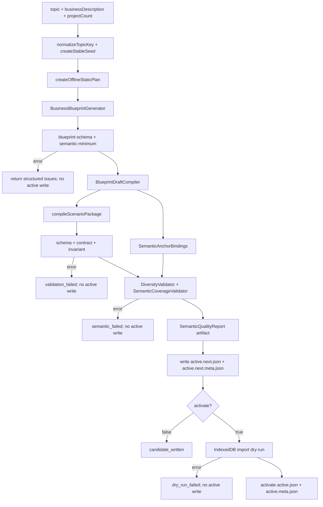
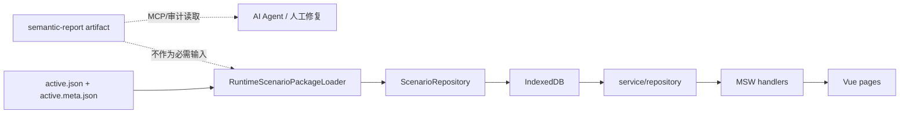

# Demo Offline Semantic Blueprint Generation 技术设计

## 架构概述

`demo-offline-semantic-blueprint-generation` 在现有 P0 runtime JSON package 链路上插入一个语义生成层：

```text
topic / businessDescription
  -> Business Blueprint
  -> IndustryDataDraft + Semantic Anchor Bindings
  -> DemoScenarioPackage v1
  -> schema / contract / invariant / semantic / import dry-run gates
  -> active.json / active.meta.json
```

现有代码证据：

| 现有能力 | 落点 | 设计影响 |
| --- | --- | --- |
| offline-static 生成入口 | `tools/demo-offline-mcp/src/offline-static/generate.ts` | 当前直接调用 `createDeterministicIndustryDraft()`；本 spec 在它之前新增 Blueprint 生成，在它之后新增语义质量 gate。 |
| v1 编译器 | `tools/demo-offline-mcp/src/compiler.ts` | 继续接收 `IndustryDataDraft`，继续输出 `DemoScenarioPackage` v1，不改页面消费结构。 |
| P0 runtime 校验 | `tools/demo-offline-mcp/src/offline-static/scenario-validation.ts`、`invariants.ts`、`import-dry-run.ts` | semantic gates 只追加，不替代 schema、contract、invariant 和 import dry-run。 |
| 原子写入与激活 | `tools/demo-offline-mcp/src/offline-static/writer.ts` | 继续写 `active.next.json`、`active.next.meta.json`，通过后再激活；semantic error 不得写入或激活。 |
| 浏览器 runtime loader | `ruoyi-fastapi-frontend/src/demo/runtime/scenario-package-loader.ts` | 仍只读取 v1 `active.json`、`active.meta.json`、`previous.json`。 |
| IndexedDB 导入 | `ruoyi-fastapi-frontend/src/demo/repositories/scenario.ts` | 仍由 `ScenarioRepository` 导入 v1 package，语义锚点不作为 runtime 必需输入。 |

设计原则：

- AI 输出最多作为 Blueprint 候选输入；本地 deterministic fallback 是必需路径。
- `auth`、`system` 仍从 default scenario 复制；Spec A 只生成 `project` 与 `simulation`。
- 通用语义锚点是范式对象，不写死为项目管理模块概念。
- 语义锚点绑定和质量报告保存为 MCP artifact/meta/report，不作为浏览器 runtime 必需文件。
- v2 manifest/slices、DOMC registry、完整 Scenario Graph/Recipes 留给后续 specs。

## 数据流图

### 生成链路



### Runtime 边界



## 组件与接口定义

### Business Blueprint

新增 MCP 侧类型，建议放在 `tools/demo-offline-mcp/src/semantic/blueprint.ts` 与 `blueprint-schema.ts`。

```ts
export interface BusinessBlueprint {
  schemaVersion: 1;
  topic: string;
  businessDescription?: string;
  topicKey: string;
  seed: string;
  industry: {
    name: string;
    keywords: string[];
  };
  domainObjects: SemanticDomainObject[];
  departments: SemanticDepartment[];
  personas: SemanticPersona[];
  processStages: SemanticProcessStage[];
  riskTypes: SemanticRiskType[];
  metricDefinitions: SemanticMetricDefinition[];
  storyBeats: SemanticStoryBeat[];
}
```

语义最小集：

| 字段 | 最小数量 |
| --- | --- |
| `domainObjects` | `>= 5` |
| `personas` | `>= 3` |
| `departments` | `>= 2` |
| `processStages` | `>= 5` |
| `riskTypes` | `>= 4` |
| `metricDefinitions` | `>= 4` |
| `storyBeats` | `>= projectCount` |

Blueprint 生成策略：

1. 先从 `topic`、`businessDescription`、`topicKey` 做 deterministic domain token extraction。
2. 用 seed-aware picker 扩展业务对象、角色、阶段、风险和指标。
3. 若存在未来 AI 候选 Blueprint，仍必须经过同一 schema 和 semantic-minimum 校验。
4. 校验失败只返回结构化 issue，不进入 Draft 编译。

### 通用语义锚点

语义锚点不是 Scenario Graph，也不是 DOMC。它是 Spec A 中用于证明主记录来源的最小范式。

```ts
export type SemanticAnchorType =
  | 'storyBeat'
  | 'domainObject'
  | 'persona'
  | 'role'
  | 'processStage'
  | 'riskType'
  | 'metricDefinition';

export interface SemanticAnchorRef {
  type: SemanticAnchorType;
  id: string;
  label: string;
}

export interface SemanticAnchorBinding {
  recordKind: 'primary' | 'supporting';
  recordPath: string;
  recordKey: string;
  module: 'project' | 'simulation';
  anchors: SemanticAnchorRef[];
  supports?: string[];
}
```

通过标准：

- 所有主演示主记录至少绑定 3 类语义锚点。
- 至少包含 `storyBeat` 或 `domainObject` 中的一类。
- Spec A 只实现 `project + simulation` 到通用锚点的首个映射。
- 锚点绑定结果保存为 semantic quality report，不写入 `active.json`。

### BlueprintDraftCompiler

新增 `compileBlueprintToIndustryDraft()`，建议放在 `tools/demo-offline-mcp/src/semantic/draft-compiler.ts`。

```ts
export interface BlueprintDraftCompileResult {
  draft: IndustryDataDraft;
  bindings: SemanticAnchorBinding[];
}
```

映射规则：

| `IndustryDataDraft` 字段 | Blueprint 来源 |
| --- | --- |
| `industry.keywords` | `industry.keywords`、`domainObjects.label` |
| `projects[].name` | `storyBeat.title` + `domainObject.label` + `processStage.label` |
| `projects[].region` | deterministic topic/location hint 或默认区域池 |
| `projects[].stage` | `processStages` |
| `projects[].ownerRole` / `ownerName` | `personas` |
| `projects[].risk` / `riskLevel` | `riskTypes` |
| `projects[].remark` | `storyBeats.summary` |
| `projects[].keyMetrics` | `metricDefinitions` |
| `projects[].topology` | `processStage` + `persona` + `domainObject` |
| `projects[].simulation` | `storyBeat` + `riskType` + `metricDefinition` |

不改 `compileScenarioPackage()` 的 v1 输出契约；必要时只减少它的 fallback 模板触发频率。

### DiversityValidator

建议放在 `tools/demo-offline-mcp/src/semantic/diversity-validator.ts`。它检查 `IndustryDataDraft` 和编译后的 package 中用户可见字段。

```ts
export interface DiversityValidationInput {
  blueprint: BusinessBlueprint;
  draft: IndustryDataDraft;
  scenarioPackage?: CompiledDemoScenarioPackage;
}
```

默认阈值：

- 关键维度 normalized duplicate ratio `>= 0.75`：`error`。
- 模板相似度 `>= 0.85`：`error`。
- 关键维度 normalized duplicate ratio `>= 0.50` 且 `< 0.75`：`warning`。
- 可由 Blueprint 业务事实解释的轻度重复：`warning`，不阻断。

关键维度：

- `description` / `remark`
- `risk`
- `stage`
- `owner` / `createBy`
- `keyMetrics`
- 时间推进线索

### SemanticCoverageValidator

建议放在 `tools/demo-offline-mcp/src/semantic/coverage-validator.ts`。

```ts
export interface SemanticCoverageValidationInput {
  blueprint: BusinessBlueprint;
  bindings: SemanticAnchorBinding[];
  scenarioPackage: CompiledDemoScenarioPackage;
}
```

检查项：

- 主记录是否绑定足够语义锚点。
- `project.projects` 的风险、阶段、指标、角色动作是否能在 `project.versions`、`project.topologies`、`simulation.*` 中找到同一锚点支撑。
- 缺失原因来自 Blueprint 时，issue 指向 `blueprint.*`。
- 缺失原因来自映射或 package 时，issue 指向 `bindings.*` 或 package path。

### SemanticQualityReport

建议放在 `tools/demo-offline-mcp/src/semantic/quality-report.ts`。

```ts
export interface SemanticQualitySummary {
  blueprintValid: boolean;
  diversityValid: boolean;
  semanticCoverageValid: boolean;
  issueCount: number;
  warningCount: number;
  errorCount: number;
}

export interface SemanticQualityReport {
  schemaVersion: 1;
  scenarioId: string;
  topicKey: string;
  seed: string;
  generatorVersion: string;
  blueprintSummary: {
    domainObjectCount: number;
    personaCount: number;
    departmentCount: number;
    processStageCount: number;
    riskTypeCount: number;
    metricDefinitionCount: number;
    storyBeatCount: number;
  };
  diversitySummary: Record<string, unknown>;
  semanticCoverageSummary: Array<{
    recordPath: string;
    recordKey: string;
    anchorTypes: SemanticAnchorType[];
    anchorLabels: string[];
  }>;
  issues: SemanticQualityIssue[];
}
```

`SemanticQualityIssue` 沿用 `ValidationIssue` 的字段，并追加 `gate`：

```ts
export type SemanticGate =
  | 'blueprint-schema'
  | 'blueprint-semantic-minimum'
  | 'diversity'
  | 'semantic-coverage';
```

## API 接口设计

### MCP 输入

`demo_offline_generate_runtime_demo` 的现有输入保持兼容：

```ts
{
  topic: string;
  businessDescription?: string;
  projectCount?: number;
}
```

不新增必填参数。后续可选参数必须保持默认启用语义质量 gate，不应让用户在 customer-facing helper 中绕过主演示语义检查。

### MCP 输出

扩展 internal `OfflineStaticActivationResult` 和 customer-facing result：

```ts
interface SemanticRuntimeResultExtension {
  semanticQualitySummary?: SemanticQualitySummary;
  semanticReportPath?: string;
}
```

输出规则：

- semantic error：`ok=false`，`phase='validation_failed'` 或后续实现中的 `semantic_failed`，不写 active。
- warning only：允许 candidate/activate，但必须返回 `semanticQualitySummary` 与 report artifact。
- report artifact：建议写入 `demo-scenarios/active.next.semantic-report.json`；激活后可移动为 `demo-scenarios/active.semantic-report.json`。该文件只供 MCP、AI Agent 或人工审计使用。

### Browser API

不新增浏览器 API。`RuntimeScenarioPackageLoader` 继续读取：

- `demo-scenarios/active.json`
- `demo-scenarios/active.meta.json`
- `demo-scenarios/previous.json`

它不读取 Blueprint、semantic report 或 anchor bindings。

## 数据模型与数据库变更

不修改：

- `DemoScenarioPackage` schemaVersion 1。
- `RuntimeScenarioMeta` 的必需字段。
- IndexedDB schema。
- 后端数据库或后端 API。
- Vue 页面、MSW handler、service/repository 消费结构。

新增 MCP 侧模型：

| 模型 | 持久化方式 | Runtime 是否必需 |
| --- | --- | --- |
| `BusinessBlueprint` | 内存；可选写入 semantic report | 否 |
| `SemanticAnchorBinding` | semantic report | 否 |
| `SemanticQualityReport` | MCP artifact/report file | 否 |
| `SemanticQualitySummary` | MCP result；可选 report | 否 |

建议新增路径字段：

```ts
interface OfflineStaticTargetPaths {
  activeNextSemanticReportPath?: string;
  activeSemanticReportPath?: string;
}
```

如果实现选择不扩展 `OfflineStaticTargetPaths`，也可以由 semantic writer 在 `demoScenariosRoot` 下局部解析路径；但写入仍必须经过 `assertOfflineStaticScenarioWritePath()`。

## 安全考量

- 本地 deterministic fallback 是强制路径；测试、CI 和客户离线包不得依赖外部 AI。
- 如果未来 AI 参与 Blueprint 候选生成，AI 输出必须经过 schema、semantic-minimum、diversity 和 coverage 校验。
- 不把 API key、MCP server 或 AI provider SDK 打入浏览器 runtime。
- semantic report 只能写入 `demo-scenarios/**`，继续复用 offline-static 路径安全校验，不能写 `assets/**` 或 `index.html`。
- semantic error 不得覆盖 active package、active meta 或 active semantic report。
- report 中避免记录敏感凭据；只记录业务语义摘要、锚点、issue 和修复建议。

## 测试策略

### 单元测试

- `BusinessBlueprint` schema：缺字段、最小集不足、无效锚点 ID。
- deterministic generator：同一输入生成相同 Blueprint，不同 `businessDescription` 生成不同关键语义。
- `BlueprintDraftCompiler`：每条主记录能生成 project 与 simulation draft，并带锚点绑定。
- `DiversityValidator`：覆盖 75%/0.85 error、50%-75% warning、可解释重复 warning。
- `SemanticCoverageValidator`：覆盖锚点不足、支撑记录缺失、Blueprint path 和 package path issue。

### 集成测试

在 `tools/demo-offline-mcp/tests/offline-static.test.ts` 或新增 semantic 测试文件中覆盖：

- `无人机巡检任务管理` 与 `二手电脑回收管理` 生成结果在 Blueprint、project、metrics、simulation events 上存在主题差异。
- 同一输入重复生成时 semantic summary 和核心 package 内容稳定。
- semantic error 不写 `active.next.json`，也不激活 `active.json`。
- warning only 时生成 candidate/active，并返回 semantic report artifact。
- 现有 schema、contract、invariant、import dry-run 仍通过。

### 回归命令

推荐实现阶段按风险逐层运行：

```bash
cd tools/demo-offline-mcp && npm test -- --run
cd ruoyi-fastapi-frontend && yarn type-check
cd ruoyi-fastapi-frontend && yarn test:run -- scenario-package-loader scenario
```

如实现只改 MCP 且没有前端类型联动，优先跑 MCP 测试和 targeted frontend runtime tests。
