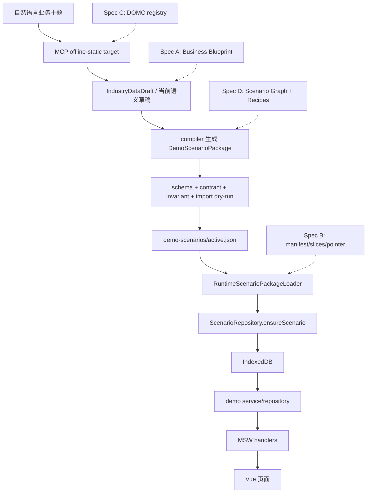
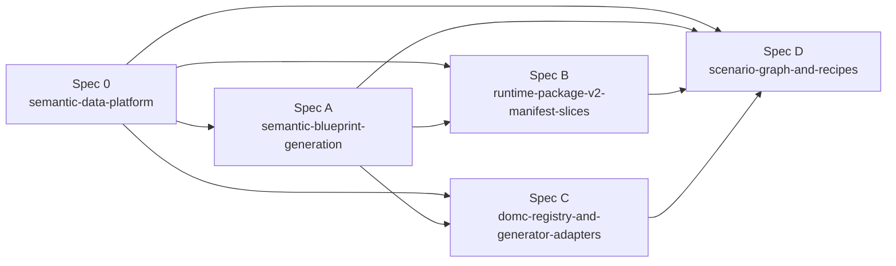
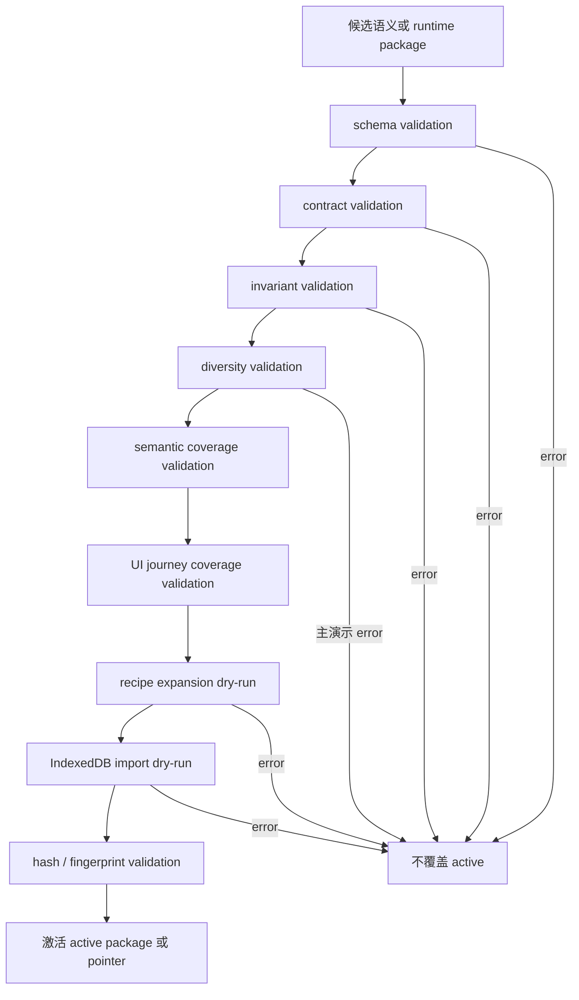

# Demo Offline Semantic Data Platform 技术设计

## 架构概述

`Demo Offline Semantic Data Platform` 是 `demo-offline` 长期数据生成能力的架构治理基线，不是一次产品代码实现大包。本设计把已完成的 `demo-offline-runtime-scenario-package` 作为 P0 基线：浏览器仍以 v1 `active.json` 为可用输入，runtime loader 选择 active/previous/default，`ScenarioRepository` 负责导入 IndexedDB，MSW handler 和页面继续通过 service/repository 读取数据。Spec 0 只规定后续 specs 的共同语言、边界、顺序和质量门禁。

现有 P0 能力已经具备以下基础：

| 基线能力 | 现有落点 | 对 Spec 0 的含义 |
| --- | --- | --- |
| Runtime package loader | `ruoyi-fastapi-frontend/src/demo/runtime/scenario-package-loader.ts` | v2 必须兼容 v1 fallback，不让页面直接读 v2 文件 |
| IndexedDB 导入入口 | `ruoyi-fastapi-frontend/src/demo/repositories/scenario.ts` | 所有 runtime 数据最终仍进入 IndexedDB |
| 随包契约 | `ruoyi-fastapi-frontend/src/demo/scenarios/contract.ts` | DOMC registry 应从现有 module contract 演进 |
| MCP offline-static target | `tools/demo-offline-mcp/src/offline-static/**` | 后续生成能力扩展 MCP，但不能绕过 validator/dry-run |
| 结构和导入校验 | `tools/demo-offline-mcp/src/offline-static/scenario-validation.ts`、`invariants.ts`、`import-dry-run.ts` | Quality Gates 在 P0 闸门上继续分层扩展 |

长期平台分为七层：

| 层 | 责任 | 首个落地 spec |
| --- | --- | --- |
| Spec 0 Governance | 术语、边界、顺序、索引、跨 spec 门禁 | 本 spec |
| Business Blueprint | AI 生成的小而精业务语义输入 | Spec A |
| Scenario Graph | 把语义输入转成可验证业务关系图 | Spec D |
| DOMC | 业务模块接入契约、字段语义、UI journey 和 adapter 约束 | Spec C |
| Compiler / Adapter / Recipes | 确定性生成、展开、ID/时间/关系控制 | Spec A、Spec C、Spec D |
| Runtime Package v2 | pointer、release、manifest、slices、hash、fallback | Spec B |
| Quality Gates | schema、contract、invariant、diversity、semantic coverage、UI journey、recipe expansion、import dry-run | Spec A-D 分层实现 |

设计原则：

- AI 只产出语义层输入，不直接写最终表数据或 active runtime package。
- compiler、adapter、validator、recipe 负责最终结构、ID、时间、状态、跨表引用、hash 和可复现性。
- 页面、MSW handler、service/repository 不因语义平台化而改职责。
- v2 作为旁路新增，不推翻 v1 `active.json` 和 source-generated 开发流程。
- Spec 0 的任务只落在文档、索引、追溯和门禁约束，不实现产品代码。

## 数据流图

当前 P0 基线和后续平台演进关系：



后续 specs 的依赖顺序：



Quality Gates 分层：



## 组件与接口定义

### Spec 0 Governance Contract

Spec 0 产出一组文档治理约束，供后续 specs 引用：

```ts
interface SemanticDataPlatformGovernance {
  specId: 'demo-offline-semantic-data-platform';
  role: 'architecture-governance-baseline';
  outputs: ['requirements.md', 'design.md', 'tasks.md', 'docs/specs/README.md'];
  implementationScope: 'documentation-and-governance-only';
  nextSpecs: SemanticPlatformSpec[];
}
```

后续 spec 必须在简介或 Clarifications 中声明：

| 字段 | 说明 |
| --- | --- |
| `parentSpec` | 固定引用 `demo-offline-semantic-data-platform` |
| `platformLayer` | Blueprint、Runtime Package v2、DOMC、Graph/Recipes 之一 |
| `upstreamDependencies` | 依赖哪些已批准 spec |
| `nonGoals` | 明确不抢其他 spec 范围 |
| `qualityGates` | 本 spec 新增或强化哪些闸门 |

### Business Blueprint

Business Blueprint 是 AI 主要参与的语义输入层。它不是最终数据包，不直接进入 IndexedDB。

后续 Spec A 至少要定义：

```ts
interface BusinessBlueprintConcept {
  industry: string;
  domainObjects: string[];
  personas: Array<{ role: string; department: string }>;
  processStages: string[];
  riskTypes: string[];
  metricDefinitions: string[];
  storyBeats: string[];
}
```

约束：

- Blueprint 必须小于最终 runtime package，便于人工 review。
- Blueprint 必须能驱动负责人、部门、描述、阶段、风险、指标、事件和时间推进差异。
- Blueprint 失败应返回可修复结构化 issue，而不是 fallback 到通用模板。

### Scenario Graph

Scenario Graph 把 Blueprint 转为可验证的关系事实。它不是 UI 图，也不是拓扑图文件。

概念结构：

```ts
interface ScenarioGraphConcept {
  nodes: Array<{
    id: string;
    type: 'persona' | 'process' | 'domainObject' | 'event' | 'risk' | 'metric' | 'journey';
    label: string;
  }>;
  edges: Array<{
    source: string;
    target: string;
    relation: 'owns' | 'handles' | 'produces' | 'triggers' | 'impacts' | 'supports';
  }>;
}
```

约束：

- 主记录必须能追溯到 graph fact、story beat 或业务对象。
- 详情页、拓扑页和仿真页的数据应能解释列表摘要。
- Graph/Recipes 不阻塞 Spec A 先修复短期同质化问题。

### DOMC

DOMC 是业务模块接入平台的机器可读契约。它从 P0 `DemoOfflineContractManifest` 的 module contract、IndexedDB mapping、handler coverage 和 invariants 演进，而不是另起一套 prompt 约定。

后续 Spec C 至少要覆盖：

```ts
interface DemoOfflineModuleContractConcept {
  moduleName: string;
  businessBoundary: string;
  uiJourneys: string[];
  apiHandlers: string[];
  indexedDbTables: string[];
  entities: Array<{
    name: string;
    primaryKey: string;
    requiredFields: string[];
    references: string[];
    statusMachine?: string;
  }>;
  generatorAdapter: { name: string; version: string };
  diversityRules: string[];
  invariantRules: string[];
}
```

无 DOMC 或 generator adapter 的模块必须 blocker，不能通过 AI 自由生成最终表数据伪装支持。

### Generator Recipes

Generator Recipes 用于表达可推导的大量派生数据，避免无理由全量物化。

概念结构：

```ts
interface GeneratorRecipeConcept {
  recipeId: string;
  version: string;
  seed: string;
  inputs: Record<string, unknown>;
  materializes: string[];
  deterministic: true;
}
```

约束：

- recipe 展开必须可由 MCP dry-run 和 runtime 导入解释为一致或等价。
- manifest 必须记录 recipe hash 和 materialization reason。
- 不得把 recipe 作为绕过 schema/contract/invariant 的入口。

### Runtime Package v2

Runtime Package v2 是对 v1 `active.json` 的旁路扩展。页面和 MSW 不直接消费 v2 文件。

推荐结构仍由 Spec B 细化：

```text
demo-scenarios/
  active.json
  previous.json
  active.pointer.json
  previous.pointer.json
  releases/<release-id>/
    manifest.json
    blueprint.json
    graph.json
    recipes.json
    slices/*.json
```

Spec 0 只固定以下边界：

- v1 `active.json` 保留兼容。
- v2 激活只切 pointer，不覆盖旧 release。
- v2 失败必须 fallback previous pointer，再 fallback v1 previous 或 bundle default。
- slices 仅作为导入源，运行阶段仍以 IndexedDB 为事实来源。
- manifest 或等价元数据必须记录每类物化数据的 materialization reason、schemaVersion、hash 和所属模块。
- 当单个 slice 超过可 review 尺寸时，Spec B 必须定义继续按 table、page、journey 或时间窗口拆分的策略；gzip、br 或其他压缩只解决传输体积，不解决 review、diff、局部修复、局部回滚和生成质量。

### Quality Gates

统一 issue 形态应沿用 P0 结构化诊断风格，并允许后续增加 gate 类型：

```ts
interface SemanticQualityIssueConcept {
  path: string;
  code: string;
  severity: 'error' | 'warning';
  actual?: unknown;
  expected?: unknown;
  fixHint: string;
  gate:
    | 'schema'
    | 'contract'
    | 'invariant'
    | 'diversity'
    | 'semantic-coverage'
    | 'ui-journey'
    | 'recipe-expansion'
    | 'import-dry-run'
    | 'hash';
}
```

error 级 issue 不得覆盖 active package 或 active pointer。warning 必须可审计，并在主演示链路中允许被后续 spec 提升为 error。

语义差异 gate 至少要识别“只改编号、名称或少量关键词，但复用同一描述模板、创建人、阶段和风险语句”的结果；普通链路应记录 warning，主演示链路可由后续 spec 提升为 error。

## API 接口设计

Spec 0 不新增运行时 API、MCP tool 或后端接口。本节定义后续 specs 的接口设计边界：

| 接口类别 | Spec 0 约束 | 后续落点 |
| --- | --- | --- |
| MCP tools | 不新增工具；后续工具必须继续返回结构化 envelope 和 issue | Spec A/B/C/D |
| Runtime loader | 不在 Spec 0 修改；v2 loader 必须兼容 v1 active/previous/default fallback | Spec B |
| Browser API | 不新增浏览器端 AI/MCP API；客户离线包不加载 AI provider | Spec A-D |
| MSW handlers | 不直接解析 runtime package、manifest、slice、blueprint、recipe | 所有后续 specs |
| Repository/importer | 继续以 IndexedDB 导入为边界；recipe 展开结果也必须走等价导入校验 | Spec B/D |
| Documentation API | 后续 specs 必须引用 Spec 0，并在 `docs/specs/README.md` 中保持轻量索引 | Spec 0 tasks |

未来 MCP 输入扩展必须遵守：

```ts
interface SemanticGenerationRequestBoundary {
  topic: string;
  businessDescription?: string;
  target: {
    kind: 'source-generated' | 'offline-static';
    packageFormat?: 'v1' | 'v2';
  };
  semanticInput?: 'blueprint' | 'blueprint+graph' | 'recipe';
}
```

该结构只作为后续设计边界，不在 Spec 0 实现。

## 数据模型与数据库变更

Spec 0 不修改数据库、IndexedDB schema、`DemoScenarioPackage` schema、runtime meta schema 或后端表结构。

后续 specs 的数据模型演进边界：

| 数据模型 | 所属 spec | Spec 0 约束 |
| --- | --- | --- |
| `BusinessBlueprint` | Spec A | 小语义层输入，不等同最终表数据 |
| `DiversityReport` / `SemanticCoverageReport` | Spec A | 必须结构化、可审计、可作为激活闸门 |
| `Runtime Package v2 Manifest` | Spec B | 记录 slices、hash、contract fingerprint、recipe hash 和 materialization reason |
| `DOMC Registry` | Spec C | 从 P0 module contract 演进，覆盖 UI journey、mapping、adapter、invariants |
| `ScenarioGraph` | Spec D | 表示业务关系事实，不替代页面拓扑图 |
| `GeneratorRecipe` | Spec D | 表示确定性展开规则，不直接作为 IndexedDB 表 |

v2 文件模型不得改变运行时事实来源：导入后仍以 IndexedDB 为页面查询来源。

## 安全考量

- 客户浏览器运行时不得包含 MCP server、AI provider SDK、API key、token 或需要联网生成数据的逻辑。
- `demo-contract/**`、blueprint、graph、recipe、manifest 不得包含用户私密数据、绝对路径、本机账号、API key 或远程 `$ref`。
- MCP 写入权限继续限制在设计确认的数据目录；后续 v2 writer 只能管理 `demo-scenarios/**` 下的 release、pointer 和 slice 文件。
- AI 输出不得直接落盘为 active package；必须经过 compiler/adapter/validator。
- 所有 gate error 都必须阻止 active 覆盖或 pointer 切换，避免坏包破坏现场演示。
- source-generated、real、fallback、build:prod 边界保持不变，语义平台不得影响真实后端或生产构建。

## 测试策略

Spec 0 的测试以文档结构和追溯检查为主，后续产品测试由 Spec A/B/C/D 承担。

Spec 0 验证：

- `requirements.md`、`design.md`、`tasks.md` 三件套存在。
- `design.md` 包含本设计要求的主要章节。
- `tasks.md` 的需求追溯 ID 均存在于 `requirements.md`。
- `docs/specs/README.md` 只新增轻量 semantic data platform 索引区，不新增独立 roadmap 文档。
- 后续 specs 的 requirements 简介或 Clarifications 引用 Spec 0。

后续 specs 的测试责任：

| Spec | 重点测试 |
| --- | --- |
| Spec A | Blueprint schema、seed-aware 稳定性、diversity validator、semantic coverage validator、v1 active 输出兼容 |
| Spec B | v2 manifest/slices/pointer、release hash、fallback pointer、v1/v2 loader 兼容、import dry-run |
| Spec C | DOMC registry、adapter 选择、缺失 DOMC blocker、module contract 覆盖 |
| Spec D | Scenario Graph 校验、recipe expansion dry-run、少物化策略、MCP/runtime 展开等价性 |

设计阶段轻量检查命令：

```bash
test -f docs/specs/demo-offline-semantic-data-platform/design.md
rg -n "^## 架构概述$" docs/specs/demo-offline-semantic-data-platform/design.md
rg -n "^## 数据流图$" docs/specs/demo-offline-semantic-data-platform/design.md
rg -n "^## 组件与接口定义$" docs/specs/demo-offline-semantic-data-platform/design.md
rg -n "^## API 接口设计$" docs/specs/demo-offline-semantic-data-platform/design.md
rg -n "^## 数据模型与数据库变更$" docs/specs/demo-offline-semantic-data-platform/design.md
rg -n "^## 安全考量$" docs/specs/demo-offline-semantic-data-platform/design.md
rg -n "^## 测试策略$" docs/specs/demo-offline-semantic-data-platform/design.md
```

## 需求追溯

| 需求 | 设计覆盖 |
| --- | --- |
| R1 | Spec 0 Governance Contract、测试策略、README 索引约束 |
| R2 | Runtime Package v2 兼容边界、API 接口设计、数据模型边界 |
| R3 | 架构概述、组件边界、API 接口设计、安全考量 |
| R4 | Business Blueprint、Scenario Graph、DOMC、Recipes、Quality Gates 定义 |
| R5 | 后续 specs 依赖顺序图和测试责任矩阵 |
| R6 | Quality Gates 分层图、失败处理、安全考量 |
| R7 | Runtime Package v2、Generator Recipes、数据模型边界 |
| R8 | Business Blueprint、Scenario Graph、Quality Gates |
| R9 | DOMC、API 接口边界、安全考量 |
| R10 | Spec 0 Governance Contract、测试策略、README 索引约束 |
