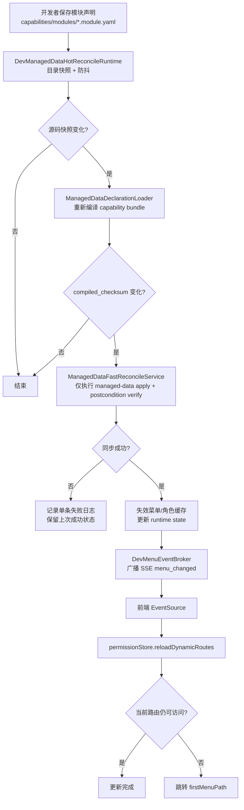

# 开发态受管数据近实时热对齐技术设计

## 架构概述

当前仓库已经具备三块可复用基础能力：

- 启动前统一工作流：[`scripts/start.sh`](/Users/hqz/dev/RuoYi-Vue3-FastAPI/scripts/start.sh#L192) 会在开发态启动前执行一次 `dev-sync`，保证应用启动时数据库已与声明对齐。
- 全量开发态同步：[`dev_sync_service.py`](/Users/hqz/dev/RuoYi-Vue3-FastAPI/ruoyi-fastapi-backend/scripts/internal/db_workflow/dev_sync_service.py#L137) 已将 `dev-sync` 收敛为 `schema-sync + managed-data-apply + postcondition verify`。
- 前端动态路由重载：[`permission.ts`](/Users/hqz/dev/RuoYi-Vue3-FastAPI/ruoyi-fastapi-frontend/src/store/modules/permission.ts#L134) 已提供 `reloadDynamicRoutes()`，能够在路由变化后无重登刷新。

当前缺口也很明确：

- 后端应用启动后不再持续感知 `capabilities/modules/*.module.yaml` 变更；[`server.py`](/Users/hqz/dev/RuoYi-Vue3-FastAPI/ruoyi-fastapi-backend/server.py#L206) 只把旧 `dev_menu_sync_runtime` 置空并输出弃用日志。
- 前端已有 [`dev-menu-hot-sync.ts`](/Users/hqz/dev/RuoYi-Vue3-FastAPI/ruoyi-fastapi-frontend/src/plugins/dev-menu-hot-sync.ts#L93) 轮询热刷新骨架，但 [`scripts/start.sh`](/Users/hqz/dev/RuoYi-Vue3-FastAPI/scripts/start.sh#L234) 会强制关闭 legacy 开关，当前默认不会自动生效。
- 旧的 [`DevMenuReconcileService`](/Users/hqz/dev/RuoYi-Vue3-FastAPI/ruoyi-fastapi-backend/modules/system/runtime/dev_menu_reconcile_service.py#L60) 仍然基于 `menus.registry.yaml`，不再适配 capability/module 稳态入口。

本设计的目标不是再造一套新工作流，而是在现有统一工作流之上补齐“应用启动后的开发态自动热对齐”：

1. `Atlas` 与 `schema` 仍留在启动前 `dev-sync` / 显式 CLI 中处理，不进入持续热路径。
2. 运行期只监听 `capabilities/modules/*.module.yaml`，并仅对受管数据执行快路径 reconcile。
3. 后端使用开发态 `SSE` 把“已完成一次有效热对齐”的事件推给前端。
4. 前端收到事件后直接调用既有 `reloadDynamicRoutes()`，不再依赖高频 polling 作为主路径。
5. 正式 `finalize -> deploy` 保持不变，不消费任何运行期热对齐状态。

为避免实现分叉，运行期热对齐不会复制 `dev-sync` 的受管数据逻辑，而是把 [`dev_sync_service.py`](/Users/hqz/dev/RuoYi-Vue3-FastAPI/ruoyi-fastapi-backend/scripts/internal/db_workflow/dev_sync_service.py#L323) 中的“声明加载 + managed-data apply + postcondition verify”抽成可复用服务，由 CLI 和运行时共用。

## 数据流图



## 组件与接口定义

### 1. 后端运行时组件

#### 1.1 `DevManagedDataHotReconcileRuntime`

职责：

- 仅在 `APP_ENV=dev` 且 `DB_WORKFLOW_MODE=development` 时启动。
- 在应用生命周期内持续感知 `capabilities/modules/*.module.yaml` 的新增、修改、删除。
- 做防抖、checksum 去重、串行化执行，避免多次保存导致并发同步。
- 将最近一次成功状态挂到 `app.state`，供诊断接口和前端事件接口读取。

放置位置：

- 在 [`server.py`](/Users/hqz/dev/RuoYi-Vue3-FastAPI/ruoyi-fastapi-backend/server.py#L155) 的 `lifespan()` 中初始化，替代当前弃用的 `app.state.dev_menu_sync_runtime = None` 占位逻辑。

设计要点：

- 不沿用旧 `watch_paths` 固定文件列表，而是监听模块目录快照。
  原因：需求要求感知文件新增/删除；旧 [`dev_menu_sync_runtime.py`](/Users/hqz/dev/RuoYi-Vue3-FastAPI/ruoyi-fastapi-backend/modules/system/runtime/dev_menu_sync_runtime.py#L44) 的固定路径方案无法天然覆盖新建 `.module.yaml` 文件。
- 采用“两级判定”降低运行期开销：
  - 一级：比较目录快照 `(path, mtime_ns, size)`，无变化则不重新编译。
  - 二级：调用声明编译，比较 `compiled_checksum`；一致则不写库、不发事件。
- 启动时只做“基线装载”，不重复执行启动前 `dev-sync`。
  启动前同步仍由 [`scripts/start.sh`](/Users/hqz/dev/RuoYi-Vue3-FastAPI/scripts/start.sh#L197) 负责。

#### 1.2 `ManagedDataFastReconcileService`

职责：

- 复用统一工作流中的 capability 声明加载、受管数据 plan/apply、metadata 同步与后置校验。
- 仅处理受管数据，不触发 Atlas schema apply。
- 成功后返回结构化摘要：`trigger`、`duration_ms`、`affected_objects`、`compiled_checksum`、`postcondition_result`。

来源与复用策略：

- 从 [`dev_sync_service.py`](/Users/hqz/dev/RuoYi-Vue3-FastAPI/ruoyi-fastapi-backend/scripts/internal/db_workflow/dev_sync_service.py#L323) 抽取可复用逻辑。
- 运行期热路径与 CLI `dev-sync` 共用同一套：
  - `ManagedDataDeclarationLoader.load()`
  - `ManagedDataPlanner`
  - `ManagedDataApplier`
  - `PostconditionVerifier`

这样可以避免出现“CLI 正确、热同步错误”两套规则并存的问题。

#### 1.3 `DevMenuEventBroker`

职责：

- 管理每个浏览器标签页对应的一个 `SSE` 订阅。
- 在热对齐成功后向所有在线订阅者广播最小事件载荷。
- 定期发送 heartbeat，防止本地开发长连接被浏览器或代理误断开。

事件载荷最小化：

- `event: ready`
  - 首次连接建立时发送，包含 `connectedAt`
- `event: menu_changed`
  - 包含 `eventId`、`trigger`、`compiledChecksum`、`syncedAt`
- `event: heartbeat`
  - 仅保活，不携带业务明细

不在事件里下发完整菜单树，也不下发完整签名快照。真正的路由树仍由现有 `/getRouters` 权限链路返回，降低泄露面并减少长连接数据量。

### 2. 后端 API 组件

#### 2.1 `GET /dev/menu/events`

职责：

- 作为开发态 `SSE` 长连接入口。
- 对认证用户开放；事件只用于提示“需要刷新路由”，不提供敏感业务数据。
- 在非开发态或开发热对齐关闭时返回 `404`，保持现有 dev-only 暴露边界。

实现位置：

- 继续挂在现有 [`dev_menu_sync_controller.py`](/Users/hqz/dev/RuoYi-Vue3-FastAPI/ruoyi-fastapi-backend/modules/system/api/dev_menu_sync_controller.py#L18) 中，沿用 dev-only router 注册模式。
- 路由注册仍受 [`modules/registry.py`](/Users/hqz/dev/RuoYi-Vue3-FastAPI/ruoyi-fastapi-backend/modules/registry.py#L104) 的开发态判定控制。

#### 2.2 `GET /dev/menu/signature`

职责调整：

- 从主刷新路径降级为兜底/诊断接口。
- 保留当前实现，用于：
  - `SSE` 断连后的低频兜底检查
  - 控制台手工诊断
  - 测试中验证用户菜单签名是否变更

#### 2.3 `POST /dev/menu/sync`

职责调整：

- 继续保留管理员手动触发入口，但内部改为调用新的 `ManagedDataFastReconcileService`。
- 用作兜底，不再作为开发态默认生效路径。

### 3. 前端组件

#### 3.1 `dev-menu-hot-sync` 插件重构

基于现有 [`dev-menu-hot-sync.ts`](/Users/hqz/dev/RuoYi-Vue3-FastAPI/ruoyi-fastapi-frontend/src/plugins/dev-menu-hot-sync.ts#L93) 做重构，而不是新建第二套插件。

新职责：

- 在 `import.meta.env.DEV` 下默认尝试建立一个 `EventSource('/dev/menu/events')` 连接。
- 收到 `menu_changed` 后立即调用 [`reloadDynamicRoutes()`](/Users/hqz/dev/RuoYi-Vue3-FastAPI/ruoyi-fastapi-frontend/src/store/modules/permission.ts#L134)。
- 连接异常时采用指数退避重连。
- 只有在持续重连失败后，才降级到低频签名检查或 `window.__DEV_MENU_SYNC__.refreshRoutes()` 手动刷新。

保留的现有行为：

- `reloadDynamicRoutes()` 中已有“当前路由不可访问时跳转首个菜单”的处理，可直接复用。
- 全局调试 API `window.__DEV_MENU_SYNC__` 继续保留，便于定位问题时人工强刷。

### 4. 配置与特性开关

新增后端开发态设置，建议放在 [`config/env.py`](/Users/hqz/dev/RuoYi-Vue3-FastAPI/ruoyi-fastapi-backend/config/env.py#L31)：

- `dev_managed_data_hot_reconcile_enabled: bool = True`
- `dev_managed_data_watch_interval_ms: int = 200`
- `dev_managed_data_debounce_ms: int = 250`
- `dev_managed_data_sse_heartbeat_seconds: int = 15`
- `dev_managed_data_sse_replay_buffer_size: int = 1`

前端不再依赖当前 `VITE_DEV_MENU_SYNC` / `VITE_DEV_MENU_SYNC_POLL_INTERVAL_MS` 作为主控制面。  
更优方案是：

- 开发环境默认尝试连接 `SSE`
- 若后端返回 `404`，前端静默判定当前环境未启用热对齐并停止自动重连

这样可以避免 [`scripts/start.sh`](/Users/hqz/dev/RuoYi-Vue3-FastAPI/scripts/start.sh#L238) 再去硬编码 legacy 前端开关。

## API 接口设计

### 1. `GET /dev/menu/events`

用途：

- 开发态菜单热更新主通道

鉴权：

- 需要已登录用户
- 非开发态或未启用热对齐时返回 `404`

响应头：

```http
Content-Type: text/event-stream
Cache-Control: no-cache
Connection: keep-alive
X-Accel-Buffering: no
```

事件格式：

```text
event: ready
data: {"connectedAt":"2026-04-06T12:00:00+08:00"}

event: menu_changed
id: 12
data: {"trigger":"file_change","compiledChecksum":"abc123","syncedAt":"2026-04-06T12:00:01+08:00"}

event: heartbeat
data: {"ts":"2026-04-06T12:00:15+08:00"}
```

错误语义：

- `404 Not Found`：非开发态、未启用热对齐、或运行时未注册
- `401 Unauthorized`：未登录

### 2. `GET /dev/menu/signature`

保留现有语义，作为兜底检查：

- 前端在 `SSE` 多次失败后的低频核验
- 人工调试时确认当前用户菜单签名是否变化

返回结构保持兼容：

```json
{
  "signature": "sha256...",
  "syncedAt": "2026-04-06T12:00:01+08:00",
  "lastSyncStatus": "ok"
}
```

### 3. `POST /dev/menu/sync`

保持管理员手动触发语义，供异常时兜底：

请求：

```json
{
  "dryRun": false,
  "trigger": "manual"
}
```

返回：

```json
{
  "trigger": "manual",
  "dryRun": false,
  "success": true,
  "durationMs": 120,
  "syncedAt": "2026-04-06T12:00:01+08:00"
}
```

## 数据模型与数据库变更

本方案不引入新的数据库表，也不新增 Alembic migration。

原因：

- 正式 schema 演进仍然由 `Atlas + finalize/deploy` 链路处理。
- 热对齐只复用现有的受管数据写入目标：
  - `sys_menu`
  - `sys_role_menu`
  - `sys_dict_type`
  - `sys_dict_data`
  - `sys_config`
- 现有 workflow metadata 也已经足够表达对象 owner、source checksum、last bundle id 等状态，[`dev_sync_service.py`](/Users/hqz/dev/RuoYi-Vue3-FastAPI/ruoyi-fastapi-backend/scripts/internal/db_workflow/dev_sync_service.py#L687) 可直接做热路径后的 postcondition 校验。

新增的数据结构全部为内存态：

- `ManifestSnapshot`
  - 目录扫描得到的 `(path, mtime_ns, size)` 快照
- `HotReconcileRuntimeState`
  - `last_seen_snapshot_checksum`
  - `last_applied_compiled_checksum`
  - `last_sync_at`
  - `last_trigger`
  - `last_error`
  - `last_event_id`
- `SseSubscriber`
  - `subscriber_id`
  - `user_id`
  - `queue`
  - `connected_at`

这些状态只服务单进程开发运行期。当前本地启动方式是单进程 `uvicorn reload`，[`app.py`](/Users/hqz/dev/RuoYi-Vue3-FastAPI/ruoyi-fastapi-backend/app.py#L6) 允许采用进程内 broker，不需要为开发态专门引入 Redis pub/sub。

## 安全考量

### 1. 环境边界

- `SSE` 与 watcher 只在 `APP_ENV=dev` 且 `DB_WORKFLOW_MODE=development` 下注册。
- 测试、预发、生产、客户环境不暴露 `/dev/menu/events`。

### 2. 鉴权边界

- `GET /dev/menu/events` 与 `GET /dev/menu/signature` 继续要求登录态。
- `POST /dev/menu/sync` 继续仅允许管理员调用。

### 3. 数据最小暴露

- `SSE` 只推送“应刷新”的事件摘要，不直接返回菜单树或角色授权图。
- 菜单树仍通过原有 `/getRouters` 权限接口获取，保持一条正式权限链路。

### 4. 日志降噪与排除策略

当前请求日志中间件会为每个 HTTP 请求输出一条结构化日志，[`request_logging_middleware.py`](/Users/hqz/dev/RuoYi-Vue3-FastAPI/ruoyi-fastapi-backend/middlewares/request_logging_middleware.py#L128)。如果不处理，`SSE` 长连接会污染调试日志。

因此需要在中间件层加入排除能力：

- 对 `/dev/menu/events` 路径不输出 `http_request` 摘要日志
- 不为 heartbeat / reconnect 单独打 info 日志
- 只在真正执行热对齐时输出一条结构化摘要日志
- diff 明细、checksum 对比仅打 debug

### 5. 失败隔离

- 热对齐失败不影响正在运行的业务接口。
- 失败时保留上一次成功状态，前端不会收到 `menu_changed` 事件。
- 开发者仍可使用 `python scripts/db.py dev-sync` 或管理员 `POST /dev/menu/sync` 手工兜底。

## 测试策略

### 1. 后端单元测试

- `ManifestSnapshot` 目录扫描：
  - 新建 `.module.yaml` 可被发现
  - 删除 `.module.yaml` 可被发现
  - 连续保存仅触发一次防抖执行
- `ManagedDataFastReconcileService`：
  - 仅受管数据变更时不调用 Atlas
  - 无 checksum 变化时不写库
  - 失败时回滚事务
- `DevMenuEventBroker`：
  - 订阅建立/断开
  - 广播 `menu_changed`
  - heartbeat 正常下发
- `RequestLoggingASGIMiddleware`：
  - `/dev/menu/events` 路径被排除，不产生日志事件

### 2. 后端集成测试

- 修改模块声明后，运行时自动完成：
  - 编译 checksum 变化
  - managed-data fast reconcile
  - postcondition clean
  - `SSE` 事件广播
- no-op 保存不触发数据库写入
- manual sync 仍可调用并复用同一快路径服务

### 3. 前端单元测试

- `EventSource` 建立成功后收到 `menu_changed` 会调用 `reloadDynamicRoutes('sse_menu_changed')`
- 当前路由失效时仍跳转 `firstMenuPath`
- `SSE` 失败后进入低频兜底而不是高频轮询
- 404 场景下静默停用热更新，不干扰正常开发

### 4. 联调验证

- 使用真实开发库：
  1. 启动 `./scripts/start.sh`
  2. 新增一个菜单声明
  3. 保存后 1 秒内侧边栏出现新菜单
  4. 删除该菜单声明
  5. 保存后 1 秒内侧边栏移除该菜单
- 联调期间后端日志中不应被 `/dev/menu/events` 心跳刷屏。

### 5. 回归验证

- `python scripts/db.py dev-sync` 仍可正常工作
- `python scripts/db.py finalize`
- `python scripts/db.py deploy --revision head`
- `python scripts/db.py verify --ci`

以上四条正式链路必须保持行为不变，证明新能力仅影响开发态热更新体验，不改变正式治理路径。
