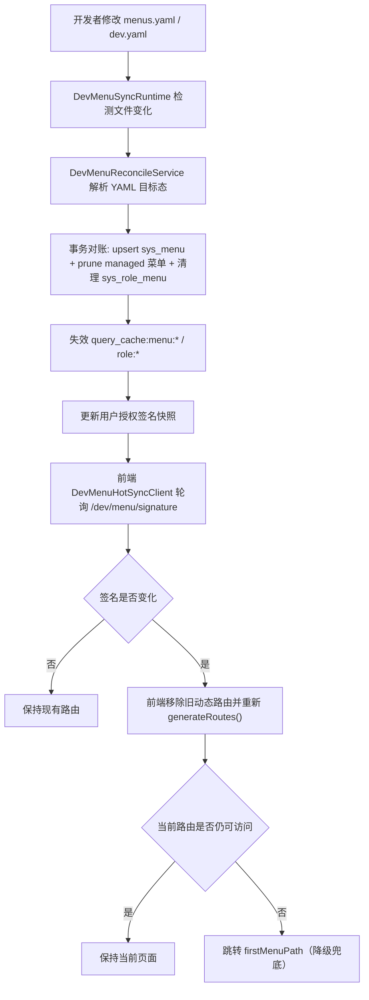

# 开发态动态菜单热同步技术设计

## 架构概述
本设计只在开发模式启用，目标是让 `menus.yaml/dev.yaml` 变更后自动收敛到数据库，并在不重新登录的前提下让前端动态路由平滑更新；生产模式保持现状，不引入运行时行为变化。

现状约束（来自现有代码）：
- 种子脚本当前是“初始化导入”模型，存在即跳过，不具备声明式收敛能力（`ruoyi-fastapi-backend/scripts/seed_data.py:271`, `ruoyi-fastapi-backend/scripts/seed_data.py:469`）。
- `/getRouters` 每次按当前用户实时组装路由（`ruoyi-fastapi-backend/modules/identity/api/login_controller.py:95`, `ruoyi-fastapi-backend/modules/identity/application/services/login_service.py:400`）。
- 前端仅在登录后的首轮鉴权流程里生成并注册动态路由，后续无自动重建机制（`ruoyi-fastapi-frontend/src/permission.ts:68`, `ruoyi-fastapi-frontend/src/store/modules/permission.ts:47`）。
- 前端 HTTP 层会解包 `payload.data`，`permission` store 直接把 `getRouters()` 结果当路由数组使用（`ruoyi-fastapi-frontend/src/utils/http.ts:137`, `ruoyi-fastapi-frontend/src/store/modules/permission.ts:51`）。因此不宜直接改 `/getRouters` 返回形状。

目标架构由四个开发态组件组成：
1. `DevMenuSyncRuntime`（后端运行时）
- 在 `APP_ENV=dev` 且 `DEV_MENU_SYNC=1` 时启用。
- 应用启动后先执行一次全量同步，再监听 `base/menus.yaml` 与 `overlays/dev.yaml` 文件变化触发增量同步。

2. `DevMenuReconcileService`（后端声明式收敛服务）
- 解析 YAML 目标态，执行 `sys_menu` + `sys_role_menu` 的事务性对账（upsert + prune）。
- 仅处理 `managed_by_seed=true` 的菜单范围，避免误删人工维护数据。
- 同步后清理相关查询缓存并更新授权签名。

3. `DevMenuSignatureAPI`（后端签名接口）
- 提供当前登录用户“授权签名”查询接口。
- 签名由有效菜单、角色菜单关系、用户角色关系的确定性快照计算，不引入人工版本号。

4. `DevMenuHotSyncClient`（前端开发态轮询器）
- 开发态定时拉取签名，签名变化时无登出重建动态路由。
- 签名未变化不重建，避免无效抖动。

设计原则：
- 开发态增强与生产态隔离：能力开关双门控（环境 + 显式开关）。
- 无人工版本维护：仅使用自动计算签名。
- 可回退：关闭开关立即恢复现有链路。

## 数据流图


## 组件与接口定义
### 后端组件
1. `DevMenuSyncRuntime`
- 建议位置：`ruoyi-fastapi-backend/modules/system/runtime/dev_menu_sync_runtime.py`
- 关键职责：
  - 启动即同步一次（trigger=`startup`）。
  - 文件监听触发同步（trigger=`file_change`），带去抖（300~500ms）与串行锁。
  - 失败不中断服务，记录错误并等待下一次触发重试。

2. `DevMenuReconcileService`
- 建议位置：`ruoyi-fastapi-backend/modules/system/application/services/dev_menu_reconcile_service.py`
- 关键接口：
```python
async def sync_once(trigger: str, dry_run: bool = False) -> SyncReport: ...
```
- `SyncReport` 字段：`added`, `updated`, `deleted`, `roleMenuDeleted`, `durationMs`, `success`, `error`, `trigger`, `syncedAt`。
- 对账规则：
  - 目标集合：`menus.yaml + dev.yaml` 合并后，且 `managed_by_seed=true`。
  - Upsert：按 `menu_id` 合并字段。
  - Prune：删除 DB 中 `managed_by_seed=1` 且不在目标集合的菜单。
  - 关系清理：删除 `sys_role_menu` 中指向已删菜单的关联。
  - 事务语义：任一失败则回滚（满足 R1.AC4）。

3. `DevMenuSignatureService`
- 建议位置：`ruoyi-fastapi-backend/modules/system/application/services/dev_menu_signature_service.py`
- 关键接口：
```python
async def get_user_signature(user_id: int) -> str: ...
```
- 签名输入（排序后哈希）：
  - 用户角色集合（`user_id -> role_id`）。
  - 角色菜单集合（`role_id -> menu_id`）。
  - 有效菜单关键字段（`menu_id,parent_id,path,component,perms,status,visible,order_num`）。
- 哈希算法：`sha256`，输出十六进制字符串。

4. `DevMenuSyncController`
- 建议位置：`ruoyi-fastapi-backend/modules/system/api/dev_menu_sync_controller.py`
- 暴露开发态接口（见下一节 API 设计）。

### 前端组件
1. `devMenuHotSync` 轮询器
- 建议位置：`ruoyi-fastapi-frontend/src/plugins/dev-menu-hot-sync.ts`
- 关键接口：
```ts
startDevMenuHotSync(): void
stopDevMenuHotSync(): void
```
- 行为：
  - 仅 `import.meta.env.DEV && VITE_DEV_MENU_SYNC === '1'` 启动。
  - 轮询周期默认 `1000ms`（可配置），结合后端 500ms 监听与 200ms 去抖，满足 3 秒内可见目标。
  - 签名变化时调用 `permissionStore.reloadDynamicRoutes()`.

2. `permission` store 扩展
- 目标文件：`ruoyi-fastapi-frontend/src/store/modules/permission.ts`
- 新增动作建议：
```ts
async function reloadDynamicRoutes(): Promise<void>
```
- 执行步骤：
  - 移除上次注册的动态路由（基于 `addRoutes` 记录的 route name）。
  - 重新拉取 `/getRouters` 并 `addRoute`。
  - 校验当前地址是否仍命中路由；若失效则跳转 `firstMenuPath`（满足 R2.AC3）。
  - 路由重建失败时保留现状并等待下一次轮询（满足 R3.AC3）。

## API 接口设计
### 1) 获取当前用户授权签名（开发态）
- `GET /dev/menu/signature`
- 鉴权：登录态必需（复用现有 token 机制）。
- 开关：仅 `APP_ENV=dev && DEV_MENU_SYNC=1` 时可用；否则返回 `404`。
- 响应：
```json
{
  "code": 200,
  "message": "success",
  "data": {
    "signature": "a1b2c3...",
    "syncedAt": "2026-02-27T16:00:00+08:00",
    "lastSyncStatus": "ok"
  }
}
```
- 说明：`signature` 只用于“是否变化”判断，不承载权限明细。

### 2) 手动触发同步（支持 dry-run，开发态）
- `POST /dev/menu/sync`
- 鉴权：仅管理员角色可调用。
- 请求体：
```json
{
  "dryRun": true,
  "trigger": "manual"
}
```
- 响应：
```json
{
  "code": 200,
  "message": "success",
  "data": {
    "added": 1,
    "updated": 2,
    "deleted": 1,
    "roleMenuDeleted": 3,
    "durationMs": 128,
    "dryRun": true
  }
}
```
- 说明：`dryRun=true` 时只输出差异，不落库（满足 R6.AC3）。

## 数据模型与数据库变更
### YAML 结构变更
在菜单定义中引入显式管理字段（满足 R1.AC6）：

```yaml
menus:
  - menu_id: 120
    menu_name: 数据源管理
    managed_by_seed: true
```

规则：
- 只有 `managed_by_seed=true` 的菜单参与自动 prune。
- 未标记菜单可被 upsert（可配置），但不会被自动删除。

### 数据库变更
对 `sys_menu` 增加布尔标记列（兼容性变更）：
- `managed_by_seed TINYINT(1) NOT NULL DEFAULT 0 COMMENT '是否由种子声明管理(0否1是)'`
- 索引：`idx_sys_menu_managed_by_seed (managed_by_seed)`

说明：
- 该变更不改变生产既有业务语义；生产环境默认不开启同步能力。
- 开发态同步仅在开关开启时读写该列。

### 缓存处理
同步成功后执行精确失效：
- `query_cache:menu:*`
- `query_cache:role:*`

不执行全量 Redis 清空，避免扩大影响面。

## 安全考量
1. 环境隔离
- 所有 `/dev/menu/*` 接口在非开发环境直接不可达（404）。

2. 权限控制
- 签名接口需登录态。
- 手动同步接口需管理员权限，避免普通用户触发结构性写操作。

3. 并发与一致性
- 同步过程使用单实例异步锁，防止并发重入。
- 数据库事务包裹对账全过程，保证“全成或全败”。

4. 输入安全
- 文件监听路径固定白名单：`scripts/seed_data/base/menus.yaml`、`scripts/seed_data/overlays/dev.yaml`。
- YAML 解析做字段白名单校验与类型校验，拒绝未知危险字段。

5. 失败策略
- 同步失败不影响服务可用性，不主动登出用户，不清空现有路由。
- 仅记录结构化错误并等待下一次触发重试。

## 测试策略
### 后端单元测试
1. `DevMenuReconcileService` 对账测试
- 新增/更新/删除差异计算正确。
- `managed_by_seed` 作用域正确，范围外菜单不被误删（R2.AC4）。
- `dry_run=true` 不落库（R6.AC3）。

2. 事务与异常测试
- 对账中途异常时数据库回滚（R1.AC4）。
- 失败后状态保持可用并可重试（R6.AC4）。

3. 签名稳定性测试
- 数据不变签名不变（R4.AC2）。
- 菜单/角色关系变化签名变化（R4.AC3）。

### 后端集成测试
1. 启动同步与文件变更同步
- 启动时执行一次同步（R7.AC2）。
- 修改 `menus.yaml` 后自动触发同步并更新 DB（R1.AC2/R1.AC3）。

2. 删除联动
- 从 YAML 删除菜单后，`sys_menu` 与 `sys_role_menu` 对应数据被清理（R2.AC1/R2.AC2）。

3. 开关与环境隔离
- `APP_ENV!=dev` 或 `DEV_MENU_SYNC!=1` 时，运行时与 API 均关闭（R5.AC1）。

### 前端单元测试（Vitest）
1. 轮询触发规则
- 开发态且开关开启时启动轮询，其他环境不启动（R5.AC1）。

2. 路由热更新行为
- 签名变化触发 `reloadDynamicRoutes`（R3.AC1/R4.AC4）。
- 签名不变不触发重建（R3.AC2）。
- 删除当前菜单后自动跳转 `firstMenuPath`（R2.AC3）。

3. 异常容错
- 签名接口失败时不清空当前路由，下一周期重试（R3.AC3）。

### 验收与时延验证
在本地开发环境执行端到端验证：
- 增加菜单：从保存 YAML 到前端可见 <= 3 秒（R3.AC4）。
- 删除菜单：侧栏移除且不可访问，当前页若失效自动跳转。
