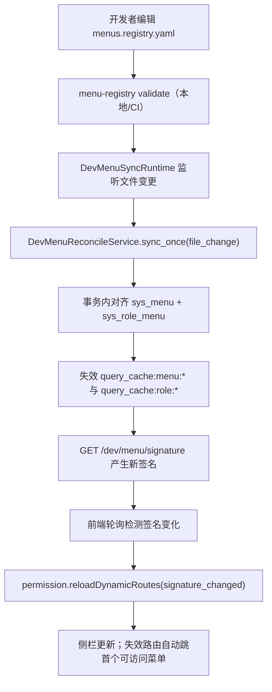
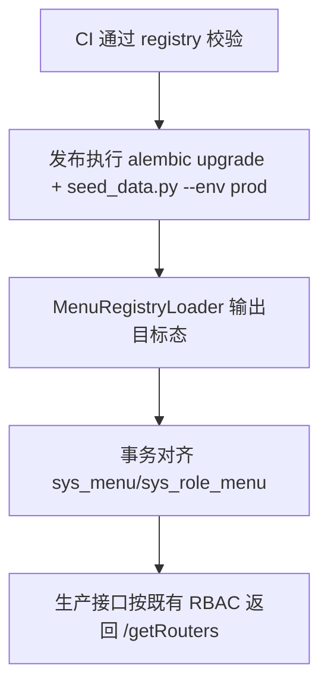

# 开发态菜单单一事实源技术设计

## 架构概述

本设计将菜单与菜单授权声明收敛到单文件 `ruoyi-fastapi-backend/scripts/seed_data/menus.registry.yaml`，并让开发态热同步与生产种子初始化复用同一套加载/校验逻辑，实现“加上即出现、删掉即消失、无重登、无多入口心智”。

核心设计决策：

1. 单一事实源覆盖全环境（dev/prod）：
- 菜单结构（`sys_menu` 目标态）与角色菜单授权（`sys_role_menu` 目标态）只从 `menus.registry.yaml` 读取。
- 生产环境仅通过常规 `seed_data.py`/发布流程生效，不启用热同步。

2. 开发态仅增加“触发方式”，不改变权限语义：
- 仍基于现有 RBAC 规则展示菜单。
- 超级管理员保持全量可见；非管理员仅看已授权菜单。
- 不做“新增菜单自动授权”隐式行为。

3. 统一同步引擎：
- `DevMenuReconcileService` 与 `SeedDataManager` 共用 `MenuRegistryLoader` 输出的目标态。
- 保持 `managed_by_seed=1` 受管边界，只对受管数据做声明式删改。

4. 工程化闭环：
- 提供脚手架命令（新增/删除菜单）、本地校验命令、CI 防回流校验三件套。
- 禁止再从 `base/menus.yaml` 与 `overlays/dev.yaml:role_menus` 作为菜单来源。

5. 声明规则与一致性约束：
- 授权声明仅使用 `role_key`，运行时映射 `role_id`，声明中不再要求 `role_id`。
- 受管菜单（`managed_by_seed=1`）的 `sys_role_menu` 执行全量声明对齐（未声明即删除）。
- 菜单新增默认由脚手架自动分配不冲突 `menu_id`，允许显式指定并做冲突校验。

涉及现有实现锚点（用于改造落位）：
- 后端热同步入口：`ruoyi-fastapi-backend/modules/system/runtime/dev_menu_reconcile_service.py`
- 后端运行时监听：`ruoyi-fastapi-backend/modules/system/runtime/dev_menu_sync_runtime.py`
- Dev API：`ruoyi-fastapi-backend/modules/system/api/dev_menu_sync_controller.py`
- 服务启动挂载：`ruoyi-fastapi-backend/server.py`
- 生产种子入口：`ruoyi-fastapi-backend/scripts/seed_data.py`
- 前端热重建：`ruoyi-fastapi-frontend/src/plugins/dev-menu-hot-sync.ts`、`ruoyi-fastapi-frontend/src/store/modules/permission.ts`

## 数据流图

### 开发态（热同步）



### 生产态（发布生效）



## 组件与接口定义

### 1. MenuRegistryLoader（新增）

建议位置：`ruoyi-fastapi-backend/modules/system/runtime/menu_registry_loader.py`

职责：
- 解析 `menus.registry.yaml`。
- 输出标准化目标态：
  - `target_menus: dict[int, MenuRecord]`
  - `target_role_menu_pairs: set[tuple[int, int]]`
- 执行结构化校验（字段类型、父子关系、重复 ID、循环引用、权限声明合法性、`role_key` 存在性）。

建议接口：
- `load_registry(path: Path) -> RegistryPayload`
- `build_target_state(payload: RegistryPayload, role_key_to_id: dict[str, int]) -> TargetState`
- `validate_registry(payload: RegistryPayload) -> list[ValidationIssue]`
- `validate_role_keys(payload: RegistryPayload, existing_role_keys: set[str]) -> list[ValidationIssue]`

### 2. DevMenuReconcileService（改造）

现状文件：`ruoyi-fastapi-backend/modules/system/runtime/dev_menu_reconcile_service.py`

改造点：
- 输入源从 `base/menus.yaml + overlays/dev.yaml` 切换到 `menus.registry.yaml`。
- 角色菜单对齐改为“受管菜单全量对齐”：
  - 先加载“受管菜单相关的现有 `sys_role_menu` 全集（跨所有角色）”，再与目标集合做差。
  - 解决“声明移除角色授权但旧关系残留”的一致性问题。
- 保持事务语义：
  - 成功时 `commit`。
  - 失败时全量 `rollback`。

### 3. SeedDataManager（改造）

现状文件：`ruoyi-fastapi-backend/scripts/seed_data.py`

改造点：
- `seed_entity('menus')` 改为使用 `MenuRegistryLoader` 的菜单目标态。
- `seed_role_menus()` 改为使用 `MenuRegistryLoader` 的授权目标态。
- 授权目标态仅接受 `role_key` 输入并在执行期映射到 `role_id`；未知 `role_key` 直接失败。
- dev/prod 都走同一 registry 来源，杜绝环境间菜单声明漂移。

### 4. DevMenuSyncRuntime（小改）

现状文件：`ruoyi-fastapi-backend/modules/system/runtime/dev_menu_sync_runtime.py`

改造点：
- `watch_paths` 从 `(menus.yaml, dev.yaml)` 收敛为 `(menus.registry.yaml,)`。
- 保留 `startup + file_change` 双触发、`debounce`、互斥锁机制。

### 5. CLI 工具链（新增）

建议文件：
- `ruoyi-fastapi-backend/scripts/menu_registry_tool.py`（脚手架）
- `ruoyi-fastapi-backend/scripts/check_menu_registry.py`（校验器）

命令约定：
- 脚手架：
  - `python scripts/menu_registry_tool.py add --parent-id <id> --menu-name <name> --path <path> --component <component> [--menu-id <id>]`
  - `python scripts/menu_registry_tool.py remove --menu-id <id> --cascade`
- 校验：
  - `python scripts/check_menu_registry.py --strict`

说明：
- 仓库已进入稳态，历史迁移脚本已退场，不再暴露 legacy 迁移命令。

### 6. CI 防回流（改造）

目标：强制单一入口。

改造点：
- `.gitlab-ci.yml` 新增 `menu-registry-check` job。
- `.github/workflows/ci.yml` 的 backend security/check 阶段新增同名检查。
- 校验内容：
  - registry 语法/语义通过。
  - 稳态后禁止新增或修改旧入口菜单声明（`base/menus.yaml`、`overlays/*:role_menus`）作为来源。
  - 稳态后若检测到旧入口仍承载菜单来源则直接失败（阻断回流）。

### 7. 迁移与稳态收敛策略（改造）

阶段划分：
- 阶段 1（迁移期）：提供一次性迁移工具，将 `base/menus.yaml + overlays/* role_menus` 转换为 `menus.registry.yaml`，并输出 `role_id -> role_key` 映射报告。
- 阶段 2（稳态期）：移除旧菜单入口定义的来源职责，仅保留 `menus.registry.yaml`；CI 持续阻断旧入口回流。

收敛要求：
- 进入稳态后，`DevMenuReconcileService` 与 `SeedDataManager` 不再读取旧入口中的菜单/授权定义。
- 文档与脚手架默认路径仅暴露 `menus.registry.yaml`，避免开发者再接触多入口路径。

## API 接口设计

本方案尽量保持前后端 API 合约稳定，降低改造风险。

### 1. `GET /dev/menu/signature`

- 现有行为保留：返回当前用户菜单授权签名、最近同步状态。
- 鉴权：需登录；接口仅在 `APP_ENV=dev && DEV_MENU_SYNC=true` 可用。
- 用途：前端轮询触发无重登路由重建。

返回示例：

```json
{
  "code": 200,
  "msg": "操作成功",
  "data": {
    "signature": "<sha256>",
    "syncedAt": "2026-02-28T18:00:00",
    "lastSyncStatus": "ok"
  }
}
```

### 2. `POST /dev/menu/sync`

- 现有行为保留：管理员手动触发同步（支持 dry-run）。
- 鉴权：仅管理员可调用。
- 语义：改为基于 `menus.registry.yaml` 目标态执行。

请求示例：

```json
{
  "dryRun": false,
  "trigger": "manual"
}
```

返回关键字段：`added/updated/deleted/roleMenuDeleted/durationMs/syncedAt`。

### 3. 非开发环境行为

- `APP_ENV!=dev` 或 `DEV_MENU_SYNC=false`：上述 dev API 返回 404（现状保持）。

## 数据模型与数据库变更

### 1. 声明文件模型（新增）

文件：`ruoyi-fastapi-backend/scripts/seed_data/menus.registry.yaml`

建议结构（单文件同时包含菜单与授权）：

```yaml
version: "1"
menus:
  - menu_id: 6
    menu_name: 任务管理
    parent_id: 0
    order_num: 6
    path: task
    component: ~
    route_name: ""
    is_frame: 1
    is_cache: 0
    menu_type: M
    visible: "0"
    status: "0"
    perms: ""
    icon: job
    managed_by_seed: true

  - menu_id: 121
    menu_name: 任务仪表盘
    parent_id: 6
    order_num: 1
    path: dashboard
    component: task/dashboard/index
    route_name: ""
    is_frame: 1
    is_cache: 0
    menu_type: C
    visible: "0"
    status: "0"
    perms: task:dashboard:list
    icon: dashboard
    managed_by_seed: true

role_grants:
  - role_key: common
    menu_ids: [6, 121]
```

说明：
- 使用 `role_key` 降低对数据库数字 ID 的心智依赖。
- 运行时通过角色表映射到 `role_id` 后再落库 `sys_role_menu`。
- `menu_id` 字段是最终持久化主键；推荐通过脚手架自动分配生成，减少手工冲突。

### 2. 数据库变更

- 不新增表。
- 继续使用 `sys_menu.managed_by_seed` 作为受管边界。
- 依赖已有迁移：`alembic/versions/20260227_add_menu_managed_by_seed.py`。

### 3. 删除语义

- 当菜单从 registry 删除且为受管菜单：
  - 删除 `sys_menu` 对应记录。
  - 删除该菜单相关 `sys_role_menu` 关系。
- 当受管菜单授权在 registry 中被移除：
  - 对受管菜单执行 `sys_role_menu` 全量声明对齐，删除未声明残留授权。
- 非受管菜单（`managed_by_seed!=1`）不自动删除。

## 安全考量

1. 环境隔离：
- dev 热同步运行时与 dev API 严格受 `APP_ENV=dev && DEV_MENU_SYNC=true` 约束。
- 非开发环境拒绝执行破坏性同步。

2. 鉴权边界：
- 手动同步接口维持管理员权限检查。
- 签名接口仅提供变更探测，不返回超出当前用户权限的数据内容。

3. 声明安全与容错：
- 校验器阻断无效声明（重复 ID、父节点不存在、组件路径非法等）。
- 同步失败原子回滚，避免半同步脏状态。

4. 缓存一致性：
- 同步成功后统一失效 `query_cache:menu:*` 和 `query_cache:role:*`，防止菜单/角色缓存滞后。

## 测试策略

### 1. 后端单元测试

新增/改造测试点：
- `MenuRegistryLoader`：
  - 正常解析、重复 ID、孤儿节点、循环父子、非法字段。
- `DevMenuReconcileService`：
  - registry 新增/更新/删除。
  - 受管菜单授权全量对齐（含授权移除）。
  - `dry_run` 无写入。
  - 异常回滚与显式提交。
- `SeedDataManager`：
  - dev/prod 均从 registry 生成 `menus + role_menus`。

参考现有测试扩展：
- `ruoyi-fastapi-backend/modules/system/tests/test_dev_menu_reconcile_service.py`
- `ruoyi-fastapi-backend/modules/system/tests/test_dev_menu_sync_runtime.py`
- `ruoyi-fastapi-backend/tests/test_seed_data.py`

### 2. 前端单元测试

- 保留并扩展路由热重建测试：
  - 签名变化时 `reloadDynamicRoutes` 被触发。
  - 当前路由失效时跳转首个可访问菜单。

参考现有测试：
- `ruoyi-fastapi-frontend/tests/unit/stores/permission.test.ts`

### 3. 集成与回归验证

后端（建议最小回归）：
- `cd ruoyi-fastapi-backend && pytest modules/system/tests/test_dev_menu_reconcile_service.py -q`
- `cd ruoyi-fastapi-backend && pytest modules/system/tests/test_dev_menu_hot_sync_e2e.py -q`
- `cd ruoyi-fastapi-backend && pytest tests/test_seed_data.py -q`

前端（建议最小回归）：
- `cd ruoyi-fastapi-frontend && yarn test:run tests/unit/stores/permission.test.ts`

CI 门禁：
- 新增 `python ruoyi-fastapi-backend/scripts/check_menu_registry.py --strict`。
- 保证脚手架命令、校验命令、CI 规则三项同时交付。
