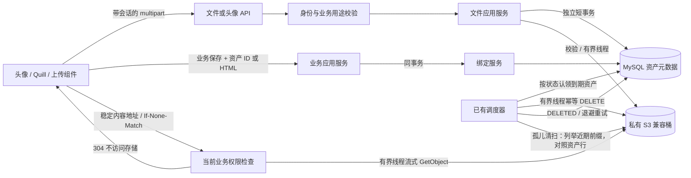
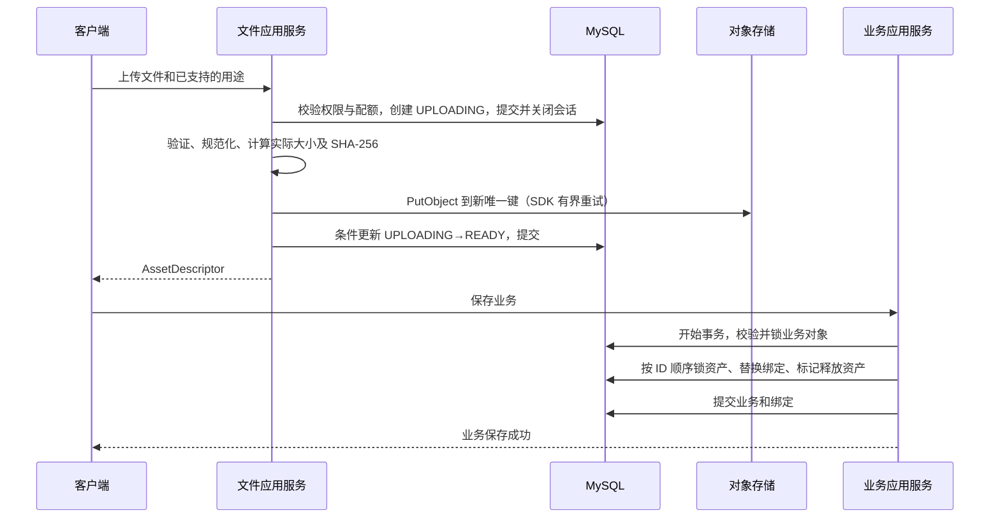
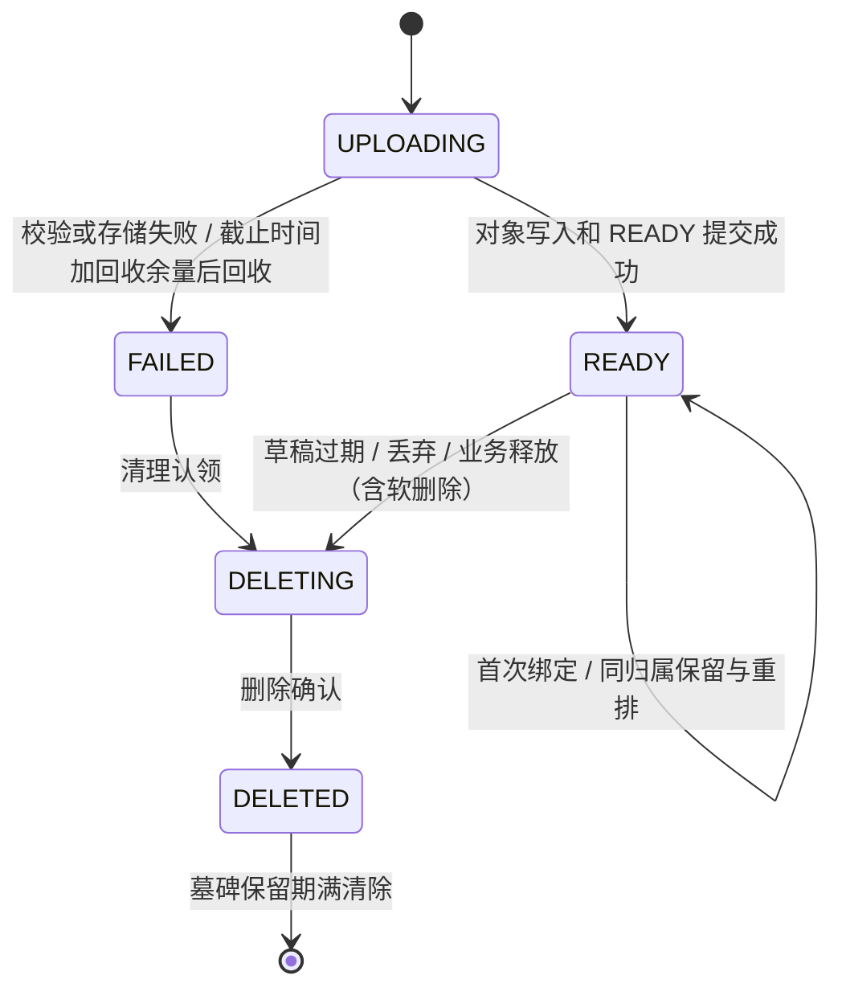

# 文件资产模块与 MinIO 接入 技术设计

## 文档状态与决策

本文件落实 [需求规格](./requirements.md) 的 R1–R16，供 [实现任务](./tasks.md) 使用。状态为 SSD auto 修订评审稿，未实施。2026-10-22 按用户要求定向完善附件类型与回收复查；2026-10-24 按用户认可的长期方案，把回收一致性改为“上传中门禁 + 按资产状态的后台删除 + 孤儿清扫 + 墓碑保留期”，内容读取改为后端同源流式，并补充头像读取、上传配额、软删除与图片规范化。保留既有提交点、取消及认证重发边界；本版需独立复审，旧版 PASS 不覆盖本轮变更。生产发行版 `TBD-PROD-01` 保持未决，不能由开发测试镜像代替决策。流程证据见 [SSD 审查记录](./ssd-review.md)。

| 决策 | 采用方案 | 依据、收益与代价 |
| --- | --- | --- |
| 上传链路 | 后端代理上传 | 当前头像、Quill 和共享组件以小文件为主，服务端可在写对象前统一校验；代价是应用承担上传带宽和临时文件，需要并发/字节限制 |
| 存储客户端 | Boto3 的 S3 client，封装为小型存储端口 | 使用成熟 S3 实现，隔离发行版选择；同步 SDK 必须放入有界线程，不引入整套云资源框架 |
| 资产归属 | 一个资产只属于一个业务对象的一个字段 | 对应现有真实用途，使鉴权、删除和数据一致性明确；跨公告复制图片需要重新上传，不引入共享引用计数 |
| 结构化关系 | 绑定表为唯一真源 | 头像和生成字段不再双存 URL/资产 ID；业务查询需批量投影 |
| 富文本格式 | 净化后的 HTML + 稳定内容 URL + 同事务引用索引 | 保持当前 Quill 使用方式；无需自定义 blot、Delta 存储或 asset:// 协议 |
| 内容读取 | 同源稳定地址 → 后端鉴权 → 从私有存储流式返回；ETag 为 SHA-256，`private, no-cache` | 稳定地址可被浏览器重验证缓存（304 不碰存储）、撤权对下一次请求立即生效、适配任何 S3 实现且存储不对浏览器暴露、头像裁剪与 CSP 无跨域；代价是下载流量经过后端，文件小且生产 nginx 缓冲慢客户端，成为瓶颈时再加网关内部转发，地址契约不变 |
| 清理 | 现有调度器按资产状态认领并执行删除（不经 Outbox），失败持久化退避、无终止状态；上传中记录过截止时间加回收余量才回收；定期孤儿清扫兜底迟到写入；墓碑保留 30 天 | 资产行本身就是持久待办，不再叠加一层事件；只有 5 个状态，无逐次写入证据和复查预算；代价是孤儿对象最多存活到下一次清扫，无主对象需运维按前缀处理，清扫需要列举权限 |
| 附件 | 保留现有 Office 能力，按字段选择受支持类型，有界线程内进程内解析后只下载 | 不因实现方便缩减业务能力；承担解析器依赖与针对性样本验证，不建设杀毒/预览平台，也不预先建设解析子进程隔离 |
| 资源保护 | 上传独立限流档 + 每用户未绑定草稿数量/字节上限 | 复用现有限流中间件，防止单账户在草稿保留期内灌满存储与临时磁盘 |
| 迁移 | 工具盘点/拷贝 + 受控写入冻结 + 一次切换 | 在研系统允许完整硬切；迁移文件与清单保留用于恢复，不形成长期双轨运行 |

未选浏览器直传：它还需要独立上传授权、完成确认、大小策略、覆盖/重放约束及对象校验，本轮真实业务不足以抵偿复杂度。未选 MinIO 专属 SDK：当前只用 S3 基础能力，不需要把应用绑定到某发行版。未采用文件管理平台或自建任务框架：仓库已有模块、权限、事务和调度器可复用。未经 Outbox 删除：现有 Outbox 重试 6 次后进入 manual_intervention，且只能从 event_history 重放，没有重新入队入口；对象删除必须最终完成，直接由调度器按资产行状态重试更简单可靠。未选预签名重定向：签名地址每次不同，无法利用浏览器缓存，每次展示都要鉴权、访问存储并完整下载；还需要浏览器可达的存储端点、额外 CSP 来源和裁剪器跨域，且同域桶代理依赖路径式寻址并要求存储接受应用主机参与签名，云厂商虚拟主机式存储不适用。未保留逐次写入终态证据：Plane 与 OpenCloud 都没有此类机制，迟到写入只造成私有桶中不可读的孤儿对象，用定期清扫回收成本更低。

参考实现（只读核对，2026-10-24）：Plane（本机 `steamer-plane` foundation 分支）先建资产行再写对象、按用途登记资产，对可执行脚本的类型强制 attachment，但采用浏览器直传、事务外批量关联，删除多为软标记，对象基本不回收；OpenCloud 在写入 S3 前设置“处理中”门禁，每次上传生成新 blob 键，下载经网关代理而非预签名，并提供只报告的元数据/存储比对命令。本设计取其门禁、新键、同源代理与比对思路，不引入断点续传、本地暂存或异步处理流水线。

## 架构概述

后端新增 `ruoyi-fastapi-backend/modules/file_assets/`，沿现有 controller → service → repository 分层，在模块注册器和应用容器中显式登记。文件模块不导入用户/公告 controller，也不通过动态扫描寻找业务归属。

业务模块提供固定的归属策略实现；容器注入这些实现到文件模块。策略负责校验业务存在性、操作权限、数据范围及字段约束；资产模块负责状态、元数据、存储与关系约束。认证只返回当前主体和必要权限上下文，不获取头像，避免循环调用。

```text
modules/file_assets/
  api/file_asset_controller.py
  application/asset_service.py
  application/binding_service.py
  application/cleanup_service.py
  application/policies.py
  domain/models.py
  domain/ports.py
  infrastructure/models.py
  infrastructure/repository.py
  infrastructure/s3_storage.py
  infrastructure/delete_handler.py
```

以上为拟新增路径；具体文件拆分服从现有模块装配习惯，不为目录本身引入多层空包装。用户/公告策略在 `modules/system/` 内实现，生成业务的策略放在生成业务模块内。`modules/registry.py`、`container/app_container.py`、`container/providers.py` 负责显式装配。

### 当前代码接入证据

以下均相对仓库根目录，行号为编写时位置。

| 位置 | 已确认事实 | 本次变化 |
| --- | --- | --- |
| `ruoyi-fastapi-backend/modules/system/application/services/common_service.py:20` | 通用上传本地写入 | 持久资产调用迁到新模块；临时导入导出单独盘点 |
| `ruoyi-fastapi-backend/modules/system/api/user_controller.py:385` | 头像参数为 bytes，独立本地写入 | 保留业务端点，改用 UploadFile 与资产应用服务 |
| `ruoyi-fastapi-backend/module_admin/entity/do/user_do.py:23` | avatar 为 URL 字符串列 | 迁移后删除；业务读取投影新字段 |
| `ruoyi-fastapi-backend/module_admin/entity/do/notice_do.py:17` | notice_content 为 LargeBinary | 迁移到文本语义、Python str；MySQL 使用 MEDIUMTEXT 以承载 1 MiB 内容 |
| `ruoyi-fastapi-backend/config/get_db.py:53` | 请求依赖退出时提交 | 上传状态用独立短会话；不能把 yield 后提交当成上传返回前已提交 |
| `ruoyi-fastapi-backend/middlewares/idempotency_middleware.py:297` | multipart 跳过幂等处理 | 不依赖它去重上传字节 |
| `ruoyi-fastapi-backend/events/dispatcher.py`、`events/runtime.py`、`server.py:226` | Outbox 默认 6 次重试后置为 manual_intervention；replay 只读 event_history，无重新入队入口 | 文件删除不经 Outbox，由调度任务按资产行状态执行与重试 |
| `ruoyi-fastapi-frontend/src/components/ui/Editor/index.vue:153` | Quill 用环境前缀拼上传地址 | 改插入稳定资源地址 |
| `ruoyi-fastapi-frontend/vite.config.ts:101`、`nginx.conf:13` | 目前只代理 API 前缀 | 显式增加 /file-assets/ 同源路由 |
| `ruoyi-fastapi-backend/module_generator/templates/python/service.py.jinja2` | 生成服务自行处理提交 | 增加绑定后的单一事务出口，仓储只 flush |
| `ruoyi-fastapi-frontend/src/views/system/user/profile/userAvatar.vue:95` | 裁剪器以当前头像为初始图；vue-cropper 1.1.1 对非 data URL 设 `crossOrigin=""` 并用 XHR 读 EXIF | 内容地址同源，裁剪器无需存储跨域 |
| `ruoyi-fastapi-backend/modules/system/application/services/user_service.py:473` | 用户删除调用 `soft_delete` | 软删除路径同事务释放头像绑定 |
| `ruoyi-fastapi-backend/middlewares/rate_limit_middleware.py`、`config/env.py:404` | auth/write/read 分档限流，写档每用户 240 次/分钟 | 为上传路径新增独立档位，复用同一中间件 |

## 数据流图



### 上传和业务保存



上传成功后关闭编辑窗口只会留下草稿；后续定时回收。头像端点在一次 HTTP 请求中编排同样的上传阶段和业务保存阶段，二者仍是不同事务。

### 生命周期



READY 本身不代表绑定；绑定表决定是否有归属。`first_bound_at` 仅记录是否曾绑定，防止已释放资产误用“上传者可读草稿”规则；不得当成当前绑定真源。FAILED/DELETING/DELETED 永远不能重新绑定或恢复 READY。

资产状态之外不维护逐次写入证据。对象层与资产行的不一致（迟到写入、状态更新失败留下的对象）由孤儿清扫按资产行回收；资产行是唯一真源，清扫从不依据对象推断业务状态。

## 组件与接口定义

### 存储与应用端口

接口为设计签名，使用现有依赖注入方式实现，不要求引入新框架。

| 接口 | 职责 / 约束 |
| --- | --- |
| `ObjectStorage.put(key, stream, size, media_type, sha256)` | 从临时文件发起 PutObject，SDK 有界重试、不自动分片；同 key 重复写入为同一字节，无害。返回成功确认及脱敏请求标识 |
| `ObjectStorage.open(key)` | 返回可分块迭代的对象流及大小；对象不存在抛出明确的缺失异常，不以 ETag 校验文件内容 |
| `ObjectStorage.list(prefix, start_after, limit)` | 分页列举键、大小与 LastModified，仅供孤儿清扫与一致性核对 |
| `ObjectStorage.delete(key)` | 幂等删除，不存在视为成功；网络或权限异常必须可观察 |
| `AssetService.upload(actor, intent, upload_file)` | 自己管理上传状态短会话、文件处理和补偿；不接受业务长事务会话 |
| `AssetService.get_metadata(actor, ids)` | 有界批量授权，返回可见描述，不做逐行业务查询 |
| `BindingService.replace_field_assets(session, actor, owner, field, ids)` | 同调用方事务校验并替换一个字段的绑定；只 flush、不 commit |
| `BindingService.release_owner(session, actor, owner)` | 业务删除路径在同事务中调用；不提供公共任意解绑接口 |
| `AssetOwnerPolicy` | `authorize_upload`、`authorize_write`、`authorize_read_many`、`field_constraints`；由所属业务实现 |

客户端参数只匹配容器中静态声明的策略，不允许上传模块接受任意 Python 类名、表名、SQL、权限表达式。新增业务通过显式代码登记和业务测试接入，不新增策略 DSL 或反射扫描器。

### 业务用途与权限

| 用途 | 上传入口与上下文 | 保存 / 读取 |
| --- | --- | --- |
| `user.avatar` | 仅头像业务端点，目标强制为当前用户 | 字段 avatar、位置 0；已绑定头像任何已登录用户可读（第一版不按部门/数据范围限制），未登录拒绝；批量读取只需确认资产绑定在 system.user/avatar 且用户未被删除 |
| `notice.image` | 通用上传端点；新建 ownerId 为空，需 add 权限；编辑必须给 noticeId 且验证 edit 和存在性 | 公告保存时复验写权限；读取共享公告业务 can_read，支持已有 list 返回完整内容或 query 详情的合法权限 |
| 生成器显式登记用途 | 对应业务模块/字段及新建或编辑上下文 | 沿生成业务的菜单操作权限、数据范围和对象存在性校验，禁止默认所有登录用户可读 |

未绑定资产：`uploader_id == actor.id`、`first_bound_at is null`、READY、未过期，且现在仍有意图对应操作权限。已绑定资产：只走当前归属策略，不保留“原上传者永久可读”旁路。管理员也走项目现有管理员判断与范围规则，不在文件模块自创超管身份。

首次绑定接受本人的新草稿，目标须满足意图约束：指定 ownerId 时必须完全相同；新建意图仅可在本次创建出的同类型对象事务中绑定，不得把它用于已有对象编辑。无客户端随意改 intent 的接口。对已经属于当前字段的资产，其他有编辑权限的操作者可保留或重排，不要求仍为原上传者。

### 事务和并发边界

**提交点与取消语义（CL-01）**：服务端数据库提交是判断成功的依据。READY 提交前确认处理失败/取消，才能进入失败补偿；数据库提交返回结果不明时先查真实状态，不凭异常推定回滚。READY 已提交后客户端断开或响应丢失不反向置 FAILED，也不直接删除；若尚未绑定，保持普通草稿到期回收。头像业务事务已提交则保留新绑定，客户端重读用户资料确认结果；HTTP 取消不是撤销接口。若资产已被回收（FAILED/DELETING/DELETED），迟到的写入完成不恢复 READY，对象由删除任务或孤儿清扫回收，不能把合法 READY 与清理终态混为一类。

1. 上传预检使用短会话取得不可变主体与权限结果，检查用户草稿配额，创建 UPLOADING 并提交。依赖中已启动的认证查询事务必须在对象 I/O 前释放；不能一边保持 `get_db` 请求会话，一边声称上传无长事务。
2. 上传应用服务拥有的 session 与业务 controller 的 session 分离。网络、解码、重编码、哈希和 PUT 在 session 关闭后执行。对象键在创建 UPLOADING 时生成且不复用；恢复任务从不重发 PUT，业务重传创建新资产与新键。SDK 线程只接收流与基本值，不能接收 ORM 对象或 AsyncSession。
3. PUT 成功后在新短事务以 `state=UPLOADING` 条件更新为 READY 并写入大小、SHA-256、uploaded_at；记录已被回收（FAILED/DELETING）时不恢复 READY、返回失败，对象由删除任务或孤儿清扫回收。READY 提交前不得返回成功；提交结果不明先核对真实状态，不能盲删可能已 READY/已绑定的对象。返回前显式提交，不能等依赖退出再提交。
4. 业务创建先 flush 取得 ownerId；修改/删除先锁定 owner。随后按资产 ID 排序锁定新旧集合，在同一事务中验证并替换绑定。重复请求使用同一 ID 集合只产生相同关系；业务创建自身是否幂等继续遵循原业务契约。
5. 为避免排序唯一键的中间冲突，已锁定字段的绑定先删除并 flush，再按最终位置插入；同事务外不可见中间状态。只对差集中的旧资产写 DELETING，保留资产不短暂释放。
6. 清理只按资产 ID 加锁，不反向锁业务对象；通过 READY、是否存在 binding、到期条件做最后检查。绑定与认领竞争以该锁串行化。唯一键冲突转为标准 409；数据库死锁仅重试完整且可重入的数据库事务，不重传对象。
7. 任何 ORM 直接删除业务对象、批量删除、软删除（当前为用户 `soft_delete`；生成器现只生成物理删除，日后引入软删除同样适用）或生成仓储 delete 路径都必须经业务释放入口，在同一事务调用 `release_owner`；不依赖 ORM 全局 hook 隐式处理通用归属。

### 前端接入

- `FileUpload`、`ImageUpload`：`modelValue: string[]`，`update:modelValue` 只发资产 ID 数组；`purpose` 与业务上下文由调用页面提供，描述信息经批量 API 获取。校验/排序/数量在前后端一致，服务端为准。
- 复用 `useAuthenticatedUpload` 和 `createSessionTransport` 的会话、取消及进度。保留明确写入前认证 401 的单次刷新重发，原请求取消或主体改变即终止；网络中断、超时、5xx、响应丢失不得自动重传。替换 `useUploadModel` 的 URL CSV 解析，不保留旧联合类型。成功上传只更新草稿表单，不调用业务绑定。
- 移除未保存条目只更新数组；明确知道属于本次会话的新草稿时可 best-effort 丢弃。关闭页面丢弃失败由 TTL 兜底，绝不能据组件移除事件删除已有绑定。
- 描述缓存限组件或现有查询机制的会话作用域；账户变更清空/取消。异步响应写回前检查现有 session generation/abort 信号，不建立另一套登录刷新系统。
- `` 无法携带自定义 Bearer 头，使用现有同源 HttpOnly access cookie。失败时通过会话传输请求元数据以取得可判别 HTTP 状态；现有单飞刷新成功且元数据可见后重新加载原内容地址一次。403/404 不刷新，503 显示失败；不在 src 放 token。依赖当前 cookie path=/ 行为，实施时加入回归。
- 用户 store 与头像组件使用 `avatarAssetId`、`avatarUrl`；默认头像仍用前端静态资源。用户列表批量投影，认证对象不得为填充头像发文件元数据请求。
- 代理分别在 Vite、生产 nginx 增加 `/file-assets/` 到同一后端路径的精确转发。该保留前缀避开 Vite `/assets/`，保留 Cookie、Host 和正确转发头；生产 nginx 对该路径开启响应缓冲，替后端承接慢客户端；不增加后端兼容路由副本。
- 头像裁剪器继续以当前头像为初始图：内容地址同源，vue-cropper 的 CORS 模式加载与 XHR 读取 EXIF 均为同源请求，无需存储跨域。

### 公告 HTML

`notice_content` 的业务值统一为 `str`；HTML 是内容真源，绑定表是服务端维护的引用索引，不接收另一份权威 imageIds 列表。保存顺序为：解析并检查不受支持图片 → nh3 白名单净化 → 再解析最终 HTML → 规范化和收集引用 → 校验/保存业务及绑定。

白名单覆盖当前工具栏的段落、标题、列表、粗体/斜体/下划线/删除线、引用、代码块、链接、对齐、缩进、前景/背景颜色及字号对应的标签/类/样式；禁止事件属性、脚本、iframe 和 CSS URL。公告工具栏同步移除当前默认 video 按钮，不保留“前端可插入、服务端却删掉”的入口；已有 iframe 属于需要人工处理的迁移差异，若实际消费者要求保留，先补充需求与可信来源策略，不能静默删除后放行迁移。允许的 `img.src` 必须精确为 `/file-assets/<UUID>/content`，不带主机、query 或 fragment；以解析器和 URL/UUID 校验处理，不能用一条正则代替 HTML 解析。超链接独立允许 http/https/mailto，并加 noopener/noreferrer；不是所有外链文本都禁止。

图片按最终出现顺序去重后绑定。存储 URL 不使用临时签名，也不依赖 Quill 会丢弃的自定义 data 属性。本地粘贴/拖放图片走同一上传流程，撤销/重做只改变编辑值；上传仍在进行时禁止提交。外部图片/data URL 不静默删掉后算成功，向用户返回字段校验错误；历史内容走迁移异常处理，不由运行时任意抓取外链。图片故障可显示占位，但不能悄悄改写保存内容。

### 生成器

在 `module_generator/entity/do/gen_do.py`、对应 VO、生成配置 UI 和同步逻辑中增加明确资产字段声明：字段名、`asset_kind`（image/file）、`allowed_type_ids`、最大字节数、最大数量、归属类型与服务端权限接入点。类型 ID 从版本内固定登记表选择，映射规范扩展名、声明 MIME 别名和校验器；不接受自由填写 MIME 开放新类型。四套模板的 accept/提示与后端策略从同一声明生成；未选类型报配置错误，不默认全部开放。资产字段作为逻辑关系字段管理；导入旧物理文件列时需明确转换并生成迁移说明，不能仅改变 html_type 就删除真实数据。

生成变化必须同时落在：

1. `python/vo.py.jinja2`：输入 ID 数组，输出数组及可选批量描述投影；编辑字段“未提供”表示不改，“[]”表示清空，不默认为空误删。
2. `python/do.py.jinja2`、`repository.py.jinja2` 和模式生成：不把逻辑资产字段写成业务 varchar/CSV 列，不将 DTO 的数组直接赋给 ORM。
3. `python/service.py.jinja2`、`controller.py.jinja2`：先业务校验，再同事务绑定/释放，仓储只 flush；单一提交出口保证整体回滚。生成业务的删除路径同事务释放资产字段绑定（生成器当前只生成物理删除）。生成配置校验同一表单全部资产字段的“最大数量 × 单项上限”之和不超过用户草稿配额（默认 200 MiB），超出报配置错误。生成策略与模块登记代码，未接入策略时生成校验失败，不默认为开放权限。
4. 四套 `vue/index.vue.jinja2`、`vue/index-tree.vue.jinja2`、`vue/v3/index.vue.jinja2`、`vue/v3/index-tree.vue.jinja2`：统一组件/数组协议、上传用途、读投影与提交阻塞；同步 JS API 与现有表单规范。
5. `sql/sql.jinja2` 和生成配置：现有菜单 SQL 职责保持，不把资产运行时 schema 初始化塞入每份生成 SQL；真正的表结构变化进入统一数据库流程。

验收使用实际生成的最小业务 fixture，安装到测试 app 后执行创建、修改、读取、删除和权限测试；仅比对模板字符串不足以验收。

## API 接口设计

### 路由与资源

以下为后端原始路径；普通 API 客户端仍可经现有 API base 前缀访问。稳定图片地址使用同源专用代理路径。UUID 作为不透明字符串传输，JSON 使用现有 camelCase 模型。

| 方法 / 路径 | 输入 | 成功响应 | 关键规则 |
| --- | --- | --- | --- |
| POST `/file-assets/uploads` | multipart `file`、`purpose`、可选 `ownerId` | 200 AssetDescriptor | 文件 1 个，已支持用途；头像用途不可通过此通用端点调用 |
| GET `/file-assets/{assetId}` | UUID | 200 AssetDescriptor | 当前权限；不返回 bucket/key/签名 |
| POST `/file-assets/metadata:batch` | `{assetIds: string[]}`，最多 100 项 | 200 `{items: AssetDescriptor[], unavailableIds: string[]}` | 去重并保持输入顺序；不可见与不存在统一 unavailable，不泄露失败原因 |
| GET `/file-assets/{assetId}/content` | 可选 `download=true`；可带 `If-None-Match` | 200 流式内容，或 304 | 默认仅图片用途中经规范化重编码的图片 inline，其他（含附件字段中的图片）attachment；显式下载可把图片转为 attachment，不能反向放宽；不支持 Range |
| DELETE `/file-assets/{assetId}` | UUID | 204 | 本人且从未绑定的草稿；本人重复丢弃成功，已绑定返回 409，不可见返回 404 |
| POST `/system/user/profile/avatar` | multipart `avatarfile` | 200 `{avatarAssetId, avatarUrl}` | 保留路由与表单字段名、硬切返回 DTO；内部上传后原子替换头像 |

`metadata:batch` 先于动态 ID 路由声明并使用 UUID 路径校验，避免路由歧义。不存在的 DELETE 返回 404；对本人已知草稿在 DELETING/DELETED 的重试返回 204，保留墓碑支持该语义。所有返回资源沿用 `ResponseUtil.ok_resource`，不新套 code/data 双层响应。保留头像路径是保留真实业务操作，不是保留旧文件存储兼容层。

```json
{
  "assetId": "a18c9be8-4317-4e10-a17d-b2caf86c63cf",
  "name": "示意图.png",
  "mediaType": "image/png",
  "size": 128000,
  "contentUrl": "/file-assets/a18c9be8-4317-4e10-a17d-b2caf86c63cf/content"
}
```

业务结构化字段仅提交 ID 数组；头像由端点内部绑定。公告沿用公告 CRUD 的 `noticeContent: string`，服务端从最终 HTML 提取 ID。接口无任意 bucket/key 参数，无通用绑定、任意 ownerType 创建或任何预签名 URL 接口。

### 错误与缓存

| 状态 | 语义 |
| --- | --- |
| 401 | 未登录、当前会话失效；沿用既有刷新协调 |
| 403 | 明确的业务写入权限或 CSRF 拒绝；读取存在性保护统一为 404 |
| 404 | 资产不存在、不可见、不可读状态或业务对象不可见 |
| 409 | 草稿已被绑定、归属冲突、状态竞争、绑定已过期资产 |
| 413 / 415 / 422 | 字节限制 / 不支持的实际类型 / 非法输入、图片、HTML 或用途上下文 |
| 429 | 上传限流档超限，或该用户未绑定草稿数量/字节超出配额；使用稳定问题类型区分两者 |
| 503 | 存储不可用、应用存储凭据/桶配置失败或并发容量耗尽；使用稳定问题类型和重试提示 |

**认证重发边界（CL-02）**：上传与头像写入端点的所有认证 401 必须在创建 UPLOADING 记录及对象 PUT 之前产生。复用现有 `src/utils/session.ts:165–180` 的单次刷新重发，不增加通用重试层。写入阶段之后发现权限变更应按业务 403/409 或实际存储/事务错误返回，不返回可被传输层自动重发的 401。测试须断言 401 路径没有资产行/对象副作用，且未知结果不会自动重传；业务提交后响应丢失按 CL-01 重读确认。

业务已授权读取但实际对象缺失视为存储完整性异常，返回 503 并记录修复告警，不能误导为“用户没有权限”。接口和代理的前置拒绝统一采用项目 RFC 7807 结构；不泄露 S3 原始错误、密钥或内部主机。

内容端点先鉴权并读取资产行；请求带 `If-None-Match` 时按 RFC 9110 弱比较处理（支持列表、`*` 与 `W/` 前缀，网关压缩把 ETag 改为弱校验时仍可命中），与 `"<sha256>"` 匹配即返回 304，不访问存储。否则在下载槽位内（槽位已满时最多等待 5 秒，仍无槽位才返回 503）以 GetObject 打开对象，Body 按 64 KiB 分块经线程池迭代写入流式响应；客户端断开时关闭 Body 并释放槽位。metadata 不必为每项做存储 I/O。响应头固定为：登记的规范 Content-Type、Content-Length、`ETag: "<sha256>"`、`Cache-Control: private, no-cache`（每次使用都重验证，撤权对下一次请求立即生效）、Content-Disposition（文件名使用安全 ASCII 回退及 UTF-8 filename* 编码，禁止拼入未经处理的响应头字符）、`X-Content-Type-Options: nosniff`、`Content-Security-Policy: default-src 'none'; sandbox` 与 `Referrer-Policy: no-referrer`。存储返回的头不透传。304 也只在鉴权通过后返回。第一版不支持 Range，附件以 attachment 整体下载。

### 默认限制

| 项目 | 第一版默认 |
| --- | --- |
| 单张图片原始上传及规范化后字节数 | 均不超过 5 MiB |
| 图片 | JPEG/PNG/WebP，单帧、总像素不超过 25,000,000，单边不超过 8192；所有图片用途按 EXIF 方向转正后以原格式重编码（JPEG/WebP 质量 90），移除 EXIF/XMP 等元数据，可保留 ICC 颜色配置；头像另缩放至最长边不超过 512 像素并编码为 PNG；规范化输出超过 5 MiB 时：JPEG/WebP 先改用质量 80，PNG 无损不调质量、改用最高压缩级别；仍超限再把最长边缩至 4096 像素，仍超限返回 422（原因码 IMAGE_NORMALIZED_TOO_LARGE） |
| 用户草稿配额 | 每用户未绑定草稿（UPLOADING 及从未绑定的 READY）不超过 50 个、合计不超过 200 MiB；创建 UPLOADING 前检查，不预占 |
| 上传限流档 | `/file-assets/uploads` 与头像上传：每 IP 60 次/分钟、每用户 30 次/分钟；复用现有限流中间件新增档位 |
| 单个附件 | 不超过 20 MiB；生成字段必须显式选择支持类型，可设更小限制 |
| 每字段资产数 / 公告图片数 | 10 / 20；头像固定 1；同一图片重复出现只计 1 |
| 元数据批量 / HTML UTF-8 字节数 | 100 个 ID / 1 MiB |
| multipart | 1 个文件、至多 4 个文本字段，每字段至多 256 字节；文件显示名规范化后最多 255 字符 |
| 请求体上限 | 通用上传 20 MiB + 64 KiB，头像 5 MiB + 64 KiB；用途内仍逐字节执行更小上限 |

### 附件类型与受限校验（CL-03）

`FileUpload/index.vue:81–84` 已有 doc/docx/xls/xlsx/ppt/pptx/txt/pdf 默认值，四套模板直接使用；本版保留其类型能力。现有后端全局后缀表还列有压缩包、视频、HTML 等，这不能证明它们是当前持久附件需求，按真实调用盘点处理，不自动扩成任意文件上传。下表定义模块能力，每个业务字段仍须显式选择子集；图片用途继续执行更严格的图片规则。

| 类型 ID / 扩展名 | 规范媒体类型 | 内容识别与拒绝条件 | 交付 |
| --- | --- | --- | --- |
| doc / .doc | application/msword | OLE/CFB 严格结构、WordDocument 等类型流；拒绝不匹配、损坏及宏/不可验证加密 | attachment |
| xls / .xls | application/vnd.ms-excel | OLE/CFB 严格结构、Workbook/Book 类型流与 BIFF 识别；拒绝 VBA/XLM 宏及不可验证加密 | attachment |
| ppt / .ppt | application/vnd.ms-powerpoint | OLE/CFB 严格结构、PowerPoint Document 类型流；须覆盖 PPT 内嵌 VBA 容器 | attachment |
| docx / .docx | application/vnd.openxmlformats-officedocument.wordprocessingml.document | OOXML 包关系及 Word 主部件匹配，无宏声明/部件 | attachment |
| xlsx / .xlsx | application/vnd.openxmlformats-officedocument.spreadsheetml.sheet | OOXML 包关系及 Excel 主部件匹配，无 VBA/XLM 宏声明/部件 | attachment |
| pptx / .pptx | application/vnd.openxmlformats-officedocument.presentationml.presentation | OOXML 包关系及 PowerPoint 主部件匹配，无宏声明/部件 | attachment |
| pdf / .pdf | application/pdf | PDF 格式校验；不执行脚本或渲染，不宣称文档无恶意内容 | attachment |
| txt / .txt；csv / .csv | text/plain；text/csv | UTF-8（允许 BOM），拒绝 NUL 等二进制内容；CSV 不执行公式，不按 Excel 导入解析 | attachment |
| jpeg / .jpg,.jpeg；png / .png；webp / .webp | image/jpeg；image/png；image/webp | 实际静态图片解码及既有像素/尺寸限制 | 图片用途（已规范化重编码）inline，可显式 attachment；附件字段中的图片保持原始字节，一律 attachment |

扩展名忽略大小写并规范化；声明 MIME 去参数后按类型登记的有限别名集比较。缺失或 `application/octet-stream` 不单独导致拒绝，必须通过内容检查；具体 MIME 与识别类型矛盾返回 415。`application/zip` 对 docx/xlsx/pptx 只作为容器别名接受，仍必须匹配 OOXML 主类型，不能借此接受普通 ZIP。输出及存储 Content-Type 永远使用上表规范值。缺失扩展名、双重伪装、未登记类型和字段不允许的类型均拒绝。

**复用解析能力，限制检测职责：**采用 Python `zipfile` 读取 OOXML，`defusedxml.ElementTree` 解析必要包元数据（禁止 DTD、实体和外部资源），`olefile` 严格只读解析 OLE，受限使用 `oletools` 的 VBA/加密检测及 BIFF 宏工作表识别；依赖在实施任务中锁定兼容版本并用真实样本验证。现有 python-docx/docxtpl 面向文档生成，不能代表 Excel/PPT 校验能力。不得自写 ZIP/OLE 解析器，也不引入 LibreOffice、预览服务或杀毒平台。

- OOXML 先校验中心目录，最多 2,048 个条目、声明及实际累计解压字节均不超过 200 MiB；只接受 STORED/DEFLATED，拒绝加密、重复规范化名称、绝对路径/目录穿越和损坏 CRC。不 extractall；逐流计数至上限即拒绝。包元数据单个 XML 不超过 1 MiB，通过 `[Content_Types].xml`、包关系和对应主部件共同识别，拒绝宏启用内容类型、VBA 部件及 Excel 宏工作表，普通 ZIP 改名不能通过。
- OLE 不以魔数或某个流名独立放行；严格解析结构并识别对应 Office 子类型，执行 VBA 检测，Excel 补充 BIFF 宏工作表检查。OOXML 与 OLE 的嵌入 Office 对象也纳入受限检查，无法完成检查则拒绝。宏专用扩展名（docm/xlsm/pptm 等）不在登记表；已知宏结构检测结果为阳性直接拒绝，不做去宏后替用户改文件。加密后不能检查的文件拒绝，不尝试密码或自动解密。
- 不调用可能模拟宏的通用分析入口：VBA 检测禁用 XLM 自动分析；XLM 使用结构识别，OOXML 查宏工作表类型，旧 XLS 使用 BIFF 宏表检测。不得调用 XLMMacroDeobfuscator 的模拟/解混淆分支。检测异常、未支持结构、资源超限均 fail-closed；检测通过不等于无宏漏洞、杀毒或完整文档语义验证。
- Office 解析在上传槽位内的有界线程中进程内执行，不另建子进程。资源由输入上限约束：OOXML 条目数、声明与实际累计解压字节、单个 XML 大小逐流计数，OLE 只解析不超过 20 MiB 的输入；解析循环在条目/流之间检查单次 5 秒墙钟预算，超时中止并判 422。线程无法被强制终止，若某次解析在检查点之间仍超时，槽位保持占用直到线程结束，由上传并发上限兜底。输入只读临时文件，不启动 Office/宏引擎，不抓取外链；解析器与依赖日志禁止输出文档字节/宏源码。若真实样本探针证明某解析器在上述上限内仍可能失控，先回写设计再引入子进程隔离。

413 用于字节/解压资源上限；415 用于类型不允许或内容类型冲突；422 用于格式损坏、宏、加密不可验证或解析时间超限，提供稳定原因码且不泄露内容。零字节附件拒绝。普通附件保持原始字节及 SHA-256；图片用途统一规范化重编码，SHA-256 与大小按规范化后的存储字节记录。Office/PDF/文本下载不宣称安全认证，下载属性不能消除本地打开文档的风险。实际历史消费者、类型/编码/宏/加密异常进入迁移清单，禁止用换扩展名、静默转码或删除记录绕过校验。

用途级小上限在 multipart 被解析前不一定可知，因此以路径总上限先限制收包/临时磁盘，再按业务用途限制实际文件。ASGI 接收限制必须在 Starlette multipart spool 之前执行，网关再做外层限制；不能仅依赖 UploadFile 读取后检查。单位统一为 MiB（1024² 字节）。

## 数据模型与数据库变更

### sys_file_asset

| 字段 | 建议类型 | 约束 / 含义 |
| --- | --- | --- |
| asset_id | CHAR(36) | UUID 主键；规范化小写 |
| bucket | VARCHAR(63) | 实际桶名，不使用部署当前桶替代历史行值 |
| object_key | VARCHAR(255) | 固定为 `assets/YYYY/MM/<asset_id>`（YYYY/MM 取 created_at 的 UTC 年月），每次上传随新资产生成、永不复用；与 bucket 组合唯一，不含原文件名；孤儿清扫据此从键反查资产行 |
| original_name / display_name | VARCHAR(255) | 有界原始名称及安全名称；不用于寻址，原始名称也不可包含控制字符 |
| media_type / size_bytes / sha256 | VARCHAR(127) / BIGINT / CHAR(64) | 校验后的存储字节元数据；UPLOADING 可为空，READY 必须齐全 |
| uploader_id | BIGINT | 操作者审计 ID；不做级联删除 FK，删除用户后仍可回收其资产 |
| purpose / intended_owner_type / intended_owner_id | VARCHAR(64) / VARCHAR(64) / VARCHAR(128) NULL | 经过策略校验的上传意图；ID 字符串规范化，不混用 01 与 1 |
| state | VARCHAR(16) | UPLOADING、READY、FAILED、DELETING、DELETED |
| created_at / updated_at / uploaded_at / first_bound_at | DATETIME(6) | UTC；后两者可空 |
| upload_deadline / expires_at / delete_after / deleted_at | DATETIME(6) | upload_deadline = created_at + 上传状态时限（默认 180 秒）；expires_at = uploaded_at + 草稿保留期；delete_after 为到期时间（释放时设为宽限期末，之后不再改动，供积压与 oldest_delete_due_age 计算）；deleted_at 为删除确认时刻；统一由数据库 UTC 时间生成 |
| delete_next_attempt_at | DATETIME(6) NULL | 下次允许执行删除的时刻：认领时写入租约（now+5 分钟），失败时写入退避时刻；NULL 表示尚未认领过。与 delete_after 分开，租约与退避不改变到期时间 |
| delete_attempts | INT | 默认 0；对象级 DELETE 失败（404 以外的 4xx）每次加 1，用于退避与告警；存储不可用类失败不计；没有上限、不进入终止状态 |
| delete_failing_since | DATETIME(6) NULL | 本轮持续删除失败的起点：任一类失败首次发生时写入，删除成功时随 DELETED 一并清空；用于“持续失败超过 1 小时”告警与 `retry-deletes` 选择 |
| last_error_code / last_error_at | VARCHAR(64) / DATETIME(6) NULL | 脱敏运维状态（如 UPLOAD_ABANDONED、VALIDATION_FAILED、STORAGE_ERROR）；详细栈在日志，不存含凭据错误 |

索引：唯一 `(bucket, object_key)`；`(state, expires_at)`、`(state, upload_deadline)`、`(state, delete_after)`、`(state, delete_next_attempt_at)`、`(state, deleted_at)`；`(uploader_id, state, first_bound_at)` 用于草稿配额与本人草稿查询。孤儿清扫按 asset_id 主键批量查询。对象 key 按 ASCII 安全字符生成，不把未知长外链写进索引。

### sys_file_binding

| 字段 | 建议类型 | 约束 / 含义 |
| --- | --- | --- |
| binding_id | BIGINT | 自增主键 |
| asset_id | CHAR(36) | FK 到资产，RESTRICT；唯一约束，保证单资产单归属 |
| owner_type | VARCHAR(64) | 已登记业务类型，如 system.user / system.notice |
| owner_id | VARCHAR(128) | 按所属业务主键标准化的字符串，可承载现有整数或 UUID；不能直接拼 SQL |
| field_key | VARCHAR(64) | 已登记字段，如 avatar / noticeContent |
| position | INT | 从 0 开始，字段内连续顺序；头像恒为 0 |
| created_at / created_by | DATETIME(6) / BIGINT | 建立绑定审计 |

唯一 `(owner_type, owner_id, field_key, position)`，查询索引 `(owner_type, owner_id, field_key)`。不存在指向所有业务表的通用 FK，由业务同事务释放和测试保证完整性。字段策略校验数量；不要以只有位置唯一键代替“头像只能一个”的业务约束。

### 其他变更与迁移入口

- `sys_user.avatar` 在旧引用迁移和读投影替换完成后移除，不添加 avatar_asset_id 重复列。用户 DTO 与前端类型同步去掉旧 avatar 存储语义。
- `sys_notice.notice_content` 从 LargeBinary 转为文本语义和 Python str；模型采用 `Text().with_variant(MEDIUMTEXT(), 'mysql')`，MySQL 正式迁移列必须为 MEDIUMTEXT。普通 MySQL TEXT 的 65,535 字节容量无法承载本设计的 1 MiB HTML 上限。不能直接依赖数据库隐式字符集转换；迁移脚本先严格 UTF-8 解码、转换引用并验证，异常单列。用多字节文本验证 UTF-8 字节上限及超过 64 KiB 的实际保存/读取，不以字符数量替代字节限制。
- 生成器配置增加逻辑资产字段元数据，真实资产关系不创建业务 CSV 列。已有生成业务按清单迁移，不直接批量删字段。
- 模型在 Alembic `alembic/env.py` 和 Atlas `scripts/internal/db_workflow/schema_apply_atlas.py` 的模型清单中显式注册，复用 `scripts/db.py` 的 dev-sync / finalize / deploy / verify 工作流。开发 dev-sync 在历史数据迁移前不得自动删 avatar 列。
- 新库直接创建目标模式；有数据升级分为扩展结构 → 数据迁移/校验 → 收缩旧结构的正式 revision。两阶段 schema 为迁移顺序服务，不意味着上线后保留双读双写。

## 回收与一致性恢复

### 调度与删除执行

现有调度器每分钟分批扫描，默认每批 100 个。通过 `FOR UPDATE SKIP LOCKED` 加状态条件认领资产，多个 worker 可以并发，不新增 Redis leader 机制。MySQL 8 为本项目当前运行基线；不能以 SQLite 并发测试替代锁验证。资产行（state + delete_after）本身就是持久的删除待办，不再经 Outbox 投递事件。

- 从未绑定 READY 且 expires_at 到期：锁定后确认无绑定，设置 DELETING，delete_after=now。
- 用户明确丢弃自己的新草稿：DELETING，delete_after=now。
- 业务释放（含软删除）：在业务事务内设置 DELETING，delete_after=now+24h；此刻即停止返回内容，宽限期只延迟物理删除，不提供回收站恢复语义。
- FAILED：认领 DELETING，delete_after=now。
- 过期 UPLOADING（上传门禁）：只有 `upload_deadline + 回收余量（默认 60 分钟）` 已过才在锁内改为 FAILED（last_error_code=UPLOAD_ABANDONED），再按 FAILED 处理。回收余量远大于上传状态时限与 PUT 的连接/读超时及有界重试总时长，正常与慢速上传在回收前都已结束；它是调度默认值，不作为“写入已终止”的证明，极端迟到写入由孤儿清扫兜底。上传执行流的 READY 条件更新只接受 UPLOADING，记录被回收后不再恢复 READY。

删除执行由同一调度器的删除任务完成：

1. 存储归属状态不是“已确认”时整轮跳过，不认领、不计尝试次数（见“存储归属保护”）。
2. 短事务认领 `state=DELETING AND delete_after<=now AND (delete_next_attempt_at IS NULL OR delete_next_attempt_at<=now)` 的一批行（`FOR UPDATE SKIP LOCKED`，按 `COALESCE(delete_next_attempt_at, delete_after)` 升序），确认无绑定后只把 delete_next_attempt_at 设为 now+5 分钟作为执行租约，提交并关闭会话；delete_after 不变。租约使进程崩溃后该行 5 分钟后可被重新认领，正常情况下同一行不会被并发执行，偶发重叠也无害（见第 5 步）；认领本身不计尝试次数。仍有绑定的 DELETING 行违反“释放即解绑”的不变量：不删除，把 delete_next_attempt_at 推后 1 小时并触发 binding_invariant_violation 告警，避免它每轮占据批次头部。
3. 在维护 I/O 槽位内执行有界 DELETE；成功或真实 not-found 视为删除成功，再以新短会话按 `state=DELETING` 条件写 DELETED 与 deleted_at，并清空 delete_next_attempt_at 与 delete_failing_since。
4. DELETE 失败时以新短会话按 `state=DELETING` 条件回写（行已被其他执行者改为 DELETED 时不生效），写 last_error，delete_failing_since 为空则写入当前时间。失败分两类：
   - 存储不可用类（连接失败、超时、5xx）：不计尝试次数，按持续失败时长退避：delete_next_attempt_at = now + min(max(1 分钟, now − delete_failing_since), 15 分钟)，即从 1 分钟起近似翻倍、封顶 15 分钟。只有连接级错误（无法建立连接或连接超时）连续 3 次才结束本轮，因为那表示存储整体不可达；单个对象返回的 5xx 或读超时只退避该行，本轮继续处理其他行，部分磁盘离线时健康对象的删除不受影响。存储恢复后，失败行最长 15 分钟内自动续删，也可用 `retry-deletes` 立即重试。
   - 对象级失败（404 以外的 4xx，如 403/400）：delete_attempts+1，delete_next_attempt_at = now + min(1 分钟 × 2^(delete_attempts−1), 6 小时)。

   没有终止状态，记录永远不会因重试次数而被放弃。
5. 从认领起 3 分钟后不再发起新的 DELETE；维护 client 单次 DELETE 最长约 30 秒（读超时 10 秒、总尝试 2 次加退避），因此本轮最后一个 DELETE 也在 5 分钟租约内结束，到时未执行的行只等租约到期。即便偶发重叠，DELETE 幂等且回写有条件，不会造成错误结果。删除、孤儿清扫与墓碑清除的调度任务均登记为禁止并发（sys_job `concurrent='1'`，即 max_instances=1），跨进程并发由 SKIP LOCKED 与租约兜底。

重复执行对同一不可变 key 安全；已是 DELETED 的行不会再被认领。删除后不安排周期 HEAD 复查。运维命令 `scripts/file_assets.py retry-deletes [--asset-id ...]` 把仍为 DELETING 且 delete_failing_since 非空的行的 delete_next_attempt_at 置为 now，用于存储恢复或修复配置/权限后立即重试；它不改 delete_after，因此不会缩短业务释放的宽限期。

### 孤儿清扫

对象键为 `assets/YYYY/MM/<asset_id>`，按创建月份分区。迟到写入只会发生在上传当月或跨月边界附近，常规清扫因此只列举当前月与上一月两个前缀，不做常规全桶扫描。做法借鉴 Mastodon `tootctl media remove-orphans`、GitLab `gitlab:cleanup:remote_upload_files` 与 OpenCloud `backup consistency` 的“列举存储 → 对照元数据”；与它们不同，本系统以资产行为唯一真源，宽限期后只自动删除资产行已判定为废弃（FAILED/DELETED）的对象。

- 周期：现有调度器每日执行一次（默认），与删除、墓碑清除共享维护 I/O 并发上限。
- 列举：ListObjectsV2 分页（每页 1,000）遍历两个月份前缀；任何列举都不进入 `_meta/`。只处理完全匹配 `assets/YYYY/MM/<规范小写 UUID>` 的键；其余键记为格式外键并告警，不删除。
- 判定：按批（每批最多 1,000 个 UUID）查询资产行。同时满足才删除：对象 LastModified 早于 now − 24 小时宽限期；资产行 state 为 FAILED/DELETED 且 bucket/object_key 与该对象一致。UPLOADING、READY、DELETING 一律跳过：READY 是正常对象，DELETING 由删除任务负责，UPLOADING 受上传门禁保护。没有资产行的对象记为无主对象：正常流程先建行再写对象，不会产生无主对象，出现即意味着误配置环境、数据库恢复或越界写入，因此只报告并告警，从不自动删除。
- 删除：清扫直接对该 key 发起 DELETE；以结构化日志记录 assetId、key 与判定原因，失败的项下一轮重试。清扫不修改资产行；FAILED 行仍按常规流程进入 DELETING → DELETED，届时 DELETE 为 not-found 幂等成功。
- 预算与游标：每轮最多删除 1,000 个对象、最长运行 10 分钟；达到任一上限即记录截断指标，并把当前前缀的 `start_after` 游标写入 Redis（键 `file_assets:sweep:cursor:<prefix>`，TTL 7 天），下一轮从游标继续，遍历完前缀后清除。游标丢失只会让下一轮从头开始，不影响正确性。列举不设对象数上限，单轮请求数随两个月内的对象数线性增长。
- 暂停：部署开关 `FILE_ASSET_ORPHAN_SWEEP_ENABLED` 控制清扫；备份恢复与数据迁移切换窗口通过现有调度器暂停清扫任务。数据库按快照恢复后，必须先完成恢复核对再恢复清扫。
- 命令：`scripts/file_assets.py check-consistency [--prefix ...]` 遍历指定前缀或全桶（跳过 `_meta/`），只报告孤儿对象、无主对象、格式外键与 READY 资产缺失的对象，不删除。`scripts/file_assets.py sweep-orphans --prefix assets/YYYY/MM/ [--dry-run]` 对指定前缀执行与定时任务相同的判定，用于清扫暂停后或两个月窗口之外的补扫，默认 dry-run，需 `--apply` 才删除；`--include-unowned` 需同时指定前缀与 `--apply`，由运维在确认误配置/恢复原因后显式删除无主对象。所有带 `--apply` 的命令与定时任务一样，先要求存储归属状态为“已确认”。

### 存储归属保护

每个桶只归属一个部署环境的数据库（R12.AC6）。部署为每个环境配置唯一的 `FILE_ASSET_INSTALLATION_ID`；`bootstrap-storage` 在桶内写入 `_meta/installation.json`（含该 ID 与创建时间，位于 `assets/` 前缀之外，任何列举与清扫都跳过 `_meta/`）。

进程内维护归属状态，取值为“未确认 / 已确认 / 无效”：

- 应用启动时为“未确认”，在开始服务前（应用 lifespan 启动阶段）读取标识，最多 3 次、每次 3 秒超时；仍无结论则先开始服务，并在后台每 10 秒重试，直到得到明确结论。读到且与配置一致 → “已确认”；明确 404（标识缺失）、内容不一致或 403 AccessDenied（应用凭据无权读取标识，属于配置错误）→ “无效”。
- “已确认”之后每 10 分钟复核一次。只有明确的缺失、不一致或 403 才改为“无效”；网络错误、超时、5xx 只记日志与指标，保持原结论，并在 30 秒后再试。“无效”状态每 1 分钟复核一次，标识恢复一致（例如运维执行 `--take-over` 或修正配置后）即回到“已确认”，无需重启。存储本身的故障仍按各请求自己的存储错误返回 503，不因一次标识读取失败而让全部文件能力停摆。
- “未确认”或“无效”时：上传、内容读取（含 304）与元数据接口统一返回 503（稳定问题类型 `file-assets-unavailable`），删除任务、孤儿清扫与所有带 `--apply` 的命令整轮跳过且不计删除尝试次数；“无效”另外触发告警，`check-storage` 报告原因。

这样从生产数据库快照恢复的预发环境，即使沿用了生产存储配置，只要安装标识不同就不会删除生产对象；若连安装标识也照搬生产配置，则属于把该环境配置成了生产，运行手册明确禁止。环境之间转交一个桶（例如恢复演练中把备份副本桶交给新环境）时，运维执行 `bootstrap-storage --take-over --confirm-installation <旧ID>`，在确认旧 ID 后改写标识；未带确认参数时，bootstrap 遇到不一致的标识一律拒绝覆盖。

### 墓碑保留

DELETED 行默认保留 30 天（自 deleted_at 起算），期间支撑审计和本人重复丢弃返回 204；之后由同一调度任务分批（每批 1,000）物理删除行（DELETED 资产已无绑定）。只清除 DELETED；UPLOADING、FAILED、DELETING（含删除重试中）的记录不清除。迟到写入只发生在上传后不久，其键位于当前月或上一月，会在墓碑清除前被清扫删除；若行清除后对象仍存在（例如清扫长期暂停），它成为无主对象，只报告，由运维按前缀显式处理。

### 运维与告警

删除积压（delete_after 到期超过 15 分钟仍未删除、且 delete_failing_since 为空，即不是因失败重试而滞留，说明删除任务未运行或处理不过来）、任一资产 delete_attempts 达到 5、任一资产 delete_failing_since 超过 1 小时（覆盖存储持续不可用）、出现仍有绑定的 DELETING 行、清扫连续 3 轮截断、发现 READY 资产对象缺失、无主对象或格式外键、存储归属状态为“无效”或“未确认”超过 5 分钟，进入现有运维可见告警。监控 delete_backlog、oldest_delete_due_age、delete_retrying、max_delete_attempts、binding_invariant_violation、orphan_found、orphan_deleted、orphan_sweep_truncated、unowned_object、unexpected_key、missing_object、storage_ownership_mismatch 及实际存储请求量。第一版不建设自动归档平台；墓碑行清除后不保留其他副本。

## 配置与运行部署

### 配置清单

在现有 Pydantic settings 中集中定义；命名在实现时与项目 env 前缀习惯统一，但不可省略下列语义。

| 配置 | 默认或约束 |
| --- | --- |
| S3_ENDPOINT | 必填，仅后端可达；后端与存储跨主机时使用 TLS。不配置浏览器可达的存储端点 |
| S3_BUCKET / S3_REGION / S3_ADDRESSING_STYLE | 必填私有专用桶；测试 region=us-east-1、path style；生产按选定实现验证 |
| FILE_ASSET_INSTALLATION_ID | 必填，每个部署环境唯一；与桶内 `_meta/installation.json` 不一致时文件能力不可用并拒绝一切对象删除 |
| S3_ACCESS_KEY / S3_SECRET_KEY | SecretStr/环境注入；不输出实际值，应用账户与 bootstrap 管理账户分离 |
| FILE_ASSET_DRAFT_TTL_HOURS / DELETE_GRACE_HOURS | 默认 24 / 24 |
| FILE_ASSET_UPLOAD_RECOVERY_MARGIN_MINUTES | 默认 60；过期 UPLOADING 在 upload_deadline 之后再等待该余量才回收 |
| FILE_ASSET_IO_CONCURRENCY | 上传每进程默认 4；包含上传占位、临时文件与 CPU/S3 阶段，防止收包阶段无限排队 |
| FILE_ASSET_DOWNLOAD_CONCURRENCY | 内容流式读取每进程默认 8；304 不占用槽位；槽位已满时最多等待 5 秒，仍无槽位返回 503 |
| 上传请求接收时限 / 上传状态时限 / 下载响应时限 | 默认 60 秒 / 180 秒 / 120 秒；进程/网关协调限制，不是线程强制取消 |
| S3 连接 / 读超时 / 总尝试次数 | 同一后端端点与凭据，按用途三套 client：数据（PUT/GET）3 秒 / 30 秒 / 3；维护（DELETE/LIST）3 秒 / 10 秒 / 2；归属核对 3 秒 / 3 秒 / 1（均为 standard 模式，次数含首次） |
| FILE_ASSET_GC_BATCH_SIZE / INTERVAL_SECONDS | 默认 100 / 60；有界批次，最大执行时间按任务预算控制 |
| 删除执行 | 租约 5 分钟（写入 delete_next_attempt_at），认领 3 分钟后不再发起新 DELETE；存储不可用类失败不计次数，按持续失败时长从 1 分钟近似翻倍、封顶 15 分钟重试，只有连续 3 次连接级错误才结束本轮；对象级失败退避 1 分钟 × 2^(尝试次数−1)，封顶 6 小时；尝试次数达到 5 或持续失败超过 1 小时告警；调度任务禁止并发 |
| 存储归属核对 | 启动阶段最多 3 次、每次 3 秒；未确认时每 10 秒重试；已确认后每 10 分钟复核；无效时每 1 分钟复核；读取失败 30 秒后重试 |
| 孤儿清扫 | `FILE_ASSET_ORPHAN_SWEEP_ENABLED` 默认 true；每日一次；宽限 24 小时；每轮最多删除 1,000 个、最长 10 分钟 |
| FILE_ASSET_TOMBSTONE_RETENTION_DAYS | 默认 30 |
| 上传配额与限流 | 每用户未绑定草稿 50 个 / 200 MiB；上传限流档每 IP 60、每用户 30 次/分钟（在现有 RateLimitConfig 中新增档位） |
| Office 解析预算 | 有界线程内执行，计入上传槽位；OOXML 2,048 项 / 累计解压 200 MiB / 单个 XML 1 MiB；单次墙钟 5 秒 |

SDK 客户端在应用生命周期内按进程创建，fork 后重建；同一后端端点与凭据按用途建三套 client（数据、维护、归属核对，超时与次数见上表），不对浏览器暴露任何端点。归属核对 client 只尝试 1 次、读超时 3 秒，使启动阶段核对在存储无响应时也最多约 9 秒。对象键不复用，同 key 的重复 PUT 写入同一字节，无害；迟到写入由孤儿清扫回收。上传容量默认 4、下载容量默认 8，维护 I/O 独立上限 2（删除、孤儿清扫、墓碑清除共享）；连接池容量与这些限额之和匹配，计算部署总量时乘进程/调度实例数。DELETE 失败在 SDK 重试后按删除任务的分类规则重试，前台存储失败按既定 503 返回。禁用 SDK transfer 线程与自动分片，不把限额与内部并发相乘。图片解码、重编码、临时文件读写、哈希、Office 解析与对象流迭代都离开事件循环；UploadFile 及规范化临时文件在 finally 关闭。

在 multipart 解析前取得进程上传容量并执行 ASGI body cap，获取失败返回受控 503；释放容量须等实际上传工作结束，不能因客户端断开立即复用仍被线程占用的槽位。反向代理设置相匹配的客户端 body 大小与接收超时。附件 20 MiB × 并发槽位及规范化副本构成临时磁盘预算，部署需按 worker 数计算总量。

### 初始化与健康

拟提供 `scripts/file_assets.py bootstrap-storage/check-storage`，通过单独管理员凭据创建私有桶和应用账户、写入本环境安装标识 `_meta/installation.json`（已存在且不一致时拒绝覆盖，只有 `--take-over --confirm-installation <旧ID>` 可改写），并输出不含秘密的验证结果；`check-storage` 同时核对安装标识。应用最小权限为专用桶所需 HeadBucket/ListBucket（孤儿清扫与一致性核对需要），`assets/` 前缀内 GetObject、PutObject、DeleteObject，以及 `_meta/installation.json` 的只读 GetObject；不授予建桶、改桶策略或读取其他桶的权限。

本版应用桶不启用 Object Lock 或版本化，删除语义要求能删除实际对象。预检检查实际桶设置、ListObjectsV2 分页与 LastModified 可用，开发和最终生产发行版分别验证。若生产启用版本化，必须先补充版本对象的清理/恢复设计与兼容验收，不能把 delete marker 当作物理字节删除完成。备份使用独立副本策略；恢复操作不得在运行中的应用桶随意覆盖旧 key，必须按恢复窗口停写、暂停孤儿清扫、恢复一致数据库/对象快照并重新核对后再恢复清扫，避免把快照之后的合法对象当作孤儿删除。

启动校验配置；运行健康项记录 `file_assets` 能力状态。合法配置但存储临时不可用时业务服务仍可运行，文件操作 503；不得让单个能力降级误触发登录刷新或自动落盘。配置语法错误直接启动失败。存储凭据/桶错误报告脱敏诊断，由管理员处理，不在 Web 请求中自动修复。

本机拟新增独立 `ruoyi-minio-local`、独立卷与私有桶，S3 `127.0.0.1:19000`、控制台 `127.0.0.1:19001`，先检查端口；不复用 steamer-plane 现有服务、桶或凭据。保持 MySQL `ruoyi-mysql-local:3306`、现有 Redis `6379`、后端 `8088`、前端 `80` 的日常路径。本规格不启动容器，也不使用根 `scripts/start.sh` 或日常不适用的 docker-compose-dev。

非生产集成环境需记录镜像来源、版本和 digest，不使用漂移的 latest。选定测试镜像只代表测试夹具；生产镜像变量在 `TBD-PROD-01` 解决前必须留空或使生产预检失败，不复制测试镜像作生产默认值。

## 安全考量

- 复用当前 Bearer 优先、HttpOnly cookie 回退的认证；不用 URL token，也不建立另一套文件 token。新上传、草稿删除、头像及使用 cookie 身份的相关业务写接口纳入既有 CSRF Guard 的 Origin/Referer 和绑定 token 校验；当前配置只列 auth 前缀，不能假设新路由已自动保护。不带 Cookie 的 Bearer 调用沿用现有豁免；同时携带 Cookie 的浏览器请求不能简单按“有 Bearer”绕过防护。
- 文件路由的 CSRF 接入必须按方法匹配：只保护非安全方法，不把 GET 内容地址放入现有“先检查 Origin 再判断安全方法”的前缀流程，否则不带 Origin/Referer 的 img 请求会被误拒。GET 仍必须通过文件身份与权限检查。Cookie 回退身份下，CSRF token 的主体绑定也必须根据实际认证主体验证；当前 Guard 只有 Bearer 分支做主体校验，实施时补齐本轮相关路径并做聚焦回归，不另建 CSRF 系统。
- 授权在任何存储访问前发生；UUID 不能替代权限检查。读取不可见资产统一 404，批量不可见项仅回传请求中的 ID，不附带文件名、上传者或归属信息。
- 对象不可变且仅后端持有写凭据。客户端重复上传获得新 key，不提供覆盖已有 asset 的 PUT 接口。不对原始文件名做路径拼接。
- 私有桶、禁止匿名 GET、禁止公共目录列表；存储端点只对后端开放，应用前端永远不能获得 S3 密钥或存储地址，也不存在可转发的签名链接。
- 文件经应用同源 `/file-assets/` 交付（借鉴 OpenCloud 网关代理读取），同源风险由响应约束控制：只有服务端解码并重编码过的静态光栅图片 inline，其余 attachment；所有内容响应附 nosniff、`Content-Security-Policy: default-src 'none'; sandbox` 与 no-referrer，Content-Type 只用登记规范值，不回显客户端声明或存储返回的头。`private, no-cache` 禁止共享缓存。
- CSP 以真实 HTML 页面响应为准，同时检查 nginx 和后端安全头；文件同源交付，现有 img-src 'self' 已覆盖，不为文件新增外部来源。头像裁剪器同源读取当前头像，不开放任何存储 CORS。
- 服务端不得 fetch 用户提交的外部 URL。历史外链由迁移报告人工决策，不能通过迁移脚本引入 SSRF。HTML 净化使用成熟库与清晰策略，文件格式检查不等于杀毒。

## 历史迁移与切换步骤

提供 `scripts/file_assets.py inventory / migrate / verify` 子命令；数据库模式操作仍经 `scripts/db.py`，不建立第二套 schema 管理器。

1. **盘点**：扫描用户头像、公告 HTML、已生成业务字段、前端/SDK/模板实际调用，以及本地上传目录。输出 JSONL/CSV 清单和汇总，禁止从生产推定无数据。临时导入/导出单独列出，`/common/download` 与 `/common/download/resource` 不混为一类。
2. **扩展**：应用新增资产表、生成器元数据及必要临时文本迁移列的正式 revision。此阶段不删除旧 avatar/内容数据。冻结将受影响的旧列自动收缩操作；新空库走目标模式。
3. **dry-run**：精确识别允许的旧本地前缀/明确配置的历史 API origin，URL decode 后校验真实路径仍在上传目录内，禁止目录穿越和符号链接逃逸。记录文件缺失、非 UTF-8、外链、非法类型及净化前后差异；不静默修复。
4. **拷贝及校验**：迁移清单记录来源引用、来源 hash、owner/field、目标 assetId/key、进度和结果。按归属创建独立资产，同一旧文件跨业务引用时分别拷贝，不违反唯一归属。目标 assetId 为随机 UUID4，迁移清单持久化“来源引用 → assetId”映射，resume 依据清单而非重新生成；迁移资产的 uploader_id 记为专用的不可登录迁移主体（保留 ID，不对应任何可登录账户），配额查询显式排除该主体，“上传者可读草稿”规则也不对其生效；同映射源内容变化则报冲突。迁移与在线上传一样先建资产行再写对象，孤儿清扫不会误删；对象写入后若资产行状态更新失败，resume 先核对清单与存储，不对同一资产重复建行。上传后读取目标实际字节核对 SHA-256，不只比 ETag。历史图片按 R3.AC2 规范化重编码属于内容变化：迁移报告逐项记录原尺寸/字节、规范化后尺寸/字节及是否降级缩放，规范化失败的项进入异常并阻断相关切换。此阶段资产登记在清单且设置足够迁移截止时间；冻结/迁移任务与 GC 显式协调，未切换资产不能被默认 24 小时 TTL 误删。
5. **切换窗口**：先备份数据库、旧文件和新对象清单，停止头像、公告和相关生成业务写入，暂停这些资产的 GC 与孤儿清扫。复查源变更并补齐，按业务事务更新引用和绑定；严格 UTF-8 转换后写新文本列（MySQL MEDIUMTEXT）。全量 verify 要求待切换集合未决项为零；有异常则停止并恢复原应用可用状态，不部分冒充完成。
6. **收缩与上线**：完成最终 revision、移除 avatar/旧列与本地 /profile 挂载，发布已迁移客户端及代理/契约，验证核心链路后恢复写入、GC 与孤儿清扫。不在运行期保留 fallback。迁移期间的临时列或参数在切换完成后移除。
7. **恢复与收尾**：保留迁移清单、备份和原文件；旧文件物理清理另行授权。回退需要代码、数据库和对象引用的配套恢复，不能用 downgrade 自动猜回新产生数据。恢复演练需包含切换后新增资产的处置，保持停写直至数据一致。

迁移工具必须有状态检查和幂等 resume；不能把每次执行都生成新 ID 当成恢复。迁移失败记录不得作为业务已绑定资产清理。生产运行上述写操作、删除旧文件仍需当次明确部署/数据操作授权，本轮仅定义并实现工具规格。

## 测试策略

| 层级 | 验证内容 | 证据要求 |
| --- | --- | --- |
| 静态与契约 | 模块依赖、旧入口引用、DTO/OpenAPI/SDK、四套模板、模式注册 | 精确搜索范围、生成命令和差异；区分故意保留的临时导出路径 |
| 单元/应用服务 | 用途/读取权限、单归属、校验器、HTML、差集替换、标准异常、错误脱敏 | 假存储故障注入明确标注，不声称证明真实 S3 行为 |
| MySQL 集成 | 业务/绑定同提交回滚、唯一键、锁顺序、绑定与 GC 交错、双 worker | 用真实 MySQL 8 验证；包含暂停点/屏障使竞争可重复 |
| S3 集成 | 私有桶、流式读取与 304、响应头、DELETE、列举分页与 LastModified、错误凭据、PUT 后 DB 失败、迟到对象被清扫 | 固定测试 MinIO 镜像版本和 digest；确认浏览器不需要直连存储 |
| 前端组件 | ID 数组、进度/取消、关闭编辑不删绑定、会话切换、过期刷新一次、无权限不重试、写入前 401 单次重发及网络/5xx 不重发、头像裁剪器同源加载当前头像 | 复用现有认证上传测试，实际组件挂载验证 |
| 业务链路 | 头像失败保旧、头像提交后响应丢失保新、他人头像登录可读与未登录拒绝、软删除释放、公告保存重开、超过 64 KiB 至 1 MiB 的多字节内容、列表/query 权限差异、粘贴/撤销/重做、格式保持、草稿配额与上传限流 429 | HTTP/API 集成及已有前端测试工具；未获授权不使用 computer use |
| 生成产物 | 最小文件字段业务生成并运行 CRUD、读权限、同事务绑定/删除 | 包含四种 Vue 模板生成检查及至少一个可执行后端产物，不能只做快照 |
| 迁移 | dry-run、缺失/外链/非 UTF-8 报告、resume、拷贝校验、冻结增量核对、恢复 | 本地样本与故障夹具分别记录；不等同生产迁移已执行 |

关键故障序列必须覆盖：PUT 成功但 READY 确认未提交；READY 提交应答不明后核查已提交结果；READY/头像事务提交后取消或响应丢失保持结果；提交前取消后线程仍 PUT；UPLOADING 被回收后 PUT 才完成（不恢复 READY，对象在宽限期后被清扫删除）；绑定和 GC 同时持锁竞争；两个 owner 争抢同资产；两个删除任务实例争抢同一行、租约过期后重新认领；物理删除成功但 DELETED 提交失败；字段更新失败导致业务、绑定和旧资产释放全部回滚。认证 401 的重发测试须同时断言第一次请求完全没有资产行及对象写入。

本轮补充的验收矩阵：每种登记类型至少一份合法真实格式样本，Office 覆盖 OLE/OOXML 各子类型、PPT VBA、XLS VBA/XLM、OOXML 宏部件、嵌入宏、不可验证加密、普通 ZIP/另一 Office 子类型改名、CRC/目录损坏、扩展名大小写、MIME 缺失/通用/别名/冲突；覆盖解压数量/字节、单个 XML 大小、XML 实体与解析墙钟预算；图片覆盖 EXIF 方向转正、EXIF/XMP/GPS 去除、头像 512 像素缩放及规范化后的大小上限。检测样本只做静态解析，不执行文档或宏；四套模板和真实生成业务证明字段 allowed_type_ids 同源生效。解析库的 False 不能替代异常/不支持状态的判断，旧 wiki 与当前源码不一致时以锁定版本及样本探针核实。

回收测试用假时钟验证草稿到期、UPLOADING 回收余量（余量内不回收、余量后回收且迟到完成不恢复 READY）、释放宽限期、删除失败的退避序列与无终止状态、租约过期重新认领且 delete_after 保持不变、认领 3 分钟后不再发起新 DELETE、失败回写在行已 DELETED 时不生效、仍有绑定的 DELETING 行不删除且告警、存储不可用类失败不计次数且按 1→15 分钟封顶退避、单个对象 5xx 不结束本轮而连续 3 次连接级错误才结束、对象级失败计数退避、持续失败 1 小时告警、物理删除成功但 DELETED 提交失败后的重试、部分资产持续失败时其他到期资产仍正常删除、`retry-deletes` 只提前失败过的行且不改 delete_after、积压告警只统计未处于失败重试的到期行。孤儿清扫覆盖：宽限期内不删；FAILED、DELETED 两类在宽限期后删除；UPLOADING/READY/DELETING 跳过；无资产行、bucket/key 不一致与格式外键只告警不删；删除数与时长预算截断后从游标继续、游标丢失从头开始；开关关闭即不执行；墓碑 30 天清除只作用于 DELETED。存储归属保护覆盖：明确缺失、不一致或 403 转“无效”、读取超时/5xx 保持原结论、启动阶段先核对再服务、启动未确认前 503、“无效”后标识恢复一致自动回到“已确认”；“未确认/无效”时上传、读取（含 304）、元数据 503，删除任务、清扫与 `--apply` 命令跳过且不计尝试次数；bootstrap 不覆盖不一致的标识，`--take-over` 需确认旧 ID；任何列举不进入 `_meta/`。真实 MySQL/MinIO 验证暂停 PUT 线程复现的迟到写入最终被清扫删除、列举分页与 LastModified、`check-consistency` 报告孤儿/无主/缺失对象、`sweep-orphans --prefix` 与定时任务判定一致。

受影响后端执行 Ruff 与聚焦 pytest；前端执行 lint、type-check、聚焦 Vitest、`yarn ui:standards`（若影响生成表单）及生产构建。OpenAPI/SDK/mock 使用仓库现有生成及校验命令，在任务 1 锁定具体入口。只在新失败/变更或未决风险需要时扩大测试，不为文档编写运行整套应用测试。

## 可观测性与交付门禁

复用日志 trace/request ID 与已有指标入口，补充 upload_success/failure、upload_quota_rejected、content_served、content_not_modified、storage_error 及上文回收与清扫指标。指标标签不得包含文件名、用户 ID、assetId 等高基数字段；这些只进入受控结构化日志。默认删除积压超过 15 分钟、删除尝试次数达到 5、清扫连续 3 轮截断、格式外键、无主对象、缺失已绑定对象或存储归属异常触发运维可见异常，接入现有告警渠道而不新建消息系统。

**开发完成条件**：需求与任务追溯完整；核心服务、调用方、模板、契约和迁移工具闭环；针对性验证通过；本地固定测试实例验证通过；保留未决项与证据。可以在 `TBD-PROD-01` 未决时达到。

**生产完成条件**：开发完成条件满足，且生产发行版/版本与镜像来源摘要、维护责任和支持策略已明确；所选环境重新通过 S3 基础能力、TLS、私有桶与仅后端可达、删除与列举语义、备份恢复和迁移预检；用户另行授权实际部署。未满足时不得写“生产接入完成”。

## 官方资料与取舍依据

核对日期：2026-10-22；回收与交付相关条目 2026-10-24 补充。以下用于确认成熟实现和边界，不代表已经选择生产产品。

- [MinIO 官方仓库](https://github.com/minio/minio)：社区仓库已归档，需独立决策生产供应与维护方式；本规格因此保留 TBD-PROD-01，不指定生产发行版。
- [Boto3 client 官方说明](https://docs.aws.amazon.com/boto3/latest/guide/clients.html)：client 的线程/进程使用边界支持进程内复用、进程间独立创建的设计；应用另行约束并发。
- [S3 预签名 URL 官方说明](https://docs.aws.amazon.com/AmazonS3/latest/userguide/using-presigned-url.html)：签名在有效期内可重复使用、无法即时撤销，且每次签发地址不同；这是本版改用同源流式读取的依据之一。
- [Mastodon tootctl media remove-orphans](https://docs.joinmastodon.org/admin/tootctl/)：扫描存储中不属于现存附件的文件并删除，支持 `--prefix`、`--start-after`、`--dry-run`；[GitLab cleanup rake tasks](https://docs.gitlab.com/administration/raketasks/cleanup/) 的 `gitlab:cleanup:remote_upload_files` 将对象存储中数据库不存在的上传文件移出，默认 dry-run。两者确认“列举存储对照元数据”是成熟的孤儿回收方式。
- OpenCloud（[reva @7c65339](https://github.com/opencloud-eu/reva/tree/7c65339b2ed5d4edfd8ec100d6dc7c8ac1811b1a)、[opencloud @ef9c6e7](https://github.com/opencloud-eu/opencloud/tree/ef9c6e7e41a04a868840221ddeed8cdd43c7e5b1)）：上传在写入 S3 前设置“处理中”标记并持锁，每次上传生成新 blob 键；下载由 [datagateway](https://github.com/opencloud-eu/reva/blob/7c65339b2ed5d4edfd8ec100d6dc7c8ac1811b1a/internal/http/services/datagateway/datagateway.go) 代理而非预签名；`backup consistency` 列举全桶对照元数据但只报告；单文件清理先删元数据再删对象，失败时留下孤儿——本设计的删除顺序避免这一点。
- Plane（本机 `/Users/hqz/dev/steamer-plane` foundation 分支，`apps/api/plane/settings/storage.py`、`apps/api/plane/app/views/asset/v2.py`、`apps/api/plane/bgtasks/file_asset_task.py`、`apps/proxy/Caddyfile.ce`）：先建资产行再浏览器直传，签名有效期默认 3600 秒，按类型强制 attachment，以同域反代桶路径规避跨域；未上传资产 7 天后只删行，业务删除基本不回收对象。
- [nh3 官方 API](https://nh3.readthedocs.io/en/stable/)：采用标签、属性、类和样式白名单能力，并在净化结果上提取业务引用，不自写 HTML 安全过滤器。
- [MySQL 字符串存储容量](https://dev.mysql.com/doc/refman/8.0/en/storage-requirements.html)、[SQLAlchemy MySQL MEDIUMTEXT](https://docs.sqlalchemy.org/en/20/dialects/mysql.html#sqlalchemy.dialects.mysql.MEDIUMTEXT)：使用匹配 1 MiB 应用上限的数据库类型，避免普通 TEXT 在大于 64 KiB 时溢出。
- [OWASP 文件上传指南](https://cheatsheetseries.owasp.org/cheatsheets/File_Upload_Cheat_Sheet.html)：类型范围由业务决定，客户端 MIME 与签名不能单独证明安全；本版复用成熟解析能力并限制交付方式。
- [Python 3.11 zipfile](https://docs.python.org/3.11/library/zipfile.html)、[defusedxml](https://pypi.org/project/defusedxml/)、[olefile 严格解析](https://olefile.readthedocs.io/en/latest/Howto.html)：采用受限解压、禁止 XML 外部资源和严格 OLE 解析，不自建容器解析器。
- [olevba 官方使用说明](https://github.com/decalage2/oletools/wiki/olevba)、[当前源码](https://raw.githubusercontent.com/decalage2/oletools/master/oletools/olevba.py)：旧 wiki 的 PPT 检测说明与较新源码存在差异；锁定版本后必须用 PPT/VBA/XLM 样本核验。源码中的 XLM 检测可能调用模拟器，本版只使用受限结构检测，禁止宏模拟/解混淆。
- [Boto3 重试配置](https://docs.aws.amazon.com/boto3/latest/guide/retries.html)：total_max_attempts 包含初次请求；本版设为 3 并以连接/读超时限定总时长，使其远小于 UPLOADING 回收余量。
- [S3 一致性模型](https://docs.aws.amazon.com/AmazonS3/latest/userguide/Welcome.html#ConsistencyModel)：写入后读取与列举为强一致；清扫仍保留 24 小时宽限期，以容忍 S3 兼容实现差异和在途写入，所选实例的列举与 LastModified 行为需兼容验证。
