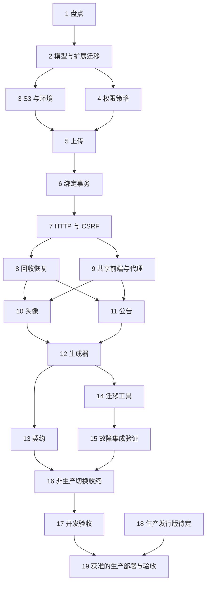

# 文件资产模块与 MinIO 接入 实现任务

## 执行说明

依据：[需求规格](./requirements.md)、[技术设计](./design.md)。2026-10-22 按 SSD auto 定向同步附件类型与回收复查修订；2026-10-24 按用户认可的长期方案同步回收一致性（上传中门禁 + 按资产状态的后台删除 + 孤儿清扫 + 墓碑保留期）、同源流式读取、头像登录可读、上传配额、软删除释放与图片规范化。所有实现任务均未开始；流程停止边界为 execution_ready，不代表以下代码、数据库或部署任务已经执行。自动采纳默认值、当前版本独立评审结论及历史证据见 [SSD 审查记录](./ssd-review.md)，旧版 PASS 不自动覆盖新修订。

按任务依赖实施，不因本机数据量小省略迁移、生成器或故障验证。每完成一项再更新勾选，并记录变更路径、验证命令、结果及未验证项。工作区已有其他在研改动，禁止覆盖；如实施需要 worktree，按根 `AGENTS.md` 建在项目本地目录。

**开发完成范围为任务 1–17。** 任务 18 为生产选型待定项，任务 19 为生产部署/验收阶段。18 未决不阻塞 1–17，但 19 必须等待其决策及实际部署授权。不得把非生产测试镜像视为生产选型，不得因只完成开发任务宣告生产完成。

默认技术参数见 design.md；若实现证据要求改变数据归属、事务、公开 API 或迁移策略，先同步三份规格及对应追溯，不在实现中静默建立兼容旁路。

## 开发与非生产验证

- [ ] 1. 固化真实调用、数据与验证入口清单
  - 依赖：无。
  - 读取当前根 `AGENTS.md`、相关模块及既有 spec，重新盘点 `/common/upload`、头像、`/profile`、公告 Editor、共享组件、四套 Vue 模板、Python 模板、SDK/mock 及真实业务消费者。
  - 区分 `/common/download` 临时导出和 `/common/download/resource` 持久资源；记录保留理由或删除依据。核实 wangEditor 仅预览和失效上传代码，仿真专用页面不扩入范围。
  - 对本地环境作只读资产引用盘点，列明文件缺失、旧生成字段和需要迁移的真实入口，不据现有本地样本推断生产。
  - 附件盘点分别记录“组件提供能力”“生成器声明”“实际消费者/历史数据”；保留八类基线及 CSV/受支持图片，记录其他旧后缀、编码、宏与加密样本，不以本地未使用为由删掉 Office 能力。
  - 盘点业务删除与软删除路径（用户 `soft_delete`；确认生成模板当前只做物理删除）、现有限流中间件的档位配置，以及头像裁剪器加载当前头像的方式，作为任务 6/7/10/12 的接入点。
  - 锁定 OpenAPI 导出、SDK 生成、mock 覆盖与测试命令；优先复用 `scripts/export_openapi.py`、`yarn api:generate`、`yarn mock:contracts` 和 `yarn ui:standards`。如需 live 生成，显式使用本项目 8088，不能照用当前 api:generate:local 的 8000 默认地址。
  - 产物：`docs/reports/file-assets-minio/inventory.md`，包含调用/数据范围、命令、待迁移清单与不变范围；记录 TBD-PROD-01 未决及其非阻塞边界。
  - 验证：每个拟删除入口均有搜索证据；每个真实持久文件消费者有后续迁移任务；不启动或修改生产服务。
  _需求追溯: R1.AC4, R9.AC4, R11.AC3, R13.AC1, R14.AC4, R16.AC1, R16.AC2_

- [ ] 2. 建立文件模块、目标数据模型与扩展迁移
  - 依赖：1。
  - 新建 `ruoyi-fastapi-backend/modules/file_assets/` 的领域模型、存储/策略端口和仓储，接入 `modules/registry.py` 及现有容器；业务策略保留在所属业务模块。
  - 实现 `sys_file_asset`、`sys_file_binding` 的字段、5 个资产状态、索引及唯一约束，包括单资产单归属、字段排序、上传期限、`assets/YYYY/MM/<asset_id>` 对象键、删除下次执行时刻 delete_next_attempt_at（承载租约与退避，delete_after 只表示到期时间）、删除尝试次数 delete_attempts 与持续失败起点 delete_failing_since、删除与墓碑清除所需时间字段、草稿配额查询索引；不建立逐次写入证据或复查字段。
  - 通过统一 DB 工作流生成扩展 Alembic 迁移，同时更新 `alembic/env.py`、`scripts/internal/db_workflow/schema_apply_atlas.py` 的模型登记；此阶段保留有数据环境的 avatar/旧公告内容，防止 dev-sync 提前收缩。
  - 明确空库目标模式和已有库升级次序；不新增用户 avatar_asset_id 列，不引入引用计数/is_bound。
  - 产物：模块骨架、模型、扩展迁移和模式验证说明。
  - 验证：真实 MySQL 上验证主键/FK/唯一约束及模型发现；确认迁移可在保留旧数据的情况下执行，静态模块依赖无用户认证递归。
  _需求追溯: R1.AC1, R5.AC3, R5.AC4, R6.AC3, R13.AC3, R15.AC4_

- [ ] 3. 实现 S3 适配、配置与独立非生产环境初始化
  - 依赖：2。
  - 在依赖清单锁定兼容的 Boto3 版本，新增 `infrastructure/s3_storage.py`；实现 PutObject、GetObject 分块流、ListObjectsV2 分页、DELETE，同一后端端点与凭据按用途建数据、维护、归属核对三套 client（超时与次数见 design.md 配置表），不配置浏览器可达端点或签名 client。
  - 配置进程生命周期、有界线程/连接池及操作超时；SDK standard 重试，三套 client 的超时与次数按 design.md 配置表，禁用自动分片与 transfer 线程。新增配置校验、SecretStr 与错误脱敏。
  - 新增 `scripts/file_assets.py bootstrap-storage/check-storage` 与非秘密环境示例；应用只用专用桶最小权限凭据（含孤儿清扫所需 ListBucket、`_meta/installation.json` 只读），建桶/策略/账户管理留给显式初始化命令。
  - 实现存储归属保护：`bootstrap-storage` 写入 `FILE_ASSET_INSTALLATION_ID` 到 `_meta/installation.json`，不覆盖不一致的已有标识，只有 `--take-over --confirm-installation <旧ID>` 可改写；进程内维护“未确认/已确认/无效”状态：lifespan 启动阶段用只尝试 1 次、读超时 3 秒的归属核对 client 先核对（最多 3 次），仍无结论则开始服务并每 10 秒重试；已确认后每 10 分钟复核，无效时每 1 分钟复核并在标识恢复一致后自动回到已确认；只有明确 404、不一致或 403 才转无效，网络错误/超时/5xx 保持原结论并 30 秒后重试；未确认或无效时上传、读取（含 304）、元数据返回 503，删除任务、清扫与 `--apply` 命令跳过且不计尝试次数，无效时告警。
  - 非生产集成夹具使用独立容器、卷、桶和凭据，检查 19000/19001 端口，记录测试镜像来源、版本与 digest；不占用 steamer-plane 的 9000/9090，不改变 MySQL/Redis 日常路径。生产镜像值保持未定。
  - 产物：S3 适配、初始化 CLI、固定测试镜像配置及运行说明。
  - 验证：真实测试实例验证私有桶、最小权限、仅后端可达端点、错误凭据、删除不存在对象、无版本化/Object Lock、GetObject 分块流与对象缺失异常、列举分页与 LastModified；归属状态三态转换（含读取超时保持原结论、403 判无效、无效后自动恢复、启动阶段先核对）、未确认/无效时 503、bootstrap 拒绝覆盖与 `--take-over` 确认；日志不含凭据。明确这些只是测试发行版证据。
  _需求追溯: R1.AC2, R2.AC2, R4.AC4, R12.AC1, R12.AC2, R12.AC3, R12.AC5, R12.AC6, R14.AC2, R15.AC1, R16.AC2_

- [ ] 4. 实现归属策略、权限批量判定与身份边界
  - 依赖：2。
  - 在文件应用层定义静态 `AssetOwnerPolicy` 接口和策略注册，业务层提供 user.avatar、notice.image 的操作与读取策略。
  - 实现草稿上传者/当前意图权限检查、已绑定归属读取、指定 ownerId 精确匹配、新建意图只在业务创建事务绑定，以及同字段保留/重排规则。
  - user.avatar 的读取策略为“已绑定头像对任何已登录用户可读、未登录拒绝”，不接入部门/数据范围；公告复用 list/query 真实读取逻辑。除头像这一显式登记的策略外，不得按上传者身份或“所有登录用户”放宽已绑定资产。
  - 批量鉴权按业务类型和 ownerId 分组，认证返回主体不读取头像；未知用途和策略缺失默认拒绝。
  - 产物：策略接口、用户/公告实现、批量授权服务。
  - 验证：聚焦测试覆盖失权上传者、不同 owner/字段、新建与编辑意图、他人头像登录可读与未登录拒绝、已删除用户头像不可读、公告 list-only/query-only、管理员既有规则和批量不可见项；检查无 N+1 和认证递归。
  _需求追溯: R1.AC1, R4.AC1, R4.AC3, R5.AC2, R6.AC3, R6.AC4, R7.AC4, R15.AC4_

- [ ] 5. 实现受限上传、内容校验及可恢复状态提交
  - 依赖：3、4。
  - 用 UploadFile 承载单文件请求；在 multipart spool 前加路径级 ASGI 字节/时长/并发限制，并校验文件和字段数量、文本字段长度。普通无关 API 不受上传限制影响。
  - 实现图像解码、静态 JPEG/PNG/WebP 识别、像素/边长/原始及输出字节上限；所有图片用途按 EXIF 方向转正后重编码并移除 EXIF/XMP 等元数据（可保留 ICC），头像另缩放至最长边 512 像素并编码为 PNG，规范化输出超限时按设计降级、仍超限返回 422（IMAGE_NORMALIZED_TOO_LARGE）；附件字段中的图片保持原始字节；建立 design.md 全部类型 ID 登记和有限 MIME 别名，缺失/通用 MIME 经内容确认接受，明确冲突拒绝，安全规范化文件名。
  - 锁定并复用 zipfile、defusedxml、olefile、oletools 的受限检测能力，覆盖六类 Office、宏/加密识别、OOXML 目录/主部件/累计解压限制；禁用自动解密、宏执行/模拟/解混淆与预览。在上传槽位内的有界线程中进程内解析，以条目数、累计解压字节、单个 XML 大小和条目/流间的 5 秒墙钟检查约束资源；异常/不支持不得假通过，不建设解析子进程。
  - 创建 UPLOADING 前检查该用户未绑定草稿数量与总字节配额，超限 429 且不建行；上传短事务提交 UPLOADING（同时确定 `assets/YYYY/MM/<asset_id>` 键），校验后 PUT（SDK 有界重试），成功后以 `state=UPLOADING` 条件更新为 READY；记录已被回收则不恢复 READY 并返回失败。存储阶段不持有认证/业务事务。
  - 实现失败状态、finally 资源关闭、客户端断开后的在途线程跟踪和补偿入口；实际工作结束前不释放容量。返回成功必须在 READY 提交后；提交结果不明先查真实状态，READY 已提交后断连/取消不反向失败或删除，未绑定项只按草稿回收。
  - 产物：上传应用服务、校验器、请求限制中间件及统一错误映射。
  - 验证：每种类型的合法样本及伪装/损坏/加密/宏（含 PPT VBA、XLS XLM、嵌入对象）样本；MIME 缺失、通用、别名和冲突，ZIP/XML 资源限制、解析墙钟预算、无宏模拟和敏感日志；图片方向转正、EXIF/XMP/GPS 去除与头像缩放。保留 Content-Length/chunked、像素炸弹、恶意文件名、零字节等既有验证；覆盖草稿配额边界与 429 无副作用，注入 PUT 失败、READY 未提交失败、READY 前后取消、UPLOADING 被回收后 PUT 完成，验证不误删已提交业务、被回收记录不恢复 READY。
  _需求追溯: R2.AC1, R2.AC2, R2.AC3, R2.AC4, R3.AC1, R3.AC2, R3.AC3, R3.AC4, R3.AC5, R3.AC6, R10.AC1, R14.AC5, R15.AC1, R15.AC2, R15.AC5_

- [ ] 6. 实现同事务绑定、字段替换与业务释放
  - 依赖：2、4、5。
  - 实现 `replace_field_assets` 与 `release_owner`，只 flush、不自行 commit；校验最终业务写权限、草稿来源、意图、状态、期限与字段限制。`release_owner` 同时服务物理删除与软删除路径，释放后资产进入 24 小时宽限期。
  - 业务先锁 owner，资产按 ID 顺序加锁；安全替换排序绑定，只对差集旧资产标记 DELETING/delete_after。同字段重复保存保持幂等。
  - 处理归属/状态冲突和完整事务重试边界；不暴露通用 HTTP bind/unbind，不用 ORM 全局 hook 自动猜归属。
  - 产物：绑定服务与业务集成协议；单一关系真源约束。
  - 验证：MySQL 测试双 owner 争用、顺序交换、已有绑定保留、字段未提供/清空差异、软删除释放、外层事务失败与 SAVEPOINT；失败时业务、绑定及旧资产释放一并回滚。
  _需求追溯: R5.AC1, R5.AC2, R5.AC3, R5.AC4, R5.AC5, R5.AC6, R10.AC2, R11.AC4_

- [ ] 7. 提供文件 API、同源流式读取、上传限流和完整 CSRF 接入
  - 依赖：3、4、5、6。
  - 实现上传、单项元数据、最多 100 项批量元数据、内容读取与本人草稿丢弃端点，严格遵守 design.md 的 DTO、状态码和不可见资源处理。
  - 内容请求先授权并读资产行：`If-None-Match` 按 RFC 9110 弱比较（列表、`*`、`W/`）匹配 `"<sha256>"` 即返回 304 不访问存储；否则在下载槽位内（满时最多等待 5 秒）GetObject 分块流式返回，断开即关闭流释放槽位。仅图片用途中已重编码的图片 inline，附件字段中的图片 attachment。固定 Content-Type、Content-Length、ETag、`private, no-cache`、Content-Disposition、nosniff、沙箱 CSP 与 no-referrer；不透传存储头，不支持 Range，不签发任何预签名地址，不提供原始 bucket/key 接口。
  - 在现有限流中间件新增上传档位（每 IP 60、每用户 30 次/分钟），覆盖 `/file-assets/uploads` 与头像上传；限流与配额超限返回可区分的 429 问题类型。
  - 在 `middlewares/csrf_guard_middleware.py` 和现有配置中接入本轮写入路径；按方法保护非安全操作，补齐 Cookie 身份的主体绑定，不把 img GET 纳入必须存在 Origin 的路径匹配。
  - 维护 JSON 资源响应、RFC 7807 及网关前置拒绝契约；上传/头像端点所有认证 401 均须发生在新增资产行和对象写入之前，后续业务失权不得返回可触发自动重发的 401。不假定现有幂等中间件覆盖 multipart。
  - 产物：可用 HTTP 契约、CSRF 配置及错误模型。
  - 验证：未登录、越权、不存在、已释放、已绑定删除、本人重复删除（墓碑期内 204）、对象缺失 503、下载槽位耗尽 503；200/304 的响应头与 ETag、撤权后重验证被拒、inline/attachment 与 `download=true` 只能收紧；上传限流 429；覆盖仅 Cookie、Bearer+Cookie、无 Cookie Bearer 与无 Origin 图片 GET，并断言认证 401 后没有新增资产行及对象副作用。
  _需求追溯: R2.AC5, R4.AC1, R4.AC2, R4.AC3, R4.AC4, R4.AC5, R8.AC5, R11.AC1, R11.AC4, R12.AC4, R12.AC5, R15.AC5_

- [ ] 8. 接入调度回收、按资产状态的删除执行、孤儿清扫与墓碑清除
  - 依赖：3、5、6、7。
  - 在现有调度入口注册有界批量扫描；草稿到期、FAILED、业务释放（含软删除）分别按规定认领，过期 UPLOADING 仅在 upload_deadline 加 60 分钟回收余量之后才转 FAILED；使用 MySQL 行锁、SKIP LOCKED、状态和无绑定条件。
  - 实现删除任务（不经 Outbox）：归属状态非“已确认”时整轮跳过；短事务以 SKIP LOCKED 认领 delete_after 已到且 delete_next_attempt_at 为空或已到的 DELETING 行，把 delete_next_attempt_at 设为 now+5 分钟作为租约（不计尝试次数，不改 delete_after）；会话关闭后有界 DELETE，成功或 not-found 按 `state=DELETING` 条件写 DELETED；成功时清空 delete_next_attempt_at 与 delete_failing_since；失败回写以 `state=DELETING` 为条件并记录 delete_failing_since：存储不可用类（连接/超时/5xx）不计次数，按持续失败时长从 1 分钟近似翻倍、封顶 15 分钟退避，只有连续 3 次连接级错误才结束本轮，单个对象 5xx 只退避该行；对象级失败（404 以外的 4xx）delete_attempts+1 并按 1 分钟×2^(n−1)、封顶 6 小时退避；无终止状态；认领 3 分钟后不再发起新 DELETE；仍有绑定的 DELETING 行不删除，delete_next_attempt_at 推后 1 小时并告警。删除、清扫与墓碑清除任务登记为禁止并发（`concurrent='1'`）。删除后不安排周期复查。
  - 实现 `scripts/file_assets.py retry-deletes [--asset-id ...]`：把 delete_failing_since 非空的 DELETING 行的 delete_next_attempt_at 置为 now，不改 delete_after，因此不缩短业务释放宽限期。
  - 实现每日孤儿清扫：归属状态非“已确认”时跳过；列举当前月与上一月前缀（任何列举都不进入 `_meta/`），仅处理 `assets/YYYY/MM/<UUID>` 格式键，按批查资产行，LastModified 超过 24 小时且行为 FAILED/DELETED（bucket/key 一致）才删除；UPLOADING/READY/DELETING 跳过，无主对象与格式外键只报告告警、从不自动删除；每轮最多删 1,000 个、最长 10 分钟，截断时把 `start_after` 游标写入 Redis 供下一轮继续；受 `FILE_ASSET_ORPHAN_SWEEP_ENABLED` 与调度暂停控制。
  - 实现墓碑清除：DELETED 满 30 天分批删除行，其他状态不清除。
  - 在 `scripts/file_assets.py` 增加 `check-consistency`（跳过 `_meta/`，只报告孤儿、无主、格式外键与 READY 缺失对象）和 `sweep-orphans --prefix`（与定时任务同一判定，默认 dry-run，`--apply` 才删除且要求归属状态已确认，`--include-unowned` 须同时指定前缀与 `--apply`），并编写立即重试删除、暂停/恢复清扫、补扫窗口外月份、桶转交（`--take-over`）的运维说明。
  - 维护 I/O 限额同时约束删除任务、孤儿清扫与墓碑清除，达到预算停止发起，不提前释放在途资源。
  - 产物：扫描任务、删除任务、孤儿清扫、墓碑清除、核对与重试 CLI 及运维说明。
  - 验证：真实 MySQL 下绑定/清理竞争、两个删除任务实例争抢同一行与租约过期重新认领、删除成功但 DB 失败后重试、部分资产持续失败时其他到期资产仍正常删除、存储故障期间不计尝试次数且恢复后最长 15 分钟内自动续删、部分对象持续 5xx 时健康对象仍正常删除、租约与退避不改变 delete_after、对象级失败计数退避、持续失败 1 小时告警、认领 3 分钟后不再发起 DELETE、失败回写不覆盖已 DELETED 的行、仍有绑定的 DELETING 行告警且不删除、`retry-deletes` 不缩短宽限期；暂停 PUT 线程复现 UPLOADING 被回收后的迟到写入，确认不恢复 READY 且对象在宽限期后被清扫删除。假时钟验证回收余量、宽限期、FAILED/DELETED 可删与 UPLOADING/READY/DELETING 跳过、无主对象/bucket-key 不一致/格式外键不删、预算截断后从游标续跑、开关关闭不执行、归属状态未确认/无效时删除任务、清扫与 `--apply` 命令跳过且不计尝试次数、墓碑只清 DELETED；`sweep-orphans --prefix` 与定时任务判定一致。
  _需求追溯: R1.AC3, R2.AC4, R5.AC6, R10.AC1, R10.AC2, R10.AC3, R10.AC4, R10.AC5, R10.AC6, R10.AC7, R12.AC6, R14.AC1, R14.AC5, R15.AC3_

- [ ] 9. 改造共享上传组件、资产展示与同源代理
  - 依赖：7。
  - 更新 `src/composables/useAuthenticatedUpload.ts`、`useUploadModel.ts`、`components/ui/FileUpload` 和 `ImageUpload`，唯一值契约为 string[]；描述单独批量读取，不保留 CSV/混合类型兼容。
  - 文件类型提示和 accept 消费字段 allowed_type_ids 的生成映射，不再用组件内八类默认值覆盖服务端字段限制；Office/PDF/文本仅提供下载，不新增预览或宏执行入口。
  - 继续使用现有会话传输/进度/取消，仅保留写入前明确认证 401 的单次刷新重发，且主体未变化、请求未取消；网络/超时/5xx/响应丢失不自动重发。区分上传与保存，移除已绑定项只改变表单，本次新草稿才可 best-effort 丢弃。
  - 实现稳定图片展示和可鉴别的失败恢复：经现有单飞刷新、元数据核验后最多重新加载一次；注销/切换/卸载取消请求，检查作用域后再写回。
  - Vite 与 nginx 增加 `/file-assets/` 精确同源代理（生产开启响应缓冲），确认真实页面 CSP 无需为文件新增来源、不开放任何存储跨域，不在持久值中引入环境前缀。
  - 产物：共享组件新契约、资产展示能力、开发/生产代理配置。
  - 验证：组件测试覆盖 ID 数组、排序、数量、取消、旧绑定不立即删、过期刷新一次、写入前 401 单次重发与未知结果不重发、403/404/503 无循环、会话切换不串数据、上传 429 提示；生产构建检查代理/静态资产前缀无冲突；浏览器仅访问应用来源即可展示与下载文件。
  _需求追溯: R2.AC5, R5.AC5, R8.AC1, R8.AC2, R8.AC3, R8.AC4, R8.AC5, R12.AC5_

- [ ] 10. 完成头像业务接入和用户读投影
  - 依赖：6、7、8、9。
  - 改造 `modules/system/api/user_controller.py` 的 avatarfile 为 UploadFile，调用上传应用服务后在用户事务内替换 avatar 绑定；成功响应使用 avatarAssetId/avatarUrl。
  - 更新用户命令/查询服务、VO、用户删除（`soft_delete`）路径同事务释放头像绑定，及批量列表投影；不让 `get_current_user` 基础认证加载头像资产。
  - 更新前端 `src/views/system/user/profile/userAvatar.vue`、用户 store 和真实头像展示调用，保留默认头像、裁剪器以当前头像为初始图和一次提交体验。
  - 此阶段将目标代码去掉旧 URL 依赖，旧列最终收缩在任务 16 的迁移切换完成后执行；不得提前让有数据环境丢失头像。
  - 产物：头像完整业务链路、读投影和删除释放。
  - 验证：确认未提交的上传/事务失败保留旧头像，已提交新头像后取消或响应丢失保留新绑定并通过重读确认；并发替换不会留下双绑定、用户软删除释放、他人头像登录可读与未登录拒绝、裁剪器同源加载当前头像、登录认证无递归；规范化后的头像不超过 512 像素且真实可解码。
  _需求追溯: R5.AC1, R5.AC6, R6.AC1, R6.AC2, R6.AC3, R6.AC4, R14.AC3, R15.AC4_

- [ ] 11. 完成公告 HTML 净化、引用绑定及编辑器接入
  - 依赖：6、7、8、9。
  - 使用 nh3 与 HTML 解析实现设计白名单，先验证图片来源，再净化并从最终 HTML 提取规范 UUID 内容地址；同公告重复引用去重，跨公告/字段复用拒绝。
  - 更新 `module_admin/entity/vo/notice_vo.py`、公告服务/查询/删除路径为 str 与同事务绑定；模型使用 Text 的 MySQL MEDIUMTEXT variant 匹配 1 MiB 上限，严格解码与数据转换工具留到任务 14/16 配套执行。
  - 改造 `components/ui/Editor/index.vue`、`views/system/notice/components/NoticeDlg.vue`、`api/system/notice.ts`，使用用途/上下文上传、稳定地址、待上传提交保护及粘贴图片流程；移除 bytes 类型补丁。
  - 检查 Quill 支持的文本格式（含引用、代码块）、撤销/重做与图片重新打开；外部图片/data URL 明确报错，不静默丢图。移除公告默认 video 按钮，历史 iframe 纳入迁移差异；发现必须保留的真实消费者时先补需求和来源策略，不静默删除。只读 wangEditor 预览不机械迁移。
  - 产物：公告内容和绑定同事务闭环、净化策略与编辑器交互。
  - 验证：合法格式保持、XSS/非法 URL、同图重复、跨用途引用、保存失败/取消编辑保旧、list-only 与 query-only 图片读取；真实 MySQL 保存/读取超过 64 KiB 至 1 MiB 的多字节 HTML，并拒绝超限；迁移错误不可被正常保存流程吞掉。
  _需求追溯: R5.AC1, R5.AC5, R7.AC1, R7.AC2, R7.AC3, R7.AC4, R7.AC5, R14.AC3_

- [ ] 12. 完成生成器资产字段全链路输出
  - 依赖：6、7、9、10、11。
  - 更新 `module_generator/entity/do/gen_do.py`、VO、配置持久化/同步及 `src/views/tool/gen/`，提供显式逻辑资产字段、allowed_type_ids/数量/大小和归属权限接入声明；前端 accept/提示与后端类型策略从同一声明生成，未选类型禁止生成，同一表单资产字段容量之和超过草稿配额时报配置错误；已有物理列转换需迁移说明。
  - 更新 Python DO/VO/repository/service/controller 模板：输入 ID 数组，未提供/清空语义不同，关系不落业务 CSV 列，读时批量投影，创建/修改/删除在单一事务出口调用绑定服务（生成器当前只生成物理删除）。
  - 更新四套 Vue 模板、JS API 与 SQL/模式声明路径，生成用途和策略登记；不以 SQL 菜单模板充当文件模块建表入口，策略缺失时报生成错误。
  - 产物：生成器新声明和可运行产物，不新增假设的手写项目附件业务。
  - 验证：四种模板均渲染；用最小真实生成业务执行创建、读取、替换、清空、删除释放、越权和业务回滚，验证不会提交数组到普通 ORM 列；覆盖只允许 PDF 的字段拒绝 Office、允许 Office 的字段可保存并下载及绕过前端限制仍被后端拒绝、资产字段容量超配额的配置被拒绝；运行表单规范检查。
  _需求追溯: R1.AC4, R3.AC3, R5.AC1, R5.AC4, R9.AC1, R9.AC2, R9.AC3, R9.AC4, R14.AC3, R14.AC5, R15.AC5_

- [ ] 13. 更新 OpenAPI、SDK、mock 和公开契约
  - 依赖：7、10、11、12。
  - 由后端模型和真实路由导出 OpenAPI，运行仓库现有生成命令更新 `src/api/_generated/`，更新手写业务 API 和受影响调用；不以手改生成文件代替源契约。
  - 更新 `src/mocks/contracts/coverage/registry/` 对新资产、头像和公告契约的登记，按当前 demo 能力明确真实服务与 mock 边界；不能让新端点无登记，也不能用演示假数据宣称真实存储成功。
  - 新契约落地后记录旧路由清单与待删调用；任务 16 统一移除最终路由并再次生成，避免包内仍导出不可用端点。
  - 产物：一致的后端契约、类型、客户端和 mock 覆盖声明。
  - 验证：SDK 生成可重复、type-check 和 `yarn mock:contracts` 通过，错误状态（含 429）/内容 200 与 304/批量 unavailableIds/头像响应与实际 HTTP 一致，无任意 bind/unbind 或预签名公开接口。
  _需求追溯: R11.AC1, R11.AC2, R11.AC3, R14.AC4_

- [ ] 14. 实现历史盘点、迁移、核对与恢复工具
  - 依赖：1、2、3、6、10、11、12。
  - 在 `scripts/file_assets.py` 实现 inventory/migrate/verify，默认 dry-run、显式选择环境；状态和清单可恢复，数据模式操作继续委托 `scripts/db.py`。
  - 实现允许旧前缀的本地引用解析、路径/符号链接边界、严格 UTF-8 转换、净化差异报告、每归属独立映射、实际字节 SHA-256 拷贝校验及重复执行冲突检测。
  - 迁移记录包括源引用/源 hash、目标 assetId（随机 UUID4）/key、owner/field、进度、异常；resume 依据清单映射，不重新生成 ID；迁移资产 uploader 记为专用的不可登录迁移主体，配额查询显式排除，“上传者可读草稿”规则不对其生效。外链不抓取，缺文件/非法类型/非 UTF-8 不静默删。迁移与在线上传一样先建资产行再写对象；实现迁移资产与 GC 协调及截止时间，避免默认 TTL 或上传回收提前清理。
  - Office 宏/不可验证加密/损坏与新增类型限制进入异常报告并阻断相关切换，不静默转换或删除；历史图片按 R3.AC2 规范化，迁移报告逐项记录规范化前后尺寸/字节与是否降级缩放，规范化失败进入异常报告并阻断相关切换。
  - 实现写入冻结、增量复查、暂停 GC 与孤儿清扫、数据与绑定事务写入、verify 零未决项门禁、备份恢复指引（恢复后先核对再恢复清扫）；历史原文件清理单独命令且需明确授权，不随 migrate 自动执行。
  - 产物：迁移 CLI、恢复清单、异常报告和运行手册草稿。
  - 验证：用本地及故障夹具 dry-run、中断/resume、重复执行、源文件变化、多 owner 共享旧路径、缺文件/非法编码/外链和备份恢复；确认所有异常可定位、不会破坏原记录，清扫在迁移期间不误删迁移对象。
  _需求追溯: R3.AC2, R3.AC6, R7.AC5, R9.AC4, R10.AC5, R10.AC7, R13.AC1, R13.AC2, R13.AC3, R13.AC4, R13.AC5_

- [ ] 15. 补齐健康状态、指标及针对性故障集成验证
  - 依赖：3、5、7、8、10、11、12、14。
  - 将文件能力健康接入现有容器/状态入口；存储临时故障为文件能力降级，写入/内容读取 503，无本地回退，普通认证不因此循环刷新。
  - 增加上传/配额拒绝、内容读取与 304、存储错误、删除积压和年龄、删除重试与最大尝试次数、孤儿发现/删除、清扫截断、无主对象、格式外键、缺失对象与归属状态指标和日志；核验删除积压（只统计未处于失败重试的到期行）、尝试次数达到 5、持续失败超过 1 小时、仍有绑定的 DELETING 行（binding_invariant_violation）、清扫连续截断、无主对象、格式外键、缺失对象与归属异常告警。对凭据、存储认证信息和文件内容脱敏，避免高基数标签。
  - 在真实 MySQL 和固定测试 MinIO 中执行设计中的关键故障序列、权限矩阵和并发交错；区分提交前失败与提交后取消/响应丢失，验证写入前 401 无副作用及一次重发、未知结果不重发、删除失败退避与立即重试、迟到写入被清扫回收、无效存储配置，以及安装标识不一致时文件能力不可用且不删除任何对象。
  - 按 worker 数验证有界上传与下载容量、请求/SDK 时限、临时文件清理和合理事件循环响应；确认浏览器只访问应用来源即可读写文件，存储端点不对客户端网络开放。
  - 产物：`docs/reports/file-assets-minio/integration.md`，分别列静态检查、假存储注入、真实数据库、真实 S3 与前端证据。
  - 验证：无未解释的绑定误删、回滚不一致、权限泄漏、宽限期后的孤儿残留、删除停滞或无界资源使用；超限失败可定位且不泄露秘密。
  _需求追溯: R2.AC4, R4.AC5, R10.AC2, R10.AC3, R10.AC4, R10.AC5, R10.AC6, R10.AC7, R12.AC4, R12.AC5, R12.AC6, R14.AC1, R14.AC2, R14.AC3, R14.AC5, R15.AC1, R15.AC2, R15.AC3, R15.AC5_

- [ ] 16. 在非生产完成迁移演练和旧路径完整收缩
  - 依赖：8、10、11、12、13、14、15。
  - 在备份的本地/测试数据上执行扩展→迁移→核对→收缩，演练相关业务写入冻结、增量复核与恢复；迁移 verify 未决项不为零时停止切换。
  - 按统一 DB 工作流生成并验证最终收缩 revision：移除 sys_user.avatar、公告旧二进制/临时迁移列及已迁移的旧文件列；空库安装与有数据升级都必须到达相同目标模式。
  - 移除 `/common/upload` 持久入口、旧资源下载和 `/profile` 挂载，删无调用的本地写入/URL 拼接路径；临时 `/common/download` 仅按任务 1 的实际证据处理。
  - 对齐头像、公告、共享组件、四套模板、SDK/mock、代理、文档，再次生成契约。历史原文件作为恢复备份保留，不随代码清理删除。
  - 产物：目标模式、无运行期双轨的代码与契约、`docs/reports/file-assets-minio/migration-rehearsal.md`。
  - 验证：新库安装、有数据迁移及受控回退演练；旧持久入口/字段无运行消费者，头像/公告/生成产物实际可用；记录切换后新增资产恢复规则。本任务不触及生产。
  _需求追溯: R1.AC2, R1.AC4, R6.AC4, R7.AC1, R9.AC4, R11.AC2, R11.AC3, R13.AC3, R13.AC4, R13.AC5_

- [ ] 17. 完成开发验收、维护文档与追溯报告
  - 依赖：1–16。
  - 更新相关开发/运行文档与稳定后的 codemap，记录配置、初始化、会话/CSRF、同源读取与代理、业务接入、限额与配额、删除重试、孤儿清扫暂停/核对、桶归属与转交、备份恢复和旧入口去除方式。
  - 运行受影响后端 Ruff/pytest、前端 lint/type-check/聚焦 Vitest、生产构建，以及 OpenAPI/SDK/mock 和生成器表单规范检查；只在失败或新增风险需要时扩大测试。
  - 汇总 79 条验收标准的证据、实现范围及未验证项，建立 `docs/reports/file-assets-minio/acceptance.md`；对需求 ID、任务引用、无孤立 AC、任务依赖和待定项做最终一致性检查。
  - 对开发范围可给出完成结论，但明确生产发行版仍为 TBD-PROD-01，测试发行版不代表生产批准，任务 18/19 保持未完成。
  - 产物：可交付的开发实现与维护说明、完整需求追溯及测试报告。
  - 验证：开发范围没有无证据的完成声明、遗漏真实消费者或永久兼容旁路；生产门禁保留，所有未验证项明确写出。
  _需求追溯: R1.AC4, R11.AC2, R14.AC1, R14.AC2, R14.AC3, R14.AC4, R14.AC5, R15.AC3, R16.AC1, R16.AC2, R16.AC3_

## 生产待定与部署门禁

- [ ] 18. 决策生产 MinIO 发行版及运行责任（TBD-PROD-01）
  - 依赖：规格中的 S3 必需能力已明确；可以与开发任务并行沟通，不阻塞 1–17。
  - 状态：待项目负责人/运维负责人决策。本任务不会因选择本地测试镜像而自动完成。
  - 决策内容：发行版/供应方、固定版本与镜像来源/digest、适用条款核验、维护与安全更新责任、支持策略、升级和回退责任人。
  - 核对 S3 SigV4、单对象 PUT、GetObject 流式读取、ListObjectsV2 分页与 LastModified、DELETE、私有桶、应用最小权限、仅后端可达与 TLS、`_meta/installation.json` 归属标识，以及应用桶无 Object Lock/版本化残留；未满足时先修订设计，不能绕过孤儿清扫的判定条件。
  - 产物：在本 spec 待定项中记录决策及关联证据，并填写生产配置；若能力差异影响设计，先同步三份文档。
  - 验证：由责任人确认完整选型记录；只有该记录成立才解除任务 19 的发行版门禁。
  _需求追溯: R12.AC1, R12.AC2, R12.AC5, R12.AC6, R16.AC1, R16.AC3_

- [ ] 19. 在获准的生产环境完成预检、迁移与验收
  - 依赖：17、18；另需用户对实际生产部署及数据写操作的明确授权。本次 spec 编写请求不提供该授权。
  - 使用已决定的发行版和固定镜像完成目标环境兼容测试、最小权限、存储仅后端可达与 TLS、生产桶的唯一安装标识、`/file-assets/` 同源代理与缓冲、页面 CSP、容量及备份恢复（含清扫暂停与恢复）检查；不以本地集成报告代替生产网络和权限核验。
  - 先完成生产只读盘点/dry-run 和具体迁移清单，再按已获准的窗口备份、冻结受影响写入、迁移、核对、收缩及验收。异常未清零停止切换并执行已演练的恢复路径。
  - 核验头像、公告、实际生成业务、后台回收及监控；记录操作人、版本/摘要、迁移清单与证据。历史原文件删除需要单独明确授权，不作为默认部署动作。
  - 产物：生产部署及验收报告；只有目标环境验证通过才能标记生产接入完成。
  - 验证：TBD-PROD-01 已解决、部署授权明确、备份可恢复、权限与同源读取可用、数据引用一致、清理可恢复；否则保持任务未完成。
  _需求追溯: R12.AC1, R12.AC2, R12.AC4, R12.AC5, R12.AC6, R13.AC1, R13.AC3, R13.AC4, R13.AC5, R14.AC2, R14.AC4, R16.AC3_

## 依赖与完成口径

图展示主要依赖，执行以每项依赖字段为准。任务 18 保持待定不影响完成规格和开发范围；任务 19 不能在发行版未决或仅有规格授权时执行。

## 本轮规格验证记录

本轮只编写与检查规格：按用户 2026-10-24 认可的决策写回需求，同步设计与任务，并交独立复审；具体结论与被评审文件摘要见 ssd-review.md 和 .ssd-run.json，不能沿用旧版 PASS。不将实现任务勾选为完成，不执行迁移、启动容器或更改业务代码。最终检查覆盖三份标题、设计必需章节、79 个唯一 AC 的双向任务追溯、19 项未勾选任务及依赖、Session 2026-10-24 的 10 条澄清（7 条用户决策、3 条评审后自动采纳默认值；原 CL-04 标注为已取代）与 TBD-PROD-01 保留。
