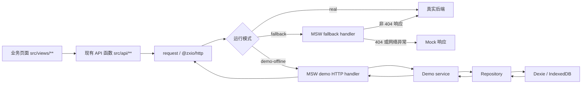
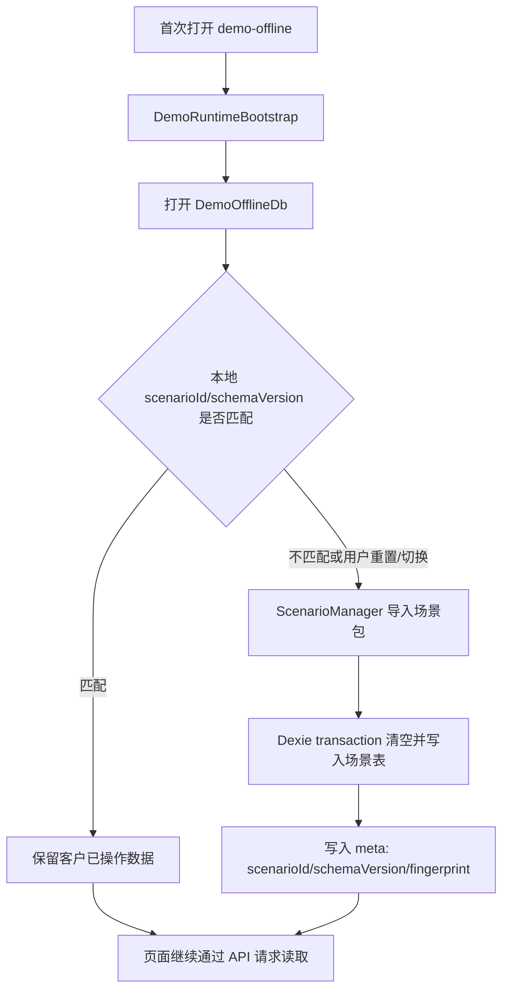
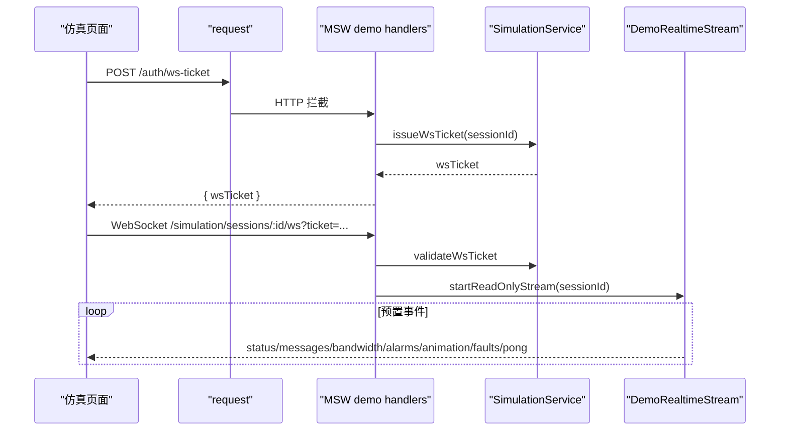

# 前端离线演示 Runtime 技术设计

## 架构概述

本设计在现有 MSW 基础上新增一个明确的 `demo-offline` 运行目标，同时保留现有开发态 `fallback`。核心原则是：真实业务页面和 `src/api/**` 调用继续通过现有 `request` 入口访问接口；运行模式、网络拦截、本地持久化、场景导入与实时流仿真统一收口到独立的 demo runtime 层。

运行模式定义如下：

| 模式 | 入口语义 | MSW 策略 | 是否访问真实后端 | 主要用途 |
| --- | --- | --- | --- | --- |
| `real` | 禁用 Mock | 不启动 | 是 | 正式环境或纯真实联调 |
| `fallback` | 真实优先，失败兜底 | `fallback` | 是，404/网络异常后回 Mock | 本地开发联调 |
| `demo-offline` | 静态 `dist-demo-offline` 独立演示 | `pure` + demo scenario | 否 | 客户前期演示 |

新增 `VITE_APP_RUNTIME_MODE=real|fallback|demo-offline` 作为业务级主开关，`VITE_ENABLE_MOCK=off|fallback|pure` 保留兼容现有脚本。解析规则为 `VITE_APP_RUNTIME_MODE` 优先；没有配置时再按旧变量映射：`off -> real`、`fallback -> fallback`、`pure -> demo-offline`。`demo-offline` 构建通过 `.env.demo-offline` 和 `yarn build:demo-offline` 显式进入，不能依赖运行时猜测。

新增代码主要落在：

```text
ruoyi-fastapi-frontend/src/demo/
  runtime/              # 模式解析、启动编排、调试入口
  db/                   # Dexie 数据库、版本迁移、事务工具
  scenarios/            # 场景包 schema、默认场景、导入导出
  repositories/         # IndexedDB 读写封装
  services/             # 登录、菜单、项目、版本、拓扑、仿真业务编排
  handlers/             # MSW HTTP/WebSocket handler 薄适配层
  realtime/             # 预置只读仿真事件流调度
```

现有 `src/mocks/**` 继续承载通用 MSW 能力和 `fallback` 能力；`demo-offline` 的业务状态、CRUD 和场景数据不继续塞进现有静态 factory，而是迁移到 `src/demo/**` 的 service/repository/Dexie 分层中。现有 handler 可逐步桥接到 demo service，但新增业务 handler 必须保持薄适配。

构建层需要新增：

```json
{
  "scripts": {
    "build:demo-offline": "vite build --mode demo-offline",
    "preview:demo-offline": "vite preview --mode demo-offline"
  }
}
```

同时新增 `.env.demo-offline`：

```dotenv
VITE_APP_ENV='demo-offline'
VITE_APP_RUNTIME_MODE='demo-offline'
VITE_ENABLE_MOCK='pure'
VITE_APP_BASE_API='/api'
VITE_DEMO_SCENARIO_ID='default'
```

`demo-offline` 的 HTTP 未覆盖接口必须被 API 前缀级 catch-all handler 拦截并返回确定性 `501 DEMO_API_NOT_IMPLEMENTED`，不能让裸 `dist-demo-offline` 静默访问真实网络。静态部署只支持 HTTP(S) 服务，不支持 `file://` 直开，因为 Service Worker 需要受支持的安全上下文和作用域。

WebSocket 首选使用当前依赖中的 MSW 官方 `ws.link` / `WebSocketHandler` 能力接入，不自写 `window.WebSocket` monkey patch。若实施验证发现目标浏览器或 MSW 当前版本对项目 WebSocket URL 拦截不稳定，只允许退到显式 `SimulationRealtimeTransport` 抽象：真实模式用浏览器原生 WebSocket，`demo-offline` 用本地只读事件流 transport；该退路仍是显式架构边界，不允许全局 monkey patch。

当前生产构建还存在一个必须在实现任务中验证的风险：`src/main.ts` 引入 `@zxio/zxui/style`，但该包当前 `exports` 未暴露 `./style`；本设计要求 `build:demo-offline` 与 `build:prod` 都纳入验证，必要时先修复构建解析问题，否则无法证明生产 `dist` 和演示 `dist-demo-offline` 可用。

## 数据流图

HTTP CRUD 数据流：



场景包与持久化生命周期：



WebSocket 只读仿真流：



## 组件与接口定义

### Runtime 组件

`RuntimeModeResolver` 负责读取环境变量并生成唯一运行模式：

```ts
export type RuntimeMode = 'real' | 'fallback' | 'demo-offline';

export interface RuntimeConfig {
  mode: RuntimeMode;
  apiPrefix: string;
  scenarioId: string;
  debug: boolean;
}
```

`DemoRuntimeBootstrap` 在 `demo-offline` 下执行以下步骤：

- 打开 Dexie 数据库并执行 schema 迁移。
- 检查本地 `meta` 表中的 `scenarioId`、`schemaVersion`、`fingerprint`。
- 首次进入或用户显式重置/切换场景时导入默认场景包。
- 注册 demo HTTP handlers、demo WebSocket handlers 和 API catch-all handler。
- 在 `window.__DEMO_RUNTIME__` 暴露只读调试信息和显式操作方法，例如 `getMode()`、`getScenario()`、`resetScenario()`、`exportScenario()`。

### 场景包接口

AI 未来不直接生成 handler，也不直接写 IndexedDB，只生成标准场景包。首版 schema：

```ts
export interface DemoScenarioPackage {
  schemaVersion: 1;
  scenario: {
    id: string;
    name: string;
    version: string;
    fingerprint: string;
    seed?: string;
  };
  auth: {
    accounts: DemoAccount[];
    roles: DemoRole[];
    permissions: DemoPermission[];
  };
  system: {
    menus: DemoMenu[];
    dicts: DemoDictData[];
  };
  project: {
    projects: DemoProject[];
    versions: DemoProjectVersion[];
    topologies: DemoTopology[];
  };
  simulation: {
    sessions: DemoSimulationSession[];
    streamFrames: DemoSimulationFrame[];
  };
}
```

场景包校验策略：

- `schemaVersion` 必须显式存在，不匹配时拒绝导入或走迁移器。
- `scenario.id + scenario.version + fingerprint` 作为确定性导入标识。
- 导入使用 Dexie transaction，保证场景切换时不会出现新旧数据混杂。
- 演示账号只允许演示密码或哈希，不允许放真实客户凭据。

### Repository 接口

Repository 是唯一允许直接访问 Dexie 的层：

```ts
export interface DemoRepository<T, ID extends string | number> {
  list(query?: DemoQuery): Promise<DemoPage<T>>;
  get(id: ID): Promise<T | undefined>;
  create(input: Partial<T>): Promise<T>;
  update(id: ID, patch: Partial<T>): Promise<T>;
  remove(id: ID): Promise<void>;
}
```

核心 repository：

| Repository | 责任 |
| --- | --- |
| `AuthRepository` | 账号、角色、权限、本地 token、CSRF token、WebSocket ticket |
| `SystemRepository` | 菜单、字典、部门树等登录后基础数据 |
| `ProjectRepository` | 项目列表、详情、新增、编辑、删除、导入导出占位 |
| `ProjectVersionRepository` | 版本列表、详情、新增、编辑、删除、克隆、固化状态 |
| `TopologyRepository` | 项目/版本拓扑读取与保存 |
| `SimulationRepository` | 预置会话、状态、消息、带宽、告警、故障、事件流帧 |
| `ScenarioRepository` | 场景元信息、导入记录、显式重置状态 |

### Service 接口

Service 承载业务规则和响应结构适配，handler 不直接拼复杂业务逻辑：

```ts
export interface DemoServiceResponse<T> {
  code: 200;
  msg: string;
  data?: T;
  rows?: T[];
  total?: number;
}
```

首批 service：

| Service | 主要能力 |
| --- | --- |
| `DemoAuthService` | captcha、login、getInfo、logout、refresh、csrf-token、ws-ticket |
| `DemoMenuService` | getRouters、角色菜单过滤、首屏菜单稳定返回 |
| `DemoProjectService` | 项目 CRUD、分页、条件过滤、删除关联校验 |
| `DemoProjectVersionService` | 版本 CRUD、克隆、固化/解固化、版本关联项目校验 |
| `DemoTopologyService` | 拓扑读取、保存、按项目/版本隔离 |
| `DemoSimulationService` | 只读会话状态、历史数据读取、WebSocket ticket 校验 |
| `DemoScenarioService` | 默认导入、重置、切换、导出当前本地场景 |

## API 接口设计

### 启动与构建接口

| 命令或配置 | 行为 |
| --- | --- |
| `yarn dev` | 沿用 `.env.development`，默认 `fallback` |
| `yarn dev:fallback` | 显式进入 `fallback` |
| `yarn dev:mock` | 保留旧纯 Mock 调试入口，可映射到 `demo-offline` |
| `yarn build:prod` | `real`，不启动 MSW |
| `yarn build:demo-offline` | 生成客户演示专用静态 `dist-demo-offline`，启动 demo runtime |
| `yarn preview:demo-offline` | 本地验证 `dist-demo-offline` 静态产物 |

### HTTP API 覆盖

首期 `demo-offline` handler 覆盖下列接口。所有路径都通过 `createApiPath()` 拼接 `VITE_APP_BASE_API`，避免 `/api`、`/dev-api`、`/prod-api` 再次分叉。

| 模块 | 接口 | demo-offline 行为 |
| --- | --- | --- |
| 登录 | `GET /captchaImage` | 返回禁用验证码或确定性验证码信息 |
| 登录 | `POST /login` | 使用场景包账号校验，签发本地 token 与 CSRF token |
| 登录 | `POST /auth/csrf-token` | 返回当前本地会话 CSRF token |
| 登录 | `POST /auth/refresh` | 若本地 token 有效则续期，否则返回 401 |
| 登录 | `GET /getInfo` | 按 token 返回场景包用户、角色、权限 |
| 登录 | `POST /auth/logout` | 清除本地会话 |
| 菜单 | `GET /getRouters` | 按角色返回场景包菜单 |
| 系统基础 | `GET /system/dict/data/type/:dictType` | 返回场景包字典 |
| 系统基础 | `GET /system/user/deptTree`、`GET /system/dept/treeselect` | 返回场景包或默认部门树 |
| 项目 | `GET /project/list` | Repository 分页、过滤、排序 |
| 项目 | `GET /project/:projectId` | 返回项目详情 |
| 项目 | `POST /project` | 创建项目并持久化 |
| 项目 | `PUT /project` | 更新项目并持久化 |
| 项目 | `DELETE /project/:projectId` | 删除项目，按规则处理关联版本 |
| 项目 | `GET /project/export/:projectId`、`POST /project/export/batch` | 返回占位 Blob 或场景 JSON，保证页面不崩溃 |
| 版本 | `GET /project/version/list` | Repository 分页、过滤 |
| 版本 | `GET /project/version/:versionId` | 返回版本详情 |
| 版本 | `POST /project/version` | 创建版本并持久化 |
| 版本 | `PUT /project/version` | 更新版本并持久化 |
| 版本 | `DELETE /project/version/:versionId` | 删除版本并清理关联拓扑 |
| 版本 | `POST /project/version/clone` | 复制版本与拓扑 |
| 版本 | `PUT /project/version/lock`、`PUT /project/version/unlock/project/:projectId` | 更新固化状态 |
| 拓扑 | `GET /project/topology/:projectId` | 按项目/版本读取拓扑 |
| 拓扑 | `POST /project/topology/save` | 保存拓扑到 IndexedDB |
| 仿真只读 | `POST /simulation/sessions` | 返回场景包预置会话或创建只读本地会话 |
| 仿真只读 | `GET /simulation/sessions/:sessionId/status` | 返回预置状态 |
| 仿真只读 | `GET /simulation/sessions/:sessionId/messages` | 返回预置报文 |
| 仿真只读 | `GET /simulation/sessions/:sessionId/bandwidth` | 返回预置带宽 |
| 仿真只读 | `GET /simulation/sessions/:sessionId/alarms` | 返回预置告警 |
| 仿真只读 | `GET /simulation/faults`、`GET /simulation/sessions/:sessionId/events` | 返回预置故障与事件 |
| 仿真实时 | `POST /auth/ws-ticket` | 签发本地 WebSocket ticket |
| 非首期控制 | `POST /simulation/sessions/:id/start|pause|resume|stop|step|speed` | 返回 `501 DEMO_NOT_SUPPORTED`，不访问真实后端 |

### WebSocket API

`demo-offline` 下注册与现有前端构造规则兼容的 WebSocket handler：

```ts
const simulationWs = ws.link('*/api/simulation/sessions/:sessionId/ws');

simulationWs.addEventListener('connection', ({ client, params }) => {
  // validate ticket, then schedule scenario frames
});
```

实现要求：

- `POST /auth/ws-ticket` 生成一次性 ticket，记录 `sessionId`、过期时间、使用状态。
- 连接建立时校验 `ticket` query 参数；无效 ticket 关闭连接并发送错误事件。
- 连接成功后按场景包 `streamFrames` 推送 `status`、`messages`、`bandwidth`、`alarms`、`animation`、`faults`。
- 收到客户端 `ping` 时返回 `{ "type": "pong", "data": {} }`。
- 断开连接时停止该连接的 timer，避免内存泄漏。
- 首期只读流不依赖启动、暂停、停止控制接口。

## 数据模型与数据库变更

新增前端浏览器数据库 `ruoyi-demo-offline`。首版 Dexie schema：

```ts
db.version(1).stores({
  meta: '&key',
  accounts: '&username, userId, roleIds',
  roles: '&roleId, roleKey',
  permissions: '&id, code',
  menus: '&menuId, parentId, path, roles',
  dicts: '++id, dictType, dictValue',
  authSessions: '&token, username, expiresAt',
  csrfTokens: '&token, sessionToken, expiresAt',
  wsTickets: '&ticket, sessionId, expiresAt, used',
  projects: '&projectId, projectName, status, createTime',
  projectVersions: '&versionId, projectId, versionName, locked, createTime',
  topologies: '&id, projectId, versionId',
  simulationSessions: '&sessionId, projectId, versionId, status',
  simulationMessages: '&id, sessionId, timestamp',
  simulationBandwidth: '&id, sessionId, portId, timestamp',
  simulationAlarms: '&alarmId, sessionId, timestamp, severity',
  simulationFaults: '&faultId, sessionId, timestamp',
  simulationEvents: '&eventId, sessionId, triggerTime',
  simulationFrames: '&frameId, sessionId, order',
  sequences: '&name',
});
```

持久化规则：

- 首次进入 `demo-offline`：如果没有 `meta.activeScenario`，导入默认场景包。
- 刷新或重新进入：如果 `scenarioId/schemaVersion/fingerprint` 未变化，保留客户操作后的 IndexedDB 数据。
- 显式重置：用当前场景包重新导入，覆盖客户操作数据。
- 切换场景：事务内清空业务表并写入新场景数据，更新 `meta.activeScenario`。
- schema 升级：Dexie `version(n).upgrade()` 负责迁移；不可迁移时要求用户重置场景。
- ID 生成：使用 `sequences` 表按实体维护递增 ID，避免刷新后 ID 冲突。

本期不引入浏览器 SQLite、PGlite 或 PostgreSQL。只有当后续出现复杂 SQL 查询、关系约束或大规模数据分析需求时，才重新评估 SQLite WASM/PGlite；在当前 CRUD、菜单、项目版本、拓扑与预置流场景中 Dexie/IndexedDB 已足够。

## 安全考量

- `demo-offline` 不得访问真实 HTTP 或 WebSocket 后端；API catch-all handler 是强制边界。
- 演示账号、token、CSRF token、WebSocket ticket 都是本地演示凭据，不可复用真实系统凭据。
- 场景包不得包含真实客户敏感数据；后续 AI 生成数据必须先通过 schema 校验与敏感字段扫描再导入。
- `window.__DEMO_RUNTIME__` 只在 `demo-offline` 且 debug 开启时暴露；`real` 和 `fallback` 下不暴露重置/导出能力。
- IndexedDB 中的数据是客户演示态本地数据，文档必须说明清理方式和浏览器隔离边界。
- Service Worker 文件继续由 MSW 生成并放在 `public/mockServiceWorker.js`；静态部署必须保证 worker scope 覆盖应用路径。
- `file://` 不受支持，文档和运行时检测都要给出明确提示。

## 测试策略

单元测试：

- `RuntimeModeResolver` 覆盖 `VITE_APP_RUNTIME_MODE` 与旧 `VITE_ENABLE_MOCK` 映射。
- Repository 使用 `fake-indexeddb` 或等效测试环境验证 Dexie CRUD、事务导入、场景重置和 schema 迁移。
- Service 测试覆盖登录、角色菜单、项目 CRUD、版本克隆/固化、拓扑保存、WebSocket ticket 校验。

集成测试：

- MSW HTTP handler 使用 `setupServer` 验证响应结构与现有 `request` 解包逻辑兼容。
- `demo-offline` catch-all 验证未覆盖 `/api/**` 返回 `501 DEMO_API_NOT_IMPLEMENTED`，不会旁路真实网络。
- MSW WebSocket handler 验证 `ws-ticket`、连接、事件推送、ping/pong 和断开清理；如浏览器环境限制明显，则补 Playwright 级静态预览 smoke。

构建与回归：

- `cd ruoyi-fastapi-frontend && yarn lint:check && yarn type-check && yarn test:run`
- `cd ruoyi-fastapi-frontend && yarn build:prod`
- `cd ruoyi-fastapi-frontend && yarn build:demo-offline`
- `cd ruoyi-fastapi-frontend && yarn preview:demo-offline` 后访问登录、菜单、首页、项目 CRUD、版本 CRUD、拓扑保存、仿真只读实时页。

验收 smoke 必须覆盖：

- 无后端进程时，`demo-offline` 登录成功并进入菜单。
- 新增/编辑/删除项目后刷新页面，数据仍保留。
- 显式重置场景后恢复默认数据。
- 访问未实现 API 不触发真实网络，返回明确 demo 错误。
- WebSocket 实时页能收到预置 `status/messages/bandwidth/alarms/animation/faults/pong`。
