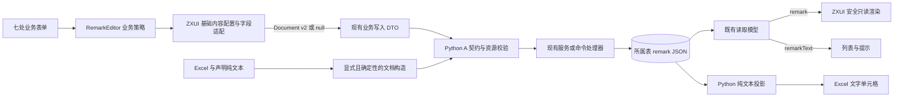
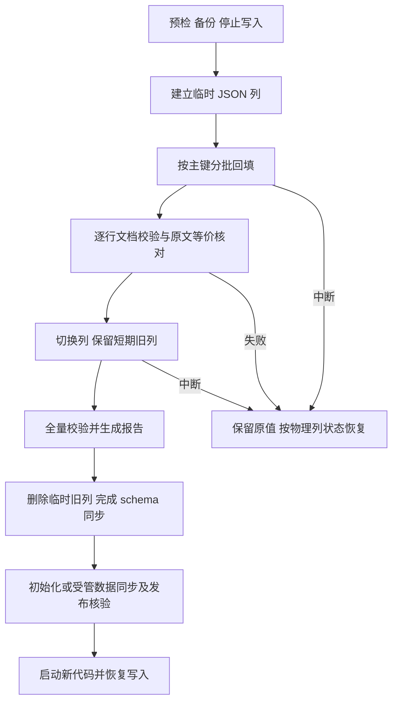

# 通用备注富文本与 JSON 存储技术设计

## 设计状态与依据

- 日期：2026-10-22。
- 输入：[已确认需求](requirements.md)，共 11 项需求、59 条验收标准。
- 状态：用户已确认，2026-10-22；确认原文为“设计没问题，继续生成 tasks.md”。本轮按 SSD auto 完成任务拆分与规格检查，尚未实施或运行数据迁移。
- 本文明确标为“新增”或“拟新增”的类型、组件、参数和命令均为实现目标，不代表当前仓库已经提供。
- 仓库已有大量同期改动。实施时按最新调用链核对，保留无关修改，不将旧规格中的表单引擎描述强行覆盖到当前代码。

### 关键源码证据

业务仓路径相对仓库根目录；ZXUI 路径相对 `/Users/hqz/Downloads/element-plus`。

| 位置 | 已确认事实 | 设计结论 |
| --- | --- | --- |
| `ruoyi-fastapi-frontend/vite/zxui-theme-packages.ts:62` | 源码插件显式登记功能包，尚无 text-editor | 将编辑器加入既有清单，不自建 alias 体系 |
| ZXUI `packages/text-editor/src/props.ts:89`、`:133` | 已有 documentValue 和 editable | 使用文档绑定；适配标准字段值与只读状态 |
| ZXUI `packages/text-editor/src/editor/runtime-extensions.ts:310` | 默认装配包含表格、代码、文件、提及、斜杠菜单等 | 新增库内基础内容配置，不能仅隐藏工具栏 |
| ZXUI `packages/text-editor/src/core/schema-kernel/tiptap-adapter.ts` | 节点与属性绑定统一结构内核 | 保持统一结构内核，在其上限制允许内容，不另建备注专用 ProseMirror schema |
| ZXUI `packages/schema-form/src/formily/SchemaForm.vue:39`、`bindings.ts:231` | 已有 bindings、自定义字段值、事件和复合字段生命周期 | 复用绑定机制，不增加第二套表单状态 |
| `ruoyi-fastapi-frontend/src/views/system/post/components/PostDlg.vue:45` | 当前岗位实际使用 Formily 入口 | 沿用当前引擎，备注适配不切换表单引擎 |
| `ruoyi-fastapi-backend/modules/system/application/read_models/post_read_models.py:25` | CQRS 读取模型独立声明字符串 remark | 读取模型和写入模型一起更新，派生文本只进入读取模型 |
| `ruoyi-fastapi-backend/module_admin/entity/vo/user_write_vo.py:23`、`:40` | 用户写入会转入 EditUserModel 验证 | 同步内部旧模型，避免新 DTO 被内部字符串模型拒绝 |
| `ruoyi-fastapi-backend/module_admin/annotation/pydantic_annotation.py:16` | as_query 将模型字段转为查询参数 | 查询模型与文档写入模型解耦，不把递归 JSON 放进 GET 查询参数 |
| `ruoyi-fastapi-backend/scripts/internal/db_workflow/dev_sync_service.py:107` | 开发流程先 schema 后受管数据 | 增加此次数据转换的前置步骤 |
| `ruoyi-fastapi-backend/scripts/db.py:523`、`:535` | deploy 先 upgrade；finalize 在临时库自动生成并执行 revision | 手写数据感知 revision；禁止自动 ALTER 直接处理目标字段 |
| `ruoyi-fastapi-backend/scripts/internal/db_workflow/finalize_release_service.py:235` | finalize 会在新结构上重放既有发布包 | 旧发布包的字符串备注需要显式输入转换 |
| `ruoyi-fastapi-backend/scripts/internal/db_workflow/deploy_release_service.py:871` | 现有发布产物校验 checksum | 原文件先验签式校验，转换发生在加载后的内存目标态；不改历史文件和校验和 |
| `ruoyi-fastapi-backend/scripts/internal/db_workflow/capability_declaration_compiler.py:1125` | 声明目前接收 string/null | 保留纯文本编写入口，编译产物改为稳定文档 |
| ZXUI `packages/text-editor/src/render/text.ts:149` | 搜索文本渲染会过滤空段落、修整换行 | 迁移等价校验不能使用搜索摘要；明确独立的保真纯文本规则 |

官方参考：[Tiptap 持久化建议](https://tiptap.dev/docs/editor/core-concepts/persistence)、[Pydantic 判别联合](https://docs.pydantic.dev/latest/concepts/unions/)、[SQLAlchemy JSON](https://docs.sqlalchemy.org/en/20/core/type_basics.html#sqlalchemy.types.JSON)、[Alembic 自动生成需要审核](https://alembic.sqlalchemy.org/en/latest/autogenerate.html)、[MySQL 隐式提交](https://dev.mysql.com/doc/refman/8.0/en/implicit-commit.html)。

## 架构概述

### 1. 统一内容，保持现有业务边界

选择“原生 JSON 单列 + 服务端受限校验 + 按需派生文本”。七个业务表继续拥有各自的 `remark`，不新增备注表或通用内容 API。完整文档只在原有业务事务中保存，权限、记录身份、审计和提交结果处理继续由所属业务承担。

本轮最终字段仅有可空 `remark` JSON；不持久化 HTML、摘要、协作状态或双写旧列。接口读取时增加只读 `remarkText`，需要富文本详情时读取 `remark` 后使用 ZXUI 安全渲染。

### 2. 两层契约

- **ZXUI 文档层**：Document v2、统一结构内核、块身份、编辑器命令与渲染。
- **通用备注层**：仅允许 A 子集，固定链接规则、空值语义和资源预算；业务选择该子集，不修改文档封套的版本或字段定义。

应用侧协议标识固定为 `remark-a-v1`，只用于源码常量、测试与迁移报告，不增加到 Document v2 的未知字段中。文档仍为 `version: 2`，`meta.schemaVersion: 'stable-block-identity/v2'`。

### 3. 长期收益与代价

| 选择 | 收益 | 必须承担的代价 |
| --- | --- | --- |
| 完整 Document v2 | 直接进入 ZXUI 编辑与渲染，不反复解析 HTML | 钉住已验证的包版本、结构版本与块身份规则 |
| Python 校验明确的 A 子集 | 服务端能独立验证和导出，无常驻 JS 服务 | 维护共享样例，升级时验证两端规则一致 |
| 按需派生文本 | 无多份可写内容的一致性问题 | 列表与导出需显式选择文本投影 |
| 一次停写切换 | 迁移步骤和失败恢复容易核对 | 部署需要短暂停止相关写入；不提供在线双写迁移 |

## 数据流图





## 组件与接口定义

### 1. ZXUI 接入及需要新增的最小能力

**现有公开能力直接复用：** `ZxTextEditor`、`v-model:documentValue`、`content-type='document'`、`output-type='document'`、`editable`、文档校验、块身份、工具栏与链接交互、`renderDocumentToHTML` 和公开样式。渲染函数目前从包根导出，不假定存在独立 `/render` 包出口。

**库内新增能力：**

| 拟新增接口 | 契约 | 所属位置 |
| --- | --- | --- |
| `contentProfile: 'full' \| 'basic-rich-text'` | 默认保持完整编辑产品能力；基础配置只允许 A，配置在实例创建时固定 | text-editor 的 props、运行时装配和内容入口 |
| `BASIC_RICH_TEXT_PROFILE` | 公开只读的允许节点、标记及默认属性描述；来自当前结构描述，不另写一套内核 | text-editor `/core` |
| `contentLimits` | 允许应用设置字符、序列化大小、节点、深度预算；无任何上传或服务配置 | text-editor 公开类型与校验入口 |
| `ZxTextEditorField` | 标准 `modelValue`/`update:modelValue` 字段适配，转接 documentValue，支持错误、焦点和未完成编辑状态 | text-editor 包根导出 |

新增基础配置遵守以下执行顺序：

1. 沿用 Document v2 的完整 schema，A 作为内容接纳策略；不删除内核定义或破坏现有完整编辑器。
2. 常驻紧凑工具栏（2026-10-23 用户确认，取代前一日形态）：首位 AI 帮写/修改，其后加粗、命名文字颜色、两个列表、链接，更多菜单收纳斜体和清除格式。复用现有格式命令、链接浮层和内容配置边界；撤销重做走快捷键。不挂载文件入口、页式布局、提及、拖拽手柄。字段通过公开 AI adapter 接收业务鉴权流，预览候选不更新正文，采用前检查原文指纹和合并文档并形成一次可撤销事务。只读展示使用公开 `ZxTextEditorView`。完整链路见 [AI-first 落地计划](../../plans/2026-10-23-ai-first-remarks.md)。
3. 在库内命令分发和文档变更接纳处阻止非 A 内容；覆盖工具栏、快捷键、输入规则、公开插入命令及程序化替换。不能仅在业务保存前删除节点。
4. 文档事务的内容限制与稳定块 ID 修复协同：结构接纳先检查允许内容，库内身份修复完成后执行完整文档校验，再发出权威更新；不得因分段瞬间缺少 ID 而拦截合法输入。
5. 粘贴先在库内解析并投影到 A，再提交事务。标题/引用转段落，代码保留文字和换行，表格按行分段、单元格用制表符分隔，危险链接去掉链接标记但保留文字；图片/文件不上传、不产生 assets，无法保留的非文字内容提示用户。
6. 结构非法的程序化输入直接拒绝并反馈；粘贴是明确的导入边界，允许上述可说明的格式降级。已有数据库文档读取不自动降级。
7. 普通输入超出内容预算时保留当前编辑内容并标记不可提交；异常大的粘贴在事务前整体拒绝、保留原编辑值，不做半段截断。输入法组合输入结束后再更新稳定值与校验反馈。

这是本次库内工作的实质前置项。只有现有公开能力经探针证明等价满足时才可复用替代，不将这些新增参数写成当前可用 API。

### 2. 标准字段与业务适配

拟新增 `ruoyi-fastapi-frontend/src/components/ui/Remark/`：

- `RemarkEditor.vue`：选择基础配置和统一预算，将业务的 `RemarkDocument | null` 转接到 `ZxTextEditorField`；只负责备注产品策略和提示，不存放业务记录或另一份文档副本。
- `RemarkDisplay.vue`：验证已接纳文档后调用 `renderDocumentToHTML(document, { profile: 'safe-html' })`，消费结果的 HTML 与诊断，使用公开编辑器样式。渲染失败显示读取错误，不当作空备注；唯一 `v-html` 边界位于此组件且输入只能是安全渲染结果。
- `contract.ts`：预算、类型收窄和共享测试样例接入；不在页面散落节点映射。

字段接口：

```ts
// 拟新增接口，实际库类型由 ZXUI 提供。
type RemarkValue = RemarkDocument | null;
// props: modelValue, disabled, readonly, placeholder, messages, id, aria-*
// emits: update:modelValue, focus, blur, edit-state
// expose: focus(path?), validate(), captureEdit(), restoreEdit(snapshot)
```

`ZxTextEditorField` 处理文档值映射、composition 状态、链接浮层未提交草稿、焦点与卸载；业务包装不复刻这些机制。禁用时不产生写事件，只读状态保持可读和可选文本。标准字段持有的 Tiptap 事务状态是临时编辑状态，父表单值是唯一提交来源。

字段接口与现有 SchemaForm 复合字段协议保持结构兼容；text-editor 不反向依赖 schema-form 或 RuoYi。需要连接类型与消息时由业务 bindings 适配，避免两个 ZXUI 包形成循环依赖。

空值显示为一个合法的空段落，但挂载时不向父级发送更新；外部回填同一文档不重复 emit、不改块 ID；不在每次渲染时重新生成元数据或初值。切换业务记录采用既有会话 key 重建实例，撤销历史不跨记录。

### 3. 原生表单与 Schema 表单

- 原生表单：`RemarkEditor` 绑定现有 `state.data.remark` 或 `form.remark`，保留 `useFormDialog`、FormGrid 与 `data-form-full`。共享字段反馈映射到 `remark`，提交前确认没有未结束组合输入或链接草稿。
- 岗位 Schema：继续 `@zxio/schema-form/formily` 与 `schemaFormDialog`；使用已存在的 `bindings`，注册 `RemarkEditor: { component: markRaw(RemarkEditor), composite: true, group: false }`。
- 岗位字段采用对象字段、空初值 `null`、无内部 properties 展开，`x-component='RemarkEditor'`。Formily 原生对象字段对 null 的接纳及 dirty 判断列为首个接入探针；若库绑定有缺陷，在 schema-form 内修复，不改用字符串或额外业务状态绕过。
- 复用复合字段的 `messages`、`edit-state`、`captureEdit/restoreEdit` 和 `validate/focus`。暂时隐藏后恢复只保留必要的未提交交互草稿；永久换记录销毁。不能在 captureEdit 中另建权威正文。
- 更新 `post-form.ts` 的 PostValues、initialPost、toPostDto、字段错误映射和原有测试。错误路径以 `remark` 开头即可归入备注控件，不解析错误消息文本。

### 4. Python 共享模块

| 拟新增文件 | 职责 |
| --- | --- |
| `ruoyi-fastapi-backend/common/remark_document_v1.py` | 无数据库/业务依赖的固定规则、预算、纯文本构造与保真文本遍历；v1 语义冻结，迁移可长期重放 |
| `ruoyi-fastapi-backend/module_admin/entity/vo/remark_vo.py` | 受限 Pydantic 节点、标记与封套模型，外层校验、空值归一化、OpenAPI 定义 |
| `ruoyi-fastapi-backend/scripts/data_migrations/remark_document_v2.py` | 本次七列的同步 SQLAlchemy 数据迁移；只依赖固定 codec 与 Core，不导入最新业务 ORM/服务 |
| `shared/remarks/remark-a-v1/` | 共享正反例、纯文本期望、限制边界及结构描述基线；由两端测试消费 |

对外函数契约：

```python
validate_remark(value: object) -> RemarkDocument | None
plain_to_remark(text: str | None, *, identity_key: str) -> dict | None
remark_literal_text(document: dict | None) -> str
remark_display_text(document: dict | None) -> str
remark_to_storage(value: RemarkDocument | None) -> dict | None
```

不新增网络内容服务。HTTP 输入错误通过既有 ProblemDetails 输出，业务服务与命令处理器继续负责事务和授权。

## 文档契约与规范化

### 1. 封套与节点

```json
{
  "version": 2,
  "body": {
    "format": "json",
    "content": {
      "type": "doc",
      "content": [
        {
          "type": "paragraph",
          "attrs": {"textAlign": null, "blockId": "blk_a1"},
          "content": [{"type": "text", "text": "需要二次确认", "marks": [{"type": "bold"}]}]
        }
      ]
    }
  },
  "annotations": [],
  "assets": [],
  "meta": {"schemaVersion": "stable-block-identity/v2"}
}
```

| 节点 | 允许子项 | 精确属性 |
| --- | --- | --- |
| doc | 至少一个 paragraph、bulletList 或 orderedList | 无 attrs |
| paragraph | text、hardBreak，可为空 | textAlign 固定 null，blockId 必填 |
| text | 无；text 为非空字符串 | 无 attrs；可有标记 |
| hardBreak | 无 | 无 attrs，可有 A 标记以匹配内核输出 |
| bulletList | 至少一个 listItem | blockId |
| orderedList | 至少一个 listItem | blockId、start 为 1–1,000,000 的严格整数、type 固定 null |
| listItem | 第一项 paragraph，后续 paragraph 或两类列表 | blockId |

标记只允许 `link`、`bold`、`italic`，无重复且按当前内核顺序排列。bold/italic 无 attrs；link 必须精确提供 href、target、rel、class、title：target 固定 `_blank`，rel 固定 `noopener noreferrer nofollow`，class 与 title 固定 null，href 按下述链接契约校验。

每个有 blockId 的节点 ID 文档内唯一，满足 `^[a-z][a-z0-9]*_[a-z0-9]+$` 且长度 4–64；客户端新建节点复用 ZXUI 身份机制，不以数组下标作为运行时身份。相邻相同标记的 text 节点按 ZXUI 规范合并；规范输出不保留空 marks、空 attrs 或空 paragraph.content 数组，空段落只省略 content。语义不支持或属性错误直接拒绝，不能借规范化删除用户未知内容。

元数据在本轮精确限制为示例中的 schemaVersion，不写 createdAt/updatedAt/source/title，避免回填产生脏状态或声明同步漂移。业务审计仍由所属记录字段承担。

### 2. 空值、文字和限制

- 新建遗漏或显式 null 均表示无备注；更新遗漏保持原值，显式 null 清空。
- 仅“一个没有 inline 内容的 paragraph”归一化为 null。多个空段落、hardBreak、空格和制表符保留，避免将历史换行或空白丢失。空列表有结构语义，不自动当作 null。
- 明确清空动作输出 null；撤销恢复文档。`doc.content=[]` 是非法文档，不能作为清空协议。
- 纯文本导入统一 CRLF/CR 为 LF，然后按 LF 拆分为 paragraph；空行使用空段落，绝不生成空 text。不 trim、不解析 HTML、Markdown 或 JSON。
- 文档内 text 不含 CR/LF，换行使用 hardBreak 或段落；允许 tab，拒绝不适用于正文的控制字符及孤立代理码点。历史出现这些异常时预检失败，原值保留。

本版固定预算如下，跨语言按同一定义验证，后续变更需更新共享样例与说明：

| 项目 | 上限/规则 |
| --- | --- |
| 正文长度 | 5,000 个 Unicode 码点；统计保真文本，包括空白和结构换行，不计列表显示前缀与链接地址；JS 用码点遍历，Python 用字符串长度 |
| 文档大小 | 256 KiB；紧凑 UTF-8 JSON 字节数，保留非 ASCII，禁止 NaN/Infinity；请求输入和最终规范文档均检查 |
| 节点 | 2,000，含根、text、hardBreak、列表和段落 |
| 列表层级 | 3，外层列表为第一层 |
| 节点树深度 | 12，doc 为第一层；在递归模型解析前迭代检查 |
| 原始 JSON 容器深度 | 32，用于前置资源保护，含对象和数组 |
| 链接 | href 不超过 2,048 个码点，HTTP/HTTPS/mailto/tel；不允许相对、协议相对或裸域名链接 |
| 列表摘要 | 完整 remarkText 仍返回；界面按 160 个 Unicode 字素簇截取并加省略号，完整文字可读 |

链接输入框可将用户明确输入的裸域名补为 HTTPS，并让用户看到最终地址；API 只收明确协议地址。HTTP(S) 要求非空主机且不含凭据；mailto/tel 要求非空目标。拒绝 C0 控制字符、DEL、空白混淆和反斜杠。采用共享正反例锁定大小写、编码及协议解析差异；不尝试将危险协议清洗成可接受协议。

### 3. Pydantic 与 JSON 编解码

- 各类节点/标记采用 `type` 判别联合；严格数值校验，`extra='forbid'`，节点子关系、标记集合及块 ID 唯一性二次校验。
- 外层先做迭代资源预检，再进入递归模型，避免深层结构导致未处理异常；Pydantic/JSON 解码异常走现有请求错误处理，不落库。
- 节点字段按文档原始名称声明，不让业务 snake_case/camelCase 转换递归改写内容。ORM 得到 JSON 普通对象；不调用 `str(document)` 或把 Pydantic 对象直接交给驱动。
- 模型序列化必须与 ZXUI 规范输出一致：仅省略无意义的可选 content/marks 字段，不能全局 `exclude_none=True` 丢失必须存在的 null 属性；写 API 的 exclude_unset 只控制业务字段是否提供，不破坏文档内部属性。
- `RemarkDocument` 输入必须是 JSON 对象；现有 API 不接受 str。plain_to_remark 只在迁移、声明和已有导入入口显式调用。
- OpenAPI 必须公开可辨识的文档结构，而不是 any/object 占位。前端使用生成的业务 DTO 类型，并经类型收窄与 JSX/Vue 适配使用 ZXUI 公共文档类型，不手写另一套库声明。

### 4. 纯文本的两个固定用途

`remark_literal_text` 用于计数和历史等价核对：paragraph 内按顺序连接文字与 hardBreak(LF)，相邻块以一个 LF 分隔，列表项及子块按文档顺序遍历；不加前缀、不 trim、不丢空块。

`remark_display_text` 用于 remarkText 和 Excel：同样保留段落、空白与换行，为无序项加 `- `，有序项从 start 加 `N. `，每层嵌套缩进两个空格，续行按前缀宽度缩进；链接输出显示文字，不额外拼地址，加粗/斜体去掉标记。

ZXUI 的现有 search-text 投影有搜索场景的换行折叠规则，不将它作为保真转换或迁移的校验器。两端共享样例比较结构语义和安全渲染；涉及保真输出的精确字符串期望由本备注协议拥有，不为了备注改变其他 ZXUI 搜索消费者的默认行为。

## API 接口设计

### 1. 既有接口与模型改造

URL、权限、分页容器和业务身份保持既有契约，以下表列路径族，不新增独立备注 CRUD：

| 路径族 | 改造对象 |
| --- | --- |
| `/system/user` | 创建/编辑 DTO、UserModel/EditUserModel、详情与资料中的既有读取、已有列表与导出、关联角色/岗位响应 |
| `/system/role` | RoleModel、创建/编辑、角色读取模型、用户详情中的嵌套角色；状态/权限专用写入不携带备注 |
| `/system/post` | PostModel、岗位 CQRS 读取模型、查询模型拆分、表单 DTO、导出 |
| `/system/dict/type` | DictTypeModel、字典类型读取模型、查询与导出 |
| `/system/dict/data` | DictDataModel、读取模型、字典缓存及导出 |
| `/system/config` | ConfigModel、读取模型与导出；配置键值接口仍返回配置值 |
| `/tool/gen` | GenTableModel/EditGenTableModel、详情与保存、表配置列表及生成输出 |

写入示例（保留对应业务必填字段，此处仅展示变化）：

```json
{"postId": 1, "remark": null}
```

非空 remark 为前文完整封套，不包在字符串中。业务更新继续使用 `model_fields_set`/`model_dump(exclude_unset=True)`，禁止使用 `exclude_none=True`，否则明确清空会丢失。不得因后端 model 默认 None 将未传字段变为清空。

读取模型包含：

```ts
remark: RemarkDocument | null;
remarkText: string; // 无备注为 ''；由服务端计算，包含完整文字
```

现有独立 ReadModel 增加只读计算字段或在查询处理器构造；不把计算字段加到同时用于 `DO(**model_dump())` 的写入模型。用户与生成器尚未分离的读取点补最小读取模型/投影，复用现有响应封装，不新建通用响应映射框架。`remarkText` 标为 OpenAPI readOnly，并在写入边界明确拒绝该字段。

继承实体的 QueryModel 改为显式查询字段模型，保留真实查询项和分页时间参数；本轮不增加备注全文过滤。这样递归文档不会被 `as_query` 展开进 URL，亦不会成为误绑定的请求体。

### 2. 错误、回显和异常旧记录

- 备注输入非法沿用现有校验错误状态和 ProblemDetails，errors.field 以 `remark` 开头，code 区分版本、结构、链接、预算等原因；不新建第二套 HTTP 错误格式。
- 任一备注校验失败不得部分保存其他字段，用户保留当前编辑值。读取失败或保存结果未知沿用原会话保护。
- 迁移完成后读到字符串、错误版本或损坏 JSON，按数据一致性错误定位记录并阻止该记录被空值覆盖；不在在线读取中悄悄迁移或降级。
- 发布时同步 `shared/openapi.json`、`src/api/_generated/`、手写适配、mock 处理器与夹具。静态生成使用仓库产物；真实 API 验证地址遵循本项目 8088 端口。

### 3. Excel、缓存与生成器

- 服务端导出先将 remark 替换为 `remark_display_text` 的普通字符串，再交给 Excel 工具；不以客户端摘要作为输入。
- 当前 ExcelUtil 使用 pandas/openpyxl。备注列应按明确的文本单元格写入，即使内容以 `=`, `+`, `-`, `@` 开头也不作为公式；以单元格字符串类型实现，不通过给原文添加可见前缀改变内容。新增能力只影响明确声明的文字列，不默认改变其他导出列。
- 用户现有导入若未映射备注列，不为本轮新增模板字段；已有映射处显式 plain_to_remark。格式不承诺 Excel 无损往返。
- 字典缓存中存储的记录文档按新契约序列化；切换后通过既有字典刷新入口重建，不能用 `default=str` 隐藏未序列化模型。参数值缓存保持原值语义，必要的记录缓存失效单独列明，不清空整个 Redis。
- 生成器编辑配置新增明确选项 `html_type='remark'`（显示“基础富文本备注”），使用现有配置列，不另造语义推断系统。普通 editor 分支继续服务范围外正文。
- 选择 remark 时要求源数据库列为 nullable JSON，生成配置校验明确报错，不自动改变任意业务表。生成前后端引用共享 RemarkDocument、RemarkEditor、RemarkDisplay 和文本投影。普通、树形模板与预览/导出共用分支；其他 JSON 保持既有语义。

生成器能力矩阵补充（SSD auto 独立审查 GEN-01 后采用的默认决定，追溯 R8.AC2）：

| 前端模板与字段位置 | remark 行为 |
| --- | --- |
| Vue3 / element-plus：crud、tree、sub 的主表字段 | 同一编辑、只读、空值、类型与后端校验契约 |
| Vue3 / element-plus：sub 的子表字段 | 同契约；表格平时呈现摘要，用户激活字段时按需挂载编辑器，不为每行常驻编辑实例 |
| Vue2 / element-ui：任意主表或子表字段 | 不支持 remark；配置保存、预览、下载与生成均由后端统一校验拒绝，并提示改选 Vue3；其他字段和既有正文 editor 维持原职责 |

此矩阵依据真实模板路由 `utils/template_util.py:get_template_list`、`genInfoForm.vue` 的版本/主子表选择，以及 `vue/v3/index.vue.jinja2`、Python DO/VO 的独立子表循环。前端仅禁用选项不足以约束已保存配置与直接 API。先装配主子表完整配置，再对所有显式 remark 列验证版本、nullable JSON 及编辑/查询用途；不把备注 JSON 用作树身份、关联键或字符串查询条件。

子表草稿的唯一权威值保留在所属行模型；激活项使用稳定行会话身份（新行使用临时会话键），不能使用会随排序变化的行号保留撤销栈。切换行前处理未结束输入和链接草稿；错误路径映射到子表、行和字段，提交前检查所有行，不依赖只有当前挂载编辑器才校验。Python 子表 VO/DO、序列化、读取文本投影以及新行默认 null 同步改造。预览和实际输出覆盖 crud/tree/sub、主字段/子字段、insert/edit 标志及 Vue2 拒绝路径。

## 数据模型与数据库变更

### 1. 最终映射与目标清单

```python
remark = Column(JSON(none_as_null=True), nullable=True, default=None, comment='备注文档')
```

MySQL 8 使用 JSON，PostgreSQL 使用 SQLAlchemy 通用 JSON 映射；本轮无 JSON 路径索引需求，不为此引入 JSONB 专用逻辑。Python None 表示 SQL NULL，不存 JSON null；没有默认文档或默认随机 ID。文档全量替换，不依赖嵌套对象的原地修改追踪。

| 表 | 主键 | 当前字段 | 最终字段 |
| --- | --- | --- | --- |
| sys_user | user_id | VARCHAR(500) | nullable JSON |
| sys_role | role_id | VARCHAR(500) | nullable JSON |
| sys_post | post_id | VARCHAR(500) | nullable JSON |
| sys_dict_type | dict_id | VARCHAR(500) | nullable JSON |
| sys_dict_data | dict_code | VARCHAR(500) | nullable JSON |
| sys_config | config_id | VARCHAR(500) | nullable JSON |
| gen_table | table_id | VARCHAR(500) | nullable JSON |

修改实际 DO，不依赖未被使用的 RemarkMixin。明确将 `module_generator.entity.do.gen_do` 纳入 Atlas 和 Alembic 的模型导入；检查关联 `gen_table_column` 在空库的建表完整性，仅补生成器既有必要结构，不混入其他未授权漂移。

### 2. 确定性的纯文本转换

`identity_key` 使用 `表名:主键:remark`；对声明也使用其最终表和稳定主键，避免声明与迁移生成不同 ID。段落 ID 为 `blk_` 加 SHA-256 对下列紧凑 UTF-8 JSON 的摘要前 32 位十六进制：

```text
["remark-a-v1", identity_key, paragraph_index, normalized_full_text]
```

因此同一记录同一文本的反复转换结果相同；不同段落与记录不会仅因文字相同共享身份。转换后检查实际文档内 ID 唯一性，发现碰撞直接失败。运行时用户继续编辑时保持现有 ID，不按新正文重算全部 ID。

NULL 或空字符串映射为 None；其他字符串按前述换行规则构造，保持全文空白。以 `remark_literal_text(result) == normalized_original` 逐行验证；不使用 HTML 标签删除函数或搜索文本投影。

### 3. 迁移物理状态

每表使用两个固定临时列名：`remark__json_v2`、`remark__text_v1`。迁移只在所有相关写入已停止时运行；旧应用、后台受管数据热同步、导入任务和脚本均需停止。数据库 advisory lock 只阻止另一个迁移执行器，不能代替停止业务写入。

| 可观察状态 | 列结构 | 处理 |
| --- | --- | --- |
| 不存在 | 表不存在 | 新库由既有建表流程创建；不当成失败或已验证历史数据 |
| 旧格式 | remark 为字符串，无临时列 | 预检通过后增加 JSON 临时列 |
| 回填中 | 字符串 remark + remark__json_v2 | 按主键遍历；空目标填充，非空目标必须等于期望文档，否则停止 |
| 已切换 | JSON remark + 字符串 remark__text_v1 | 从旧列重新核对所有新值，允许恢复后继续核验 |
| 已完成 | 仅 JSON remark | 校验当前文档并视为已转换，不再次用旧文本覆盖 |
| 异常 | 未预期类型/列组合、冲突临时列 | 停止，不能猜测并清理列 |

不以某一个本地报告文件作为唯一执行进度；物理列状态与数据内容共同决定恢复动作。每次运行另生成报告，包含数据库标识、迁移实现版本、schema 指纹、每表行数与阶段、原文/转换后有序摘要、失败主键和备份引用。报告不打印完整备注正文。

### 4. 执行顺序

1. **预检**：只读检查七表、类型、临时列冲突、内容预算、控制字符、转换可行性以及未迁移外部写入源；全部可转换才进入写阶段。检查数据库方言，禁止把未知数据库按 MySQL 处理。
2. **备份与停写**：为非空已有库准备可恢复备份与 manifest（目标数据库、时间、文件摘要、恢复验证记录），停止写入后再次扫描并比对源数据摘要。没有满足条件的备份或停写声明则阻断；空库不要求备份。
3. **加列**：每表增加 nullable JSON `remark__json_v2`；不直接 ALTER 旧 remark 的类型。
4. **回填**：按主键 keyset 分页，每批 500 行，使用绑定参数和 SQLAlchemy JSON 类型写入，NULL 通过 none_as_null 写为 SQL NULL。按批事务提交；不加载全表进内存。
5. **核验**：扫描全部行，核对主键集合、行数、NULL/空值映射、规范文档、原文等价及摘要。NULL 源不能因为目标同样 NULL 而跳过计数；额外通过数据库 JSON 类型检查区分 JSON null 与 SQL NULL，前者不符合本契约。任一不符停止切换。
6. **切换**：MySQL 每表用一个 ALTER 将旧列改名为 `remark__text_v1`、临时列改为 remark；PostgreSQL 在事务中完成同等改名。明确保留原长度、可空与注释，不依赖 ORM 当前字段描述猜旧定义。
7. **全局验证**：七表均切换后重新核对新旧值和源摘要，保持停写。报告持久化成功后，删除旧临时列；中断后按表状态恢复。所有临时列清理完成后才进入通用 schema apply。
8. **同步与放行**：执行剩余 schema、初始化/受管产物、缓存刷新和 verify；应用读取冒烟通过后恢复新版本写入。旧版本应用不得在 JSON 结构上重新上线。

备份文件与含原始数据的演练资料存放于仓库外或明确忽略的受限目录，不提交 Git。报告和恢复凭据应与目标库绑定，不能把其他数据库的 manifest 当作已备份证明。

### 5. 失败与恢复

| 失败时点 | 保留的数据 | 恢复动作 |
| --- | --- | --- |
| 预检或加列前 | 全部原字段 | 处理异常或恢复前置条件，再预检 |
| 回填中 | 原字段完整、部分新值 | 重新执行同一迁移，核对已有新值后继续；不清空重做 |
| 部分表已切换 | 各表旧字段或短期备份列 | 继续停写，按表状态完成核验与后续切换 |
| 清理旧列中断 | 外部备份、已完成 JSON、部分短期旧列 | 完成其余核验与清理；已清理表不得用旧快照重新覆盖 |
| 受管同步或应用验证失败 | 已迁移 JSON、外部备份 | 优先修复并继续新版本；如必须退回旧版本，恢复经过验证的完整一致快照与相配代码 |
| 已恢复写入后发现问题 | 新格式写入已产生 | 先停止写入并备份当前库，修复向前；不得自动 JSON→VARCHAR 或恢复旧快照丢失新写入 |

正式 revision 的 downgrade 明确拒绝自动降级并给出恢复指引。没有跨 MySQL DDL、七表回填和发布产物的自动全局回滚承诺。

## 数据库工作流与交付顺序

### 1. 开发流程

在现有 `execute_dev_sync` 中加入此次转换的固定前置步骤：

```text
声明验证 → 备注格式预检/必要转换 → Atlas schema apply → 受管数据对齐 → 备注后置验证
```

使用现有 `ruoyi-fastapi-backend/scripts/db.py`，不暴露第二套独立数据库脚本。拟新增的窄范围参数如下，实施前不得视为现成命令运行：

- `db.py remark-migration-check --report <path>`：只读预检和恢复状态报告。
- `db.py dev-sync --remark-backup-manifest <path> --remark-writers-stopped`：已有非空旧库允许转换的显式前提，实际仍由统一同步编排执行。
- `deploy` 接受相同前提参数，用于新迁移需要处理已有数据的目标；没有旧数据则不要求。

`--remark-writers-stopped` 是操作者对真实停止服务和任务的声明，不是自动锁住其他进程；文档必须列出需要停止的进程。自动启动遇到需要迁移的非空旧库时输出预检及上述统一入口指引并退出，不能擅自丢数据、清库或带旧结构启动。

### 2. 正式 Alembic 与 finalize

- 编写一个手工审核的正式 revision，固定七列表、方言分支和不可变迁移实现；其 upgrade 调用上述转换，随后达到新 metadata 状态。revision 号与 down_revision 由实施时真实 head 确定，不在设计中猜测。
- `db.py` 将已校验的备份 manifest、停写声明和报告目标通过 Alembic `Config.attributes` 传递给该 revision，不把路径或授权状态写入业务配置表。直接运行 upgrade 缺少这些上下文且存在待迁移的非空旧数据时必须失败；finalize 的隔离临时库以显式临时库上下文运行，不能把豁免应用到用户数据库。
- 迁移模块及 v1 codec 不再随在线规则变化而重写；新协议需要新版本模块和新 revision。历史回放不导入当前业务 ORM 或最新 DTO。
- 将生成器模型纳入正式 metadata；缺少生成器既有表的空库先按审核后的建表操作创建，已有表只迁移目标字段，不能因注册模型而删除/重建其数据。
- `finalize` 继续在临时库 upgrade 到正式 head，然后生成受管发布包；这次已提交手工 revision，所以七列不应再出现待自动生成的类型漂移。
- 在 Alembic autogenerate 的现有集成处增加针对这七列的窄保护：如发现尚未由正式 revision 处理的字符串→JSON AlterColumnOp，停止自动生成/执行并指向本迁移；不为此建立通用迁移插件框架。
- 空库上的自动升级只能验证建表路径；必须另用含历史样例的副本执行同一 revision，证明数据转换和恢复成立。

### 3. 受管数据、bootstrap 与历史发布包

1. `capability_declaration_compiler` 对字典类型、字典数据与参数的文本 remark 调用固定转换；代码编写仍可用 YAML 文本，但编译后 target_state 为 JSON。初始角色、岗位、用户也在 SeedDataManager 入库边界转换。
2. identity_key 使用最终表和稳定主键；规范化完成后才计算新发布包、目标态与比较用的校验和，重复编译应没有新增时间戳或随机值。
3. finalize 和 deploy 都会消费真实存在的旧发布产物。原文件先按既有规则校验 checksum，再在加载后的操作对象中适配这次三类受管实体的字符串 remark；仅当目标列已为 JSON 时转换。
4. 原历史 YAML、artifact ID 和原始 checksum 不修改；新发布包直接写 JSON。该冻结适配仅服务仍被保留并重放的历史产物，是有实际消费者的数据迁移边界，不进入业务 API。
5. 对已有 DB 工作流台账，保留历史 artifact 账本；新目标快照更新走既有 planner/applier，比较双方使用规范对象。不能因格式变化清空所有权台账、扩大 managed_scope 或重置未受管记录。
6. 报告分别记录纯格式转换和本次受管声明产生的实际内容更新；非受管备注只能经历保真迁移，不被默认种子覆盖。

### 4. 发布顺序

库候选包和应用代码先完成验证并形成同一可部署产物；运行时顺序为：停止旧写入 → 备份/预检 → deploy 正式迁移 → 受管产物/缓存 → verify → 新应用启动与只读冒烟 → 恢复写入。前后端同批切换，不承诺旧字符串客户端与新 API 并存。

本地通过源码直连完成库业务联调，再用实际 tarball、锁文件和公开导入验证无 alias 的生产构建；不以 npm 正式发布作为本轮前置，也不把本地包验证当作已发布。

## 安全考量

- JSON 校验与链接安全分别执行；已验证 ZXUI 结构检查不能单独拦截 javascript 链接。
- 对 JSON 请求执行前置资源预算和可定位的校验错误处理；不在日志或错误响应回显整份恶意文档。
- 文本与代码形似内容一律作为文字；HTML 只由经过校验的 JSON 经库安全 renderer 生成，业务不接受 raw HTML。
- 备注沿用所属记录的权限与审计，不新增绕过原控制器的写入口。SchemaForm 的只读只是界面约束，服务端仍检查权限。
- Excel 导出按文本单元格处理，测试恶意公式外观但不改变原备注文字。
- 迁移绑定目标数据库、备份和停写条件；数据库 advisory lock 与受限报告文件共同防止误并发和误操作，但不能替代真实备份恢复验证。

## 测试策略

### 1. 本次设计已取得的证据

- 静态审查覆盖 ZXUI 装配、公开 props/exports、SchemaForm bindings、CQRS 读取模型、API 查询装配和数据库工作流。
- 内存探针从 ZXUI `/core` 读取真实节点属性与标记顺序；确认合法空段落可校验、空根文档非法、结构校验不会替代链接安全。
- SQLAlchemy JSON 方言映射已做 DDL 编译探针；尚未执行真实迁移。
- 此处新增的 contentProfile、字段适配、Python A 模型和迁移命令尚未实现，不宣称已经可用。

### 2. 必须先做的接入探针

| 探针 | 判定标准 | 失败归属 |
| --- | --- | --- |
| 基础配置的命令与事务 | 快捷键/粘贴不能引入非 A 内容，合法分段不被块 ID 检查阻断 | text-editor |
| 空值、回填与会话 | mount/null 回填不变 dirty，更新格式会变 dirty，换记录清空撤销栈 | 字段适配或实际会话责任方 |
| Schema 对象字段 | null 与 JSON 可编辑；隐藏恢复、composition、错误焦点和 submit blocking 有效 | schema-form/text-editor 字段适配 |
| 公共包消费 | 源码模式与真实包的导出、样式、主题、类型和构建一致 | 对应 ZXUI 包与构建集成 |
| 规范文档往返 | Pydantic 输出可被 ZXUI 接纳且再次编辑无内容丢失 | 两端契约与固定样例 |

### 3. 分层验证矩阵

| 层 | 必要验证 |
| --- | --- |
| 固定 codec/Pydantic | 59 条验收项中相关的空值、空白、中文、表情、换行、HTML/JSON 字面量、列表编号、链接、重复 ID、非法属性、边界预算；无转换不确定性 |
| 跨语言样例 | 合法实例都通过 ZXUI 文档校验及 Python A 校验；危险链接即使结构合法也被 A 拒绝；非法实例标明结构拒绝或产品策略拒绝，不要求上游完整编辑器与 A 接纳集合相同 |
| API/读取模型 | 七个业务写入与读回、更新遗漏与显式 null、只更状态不清空备注、嵌套响应、GET 参数不出现递归文档、OpenAPI 生成、损坏读取失败 |
| 表单 | 七处实际入口；原生表单、抽屉、Schema 表单和生成器的加载、切换、保存失败、取消、清空、撤销、输入法、只读和主题 |
| 输出 | 列表无对象字符串；富文本只读安全；Excel 保留空白与编号且不执行公式；字典/配置缓存升级 |
| 生成器 | 显式 remark 配置的普通/树形/主子表主字段与子字段预览、导出代码编译；子表按需编辑和完整校验；Vue2 + remark 明确拒绝；非备注 JSON/旧正文 editor 不被改义 |
| 初始化与受管 | 空库 seed、两次 dev-sync 无变化、同声明 checksum 稳定、旧发布包校验和不变且可重放、非受管数据保持 |
| MySQL 演练 | 含旧数据副本完整升级；加列/批次/切换/清理四处注入中断后恢复；异常数据阻断；已有 JSON 再执行不覆盖；备份恢复到相配旧版本 |
| PostgreSQL | 方言映射、SQL 参数化、NULL 与改名事务路径；真实演练未做时单列未验证，不能以编译代替 |

共享样例保存在 `shared/remarks/remark-a-v1/`，包含 `valid/`、`invalid/`、`plaintext/` 和描述版本的 manifest；不把完整编辑器所有节点测试复制到业务仓。只对实际边界补必要回归。

变更后先运行受影响的 Vitest/Pytest 与生成器测试，再完成前端 lint/type-check、生产构建、`yarn ui:standards` 和后端 Ruff；按仓库质量门禁运行需要的测试，不因文档生成执行全业务测试。

真实业务与迁移证据建议汇入 `docs/reports/generic-remark-rich-text/`：版本/包哈希、运行环境、入口清单、API 记录、迁移计数与摘要及恢复步骤。数据备份正文不进入该目录。UI 实测必须使用获得授权的方式；当前没有 computer use 授权，不能据此跳过后宣称通过。

## 需求追溯与实施依赖

| 需求 | 设计覆盖 |
| --- | --- |
| R1 | 七字段清单、路径族、生成器显式语义、范围外正文保留 |
| R2 | 基础内容配置、粘贴投影、输入法与限制预算 |
| R3 | 公共包接入、库内内容约束、字段适配、主题与包产物验证 |
| R4 | 原生/Schema 单一值、会话重建、未完成编辑与错误反馈 |
| R5 | 封套、空值、节点属性、整体更新、读写 DTO/OpenAPI |
| R6 | Pydantic A 校验、链接、前置预算、共享样例与权限 |
| R7 | 两种纯文本用途、只读渲染、Excel、缓存 |
| R8 | 生成器 remark 配置、bootstrap、受管声明、历史发布重放 |
| R9 | 确定性转换、物理状态表、回填与逐行校验、恢复表 |
| R10 | dev-sync 前置转换、手写 revision、finalize/deploy/verify 和方言验证 |
| R11 | 接入探针、分层矩阵、证据与后续任务拆分 |

实现依赖顺序：固定 A 契约和共享样例 → ZXUI 基础配置与字段适配探针、Python codec/模型 → 迁移和所有数据写入源 → API/读取模型与前端七处接入 → 生成器/OpenAPI/mock/缓存/导出收敛 → 隔离迁移演练、真实业务与包产物验收。多个模块可在不共享写入状态的情况下分工，但本阶段不启动实施。

## 审核状态

- 需求：已确认；仅同步确认记录，未修改验收条款。
- 本设计：用户已确认，2026-10-22；SSD auto 独立审查后补充生成器版本与主子表能力矩阵，核心架构与已批准验收编号不变，默认决定见 requirements.md 的 Clarifications。
- 实现任务：[tasks.md](tasks.md) 已生成，23 项任务逐项追溯 59 条验收标准；独立设计复审通过，按 SSD auto 进入 execution_ready，无需再次逐阶段确认。
- 应用代码、ZXUI 源码和数据库：本阶段未修改。
