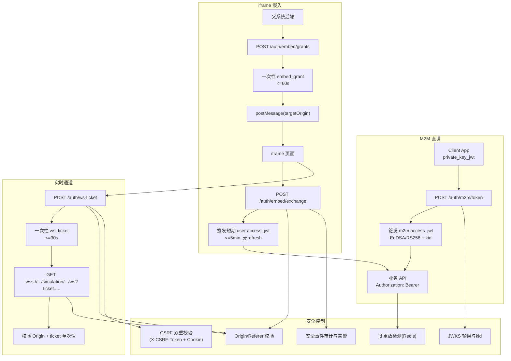

# JWT 直调与 iframe 嵌入零信任安全改造 技术设计

## 架构概述

本设计基于现有 `ruoyi-fastapi-backend` 与 `ruoyi-fastapi-frontend`，执行“无兼容分支硬切”，统一实现以下安全目标：

1. 浏览器侧不再依赖可读 Cookie 持久化 JWT，`access_jwt` 仅内存持有。
2. API 鉴权统一为 `Authorization: Bearer`，禁止 query/cookie/form token 来源。
3. `iframe` 场景采用一次性 `embed_grant` + 短期 `access_jwt` 交换模型。
4. WebSocket 采用一次性 `ws_ticket`，禁止现有 query token / cookie token 回退。
5. 引入国际标准对齐机制（ASVS/RFC/NIST）与发布门禁，形成可审计闭环。

### 现状约束与改造入口

当前代码中，鉴权主链路与风险点如下：
- 登录签发与 JWT 解析：`modules/identity/api/login_controller.py`、`modules/identity/application/services/login_service.py`
- WebSocket 当前支持 query/header/cookie 三来源：`module_admin/controller/simulation_controller.py`
- CORS 当前 `allow_credentials=True`：`middlewares/cors_middleware.py`
- 前端当前使用 `Admin-Token` Cookie：`src/utils/auth.ts`
- 登录页当前保存加密后密码到 Cookie：`src/views/login.vue`

硬切后保留现有分层（controller -> service -> repository），新增安全组件，不再保留旧 token 来源逻辑。

## 数据流图

## 组件与接口定义

### 后端组件

1. `IdentityTokenService`（新增）
- 职责：统一签发/验签 `m2m_jwt`、`user_access_jwt`、`embed_grant`、`ws_ticket`。
- 依赖：密钥管理器、Redis 防重放存储、审计服务。

2. `KeyManagementService`（新增）
- 职责：维护活动签名私钥、`kid`、JWKS 公钥发布、轮换与吊销。
- 输出：`/.well-known/jwks.json`。

3. `EmbedPolicyService`（新增）
- 职责：按“租户+集成应用”维护可信 origins 与 path 约束。
- 被 `embed_grant` 签发与交换、ws-ticket 签发复用。

4. `CsrfGuardMiddleware`（新增）
- 职责：对 Cookie 身份端点执行 `Origin/Referer` + `X-CSRF-Token` 校验。
- 范围：`/auth/refresh`、`/auth/logout`、`/auth/embed/*`、`/auth/ws-ticket`。

5. `SecurityHeadersMiddleware`（新增）
- 职责：统一下发 CSP、HSTS、X-Content-Type-Options、Referrer-Policy、Permissions-Policy。

6. `WebSocketAuthGateway`（改造现有 simulation websocket 入口）
- 职责：从 `ticket` 校验身份，拒绝 query token/cookie token/重复 ticket。

### 前端组件

1. `TokenMemoryStore`（新增）
- 职责：仅在内存中保存 `access_jwt`，提供读取与过期回调。
- 替换：`src/utils/auth.ts` 中基于 Cookie 的 token 读写。

2. `HttpAuthInterceptor`（改造 `src/utils/http.ts`）
- 职责：统一注入 Authorization；遇到 401 清理内存态 token 并跳转登录。

3. `EmbedBridge`（新增）
- 职责：iframe 与父页面 `postMessage` 双向 origin 校验、grant 收发、令牌交换。

4. `SafeRenderPolicy`（新增规则）
- 职责：禁止直接 `v-html/innerHTML`，必要渲染走白名单净化组件。

## API 接口设计

以下接口以 RFC 7807 错误格式返回失败结果（沿用项目现有 `application/problem+json` 风格）。

### 1) M2M Token 签发
- `POST /auth/m2m/token`
- 认证方式：`private_key_jwt`（RFC 7523）
- 请求体：
  - `grant_type=client_credentials`
  - `client_assertion_type`
  - `client_assertion`
  - `scope`（可选）
- 成功响应：
  - `access_token`
  - `token_type=Bearer`
  - `expires_in<=600`
- 安全约束：拒绝 `client_secret`、Basic、API Key。

### 2) iframe grant 签发
- `POST /auth/embed/grants`
- 调用方：父系统后端（Bearer 或 m2m）
- 请求体：`tenant_id`、`integration_id`、`origin`、`path`、`subject`
- 成功响应：`embed_grant`、`expires_in<=60`
- 校验：`origin/path` 必须命中租户+集成应用白名单。

### 3) iframe grant 交换 access token
- `POST /auth/embed/exchange`
- 请求体：`embed_grant`
- 成功响应：`access_token`、`token_type=Bearer`、`expires_in<=300`
- 约束：单次使用；无 refresh token。

### 4) ws-ticket 签发
- `POST /auth/ws-ticket`
- 请求头：`Authorization: Bearer <access_jwt>`
- 请求体：`session_id`、`origin`
- 成功响应：`ws_ticket`、`expires_in<=30`

### 5) WebSocket 握手
- `GET /simulation/sessions/{session_id}/ws?ticket=<ws_ticket>`
- 握手校验：
  - ticket 有效且未使用
  - ticket 中 session_id 与 path 匹配
  - `Origin` 命中策略白名单
- 失败：关闭码 `1008`。

### 6) JWKS 发布
- `GET /.well-known/jwks.json`
- 返回：当前与轮换窗口内可验签公钥集（仅公钥、含 `kid`）。

## 数据模型与数据库变更

### 新增表（建议以 Alembic 管理）

1. `sec_client_app`
- 字段：`id`、`tenant_id`、`integration_id`、`client_id`、`status`、`created_at`、`updated_at`
- 用途：M2M 客户端主数据。

2. `sec_client_jwk`
- 字段：`id`、`client_app_id`、`kid`、`public_jwk`、`status`、`not_before`、`not_after`、`created_at`
- 用途：每客户端独立 JWKS 公钥管理。

3. `sec_embed_origin_policy`
- 字段：`id`、`tenant_id`、`integration_id`、`origin`、`path_pattern`、`enabled`、`created_at`
- 用途：iframe/WS 可信来源策略。

4. `sec_key_registry`
- 字段：`id`、`kid`、`alg`、`private_key_ref`、`status`、`activated_at`、`retired_at`
- 用途：服务端签名密钥生命周期。

5. `sec_security_event`
- 字段：`id`、`event_type`、`subject`、`request_id`、`source_ip`、`reason`、`payload_json`、`created_at`
- 用途：安全审计闭环。

### Redis Key（短生命周期数据）

1. `sec:jti:<jti>`：JWT 重放检测，TTL=`exp`。
2. `sec:embed_grant:<grant_id>`：一次性 grant 状态，TTL<=60s。
3. `sec:ws_ticket:<ticket_id>`：一次性 ws_ticket 状态，TTL<=30s。
4. `sec:csrf:<session_or_subject>`：CSRF token 状态与轮换信息。

## 安全考量

### 标准映射

1. JWT 设计与验证：RFC 7519 + RFC 8725
- 严格算法白名单、`aud` 必须校验、拒绝 `none` 算法。

2. 客户端认证：RFC 7523
- m2m 强制 `private_key_jwt`。

3. WebSocket 安全：RFC 6455 + OWASP WebSocket Security
- 握手前置 origin 校验 + 一次性票据。

4. 应用安全基线：OWASP ASVS 4.0.3（L2/L3 目标）
- 身份验证、会话管理、访问控制、输入输出编码、日志与监控。

5. 身份与会话建议：NIST SP 800-63B
- 短时令牌、重放防护、可撤销。

### 关键威胁与缓解

1. CSRF
- 缓解：仅 Cookie 身份端点启用 CSRF 双重校验；业务 API 不接受 Cookie token。

2. XSS 导致 token 窃取
- 缓解：access token 内存态；CSP nonce；禁用 `v-html/innerHTML` 直渲染。

3. Token 泄露（URL/日志/代理）
- 缓解：禁止 query token，WS 改一次性 ticket。

4. Token 重放
- 缓解：`jti` 单次窗口检测；embed_grant/ws_ticket 一次性失效。

5. 密钥泄露与轮换中断
- 缓解：多 `kid` 轮换窗口，JWKS 双活发布，支持紧急吊销。

## 测试策略

### 单元测试

1. `IdentityTokenService`
- JWT claim 完整性、过期边界、`aud`/`iss` 校验、`jti` 防重放。

2. `EmbedPolicyService`
- 租户+集成应用 origin/path 白名单匹配。

3. `CsrfGuardMiddleware`
- 缺失 `Origin/Referer`、缺失 `X-CSRF-Token`、伪造来源均返回 403。

4. `WebSocketAuthGateway`
- 无 ticket、重复 ticket、错 origin 均返回 1008。

### 集成测试

1. M2M：`private_key_jwt` 获取 token 并调用受保护接口。
2. iframe：grant 签发 -> postMessage -> exchange -> API 调用全链路。
3. JWKS：`kid` 轮换前后验签连续可用。
4. 认证来源限制：query/cookie/form token 均被拒绝。

### 安全回归测试

1. XSS 回归：针对 `v-html` 与 `innerHTML` 规则执行 lint 阻断。
2. CSRF 回归：跨站 POST 在无 CSRF 令牌时必须 403。
3. WS 回归：跨站 origin 握手必须失败。
4. 供应链检查：依赖漏洞扫描（高危阻断）。

### 验证命令（实现阶段执行）

后端：
- `cd ruoyi-fastapi-backend && pytest tests/ -v`
- `cd ruoyi-fastapi-backend && ruff check . && ruff format --check .`

前端：
- `cd ruoyi-fastapi-frontend && yarn lint:check && yarn type-check && yarn test:run`

安全专项（新增后）：
- `cd ruoyi-fastapi-backend && pytest tests/security/test_jwt_profiles.py -v`
- `cd ruoyi-fastapi-backend && pytest tests/security/test_csrf_guard.py -v`
- `cd ruoyi-fastapi-backend && pytest tests/security/test_websocket_ticket.py -v`
