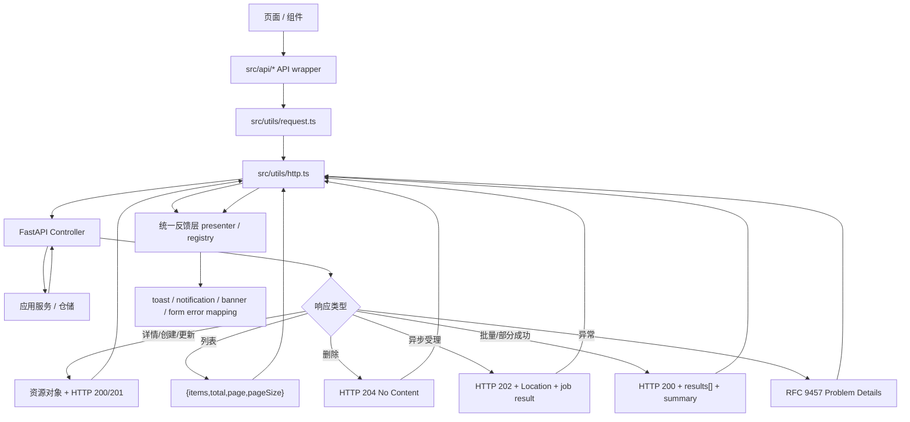
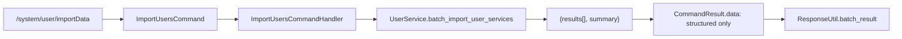

# 平台消息治理与 API 反馈契约 技术设计

## 架构概述

本设计将“平台消息治理”拆成三个彼此独立但同轮落地的层次：

1. 后端 HTTP 契约层：只负责输出资源导向成功响应、RFC 9457 Problem Details 错误响应，以及标准化响应头。
2. 前端传输与反馈层：只负责把 HTTP/业务语义映射为统一 UI 反馈，不再把服务端 success body 当作文案来源。
3. 治理与脚手架层：通过模板、静态检查、契约测试和 CI 阻断旧模式回流。

本轮采用现有路径硬切，不新增 `/v2`。所有业务 JSON HTTP API 在同一轮内迁移到新契约；`health` / `metrics` / `docs`、二进制下载、streaming、WebSocket / SSE 不强制套用本设计的成功响应结构。

### 前提与适用范围

- 本轮业务 JSON HTTP API 的消费方仅限仓库内 `ruoyi-fastapi-frontend`，**不存在**外部 SDK、移动端 App、第三方对接方或 CLI 调用方；因此不引入 `Deprecation` / `Sunset` 过渡头或 `/v2` 并行路径。若后续需要对外开放，需单独补版本治理策略。
- 本轮不引入多语言与 operation code registry。前端反馈层文案以 zh-CN 硬编码存入 feedback registry，后端不返回任何本地化字符串或 code。
- 本轮所有业务列表接口仅使用 offset-total 分页；cursor 分页只在契约与工厂签名上预留，不落地任何业务接口。

### 设计原则

- 错误契约标准化，成功契约资源化。错误统一为 RFC 9457，成功不引入全局 `{ data, meta }`。
- HTTP 语义优先。`200/201/202/204/4xx/5xx` 负责表达通用状态，不再依赖成功文案或全局 operation code。
- UI 语义前移到前端。后端不返回 toast/dialog 指令；前端不再把 `payload.message|msg` 作为默认成功反馈来源。
- 成功响应体零追踪污染。`requestId/traceId` 通过响应头回传；错误响应额外在 Problem Details body 中带出。
- 不做温和兼容。旧 `{code,msg,success}` 错误出口、旧 `rows` 列表主字段、旧 success message contract 都在本轮移除。

### 当前实现与目标架构差距

- 后端 `ResponseUtil.success()` 仍返回 `{data, message, requestId}`，并内建 `rows` 合并逻辑，见 `ruoyi-fastapi-backend/utils/response_util.py`。
- 后端 `module_admin/annotation/log_annotation.py` 仍调用 `ResponseUtil.failure()` / `ResponseUtil.error()`。
- 代码生成模板仍默认生成 `ResponseUtil.success(msg=...)` 与前端 `response.rows` 用法。
- 前端 `src/utils/http.ts` 仍在 mutation 2xx 后自动读取 `payload.message|msg` 并直接 `ElMessage.success(...)`，列表插件仍把 `rows` 作为标准列表字段。
- 页面层仍广泛直接调用 `$modal.msgSuccess` / `ElMessage.success` 处理服务端 CRUD 结果。

### 目标架构

- 后端保留一个统一响应工厂，但只暴露显式语义方法：
  - `ok_resource`
  - `ok_collection` 纯集合，无分页
  - `ok_page` offset 分页
  - `ok_cursor` cursor 分页（签名预留，本轮无业务接入）
  - `created_resource`
  - `accepted_job`
  - `no_content`
  - `batch_result`
  - `problem_details`
  - `validation_problem`
- 前端保留统一 `http` 客户端，但拆出一个独立反馈层：
  - 负责 `2xx/202/422/429/5xx` 默认反馈策略
  - 负责读取响应头中的 `X-Request-Id` / `X-Trace-Id`
  - 负责读取 API wrapper 提供的 `feedbackKey` / `feedbackMode`
  - 不再从 success body 中读取 `message/msg`
- 生成器与治理层同步更新：
  - 后端控制器模板生成新响应模式
  - 前端模板和 API wrapper 生成 `items` 分页与统一反馈配置
  - CI 阻断旧错误出口、旧分页字段和页面直弹服务端 CRUD 成功消息

## 数据流图



## 组件与接口定义

### 后端组件

#### 1. 响应工厂

保留 `ruoyi-fastapi-backend/utils/response_util.py` 作为统一出口，但重构为“显式语义工厂”，不再保留泛化的 `success(msg=..., rows=...)` 风格。

建议接口：

```python
class ResponseUtil:
    @classmethod
    def ok_resource(cls, resource: Any, *, headers: Mapping[str, str] | None = None) -> JSONResponse: ...

    @classmethod
    def ok_collection(
        cls,
        *,
        items: list[Any],
        headers: Mapping[str, str] | None = None,
    ) -> JSONResponse: ...

    @classmethod
    def ok_page(
        cls,
        *,
        items: list[Any],
        total: int,
        page: int,
        page_size: int,
        headers: Mapping[str, str] | None = None,
    ) -> JSONResponse: ...

    @classmethod
    def ok_cursor(
        cls,
        *,
        items: list[Any],
        page_size: int,
        next_cursor: str | None,
        headers: Mapping[str, str] | None = None,
    ) -> JSONResponse: ...

    @classmethod
    def created_resource(
        cls,
        resource: Any,
        *,
        location: str,
        headers: Mapping[str, str] | None = None,
    ) -> JSONResponse: ...

    @classmethod
    def accepted_job(
        cls,
        job: dict[str, Any],
        *,
        location: str,
        headers: Mapping[str, str] | None = None,
    ) -> JSONResponse: ...

    @classmethod
    def batch_result(
        cls,
        *,
        results: list[dict[str, Any]],
        summary: dict[str, int],
        headers: Mapping[str, str] | None = None,
    ) -> JSONResponse: ...

    @classmethod
    def no_content(cls, *, headers: Mapping[str, str] | None = None) -> Response: ...
```

`ok_cursor` 仅保留方法签名以冻结契约形状，本轮不会被任何业务接口调用；`created_resource` 与 `accepted_job` 的 `location` 参数应传入**绝对 URL**（可通过公共工具基于 `Request.url_for` + `base_url` 构造），跨网关部署更稳。

强制约束：

- 删除 `failure` / `unauthorized` / `forbidden` / `error` 旧错误出口。
- 删除 success body 中的 `message`、`msg`、`requestId`。
- 删除 success helper 中的 `rows` 参数以及泛化的 `ok_list(total=None)` 双形态写法。
- 不再允许 `dict_content/model_content` 以“拼装根对象”的方式逃逸契约。

#### 2. Problem Details 工厂

`problem_details()` 与 `validation_problem()` 只允许输出 RFC 9457 核心字段与冻结扩展字段：

- 核心字段：`type`、`title`、`status`、`detail`、`instance`
- 扩展字段：`errorCode`、`requestId`、`traceId`、`errors`

强制约束：

- 删除 `developerMessage` 对外返回；技术细节只入日志。
- 删除 `data` 与任意 `kwargs` 式扩展字段。
- `422` 专用 `errors[]` 结构统一为：

```json
[
  {
    "field": "roleName",
    "message": "角色名称不能为空",
    "code": "missing"
  }
]
```

`type` 必须是**绝对 URL**，由应用层基于可配置前缀拼接，不允许相对路径：

- 新增配置项 `PROBLEM_TYPE_BASE_URL`（例如 `https://problems.example.internal`），由部署环境注入；开发/测试环境给默认值 `http://localhost/problems`。
- 已映射到具体 problem slug 的错误：`type = f"{PROBLEM_TYPE_BASE_URL}/{problem-slug}"`。
- 未映射到具体 slug 的通用错误（兜底 500、未分类的 4xx）：`type = "about:blank"`，符合 RFC 9457 §4.2 的推荐用法。
- 应用层不允许硬编码 `api.example.com` 或业务域名。

`errors[].code` 值域直接沿用 pydantic v2 的原生 `type` 标识（如 `missing`、`string_too_short`、`value_error`、`int_parsing`），不新增一套自定义枚举；自定义业务校验（非 pydantic 层）可使用大写下划线风格（如 `PASSWORD_WEAK`），并在代码注释中登记，避免无序扩散。

#### 3. 响应头写入器

响应头由统一响应工厂和中间件写入，成功与错误行为一致：

- `X-Request-Id`: 必带
- `X-Trace-Id`: 有可用 trace 时带出
- `Location`: 仅 `201 Created` / `202 Accepted`
- `Retry-After`: 仅限流或异步轮询建议场景
- `RateLimit-Limit` / `RateLimit-Remaining` / `RateLimit-Reset`: 仅限流相关接口

为保证浏览器可读，后端 CORS 配置必须把以下头加入 `Access-Control-Expose-Headers`：

- `X-Request-Id`
- `X-Trace-Id`
- `Location`
- `Retry-After`
- `RateLimit-Limit`
- `RateLimit-Remaining`
- `RateLimit-Reset`

#### 4. 异常转换层

`ruoyi-fastapi-backend/exceptions/handle.py` 保持统一异常翻译职责，但改成“异常 -> Problem Details”单向出口：

- `AppException` 子类直接映射到 `problem_details()`
- `RequestValidationError` / `ValidationError` 映射到 `validation_problem()`
- `StarletteHTTPException` 映射到 `problem_details()`
- 通用异常映射到 `500` Problem Details

`module_admin/annotation/log_annotation.py` 中对旧 `ServiceWarning` / `ServiceException` 的兼容处理，改为抛出标准 `AppException` 子类，不再在装饰器内部构造旧风格响应。

#### 5. Command Result 边界

system 模块的 controller -> mediator -> command handler 链路属于 HTTP contract 的上游边界，不能作为旧 success message 的临时中转层。command handler 可以读取 service 层 `CrudResponseModel.message` 做日志、审计或兼容内部判断，但写入 `CommandResult.data` 时必须只保留业务结果字段。

边界规则：

- command handler 使用统一 helper 提取 service `result`，缺失 `result` 时返回空对象，而不是把 `message/msg` 补进 `data`。
- helper 必须过滤 `message` / `msg`，防止 service 层旧字段通过 `CommandResult.data` 回流到 controller。
- controller 必须根据接口语义选择显式响应工厂，例如创建走 `created_resource`、删除走 `no_content`、批量导入走 `batch_result`；禁止 `ResponseUtil.ok_resource(<command>_result.data)` 这类不带语义的直接透传。
- 批量导入、批量删除、同步、状态切换等动作型接口必须在 controller 层明确返回动作结果或 `results[] + summary`，而不是把 command status 或 success text 当作响应体。

用户导入是该边界的代表链路：



`results[i].error` 继续沿用批量结果内嵌错误的三字段约束：`errorCode` / `title` / `detail`，不升级为完整 Problem Details。

#### 6. 列表与分页适配器

列表响应契约按语义分三类：

| 模式 | 使用场景 | 响应体必带字段 | 响应体可选字段 | 后端工厂 |
| --- | --- | --- | --- | --- |
| 纯集合 | 字典枚举、固定小集合 | `items` | 无 | `ok_collection` |
| offset 分页 | 带筛选/跳页的表格（本轮所有业务列表） | `items`、`total`、`page`、`pageSize` | 无 | `ok_page` |
| cursor 分页 | 大表、无限滚动（本轮无业务使用） | `items`、`pageSize`、`nextCursor` | 无 | `ok_cursor` |

三种模式互斥，单个接口只能输出其中一种形状；前端适配层按"是否存在 `nextCursor` / `total`"判定模式：

```
if 'nextCursor' in body: cursor 模式
elif 'total' in body:    offset 模式
else:                    纯集合模式
```

查询参数命名：

- offset 分页：`?page=1&pageSize=20`
- cursor 分页：`?cursor=abc123&pageSize=20`

后端查询模型对外字段只暴露 `page/pageSize/cursor`，去掉以 `pageNum` 为正式对外字段的模式；必要时可在内部模型短期保留 alias 便于仓库内迁移。

未来扩展：如后续出现大表或无限滚动场景，可在不破坏 `items` 主字段的前提下，通过 `ok_cursor` + `nextCursor` 接入游标分页，本轮仅保留契约与方法签名，不实现业务使用。

#### 7. 生成器与模板

以下模板必须同步改造，否则旧模式会持续回流：

- `ruoyi-fastapi-backend/module_generator/templates/python/controller.py.jinja2`
- `ruoyi-fastapi-backend/module_generator/templates/vue/index.vue.jinja2`
- `ruoyi-fastapi-backend/module_generator/templates/vue/v3/index.vue.jinja2`

模板目标：

- 后端新增控制器默认生成 `ok_page / ok_resource / created_resource / no_content`（如为字典/枚举类接口则生成 `ok_collection`）
- 前端新增列表默认读取 `items`
- 前端新增写操作默认通过 API wrapper 的 `feedbackKey` 触发统一反馈，不再内联 `msgSuccess`

### 前端组件

#### 1. HTTP 传输层

`ruoyi-fastapi-frontend/src/utils/http.ts` 做如下重构：

- `successResolver` 不再读取 `payload.message|msg`
- `successCodes: [200]` 改为覆盖全部 `2xx`，或移除该白名单并统一由 `response.status` 判定成功
- `afterResponseTransform` 不再按 mutation 方法直接 `ElMessage.success(...)`
- `gridListPlugin` 改为 `listField: 'items'`
- `attachPager()` 改为按响应体字段自动判定分页模式：含 `nextCursor` 为 cursor 模式，含 `total` 为 offset 模式，均不含则视为纯集合不挂分页器
- 为空响应体的 `204 No Content` 提供显式分支，避免被解包逻辑误判为异常或 `undefined` 数据对象
- 错误解析只读取 RFC 9457 Problem Details

`ruoyi-fastapi-frontend/src/utils/request.ts` 扩展请求选项：

```ts
type FeedbackMode = 'auto' | 'manual' | 'silent';

interface FeedbackOptions {
  mode?: FeedbackMode;
  key?: string;
  successContext?: Record<string, unknown>;
  validationTarget?: {
    apply(errors: Array<{ field: string; message: string; code?: string }>): void;
  };
}

interface ExtendedAxiosRequestConfig extends AxiosRequestConfig {
  feedback?: FeedbackOptions;
  skipRelogin?: boolean;
}
```

语义：

- `auto`: 统一反馈层根据 `feedbackKey + HTTP 状态 + 响应体/响应头` 处理默认反馈
- `manual`: 调用端接管展示，但 `http.ts` 仍做基础错误解析
- `silent`: 完全不做默认反馈

#### 2. 统一反馈层

新增前端反馈模块，例如：

- `src/utils/feedback/presenter.ts`
- `src/utils/feedback/registry.ts`
- `src/utils/feedback/types.ts`

反馈层职责：

- 读取 `feedback.key`
- 根据 `response.status` 判定策略：
  - `200/201`: 普通成功 toast
  - `204`: 无 body 成功 toast
  - `202`: “已受理，可稍后查看进度” info/warning
  - `200 + results[] + summary.failed > 0`: warning notification/banner
  - `422 + validationTarget`: 写入字段错误，不弹默认红 toast
  - `403/404/409/429/5xx`: 统一错误提示，并可带 `requestId/traceId`
- 从响应头读取 `X-Request-Id` / `X-Trace-Id` 并在错误反馈中追加可追踪信息

反馈文案来源：

- 不来自服务端 success body
- 来自前端 registry，例如：

```ts
const feedbackRegistry = {
  'system.role.create': { success: '角色已创建' },
  'system.role.update': { success: '角色已更新' },
  'system.role.enable': {
    success: (ctx) => `角色已${ctx.successContext?.statusLabel ?? '启用'}`,
  },
  'system.role.batchDelete': {
    partial: (summary) => `部分完成：成功 ${summary.succeeded} 条，失败 ${summary.failed} 条`,
  },
};
```

registry 治理规则：

- **key 命名规范**：`{module}.{resource}.{action}`，全小写，点分隔，如 `system.role.create`、`monitor.job.run`；`module` 对齐 `src/api/**` 目录一级划分，`action` 使用动词原形（`create` / `update` / `delete` / `enable` / `disable` / `import` / `export` 等）。
- **存放位置**：单一文件 `src/utils/feedback/registry.ts`，禁止按模块拆分散落；API wrapper 仅引用 key，不内联文案。
- **启动校验**：`src/utils/feedback/presenter.ts` 在应用初始化时收集所有 API wrapper 声明的 `feedback.key`（通过显式注册 API 或构建期静态扫描），校验其是否全部存在于 registry 中；`import.meta.env.DEV` 下缺失直接抛错，`prod` 下降级为默认文案 `'操作成功'` 并 `console.warn(key)`，不允许静默丢失。
- **文案形态**：本轮仅支持 zh-CN 硬编码字符串或返回字符串的函数，不引入 i18n key；未来需要多语言时仅替换渲染函数，registry 结构本身不变。
- **下沉原则**：默认反馈配置下沉到 `src/api/**` wrapper，而不是散落在页面中直接调 `ElMessage`。

#### 3. API Wrapper 层

所有服务端 CRUD API wrapper 必须显式声明反馈策略。例如：

```ts
export function createRole(data: RoleForm) {
  return request.post('/system/role', data, {
    feedback: { mode: 'auto', key: 'system.role.create' },
  });
}

export function changeRoleStatus(roleId: number, status: string) {
  return request.put('/system/role/changeStatus', { roleId, status }, {
    feedback: {
      mode: 'auto',
      key: 'system.role.enable',
      successContext: { statusLabel: status === '0' ? '启用' : '停用' },
    },
  });
}
```

页面规则：

- 页面不再直接对服务端 CRUD 结果调 `ElMessage.*` / `ElNotification.*` / `$modal.msg*`
- 页面仅在本地交互场景保留消息能力，例如：
  - 提交前确认
  - 本地表单校验
  - 非 HTTP 实时事件
  - 纯前端复制、拖拽、画布交互

非 CRUD 的 HTTP 请求（文件下载、文件上传、纯查询、轮询探活等）不走统一反馈层，由 API wrapper 显式声明 `feedback: { mode: 'silent' }` 跳过默认反馈；反馈层不通过 `Content-Type` 或 URL 启发式推断，始终以 `feedback.mode` 为准，避免隐式行为。

#### 4. 列表适配层

所有列表页和表格封装改为消费 `items/total/page/pageSize`：

- `gridListPlugin.listField = 'items'`
- 业务代码中的 `response.rows` 统一替换为 `response.items`
- 旧 `attachPager()` 辅助逻辑改为对 `page/pageSize/total` 建立 `pager`

对现有组件的硬切策略：

- 网格组件优先通过适配层一次吸收新字段
- 页面自身的 `rows` 访问在本轮全部替换
- 不保留“同时兼容 rows 和 items”的长期分支

## API 接口设计

### 1. 成功响应模式

| 场景 | HTTP 状态 | 响应体 | 备注 |
| --- | --- | --- | --- |
| 详情查询 | `200 OK` | 资源对象 | 无全局 envelope |
| 纯集合查询 | `200 OK` | `{items}` | 字典、枚举等无需分页 |
| 分页列表查询（offset） | `200 OK` | `{items,total,page,pageSize}` | 本轮业务列表默认模式 |
| 游标列表查询（cursor） | `200 OK` | `{items,pageSize,nextCursor}` | 契约预留，本轮无业务使用 |
| 创建 | `201 Created` | 创建后的完整资源对象 | 同时返回绝对 URL `Location` |
| 更新 | `200 OK` | 更新后的完整资源对象 | 明确无 body 才用 `204` |
| 删除 | `204 No Content` | 无响应体 | 默认删除模式 |
| 异步受理 | `202 Accepted` | 任务结果对象 | 同时返回绝对 URL `Location` |
| 批量/部分成功 | `200 OK` | `{results,summary}` | 不以 `207` 作为默认 |

#### 详情

```json
{
  "roleId": 1,
  "roleName": "管理员",
  "roleKey": "admin",
  "status": "0"
}
```

#### 纯集合（无分页）

```json
{
  "items": [
    { "dictCode": 1, "dictLabel": "男", "dictValue": "0" },
    { "dictCode": 2, "dictLabel": "女", "dictValue": "1" }
  ]
}
```

#### 分页列表（offset）

```json
{
  "items": [
    {
      "roleId": 1,
      "roleName": "管理员",
      "roleKey": "admin",
      "status": "0"
    }
  ],
  "total": 1,
  "page": 1,
  "pageSize": 20
}
```

#### 游标列表（cursor，契约预留）

```json
{
  "items": [
    { "logId": 10234, "operator": "admin", "createdAt": "2026-04-22T10:30:00+08:00" }
  ],
  "pageSize": 20,
  "nextCursor": "eyJpZCI6MTAyMzR9"
}
```

`nextCursor` 为 `null` 时表示已到末页。本轮没有业务接口使用此模式，仅作契约冻结。

#### 创建

响应头：

```http
HTTP/1.1 201 Created
Location: https://api.example.internal/system/role/1
X-Request-Id: req_abc
X-Trace-Id: trace_abc
```

响应体：

```json
{
  "roleId": 1,
  "roleName": "管理员",
  "roleKey": "admin",
  "status": "0"
}
```

#### 删除

```http
HTTP/1.1 204 No Content
X-Request-Id: req_abc
X-Trace-Id: trace_abc
```

#### 异步受理

```http
HTTP/1.1 202 Accepted
Location: https://api.example.internal/system/import-jobs/job_123
X-Request-Id: req_abc
X-Trace-Id: trace_abc
```

```json
{
  "jobId": "job_123",
  "status": "accepted",
  "statusUrl": "https://api.example.internal/system/import-jobs/job_123"
}
```

#### 批量/部分成功

```json
{
  "results": [
    {
      "index": 0,
      "status": "succeeded",
      "itemId": 101
    },
    {
      "index": 1,
      "status": "failed",
      "error": {
        "errorCode": 30021,
        "title": "角色不存在",
        "detail": "roleId=999 不存在"
      }
    }
  ],
  "summary": {
    "total": 2,
    "succeeded": 1,
    "failed": 1
  }
}
```

`results[i].error` **不是**完整 Problem Details，仅保留 `errorCode` / `title` / `detail` 三字段，不带 `type` / `status` / `instance` / `errors` / `requestId` / `traceId`，避免消费方误判为顶层错误或重复展示追踪标识。整体批量请求的 `requestId` / `traceId` 通过响应头一次性回传。

### 2. 错误响应模式

所有业务 JSON HTTP 错误统一返回 `application/problem+json`。

#### 通用错误

```json
{
  "type": "https://problems.example.internal/role-conflict",
  "title": "角色标识冲突",
  "status": 409,
  "detail": "roleKey=admin 已存在",
  "instance": "/system/role",
  "errorCode": 30009,
  "requestId": "req_abc",
  "traceId": "trace_abc"
}
```

未映射到具体 slug 的通用错误（如未分类的 500）返回 `"type": "about:blank"`。

#### 422 字段校验错误

```json
{
  "type": "https://problems.example.internal/validation-error",
  "title": "参数验证失败",
  "status": 422,
  "detail": "请检查输入的信息是否正确",
  "instance": "/system/role",
  "errorCode": 10001,
  "requestId": "req_abc",
  "traceId": "trace_abc",
  "errors": [
    {
      "field": "roleName",
      "message": "角色名称不能为空",
      "code": "missing"
    }
  ]
}
```

`errors[].code` 直接透传 pydantic v2 的原生 `type`（`missing` / `string_too_short` / `value_error` / `int_parsing` 等），不新增自定义映射。

### 3. 请求头与响应头约定

#### 入站请求

- 认证：`Authorization`
- 幂等：`Idempotency-Key`
- 追踪：
  - 优先支持 `traceparent`
  - 内部系统可继续携带 `X-Trace-Id`，但应用层会统一解析成同一 trace 语义

#### 出站响应

- 成功响应：
  - `X-Request-Id`
  - `X-Trace-Id`（可用时）
  - `Location`（201/202）
- 错误响应：
  - 同上
  - `Content-Type: application/problem+json`
- 限流响应：
  - `Retry-After`
  - `RateLimit-Limit`
  - `RateLimit-Remaining`
  - `RateLimit-Reset`

### 4. 幂等与限流

#### 幂等

`ruoyi-fastapi-backend/middlewares/idempotency_middleware.py` 当前只识别 `X-Idempotency-Key`。本轮切换为标准 `Idempotency-Key`，并同步修改：

- 中间件读取逻辑
- 前端写请求 header 透传逻辑
- 单元测试与契约测试

幂等行为细节（对齐 `draft-ietf-httpapi-idempotency-key-header`）：

- **作用范围**：仅对 `POST` / `PATCH` / `PUT` / `DELETE` 等非幂等方法生效；`GET` / `HEAD` 忽略该头。
- **重放窗口**：24 小时；窗口内相同指纹的请求直接返回首次结果。
- **指纹组成**：`method + path + query + Content-Type + body hash + caller scope (user_id 或 client_id)`；任一不一致都视为不同请求。
- **存储介质**：沿用当前中间件实现（具体为 Redis 或内存缓存，以现有代码为准）；本设计不引入新的存储依赖，若后续需要分布式一致性再单独立项。
- **冲突策略**：相同 key 但指纹不一致返回 `409 Conflict` + RFC 9457 Problem Details。
- **并发请求**：相同 key 在首次请求未完成时进入，返回 `409 Conflict`（避免重复执行副作用），不做请求合并或等待。

#### 限流

`ruoyi-fastapi-backend/middlewares/rate_limit_middleware.py` 当前使用 `x-ratelimit-*` 自定义头，并把额外信息塞入 Problem Details `data`。本轮改为：

- 头部改为 `RateLimit-Limit` / `RateLimit-Remaining` / `RateLimit-Reset`（对齐 `draft-ietf-httpapi-ratelimit-headers` 旧三头方案）
- `Retry-After` 保持
- Problem Details body 只保留白名单扩展字段，不再返回 `data`
- 详细限流信息以 header 为准，前端统一反馈层负责展示退避信息

备注：IETF 草案后续版本已转向单头结构化字段 `RateLimit: limit=100, remaining=0, reset=30`。本项目**本轮固定采用旧三头方案**，等草案定稿后再单独立项切换，避免跟随频繁变动的草案。

## 数据模型与数据库变更

本设计不引入数据库 schema 变更。

### 后端模型变更

新增或重构的 HTTP 契约模型仅存在于应用代码层：

- `CollectionResult[T]` 纯集合
- `PagedResult[T]` offset 分页
- `CursorResult[T]` cursor 分页（本轮无业务使用，契约冻结）
- `BatchResult`
- `BatchItemResult`
- `BatchItemError` 仅含 `errorCode/title/detail`
- `AcceptedJobResult`
- `ProblemDetails`
- `ValidationErrorItem`

建议放置在统一的 contract 模块，例如：

- `ruoyi-fastapi-backend/common/http_contracts.py`
- 或 `ruoyi-fastapi-backend/schemas/http_contracts.py`

应用服务层不需要为 UI 文案维护字段；控制器只把领域/应用结果映射成上述 HTTP 契约。

### 前端模型变更

新增 TypeScript 类型：

- `ProblemDetails`
- `ValidationErrorItem`
- `CollectionResult<T>`
- `PagedResult<T>`
- `CursorResult<T>`
- `BatchResult<T>`
- `BatchItemError`
- `AcceptedJobResult`
- `FeedbackOptions`
- `FeedbackRegistryEntry`

这些类型应集中在 `src/types/http-contract.ts` 或等效位置，避免 `http.ts`、页面和 API wrapper 各自重复定义。

### 代码生成与脚手架变更

虽然无数据库变更，但本轮必须同步更新代码生成器，否则新代码会继续生成旧结构：

- 后端 controller 模板不再生成 `message` 型 success
- 前端模板不再生成 `response.rows`
- 前端模板不再生成默认 `msgSuccess('新增成功')` / `msgSuccess('修改成功')`

## 安全考量

### 1. 错误信息最小暴露

- Problem Details 不再返回 `developerMessage`
- 堆栈、SQL、内部异常类名仅入日志
- `detail` 仅保留对调用方有用且经审计的信息

### 2. 追踪与审计

- `requestId` 全链路必达
- `traceId` 在有 tracing 上下文时回传
- 错误提示可展示 `requestId/traceId` 以便用户报障
- 日志、审计记录、事件 outbox 使用相同追踪标识

### 3. 幂等防重放

- `Idempotency-Key` 仅用于非幂等写请求
- 指纹必须包含方法、路径、查询串、Content-Type、请求体和调用者作用域
- 相同 key 不同 body 返回 `409 Conflict`

### 4. 限流与退避

- 前端统一反馈层依据 `Retry-After` 和 `RateLimit-*` 提示用户退避
- 不再依赖后端额外返回的自由文本描述限流信息

### 5. 浏览器可观测性

- 必须暴露 `X-Request-Id` / `X-Trace-Id` / `Location` / `Retry-After` / `RateLimit-*`
- 否则前端无法完成统一反馈与问题定位

## 测试策略

### 1. 后端单元测试

更新并新增以下测试：

- `ruoyi-fastapi-backend/tests/unit/test_response_util.py`
  - success 不再断言 `message/requestId` 在 body 中
  - 覆盖 `ok_resource / ok_collection / ok_page / ok_cursor / created_resource / no_content / accepted_job / batch_result`
  - 断言 `problem_details` 的 `type` 为绝对 URL，未映射 slug 时为 `about:blank`
  - 断言 `created_resource` / `accepted_job` 的 `Location` 为绝对 URL
- `ruoyi-fastapi-backend/tests/unit/middlewares/test_idempotency_middleware.py`
  - 头名改为 `Idempotency-Key`
- `ruoyi-fastapi-backend/tests/unit/middlewares/test_rate_limit_middleware.py`
  - 断言 `Retry-After` 与 `RateLimit-*` 头
  - 断言 Problem Details body 不再出现 `data`

### 2. 后端集成/契约测试

更新并新增以下测试：

- `ruoyi-fastapi-backend/tests/integration/test_error_handling_rfc7807.py`
  - 调整为 RFC 9457 术语
  - 断言扩展字段白名单
  - 断言 `X-Request-Id` 与 body `requestId` 一致
- 新增列表/详情/创建/更新/删除契约测试
  - 纯集合只允许 `items`
  - offset 分页只允许 `items/total/page/pageSize`
  - cursor 分页只允许 `items/pageSize/nextCursor`（签名测试，本轮无业务接口实测）
  - 创建默认 `201 + 绝对 Location + resource`
  - 删除默认 `204`
- 新增批量/异步接口契约测试
  - `202 Accepted + 绝对 Location`
  - `200 + results[] + summary`
  - `results[i].error` 仅包含 `errorCode/title/detail` 三字段

### 3. 前端单元测试

新增 Vitest 覆盖：

- `src/utils/http.ts`
  - successResolver 不再消费 `payload.message|msg`
  - `202/204/422/429` 分支行为
- `src/utils/feedback/presenter.ts`
  - `auto/manual/silent` 策略
  - partial success 展示
  - field errors 映射
- grid adapter
  - `items` 纯集合解析
  - `items + total + page + pageSize` offset 分页解析
  - `items + pageSize + nextCursor` cursor 分页解析
- `src/utils/feedback/registry.ts`
  - 启动校验：dev 下缺失 key 抛错，prod 下降级为 `'操作成功'` 并 `console.warn`

### 4. 静态治理与 CI

新增或强化扫描规则：

- 后端禁止：
  - `ResponseUtil.failure(`
  - `ResponseUtil.error(`
  - `ResponseUtil.unauthorized(`
  - `ResponseUtil.forbidden(`
  - `ResponseUtil.success(` / `ResponseUtil.ok_list(` 泛化出口
  - success body 中 `message` / `msg` contract
  - `rows` 作为业务 JSON 列表主字段
  - Problem Details `type` 以 `/problems/` 开头的相对路径
- 前端禁止：
  - 页面层对服务端 CRUD 直接调用 `ElMessage.success`
  - 页面层对服务端 CRUD 直接调用 `$modal.msgSuccess`
  - `payload.message|payload.msg` 作为默认成功文案来源
  - `listField: 'rows'`
  - API wrapper 未声明 `feedback` 选项（CRUD 类 wrapper 必须显式声明 `mode` 与 `key`）

推荐做法：

- ESLint 自定义规则阻断页面层直弹服务端 CRUD 消息
- `rg` 扫描脚本阻断旧响应出口与旧字段名
- CI 在前后端测试与扫描全部通过后才允许合入

### 5. 合入前验收清单

合入前必须满足：

1. 仓库内所有业务 JSON HTTP API 已切换到新成功响应模式。
2. RFC 9457 Problem Details 扩展字段已收敛到白名单。
3. 前端统一反馈层已接管默认服务端 CRUD 反馈。
4. 页面层旧 `msgSuccess/ElMessage.success` 服务端 CRUD 用法已清理。
5. 生成器模板已更新，避免新代码回流旧结构。
