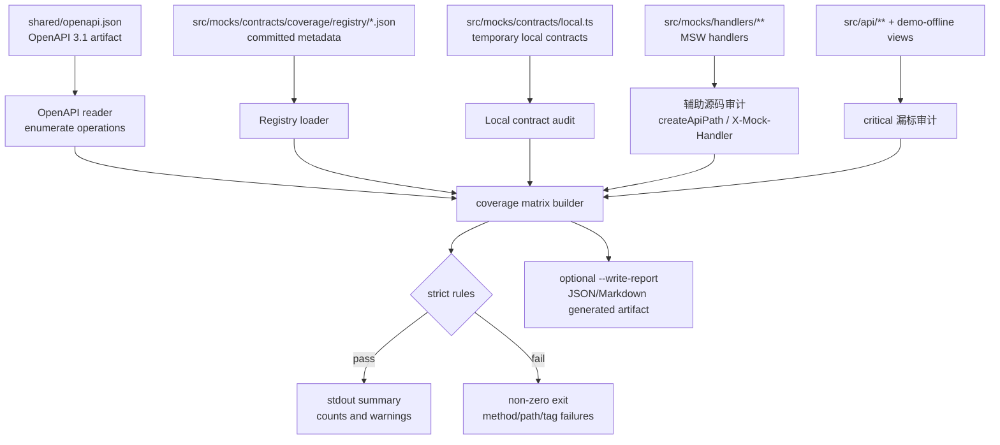
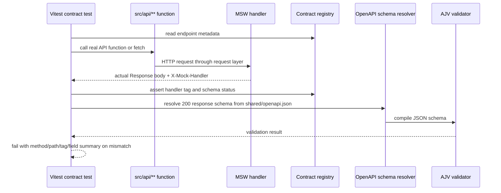

# Mock 契约覆盖与 Schema 门禁技术设计

## 架构概述

本设计在现有 `src/mocks/**` 主线旁新增一个 contract governance layer。它不替换 MSW handler、不改变 Dexie store、不改变 demo-offline runtime mode，而是把 `shared/openapi.json`、显式 registry、覆盖检查脚本和 schema validation 测试串成一条可执行门禁。

目标态分为两条链路：

1. 快速覆盖矩阵门禁：
   - 读取 `shared/openapi.json` 中全部 HTTP operations。
   - 读取已提交的 contract registry/metadata。
   - 校验每个 operation 只有一个分类：`mock-handled`、`real-only`、`unsupported-501`、`legacy-local-contract` 或 `missing`。
   - 校验 critical、missing 债务、handler tag、测试文件、schema 状态和 local contract 迁移说明。
   - 生成稳定 stdout 摘要和可选机器报告；默认不提交完整 coverage report 文件。

2. 核心 schema validation 测试：
   - 通过真实 `src/api/**` API function、`fetch` 或 request 兼容层触发 MSW handler。
   - 读取实际 response body 与 debug headers。
   - 用 `shared/openapi.json` 派生的 response schema 和 AJV 执行 runtime validation。
   - 对 OpenAPI `{}`、unknown、binary response 和本地临时契约输出明确 schema 状态，不把例外计入 OpenAPI schema coverage。

设计原则：

- `shared/openapi.json` 仍是唯一 API 契约 artifact；不从运行中后端拉取作为门禁事实源。
- registry/metadata 是 coverage matrix 的事实源；源码扫描只做辅助审计。
- `critical` 标记由 registry 显式维护；`src/api/**`、demo-offline 页面入口和后续 E2E 只用于发现漏标。
- P0 schema validator 优先直接解析 `shared/openapi.json`，不改 `api:generate` 主链路。
- 完整 coverage report 只由命令生成；仓库只提交 registry/metadata、脚本、测试和文档。
- 快速 coverage check 应在正常本地仓库状态下 10 秒内完成；schema-heavy 响应校验放在 targeted Vitest suite。

## 数据流图





## 组件与接口定义

### Contract registry

目标路径：

```text
ruoyi-fastapi-frontend/src/mocks/contracts/coverage/
  registry.schema.json
  registry/
    auth.json
    system.json
    project.json
    simulation.json
    monitor.json
    real-only.json
  types.ts
  index.ts
```

registry 使用 JSON 分域提交，原因是 Node 快速门禁可以直接读取，不需要 Vite、ts-node 或 TS 编译链路。`types.ts` 和 `index.ts` 只为 Vitest、编辑器和后续开发提供类型辅助。

核心 entry 结构：

```ts
type ContractCoverageStatus =
  | 'mock-handled'
  | 'real-only'
  | 'unsupported-501'
  | 'legacy-local-contract'
  | 'missing';

type ContractSchemaStatus =
  | 'openapi-validated'
  | 'schema-unavailable'
  | 'binary-response'
  | 'local-schema-validated'
  | 'not-applicable';

interface ContractRegistryEntry {
  method: 'GET' | 'POST' | 'PUT' | 'DELETE' | 'PATCH' | 'OPTIONS' | 'HEAD';
  openapiPath: string;
  mswPath?: string;
  handlerTag?: string;
  owner: string;
  status: ContractCoverageStatus;
  critical: boolean;
  schemaStatus: ContractSchemaStatus;
  tests: string[];
  persistence?: 'dexie' | 'readonly' | 'unsupported-501' | 'real-only' | 'none';
  localContract?: string;
  reason?: string;
  migrationTarget?: string;
}
```

约束：

- 每个 OpenAPI operation 必须有且只有一个 registry entry。
- `mock-handled` 必须有 `mswPath`、`handlerTag`、`tests` 和 schema 状态。
- `unsupported-501` 必须有 `mswPath`、`handlerTag`、`reason` 和测试证据。
- `real-only` 不得用于 critical endpoint，且必须有 `reason`。
- `legacy-local-contract` 必须有 `localContract`、`reason` 和 `migrationTarget`。
- `missing` 若为 critical 必须失败；若为 non-critical，则必须有 `owner`、`reason`、`migrationTarget` 才能作为受控债务通过。
- `critical` 事实源只来自 registry；辅助审计只能提示漏标，不能自动改写 critical。

### Coverage check CLI

目标文件：

```text
ruoyi-fastapi-frontend/scripts/check-mock-contracts.mjs
```

目标 package scripts：

```json
{
  "mock:contracts": "node scripts/check-mock-contracts.mjs --strict",
  "mock:contracts:report": "node scripts/check-mock-contracts.mjs --strict --format=markdown",
  "mock:contracts:json": "node scripts/check-mock-contracts.mjs --strict --format=json"
}
```

CLI 职责：

- 读取 `../shared/openapi.json`，枚举 HTTP methods，计算 artifact fingerprint。
- 读取 `src/mocks/contracts/coverage/registry/**/*.json`。
- 校验 registry schema、重复 method/path、重复 handler tag、孤儿 entry、未分类 operation。
- 规范化 path：
  - OpenAPI path 使用 `/project/{project_id}`。
  - MSW path 使用 `/api/project/:projectId` 或 `*<apiPrefix>/project/:projectId`。
  - path 参数名允许不同，但动态段数量和位置必须匹配。
- 运行 local contract audit：
  - registry 中的 `localContract` 必须能在 `src/mocks/contracts/local.ts` 找到。
  - `legacy-local-contract` 必须有迁移目标。
- 运行 critical 辅助审计：
  - 扫描 `src/api/**` 和 demo-offline 页面入口中对 API wrapper 的引用。
  - 发现新增调用但 registry 未评估 critical 时输出 warning 或 strict failure，具体按影响范围判定。
- 输出稳定摘要：
  - 总 operations、各分类数量、critical 数、critical 缺口数、schema coverage 数、local contract 数。
  - failure list 使用相对路径、method、OpenAPI path、handler tag。
- 支持显式参数写报告：
  - `--format=json|markdown|summary`
  - `--write-report <path>`
  - 默认只输出到 stdout，不要求提交完整报告文件。

失败规则：

| 条件 | strict 结果 |
| --- | --- |
| OpenAPI operation 没有 registry entry | fail |
| registry entry 不匹配 OpenAPI method/path | fail |
| critical endpoint 是 `missing` 或 `real-only` | fail |
| non-critical `missing` 缺少 owner/reason/migrationTarget | fail |
| `mock-handled` 缺少 handlerTag、tests 或 schemaStatus | fail |
| handlerTag 重复 | fail |
| tests 文件不存在 | fail |
| `legacy-local-contract` 缺少 localContract 或 migrationTarget | fail |
| optional report 包含绝对临时路径或时间戳 | fail |

性能：

- `mock:contracts` 不启动 Vite、不启动 Vitest、不构建前端。
- 只读 JSON、OpenAPI、registry 和少量源码审计。
- 正常本地仓库状态下目标耗时小于 10 秒。

### OpenAPI schema resolver

目标文件：

```text
ruoyi-fastapi-frontend/tests/mocks/contracts/openapi-schema-validator.ts
```

职责：

- 读取 `../shared/openapi.json`。
- 根据 method + OpenAPI path + status code 解析 response schema。
- 支持 `$ref` 指向 `#/components/schemas/*`。
- 使用 AJV 进行 runtime validation。实现时应把 AJV 作为显式 devDependency，避免依赖 transitive package。
- 对以下情况返回跳过原因，而不是假装通过：
  - schema `{}` 或缺失。
  - `application/octet-stream`、文件下载或 Blob。
  - registry 标记 `schema-unavailable`、`binary-response` 或 `not-applicable`。
  - `legacy-local-contract` 使用本地 adapter schema。

建议接口：

```ts
interface ValidateOpenApiResponseOptions {
  method: string;
  openapiPath: string;
  status?: number;
  body: unknown;
}

interface ValidationResult {
  ok: boolean;
  skipped?: boolean;
  reason?: string;
  errors?: Array<{
    path: string;
    message: string;
    keyword: string;
  }>;
}

export function validateOpenApiResponse(
  options: ValidateOpenApiResponseOptions
): ValidationResult;
```

### Schema contract tests

目标文件：

```text
ruoyi-fastapi-frontend/src/mocks/contracts/coverage.test.ts
ruoyi-fastapi-frontend/src/mocks/handlers/api-contract-schema.test.ts
```

`coverage.test.ts` 覆盖 registry 结构、路径规范化、critical 分类和 local contract 引用。它与 CLI 共享轻量纯函数，避免脚本和测试实现分叉。

`api-contract-schema.test.ts` 不直接 mock `@/utils/request`，而是复用已有做法：

- 初始化 `MockDemoDb` 和 `createMockDataSource()`。
- 通过 `mockServer.use(...createMockHandlers({ strategy: 'pure', dataSource }))` 注册当前主线 handlers。
- 调用真实 `src/api/**` API function 或 `fetch`。
- 断言 `X-Mock-Handler` 与 registry 一致。
- 对 registry 中 `schemaStatus = 'openapi-validated'` 的核心 endpoint 执行 AJV validation。

首批 schema validation 范围：

- auth：`/captchaImage`、`/login`、`/getInfo`、`/auth/logout`、`/auth/csrf-token`、`/auth/refresh`。
- system：`/getRouters`、dict、role、dept、menu、config 中已被 demo-offline 主链路或现有 tests 覆盖的接口。
- project：project list/detail/create/update/delete/export、version list/clone/lock/unlock、topology get/save。
- simulation read model：status/messages/bandwidth/alarms/events/strategies；response schema 为 `{}` 的 operation 必须标记 `schema-unavailable`。

### Handler tag 对齐

当前 `withBackendFallback()` 已在 mock response 上设置 `X-Mock-Handler`。本设计不要求重写所有 handler，但新增以下约束：

- registry 中的 `handlerTag` 必须与实际响应 header 一致。
- 文件下载 handler 也必须设置 `X-Mock-Handler`。
- `unsupported-501` handler 必须使用稳定 tag，不能全部混用 `unhandled-api`，除非它确实是 demo-offline 缺口 fallback。
- 后续可引入 `assertKnownMockHandlerTag(tag)` 或 `markMockResponse(..., tag)` 的 typed helper，但 P0 不强制改造所有 handler 生成方式。

### CI 集成

GitLab `frontend-quality-gates` 目标顺序：

```text
yarn api:generate
generated client drift check
yarn lint:check
yarn type-check
yarn type-check:strict
bash scripts/check-mock-standards.sh
bash ../scripts/check-mock-mainline.sh
yarn test:run src/mocks/runtime src/mocks/contracts src/mocks/handlers/api-contract-schema.test.ts
yarn mock:contracts
yarn test:run
yarn build:prod
yarn build:demo-offline
bash ../scripts/check-mock-mainline.sh --require-dist
```

GitHub manual workflow 需要增加同等的 `yarn mock:contracts` 和 targeted schema test，避免辅助 workflow 口径落后于 GitLab。

## API 接口设计

本规格不新增后端 HTTP API，不修改现有业务接口路径，不改变 `src/api/**` 调用层返回语义。

新增的是内部 CLI、registry 数据接口和测试 helper。

### CLI 接口

```bash
cd ruoyi-fastapi-frontend
yarn mock:contracts
yarn mock:contracts:report
yarn mock:contracts:json
node scripts/check-mock-contracts.mjs --strict --format=json --write-report tests/reports/mock-contract-coverage.json
```

CLI 退出码：

| 退出码 | 含义 |
| --- | --- |
| `0` | 覆盖矩阵、metadata 和 schema 状态通过 strict rules。 |
| `1` | 发现覆盖缺口、metadata 不一致、critical 失败、测试文件缺失或 schema 状态违规。 |
| `2` | 参数错误、OpenAPI artifact 缺失、registry JSON 无法解析或依赖缺失。 |

### Registry data contract

registry JSON 必须只包含相对路径、method/path/tag/status/schema metadata，不得包含真实 token、真实账号凭据、环境变量值、内部连接字符串或 provider 配置。

报告中的 endpoint key 格式：

```text
<METHOD> <OPENAPI_PATH>
```

示例：

```json
{
  "method": "GET",
  "openapiPath": "/project/list",
  "mswPath": "/api/project/list",
  "handlerTag": "project:list",
  "owner": "project",
  "status": "mock-handled",
  "critical": true,
  "schemaStatus": "openapi-validated",
  "tests": ["src/mocks/handlers/api-contract-schema.test.ts"],
  "persistence": "dexie"
}
```

### Report contract

机器报告结构：

```ts
interface MockContractCoverageReport {
  artifact: {
    path: 'shared/openapi.json';
    openapi: string;
    fingerprint: string;
    operationCount: number;
  };
  summary: {
    byStatus: Record<string, number>;
    criticalTotal: number;
    criticalFailures: number;
    schemaValidated: number;
    schemaUnavailable: number;
    localContracts: number;
  };
  entries: ContractRegistryEntry[];
  failures: Array<{
    code: string;
    method?: string;
    openapiPath?: string;
    handlerTag?: string;
    message: string;
  }>;
  warnings: Array<{
    code: string;
    message: string;
  }>;
}
```

`--write-report` 写出的报告是生成产物，不作为默认提交基线。默认门禁只依赖 registry/metadata。

## 数据模型与数据库变更

本规格不涉及后端数据库，也不改变 Dexie mock store schema。

新增数据模型仅限仓库内静态 contract metadata：

- `coverage/registry/**/*.json`：已提交的 endpoint classification metadata。
- `registry.schema.json`：registry JSON 的结构约束。
- 可选 generated report：通过显式 `--write-report` 写入 `tests/reports/**` 或调用者指定路径，不纳入默认提交要求。

数据一致性规则：

- `openapiPath` 必须来自 `shared/openapi.json`。
- `method + openapiPath` 是唯一键。
- `handlerTag` 在所有 `mock-handled` 和 `unsupported-501` endpoint 中唯一。
- `tests` 使用仓库相对路径。
- `critical` 不从页面扫描自动生成，避免隐式状态漂移。
- non-critical `missing` 是显式技术债，必须带 owner、reason、migrationTarget。

## 安全考量

- CLI 和报告只输出 endpoint metadata、schema 状态和失败定位，不输出请求 body、token、真实账号凭据或环境变量值。
- OpenAPI artifact、registry 和报告扫描不得引入 provider、API key 或 MCP 旧配置。
- schema validation 在测试环境运行，不在生产 bundle 或普通 `real` runtime 中启动。
- 不能通过覆盖报告把内部绝对路径、CI 临时路径或本机用户名写入可提交文件。
- `real-only` 分类不能用于 demo-offline critical endpoint，避免离线演示意外依赖真实后端。
- `legacy-local-contract` 必须有迁移目标，防止本地契约长期绕开 OpenAPI 事实源。

## 测试策略

### 快速门禁测试

- 为 `scripts/check-mock-contracts.mjs` 的核心纯函数建立单元测试，覆盖 OpenAPI operation 枚举、path 规范化、registry join、duplicate detection、critical failure 和 missing debt。
- 使用小型 fixture 覆盖失败场景，不需要在每个测试中加载完整 244 operations。
- `yarn mock:contracts` 在真实仓库数据上运行，目标 10 秒内完成。

### Registry 与 local contract 测试

- `src/mocks/contracts/coverage.test.ts` 校验 registry JSON 符合 schema。
- 校验 `localContract` 能对应到 `src/mocks/contracts/local.ts` 中的声明。
- 校验所有 `tests` 文件存在。
- 校验 `schemaStatus` 与 status 组合合法，例如 `real-only` 不要求 OpenAPI validation，`mock-handled` 必须有明确 schema 状态。

### Handler tag 与真实请求链路测试

- 扩展现有 `src/mocks/handlers/api-contract.test.ts`，或新增 `api-contract-schema.test.ts`。
- 继续通过真实 API function 或 `fetch` 触发 MSW，不 mock `@/utils/request`。
- 对 critical `mock-handled` endpoint 断言 `X-Mock-Handler` 与 registry 一致。
- 对 `unsupported-501` endpoint 断言 HTTP 501、稳定 body 语义和 tag。

### Schema validation 测试

- 对 `schemaStatus = 'openapi-validated'` 的首批核心 endpoint 执行 AJV validation。
- 对 `schema-unavailable` endpoint 验证报告中有 reason。
- 对 binary response 验证分类为 `binary-response`，不把 Blob 误作 JSON schema。
- 对 `legacy-local-contract` 验证使用本地 adapter schema 时报告仍标记为 local contract。

### CI 验收命令

设计验收命令：

```bash
cd ruoyi-fastapi-frontend
yarn mock:contracts
yarn test:run src/mocks/contracts src/mocks/handlers/api-contract-schema.test.ts
yarn type-check:strict
```

完整回归沿用前端质量门禁：

```bash
cd ruoyi-fastapi-frontend
yarn lint:check
yarn type-check
yarn type-check:strict
yarn test:run
yarn build:prod
yarn build:demo-offline
cd ..
bash scripts/check-mock-mainline.sh --require-dist
```
