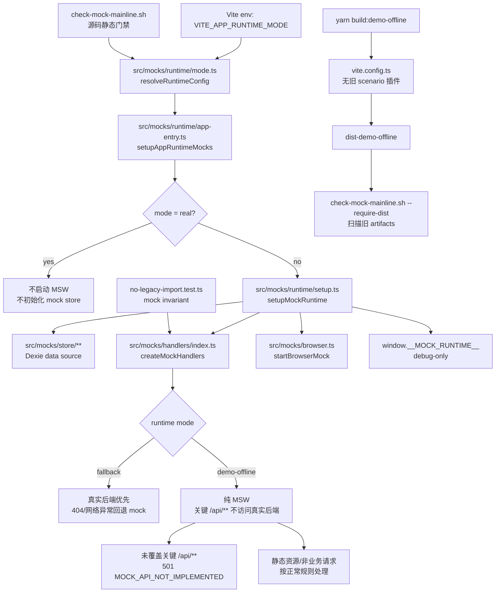

# Mock Runtime Legacy 退场技术设计

## 架构概述

本设计把 mock runtime 从旧 `src/demo/**` / scenario package / release pointer 双主线，硬切到 `src/mocks/**` 单主线。实施基线按“legacy 仍存在”处理，因此设计覆盖迁移、删除、替换和验证全过程；若某些步骤在当前仓库已经完成，实施任务仍以验证和补漏方式闭环。

目标态只有一条运行链路：

- `src/mocks/runtime/mode.ts` 负责解析 `real | fallback | demo-offline`，默认 `real`。
- `src/main.ts` 通过 `setupAppRuntimeMocks()` 启动运行态 mock；`real` 不启动 MSW，`fallback` 和 `demo-offline` 进入统一 mock runtime。
- `src/mocks/runtime/setup.ts` 统一初始化 data source、MSW handlers、缺口处理和 `__MOCK_RUNTIME__` debug API。
- `src/mocks/handlers/**` 作为唯一 handler 聚合入口；`fallback` 走真实后端优先，`demo-offline` 走纯 MSW。
- Vite demo-offline 构建不再注册旧 contract/scenario 插件，不再产出 `demo-contract/` 或 `demo-scenarios/`。
- `scripts/check-mock-mainline.sh` 与 mock invariant 测试持续阻止旧路径、旧环境变量、旧类型和旧构建产物回流。

设计原则：

- 硬删除旧源码、旧插件、旧 runbook；不把旧源码移动到 `archive/**` 或 `docs/archive/**`。
- 保留不依赖旧 runtime/scenario 的 demo-offline UI 页面壳，例如 `src/views/demo/**` 占位页。
- 不引入 Microcks、WireMock 或新 MCP 平台；本阶段只收口现有 MSW + typed dataset + Dexie store 主线。
- 不改变业务 API、后端 OpenAPI artifact、当前 Dexie mock store schema 或业务 dataset 结构。

## 数据流图



## 组件与接口定义

### Runtime mode 模块

目标文件：`ruoyi-fastapi-frontend/src/mocks/runtime/mode.ts`

职责：

- 定义 `RuntimeMode = 'real' | 'fallback' | 'demo-offline'`。
- 定义 `MockRuntimeMode = 'fallback' | 'demo-offline'`。
- 提供 `resolveRuntimeConfig(env)`，只读取当前环境变量：
  - `VITE_APP_RUNTIME_MODE`
  - `VITE_APP_BASE_API`
  - `VITE_DEMO_RUNTIME_DEBUG`
- 提供 `normalizeRuntimeMode()`，非法值 fail fast。
- 提供 `isMockRuntimeMode()`、`isDemoOfflineMode()`、`strategyForRuntimeMode()`。

迁移要求：

- 从旧 `src/demo/runtime/mode.ts` 迁出必要的通用能力，但不得迁入 `scenarioId`、`allowCandidateScenarios`、`mockMode` 或旧环境变量兼容逻辑。
- 所有应用运行面引用必须改为 `@/mocks/runtime/mode` 或相对当前 mock runtime 路径。
- 删除旧 `src/demo/runtime/mode.ts` 所在源码树，不保留源码归档。

### App runtime 入口

目标文件：`ruoyi-fastapi-frontend/src/mocks/runtime/app-entry.ts`

职责：

- 对 `real` 直接返回，不加载 `setup.ts`，避免生产或默认开发模式启动 MSW。
- 对 `fallback` 和 `demo-offline` 动态加载 `setupMockRuntime()`，降低 `real` 模式无关代码耦合。
- 每次启动前清理旧 `__DEMO_RUNTIME__` 和当前 `__MOCK_RUNTIME__`，避免热更新或测试残留影响判断。

当前全局 debug API 只允许 `__MOCK_RUNTIME__`。旧 `__DEMO_RUNTIME__` 只能作为清理目标出现，不得作为公开 API、测试入口或文档入口继续存在。

### Mock runtime setup

目标文件：`ruoyi-fastapi-frontend/src/mocks/runtime/setup.ts`

职责：

- 按 runtime mode 映射 MSW strategy：
  - `fallback` -> `fallback`
  - `demo-offline` -> `pure`
- 初始化 `src/mocks/store/**` data source。
- 使用 `createMockHandlers({ strategy, dataSource, apiPrefix, onMissingCapability })` 获取统一 handlers。
- `demo-offline` 设置 `onMissingCapability: 'error'`，`fallback` 设置 `passthrough`。
- debug 且处于 demo-offline 或测试环境时暴露 `__MOCK_RUNTIME__`，只提供 mode、datasetVersion、resetDataset、exportDatasetSnapshot。

### Handler 聚合与未覆盖 API

目标文件：

- `ruoyi-fastapi-frontend/src/mocks/handlers/index.ts`
- `ruoyi-fastapi-frontend/src/mocks/runtime/unhandled.ts`

职责：

- `createMockHandlers()` 聚合 system、user、project、simulation、test、monitor 等当前主线 handler。
- `createUnhandledApiHandler(apiPrefix)` 只匹配 `apiPrefix` 下的业务 API。
- `demo-offline` 未覆盖关键 `/api/**` 返回：
  - HTTP status: `501`
  - body code: `501`
  - body msg: `MOCK_API_NOT_IMPLEMENTED: <METHOD> <PATH> ...`
  - headers: `X-Mock-Response: true`、`X-Mock-Handler: unhandled-api`
- 静态资源、Vite 开发资源、非业务请求不得被该缺口 handler 强制转换为 501。

### 应用引用面

需要迁移或验证的引用面：

- `src/main.ts`：从当前 runtime mode 读取配置，通过 `setupAppRuntimeMocks()` 启动 mock。
- `src/mocks/index.ts`：从当前 runtime mode 推导 browser mock strategy。
- `src/mocks/runtime/app-entry.ts`：只依赖当前 runtime setup。
- `src/router/history.ts`、`src/views/project/topo.vue`、`src/views/monitor/druid/index.vue` 等 demo-offline 特例：只从当前 runtime mode 判断模式。

禁止引用：

- `@/demo/**`
- `src/demo/**`
- `DemoScenarioPackage`
- `ScenarioRepository`
- `release-store`
- `generatedScenarioRegistry`
- `candidateScenarioRegistry`
- `activeGeneratedScenarioId`
- `tools/demo-offline-mcp`
- 旧 scenario 构建产物名和旧环境变量。

### Vite 构建面

目标文件：

- `ruoyi-fastapi-frontend/vite.config.ts`
- `ruoyi-fastapi-frontend/vite/plugins/**`
- `ruoyi-fastapi-frontend/package.json`

职责：

- `build:demo-offline` 继续输出到 `dist-demo-offline`，使用相对 base。
- 删除旧 demo-offline contract plugin；`createVitePlugins()` 不得注册旧 scenario/contract 插件。
- `dev:fallback` 只设置 `VITE_APP_RUNTIME_MODE=fallback`，不得设置旧 mock 环境变量。
- demo-offline 构建产物不得包含 `demo-contract/`、`demo-scenarios/` 或 release pointer 资产。

### 静态门禁

目标文件：

- `scripts/check-mock-mainline.sh`
- `ruoyi-fastapi-frontend/src/mocks/invariants/no-legacy-import.test.ts`

职责：

- 如果 `ruoyi-fastapi-frontend/src/demo` 存在，直接失败。
- 扫描当前运行面：`src`、`tests`、`vite`、`vite.config.ts`、`package.json`。
- 允许 legacy 字符串只出现在门禁测试、历史 spec 或明确历史说明中；不得出现在当前运行链路。
- `--require-dist` 要求 `dist-demo-offline/index.html` 存在，并扫描旧 scenario artifacts 和敏感 provider 配置。

## API 接口设计

本规格不新增后端 API，不修改 FastAPI OpenAPI artifact，也不改变现有业务请求路径。

### 环境变量接口

| 变量 | 允许值 | 默认值 | 说明 |
| --- | --- | --- | --- |
| `VITE_APP_RUNTIME_MODE` | `real`、`fallback`、`demo-offline` | `real` | 唯一运行模式开关 |
| `VITE_APP_BASE_API` | API 前缀字符串 | `/api` | 归一化为前导 slash、无尾 slash |
| `VITE_DEMO_RUNTIME_DEBUG` | `1/true/yes/on` 等布尔真值 | `false` | 仅控制当前 mock runtime debug API |

旧变量 `VITE_ENABLE_MOCK`、`VITE_DEMO_SCENARIO_ID`、`VITE_DEMO_ALLOW_CANDIDATE_SCENARIOS` 不再是接口；任何重新接入当前运行模式的改动都应被门禁拒绝。

### Browser debug API

```ts
interface MockRuntimeDevtools {
  getMode(): 'fallback' | 'demo-offline'
  getDatasetVersion(): string
  resetDataset(): Promise<void>
  exportDatasetSnapshot(): Promise<unknown>
}
```

约束：

- 仅通过 `window.__MOCK_RUNTIME__` 暴露。
- `real` 模式不得暴露。
- 旧 `window.__DEMO_RUNTIME__` 不得作为接口继续使用。

### 未覆盖 API 响应

`demo-offline` 模式下，未覆盖的关键 `/api/**` 请求返回统一 JSON：

```json
{
  "code": 501,
  "msg": "MOCK_API_NOT_IMPLEMENTED: <METHOD> <PATH> 尚未在单套 mock 主线中实现",
  "data": null
}
```

HTTP 状态码必须为 `501`。响应必须带 `X-Mock-Response: true` 和 `X-Mock-Handler: unhandled-api`，方便测试和后续 E2E 定位。

## 数据模型与数据库变更

本规格不引入新的业务数据模型，也不修改当前 `src/mocks/data/**` typed dataset 的实体结构。

浏览器本地持久化边界：

- 保留当前 `src/mocks/store/**` Dexie mock store。
- 不复用旧 `DemoScenarioPackage`、`ScenarioRepository`、active/candidate/promote 数据模型。
- 不要求迁移旧 demo IndexedDB 或旧 scenario package 本地数据。
- 如果旧 demo runtime 曾写入其他 IndexedDB 数据库，本规格只要求当前应用不再读取或写入它们；不执行破坏性客户端清理。

构建产物数据边界：

- `dist-demo-offline` 只包含当前应用静态资产、MSW worker、typed dataset/store 所需代码。
- 不生成、不复制、不引用旧 `demo-contract/`、`demo-scenarios/` 或 release pointer 资产。

## 安全考量

- `real` 模式默认不启动 MSW，避免生产或普通开发环境被 mock runtime 影响。
- `demo-offline` 不应访问真实后端补齐关键 `/api/**`，避免离线演示泄漏真实环境依赖。
- `dist-demo-offline` 必须扫描旧 MCP、AI provider、API key 或 provider 配置标识，防止历史工具链配置进入静态包。
- `__MOCK_RUNTIME__` 仅暴露有限 debug 能力，不暴露旧 scenario、candidate/promote、release pointer 或任意 provider 配置。
- 静态门禁应打印具体命中位置，但不得输出任何真实密钥值；扫描模式只用于发现敏感标识。

## 测试策略

### 单元测试

- `src/mocks/runtime/mode.test.ts` 覆盖默认 `real`、合法模式归一化、非法模式 fail fast、strategy 映射。
- `src/mocks/runtime/app-entry.test.ts` 覆盖 `real` 不启动 mock、清理 `__DEMO_RUNTIME__`、`fallback`/`demo-offline` 统一启动。
- `src/mocks/runtime/setup.test.ts` 覆盖 fallback strategy、demo-offline debug API。
- `src/mocks/runtime/unhandled.test.ts` 覆盖关键 `/api/**` 501 响应和非业务请求例外。
- `tests/unit/router/history.test.ts` 覆盖 demo-offline 使用 hash history，且模式来源为当前 runtime mode。

### 静态与 invariant 测试

- `src/mocks/invariants/no-legacy-import.test.ts` 断言 `src/demo` 不存在，并扫描当前 mock 源码无 legacy import。
- `scripts/check-mock-mainline.sh` 扫描当前运行面，发现旧路径、旧 env、旧类型、旧 plugin、旧 artifacts 名称即失败。
- `scripts/check-mock-mainline.sh --require-dist` 在 demo-offline 构建后扫描 dist 产物。

### 构建与回归命令

最小设计验收命令：

```bash
cd ruoyi-fastapi-frontend
yarn lint:check
yarn type-check
yarn test:run src/mocks
yarn build:prod
yarn build:demo-offline

cd ..
scripts/check-mock-mainline.sh
scripts/check-mock-mainline.sh --require-dist
```

补充搜索验收：

```bash
rg -n "@/demo|src/demo|VITE_ENABLE_MOCK|VITE_DEMO_SCENARIO_ID|VITE_DEMO_ALLOW_CANDIDATE_SCENARIOS|demo-offline-contract|demo-contract|demo-scenarios|DemoScenarioPackage|ScenarioRepository|release-store" \
  ruoyi-fastapi-frontend/src \
  ruoyi-fastapi-frontend/tests \
  ruoyi-fastapi-frontend/vite \
  ruoyi-fastapi-frontend/vite.config.ts \
  ruoyi-fastapi-frontend/package.json \
  --glob '!**/no-legacy-import.test.ts' \
  --glob '!tests/reports/**'
```

该搜索在当前运行面应无命中；专门门禁测试、历史 specs 和 git history 不属于失败范围。

## 需求追溯

| 需求 | 设计覆盖 |
| --- | --- |
| R1 | Runtime mode 模块、App runtime 入口、环境变量接口、单元测试 |
| R2 | 旧 runtime 硬删除策略、应用引用面、静态门禁、页面壳边界 |
| R3 | Vite 构建面、构建产物数据边界、dist 扫描 |
| R4 | Mock runtime setup、Handler 聚合、未覆盖 API 响应、测试策略 |
| R5 | 静态门禁、invariant 测试、补充搜索验收 |
| R6 | 文档边界、runbook 删除策略、README/spec 索引更新要求 |
| R7 | 单元测试、构建与回归命令、验收命令缺口报告 |
