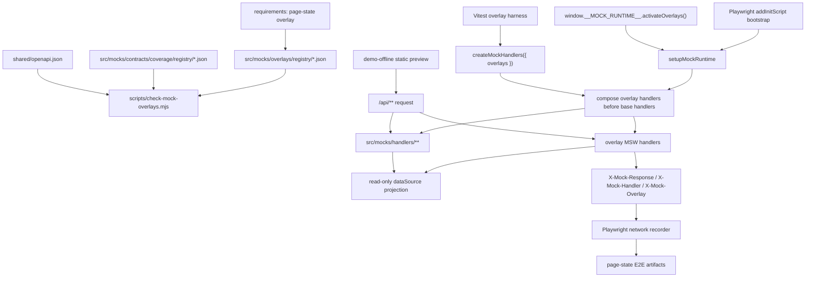

# Mock Scenario Overlay 与页面状态 Harness 技术设计

## 架构概述

本设计在当前 `src/mocks/**` 主线旁增加一个受控 overlay 层。默认 `createMockHandlers()`、`setupMockRuntime()`、contract schema tests 和 `yarn e2e:demo-offline` 成功链路保持不变；只有 Vitest harness、Playwright test bootstrap 或 demo-offline debug/test 模式显式激活 overlay 时，overlay handlers 才会叠加到基础 handlers 前面。

现有事实：

- `ruoyi-fastapi-frontend/src/mocks/runtime/setup.ts` 统一创建 data source、handlers、MSW worker，并只在 demo-offline/debug 或 test 模式暴露 `window.__MOCK_RUNTIME__`。
- `ruoyi-fastapi-frontend/src/mocks/handlers/index.ts` 是当前 MSW handler 聚合入口，所有业务域 handler 都从这里进入。
- `ruoyi-fastapi-frontend/src/mocks/handlers/error-common.ts` 已提供 429、5xx、timeout 等共享错误响应能力。
- `ruoyi-fastapi-frontend/tests/e2e/demo-offline/network.ts` 已记录 `/api/**` 响应，并可读取 contract registry 判断 critical API 覆盖。
- `ruoyi-fastapi-frontend/scripts/run-demo-offline-e2e.mjs` 已封装 build、preview、Playwright 执行和清理流程。

新增组件分四层：

| 层级 | 新增位置 | 职责 |
| --- | --- | --- |
| Overlay registry | `src/mocks/overlays/registry/**` | 声明 overlay id、目标 endpoint、状态类型、Core matrix、测试证据和可组合性。 |
| Runtime overlay engine | `src/mocks/overlays/runtime.ts`、`handlers.ts` | 校验激活请求、组合 overlay、生成前置 MSW handlers、提供只读投影上下文。 |
| Test harness | `tests/mocks/overlays.ts`、`tests/e2e/demo-offline/page-state/**` | Vitest 与 Playwright 的激活、复位、诊断和断言封装。 |
| Gate/CLI | `scripts/check-mock-overlays.mjs`、`scripts/mock-overlays-core.mjs` | 校验 registry 与 contract coverage 对齐，执行 Core matrix fail/warning 规则。 |

核心约束：

- overlay 只做 read-only projection：可读取当前 data source 生成投影、过滤或替代响应，不写 Dexie，不改 seed。
- overlay 激活默认关闭；`real` 模式不读取、不初始化、不应用 overlay。
- 首屏前 overlay 只能通过测试 bootstrap 注入；页面加载后只能通过当前 `window.__MOCK_RUNTIME__` 的受限 API 激活/复位。
- 多 overlay 只允许 registry 声明的兼容组合；冲突激活整体 fail fast，保持原状态不变。
- page-state E2E 使用独立 `yarn e2e:demo-offline:page-state`，复用现有 build/preview runner，不并入默认成功链路 E2E。

## 数据流图



## 组件与接口定义

### Overlay Registry

新增目录：

```text
ruoyi-fastapi-frontend/src/mocks/overlays/
  index.ts
  types.ts
  registry.schema.json
  registry/
    project.json
    version.json
    topology.json
    simulation.json
  runtime.ts
  handlers.ts
  response.ts
```

`registry/*.json` 是提交到仓库的事实源，按业务域拆分。每个 overlay 必须映射到 contract registry 中的 endpoint，或明确绑定 `unhandled-api` 501 探测例外。

建议类型：

```ts
export type MockOverlayStateType =
  | 'empty'
  | 'latency'
  | 'problem'
  | 'forbidden'
  | 'timeout'
  | 'unsupported'
  | 'readonly';

export interface MockOverlayRegistryEntry {
  id: string;
  name: string;
  stateType: MockOverlayStateType;
  target: {
    method: MockHttpMethod;
    openapiPath: string;
    mswPath: string;
    handlerTag: string;
  };
  pages: string[];
  owner: string;
  tests: string[];
  coreMatrix: boolean;
  e2eEnabled: boolean;
  resetStrategy: 'overlay-only';
  composition: {
    compatibleWith?: string[];
    conflictsWith?: string[];
  };
  response?: {
    status?: number;
    delayMs?: number;
    reason?: string;
    projection?: 'empty-page' | 'empty-list' | 'readonly-view';
  };
}
```

首批 Core matrix overlays：

| 页面 | 必须状态 | 示例目标 handler |
| --- | --- | --- |
| 项目列表 | 空态、写入错误 | `project:list`、`project:create` 或 `project:update` |
| 版本列表 | 空态或错误 | `project:version:list`、`project:version:clone` |
| 拓扑 | 加载或保存错误 | `project:topology:get`、`project:topology:save` |
| simulation | 只读或 unsupported 控制状态 | `simulation:*`、已有 `unsupported-501` handler |

### Runtime Overlay Engine

`createMockHandlers()` 增加可选 overlay 参数，但默认调用行为不变：

```ts
export interface CreateMockHandlersOptions {
  strategy: MockNetworkStrategy;
  dataSource?: MockDataSource;
  apiPrefix?: string;
  onMissingCapability?: 'error' | 'passthrough';
  overlays?: MockOverlayActivationInput;
}
```

组合策略：

1. 加载并校验 overlay ids。
2. 检查 runtime mode 是否允许 overlay。
3. 检查同 endpoint、同 handler tag、同状态语义冲突。
4. 只对 registry 声明兼容的 overlay 生成组合 handlers。
5. 将 overlay handlers 放在基础业务 handlers 前面。

激活失败必须整体拒绝，不更新当前 active state。

Read-only projection 通过只读 wrapper 实现。Overlay resolver 只能拿到读取接口和不可变 seed 快照，不暴露 repository 写方法；需要写操作失败时返回 problem/501，而不是写 Dexie 后再 reset。

### Runtime Devtools API

扩展现有 `window.__MOCK_RUNTIME__`，不新增旧 `__DEMO_RUNTIME__` 或旧 scenario 全局入口：

```ts
export interface MockRuntimeDevtools {
  getMode(): MockRuntimeMode;
  getDatasetVersion(): string;
  resetDataset(): Promise<void>;
  exportDatasetSnapshot(): Promise<unknown>;
  listOverlays(): MockOverlayRegistrySummary[];
  getOverlayState(): MockOverlayState;
  activateOverlays(ids: string[]): Promise<MockOverlayState>;
  resetOverlays(): Promise<MockOverlayState>;
}
```

浏览器首屏前注入使用测试专用 bootstrap：

```ts
declare global {
  interface Window {
    __MOCK_RUNTIME_BOOTSTRAP__?: {
      source: 'playwright' | 'vitest';
      overlays?: string[];
    };
  }
}
```

`setupMockRuntime()` 只在 demo-offline debug/test 下读取该 bootstrap，并在初始化后删除 bootstrap 对象。普通 URL query、普通环境变量和客户可见 UI 都不得激活 overlay。

当页面加载后调用 `activateOverlays()` 或 `resetOverlays()` 时，runtime 重新生成 overlay + base handlers，并调用当前 MSW worker 的 `resetHandlers(...)`。Vitest Node 环境由测试 harness 调用 `mockServer.use(...)` 或 `mockServer.resetHandlers(...)` 完成同等动作。

### Playwright Harness

新增：

```text
ruoyi-fastapi-frontend/playwright.demo-offline-page-state.config.ts
ruoyi-fastapi-frontend/tests/e2e/demo-offline/page-state/
  fixtures.ts
  specs/
    project-page-state.spec.ts
    version-topology-page-state.spec.ts
    simulation-page-state.spec.ts
```

`playwright.demo-offline-page-state.config.ts` 复用现有 Chromium、单 worker、trace/screenshot/video 策略，但使用独立 `testDir` 与报告目录：

- `tests/e2e/demo-offline/page-state`
- `tests/reports/demo-offline-page-state-e2e`
- `tests/reports/demo-offline-page-state-e2e-html`

`tests/e2e/demo-offline/runtime.ts` 增加 helper：

- `bootstrapOverlays(context, ids)`：通过 `context.addInitScript()` 在首屏前设置 bootstrap。
- `activateOverlays(page, ids)`：页面加载后调用 `window.__MOCK_RUNTIME__.activateOverlays(ids)`。
- `resetOverlays(page)`：清空 overlay，不 reset dataset。
- `expectOverlayState(page, ids)`：断言当前 active overlays。

`tests/e2e/demo-offline/network.ts` 增加 `overlay?: string` 字段，读取 `x-mock-overlay`，并提供：

- `waitForOverlayResponse(id)`
- `assertOverlayResponsesTagged()`
- `summary()` 输出 overlay id。

### Vitest/API Harness

新增 `tests/mocks/overlays.ts`：

```ts
export function setupOverlayMockHandlers(overlays: string[]): MainlineMockContext;
export function activateOverlayHandlers(overlays: string[], context: MainlineMockContext): void;
export function resetOverlayHandlers(context: MainlineMockContext): void;
```

它复用 `setupMainlineMockHandlers()` 的独立 `MockDemoDb` 和 `MockDataSource`，通过真实 API function 或 `@/utils/request` 进入 MSW。不得在测试文件内复制业务响应结构，也不得 mock `@/utils/request` 绕开 HTTP contract。

## API 接口设计

本规格不新增后端 API，不修改 FastAPI OpenAPI 事实源。

### 前端 Debug API

只扩展 demo-offline debug/test 下的 `window.__MOCK_RUNTIME__`。生产 `real` 模式不暴露 overlay API；普通 `fallback` 和默认 `demo-offline` 成功链路 overlay 默认关闭。

错误语义：

| 场景 | 行为 |
| --- | --- |
| overlay id 不存在 | `activateOverlays()` reject，错误包含 overlay id。 |
| mode 不允许 | reject，说明当前 mode 不支持 overlay。 |
| 组合冲突 | 整体 reject，并保留请求前 active state。 |
| registry 与 contract 漂移 | 本地 `mock:overlays` 失败，不允许进入验收。 |

### HTTP Response Headers

所有 overlay 响应必须包含：

```text
X-Mock-Response: true
X-Mock-Handler: <base handler tag or unsupported tag>
X-Mock-Overlay: <overlay id>
```

错误响应继续复用 `error-common` problem 结构。`unsupported` overlay 使用 HTTP 501，并区分：

- `X-Mock-Handler: unhandled-api`：主线缺口 fallback。
- `X-Mock-Handler: <registered unsupported handler>` + `X-Mock-Overlay`：显式 overlay 验收状态。

### CLI / Package Scripts

新增脚本：

```json
{
  "mock:overlays": "node scripts/check-mock-overlays.mjs --strict",
  "mock:overlays:report": "node scripts/check-mock-overlays.mjs --strict --format=markdown",
  "e2e:demo-offline:page-state": "node scripts/run-demo-offline-e2e.mjs --config=playwright.demo-offline-page-state.config.ts"
}
```

为复用现有 runner，`run-demo-offline-e2e.mjs` 增加参数：

- `--config <path>`：默认仍为 `playwright.demo-offline.config.ts`。
- `--suite-name <name>`：仅用于日志，例如 `page-state`。

默认 `yarn e2e:demo-offline` 不运行 page-state suite。

## 数据模型与数据库变更

本规格不新增后端表，不修改 Dexie schema，不修改 seed dataset 结构。

新增数据模型仅包括 JSON registry、TypeScript 类型和内存态：

```ts
export interface MockOverlayState {
  activeIds: string[];
  activeEntries: MockOverlayRegistryEntry[];
  source: 'none' | 'bootstrap' | 'runtime-api' | 'vitest';
}
```

Overlay reset 只清空 `MockOverlayState`，不调用 `resetDataset()`。业务数据回滚继续由现有 `window.__MOCK_RUNTIME__.resetDataset()` 或测试清理流程负责。

`check-mock-overlays.mjs` 数据来源：

- `src/mocks/overlays/registry/*.json`
- `src/mocks/overlays/registry.schema.json`
- `src/mocks/contracts/coverage/registry/*.json`
- `shared/openapi.json`
- overlay registry 中声明的 `tests` 文件路径

报告稳定排序：`coreMatrix desc`、`target.openapiPath`、`target.method`、`id`。

## 安全考量

- Overlay API 只在 demo-offline debug/test 下暴露，`real` 模式不初始化。
- Test bootstrap 只能由 Playwright/Vitest 注入，runtime 初始化后立即删除，避免成为客户可见开关。
- 不支持 URL query、普通环境变量或 UI 菜单激活 overlay，防止静态演示包被误切到异常态。
- Network artifact 只记录 method、path、status、handler tag、overlay id 和步骤，不输出 token、账号密码、cookie、真实后端地址或密钥。
- Overlay resolver 不暴露 Dexie 写接口；任何需要写失败的状态必须通过 response/problem 模拟。
- 静态门禁继续禁止 `VITE_DEMO_SCENARIO_ID`、candidate/promote、active pointer 和旧 demo runtime 标识回潮。

## 测试策略

### 单元与 Contract 检查

新增 targeted Vitest：

- `src/mocks/overlays/registry.test.ts`：校验 registry schema、id 唯一、目标 contract entry 存在、test 文件存在。
- `src/mocks/overlays/runtime.test.ts`：校验激活、reset、冲突组合整体失败、read-only projection 不写 data source。
- `src/mocks/overlays/handlers.test.ts`：校验 `X-Mock-Overlay`、`X-Mock-Handler`、problem/501/empty page 响应。
- `tests/unit/api/*` 或 `src/mocks/handlers/*` 增补 overlay API 路径测试，必须通过真实 API function 或 request path。

新增 CLI 检查：

```bash
cd ruoyi-fastapi-frontend
yarn mock:overlays
```

失败条件：

- overlay registry schema 不合法。
- overlay id 重复。
- 目标 handler tag、method/path 或 test 文件失效。
- Core matrix 缺失项目、版本、拓扑、simulation 代表状态覆盖。
- 冲突组合元数据自相矛盾。

Warning 条件：

- 非 Core matrix critical endpoint 暂无 overlay 覆盖。
- schema-unavailable 或 local contract endpoint 的 overlay 无法计入 OpenAPI schema-validated coverage。

### Playwright Page-State E2E

新增独立命令：

```bash
cd ruoyi-fastapi-frontend
yarn e2e:demo-offline:page-state
```

默认流程仍 build `dist-demo-offline`、启动静态 preview、运行 Chromium、清理 preview。可继续支持 `--skip-build`、`--base-url`、`--port` 等现有 runner 参数。

首批 E2E 覆盖：

1. 项目列表空态：首屏后激活或 bootstrap 激活空态 overlay，断言空态 UI、`X-Mock-Overlay` 和无真实后端请求。
2. 项目写入错误：激活 `project:create` 或 `project:update` problem overlay，断言错误提示、handler tag、overlay id。
3. 版本列表空态或错误：进入项目详情后验证版本区域状态。
4. 拓扑加载或保存错误：验证页面可观察错误态，不只断言请求失败。
5. simulation 只读或 unsupported 控制状态：断言控制入口禁用/提示或 HTTP 501，且不访问真实后端。

### 回归顺序

完整本地验收建议：

```bash
cd ruoyi-fastapi-frontend
yarn mock:contracts
yarn mock:overlays
yarn test:run src/mocks/overlays tests/unit/api
yarn build:demo-offline
yarn e2e:demo-offline --skip-build
yarn e2e:demo-offline:page-state --skip-build
```

本阶段不接入 GitLab/GitHub CI；后续 CI 必须复用本地命令或薄包装命令。
