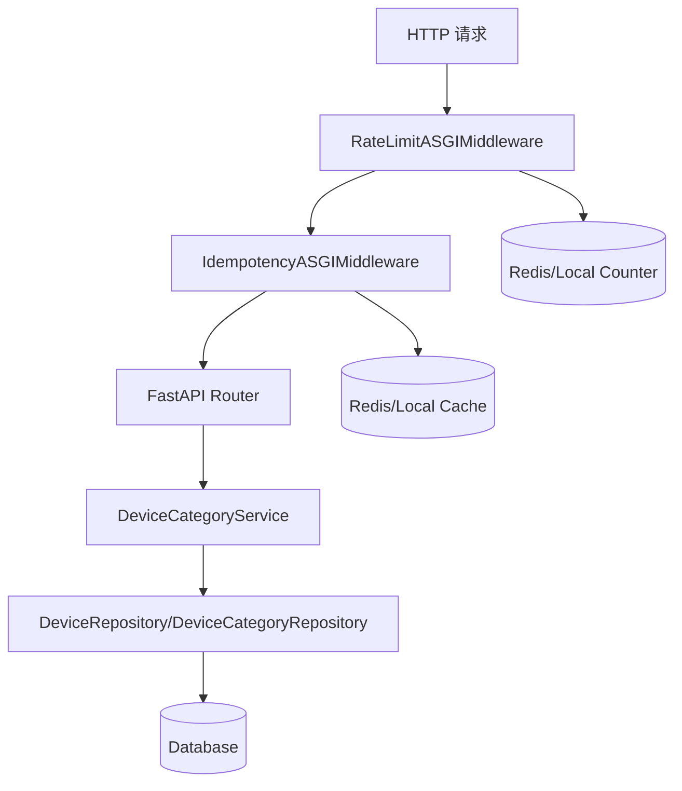

# 中间件安全加固与分类删除校验 技术设计

## 架构概述
本次改动集中在三条链路：
1. 幂等中间件：为缓存键引入身份维度，并新增请求体上限保护。
2. 限流中间件：仅在可信代理后解析 `X-Forwarded-For`。
3. 设备分类删除：在 Service 层引入引用校验（设备存在则拒绝删除）。

现有中间件链路由 `middlewares/handle.py` 统一注册，幂等与限流都在请求进入业务前执行，后续仍保持这一布局（只调整内部识别逻辑）。

## 数据流图

## 组件与接口定义

### 1. 幂等中间件
涉及文件：
- `/Users/hqz/dev/RuoYi-Vue3-FastAPI/ruoyi-fastapi-backend/middlewares/idempotency_middleware.py`
- `/Users/hqz/dev/RuoYi-Vue3-FastAPI/ruoyi-fastapi-backend/config/env.py`

设计要点：
- 新增“身份作用域”解析：
  - 尝试从 `Authorization: Bearer <token>` 解码 `user_id`/`userId`。
  - 解析失败时落入匿名作用域，但必须与已认证用户隔离。
  - 匿名作用域建议使用“可信 IP + idempotency_key”组合，避免跨客户端共享。
- 缓存键/锁键拼接：
  - `scope_key = user:{user_id}` 或 `anon:{client_ip}`。
  - `cache_key = hash(method:path:idempotency_key:scope_key)`。
- 请求体上限：
  - 新增 `idempotency_max_request_body_bytes` 配置。
  - 若请求体超限，继续业务处理但跳过缓存逻辑并记录日志事件（满足 R3.AC1/AC2）。

### 2. 限流中间件
涉及文件：
- `/Users/hqz/dev/RuoYi-Vue3-FastAPI/ruoyi-fastapi-backend/middlewares/rate_limit_middleware.py`
- `/Users/hqz/dev/RuoYi-Vue3-FastAPI/ruoyi-fastapi-backend/config/env.py`

设计要点：
- 新增可信代理配置：`rate_limit_trusted_proxies`（CSV，允许 CIDR 或 IP 列表）。
- 解析 IP 逻辑：
  - 若 `scope.client` 在可信代理列表内，才读取 `X-Forwarded-For` 第一个地址。
  - 否则使用 `scope.client`。
- 该解析函数可复用到幂等中间件的匿名作用域，以保证一致性。

### 3. 设备分类删除校验
涉及文件：
- `/Users/hqz/dev/RuoYi-Vue3-FastAPI/ruoyi-fastapi-backend/module_admin/service/device_category_service.py`
- `/Users/hqz/dev/RuoYi-Vue3-FastAPI/ruoyi-fastapi-backend/module_admin/repository/device_repository.py`
- `/Users/hqz/dev/RuoYi-Vue3-FastAPI/ruoyi-fastapi-backend/module_admin/entity/do/device_do.py`

设计要点：
- 在 `delete_device_category_services` 中查询设备引用：
  - 新增仓储方法：`count_by_category_ids(category_ids)` 或 `exists_by_category_ids`。
  - 当存在引用时抛出业务异常（建议 `ValidationException` / `BusinessException`，返回明确 message）。
- 保持无引用时的删除行为不变。

## API 接口设计
本次不新增外部 API，仅调整现有行为。

配置项新增/调整建议：
- `IDEMPOTENCY_MAX_REQUEST_BODY_BYTES`：幂等请求体最大字节数（新增）。
- `RATE_LIMIT_TRUSTED_PROXIES`：可信代理列表（新增）。

响应行为：
- 幂等中间件在超限请求体时不返回错误，仅记录日志并跳过缓存。
- 分类删除在引用存在时返回业务错误（HTTP 400/409，沿用现有异常体系）。

## 数据模型与数据库变更
不涉及数据库结构变更。现有 `sys_device.device_category_id` 关联关系已存在（见 `DeviceDO.device_category_id` 外键定义）。

## 安全考量
- 幂等缓存必须按身份隔离，避免跨用户响应重放（R1）。
- 限流 IP 解析必须限制在可信代理链（R2）。
- 请求体上限避免内存放大与潜在 DoS（R3）。

## 测试策略
新增/更新单元测试：
- `/Users/hqz/dev/RuoYi-Vue3-FastAPI/ruoyi-fastapi-backend/tests/unit/middlewares/test_idempotency_middleware.py`
  - 覆盖跨用户同 key 重放不得命中缓存（R5.AC1）。
  - 覆盖超限请求体跳过缓存路径（R3.AC1/AC2）。
- `/Users/hqz/dev/RuoYi-Vue3-FastAPI/ruoyi-fastapi-backend/tests/unit/middlewares/test_rate_limit_middleware.py`
  - 伪造 `X-Forwarded-For` 时仍使用真实 client（R5.AC2）。
- `/Users/hqz/dev/RuoYi-Vue3-FastAPI/ruoyi-fastapi-backend/tests/unit/services/test_device_category_service.py`
  - 分类被引用时删除失败；无引用时正常删除（R5.AC3）。
