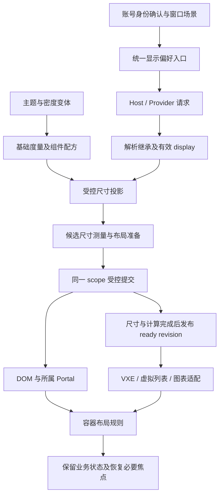

# ZXUI 与 RuoYi 全局显示大小技术设计

日期：2026-09-26。输入：[requirements.md](requirements.md)。本文件描述待实现方案；下文标为“新增”的类型、导出、文件和字段目前不存在，不得当作现有 API 使用。

SSD 前置证据：`CLARIFY_SCAN_MODE=read-only-subagent`，绑定当前 requirements，主代理已写回 CL-01～CL-04；`OUTSTANDING_HIGH_IMPACT_AMBIGUITY=none`。自动采用的产品默认值保留集中复核标记，见 [规格审查记录](spec-review.md)。本轮不实施代码。

## 架构概述

### D1. 一条偏好与尺寸链

在现有 Theme Kernel → Compiler → Host/Runtime → Provider → 消费者链上增加独立显示参数和有效尺寸投影。继续使用既有五个主题轴选择颜色/密度等变体；显示场景和四档比例不进入主题变体笛卡尔积，不另建全局事件总线。

职责分为三层：

| 层 | 所有者 | 负责事项 |
| --- | --- | --- |
| 尺寸基础及控件 | ZXUI | 场景角色、比例、内容尺寸配方、继承与浮层、可测量尺寸、通用导航/溢出行为 |
| 产品偏好及布局 | RuoYi | 账号/窗口偏好、显示设置、应用外壳、表单策略、主要操作及列优先级 |
| 第三方消费者 | 对应集成层 | VXE/图表/编辑器等版本适配；通用原语在库，RuoYi 消费配置在业务 |

首条链路选系统用户管理；远距离展示选 `src/views/monitor/server/index.vue` 的真实 `getServer` 数据。`src/views/dashboard/index.vue` 当前模板只有 ThemeDemo，不能作为真实看板验收。非仿真页面均适配两种尺寸场景，但不为每个 CRUD 页面新建展示版本。

### D2. 已核对的代码落点

下表业务路径以 `ruoyi-fastapi-frontend/` 为根，ZXUI 路径以 `/Users/hqz/Downloads/element-plus/` 为根。工作区已有大量其他修改，实施从当前源文件复核，不覆盖或清理存量工作。

| 源码证据 | 设计处理 |
| --- | --- |
| ZXUI `packages/zxui/theme-runtime/selection-resolver.ts:15`、`:24` | 为请求新增合法 display 字段，单独解析；原五轴 variantKey 不变 |
| ZXUI `packages/components/theme-provider/src/types.ts` | Vue 公共类型、prepared/ready scope 与 Runtime 同步，不在业务补类型 |
| ZXUI `packages/zxui/theme-host/use-theme-consumption.ts`、`consumption.ts` | 复用主题消费和取消过时投影机制；现有 CSS token 字符串不等于已解析像素 |
| ZXUI `packages/zxui/theme-host/consumer-port.ts:124` | 复用 effectiveRevision 发布路径，明确布局测量完成状态 |
| ZXUI `packages/theme-compiler/src/adapters/element-plus/density.ts` | 当前高度包含 control-y 与固定 offset，整个配方一起处理比例 |
| ZXUI `packages/theme-compiler/src/adapters/element-plus/passthrough.ts` | 对 GEOMETRY 分类逐项拆出真正 UI 尺寸，保留 z-index/时间等非尺寸值 |
| ZXUI `packages/theme-compiler/src/targets/css/variant-css.ts` | 基础度量与有效投影分别生成，避免从已缩放变量继续推导 |
| ZXUI `packages/components/dialog/src/use-dialog-layout.ts` | 命名预设消费度量，显式 width/height 保持原语义与优先级 |
| 业务 `src/main.ts:104`、`:108`，`src/App.tsx` | 保留旧 EP 消费链兼容尺寸，消除旧入口刷新；不扩散到原本 default 的 ZXUI 链 |
| 业务 `src/theme/zx-theme-config.ts`、`src/theme/zx-theme-host.ts` | 同一偏好入口驱动 Host/Provider；保留公开 deployment 接入 |
| 业务 `src/permission.ts`、`src/store/modules/user.ts` | 在身份恢复完成和路由放行之间装载账号偏好；不用最近账号猜身份 |
| 业务 `src/layout/index.vue:58`、`src/layout/components/AppMain.vue:41` | 移除分散的 50/84/54 等布局常量，改为共享布局角色或正常流 |
| 业务 `src/components/ui/FormDialog/policy.ts:3` | 继续由业务拥有标签、横向间距、最小列宽，消费库度量机制 |
| 业务 `src/plugins/vxe-table.ts`、`package.json` | 已有 VXE 入口；安装版本核对为 4.17.15，实际发布锁版本再复核 |

## 数据流图



修改 display 时先保存逻辑锚点和待恢复焦点，计算/校验候选请求并在非展示测量目标解析新度量，再让注册的布局适配器完成准备。能同步更新的尺寸与计算在同次提交中生效；需要异步重算的区域先进入固定边界的局部 busy 状态，计算完成前不呈现或接受输入到半更新的行/控件。所有必要消费者完成才发布 ready 并确认有效设置。快速连续切档只采用最新代次；失败和取消按 D5 恢复上一完整状态，不写入半套有效偏好。

## 组件与接口定义

### D3. 公开显示请求与继承

拟在 ZXUI 已有公共入口导出类型，并由 `ZxConfigProvider.theme` / `ZxThemeProvider` / Host `rootRequest` 接受同一请求：

```ts
// 新增公开契约示意；最终由库导出，业务仅导入。
type ZxDisplayScale = 90 | 100 | 110 | 125
type ZxDisplayProfile = 'office' | 'distance'
interface ZxDisplayRequest {
  readonly profile?: ZxDisplayProfile
  readonly scale?: ZxDisplayScale
}
interface ZxDisplayInteractionPolicy {
  readonly touchTargets: 'auto' | 'on' | 'off'
  readonly directionalNavigation: boolean
}
// ThemeScopeRequest 新增 readonly display?: ZxDisplayRequest
// Host 配置新增 interaction 策略；不是颜色变体轴或个人字号字段。
```

- 子 scope 对 profile/scale 分字段继承最近父值；没有父值时使用 office/100。子 scope 的 110 表示该场景的 110%，不乘父 scope 的 125%。删除本地字段恢复继承，显式 100 表示覆盖；不用 null/undefined 混合表达多个重置含义。
- 有效值只由 Runtime 解析；DOM data 属性为结果投影。未知字段、非法档位、非有限值拒绝提交并返回结构化诊断；业务存储损坏则在边界归一化为默认值。
- touchTargets=auto 依据浏览器粗指针能力；混合设备存在粗指针时满足触控下限，不因最后一次鼠标移动缩小控件。directionalNavigation 由明确设备/入口策略启用，不能监听全站方向键猜测遥控器。
- 交互能力变化只影响命中下限与导航，不改个人 scale/profile。它进入有效度量的更新原因，拥有独立的能力状态，不写回个人比例。
- 在 `selection-resolver`、Provider 类型、runtime 校验/序列化、SSR prepared state、scope hash/no-op 判定、父子传播和程序化浮层入口同步处理新字段。禁止只修改类型而遗漏运行时白名单。
- 保持既有无 display 请求的办公默认链可用；新旧 runtime/资产组合在导出与安装验证中核对。显式请求新能力但资产缺少所需度量时给出诊断，不能显示一个无效的 125% 选择。

### D4. 基础度量、场景角色与配方

新增受类型约束的显示度量目录，归入现有 tokens/compiler 源码。每项记录角色、未缩放来源、单位、缩放策略、可测量投影和拥有者。策略至少区分 UI 可缩放长度、固定细线/焦点样式、比例/视口约束、领域内容；时间、z-index 不属于长度。

编译器从原始 token/配方产生稳定基础值；Runtime 负责场景与比例投影。所有中间来源必须是未缩放基础值，不能重新读取有效 CSS 变量再乘一次。spacing、typography 复合 token 的字段分别归类；行高为无单位值时保留比值，不能与字号一起重复缩放。

候选配方为：

```text
文字 = max(角色下限, 场景角色基础文字 × scale / 100)
控件内容高度 = max(实际文字行盒, 图标) + 纵向 padding + 边框
交互高度 = max(控件内容高度, 当前输入方式的目标下限)
宽度/排列 = 在实际容器内遵守内容最小尺寸和视口上限
```

办公 100% 先复现现有 token/size/density 结果。EP default 密度下 small/default/large 的 24/32/40px 是兼容基准，不是所有档位强制不变的高度；现有 `2 * control-y + offset` 的两项都进入配方。触控下限初始产品目标为 44 CSS px，不能宣称 WCAG 一律要求 44；办公紧凑控件按适用目标间距和实际内容校验，边界缺陷单列修复。

远距离首轮校准候选：正文 24、辅助 20、标题 32、UI 图标 28、默认单行控件最小高度 56 CSS px（浏览器默认字体基准下）。这些是待测种子，不是对所有电视的固定承诺；实际观看距离下验证中文/英文、长文和焦点后固化为库内版本化配方。间距与控件横向 padding 独立校准，不能把所有办公尺寸统一乘某个“电视倍率”。

可随浏览器默认字体变化的度量使用 rem，以默认 16px 下的现有长度为校准基准；不主动修改 document 根字号。字体及其承载空间共同响应浏览器字号。已有 rem/em、固定 px、百分比及 calc 先分类，不能以 parseFloat 提取数字后盲乘。原始长度逃生口保留原 CSS 语义；正文、画布及导出不消费 UI 度量。

实现先扩展 existing composition 的受控生成样式阶段，而不是直接在业务根节点写核心变量。基础目录、有效投影与必要元数据经现有 compiler/deployment 导出、完整性校验和资产加载链交付；不为九主题额外生成四倍颜色变体。新度量资产和版本需列入公开 exports/部署 manifest；不支持的新旧组合显式诊断，不绕过哈希或 schema 校验。

### D5. CSS 与 JS 的同一有效尺寸

新增 `useDisplayMetrics()`，作为现有 Host 消费服务的薄接口，公开 CSS 引用和浏览器有效长度。保留现有 `useThemeTokens` 的原语义，不能将旧接口的基准对象偷偷解释为像素。

```ts
// 拟由 @zxio/zxui/theme-host 导出。
interface ZxDisplayMetricsSnapshot {
  readonly scopeId: string
  readonly effectiveRevision: number
  readonly layoutRevision: number
  readonly profile: ZxDisplayProfile
  readonly scale: ZxDisplayScale
  readonly pixels: Readonly<Record<string, number>>
}
// useDisplayMetrics():
// reference(metricId) -> Result<string>，返回 CSS var 引用，可用于 SSR。
// snapshot(metricIds) -> Result<ZxDisplayMetricsSnapshot>，仅浏览器测量就绪时成功。
// status / revision / subscribe 与既有消费生命周期集成，作用域销毁即解除订阅。
```

测量规则：未注册的 metricId 返回诊断；每 scope 使用有限且缓存的测量探针，给探针实际 width/height/font 等属性赋值，再读取计算后的 CSS px。`getComputedStyle(root).getPropertyValue('--x')` 可能仍是 rem/calc，不能直接 parseFloat 当像素；不使用 transform 后的矩形或乘 devicePixelRatio。

theme/display 提交推进 effectiveRevision；字体/容器测量变化推进 layoutRevision。根字体探针、字体加载完成和相关容器 ResizeObserver 触发布局测量，不另造业务全局事件总线。按帧合并读写，比较尺寸后才通知；严禁循环写回被观察元素制造反馈。ready 必须表示消费者视觉与计算均完成，不允许新 CSS 行高配旧虚拟偏移继续显示和交互。

为实际依赖几何计算的消费者新增布局参与协议，复用 Host 的绑定、AbortSignal 与销毁生命周期；普通颜色 adapter 不被强制改写为事务参与者：

```ts
// 新增协议示意；由 useThemeAdapter 的布局绑定分面或同服务的正式导出注册。
interface ZxDisplayLayoutParticipant {
  readonly id: string
  readonly metrics: readonly string[]
  prepare(next: ZxDisplayMetricsSnapshot, signal: AbortSignal): Promise<{
    commit(): void | Promise<void>
    rollback(): void | Promise<void>
    dispose(): void
  }>
}
```

参与者状态机为 stable → preparing → committing → stable/error；事务记录旧请求、样式、度量快照、锚点与必要的布局配置。准备阶段仅用候选样式测量有限探针，不改展示 DOM 和业务数据；候选测量使用同一根字体、容器基准与合法受控样式。同步参与者 commit 在一次更新批次内应用 CSS 与计算配置。返回 Promise 的第三方在提交前以局部 busy 占位保留区域尺寸，隐藏不一致的数据行并阻断该区域指针/键盘操作，业务模型与编辑值保持；完成并恢复锚点后再展示。不能只设置 aria-busy 而让混合几何保持可见可点。

prepare 失败时不应用新样式。commit 失败时在受控区域仍 busy 的情况下按逆序 rollback，恢复旧 scope 样式/快照和各参与者布局，再恢复原焦点；回滚失败则显示该区域可恢复错误与重试入口，禁止把旧快照标作正常 ready。取消在准备期直接释放候选资源；提交期先完成/撤销当前提交再启动最新请求，过时异步回调必须先检查代次才可写 DOM，不能并发应用两套配置。持久化仅在成功提交后发生。

浏览器字体或容器的外部变化可能已经发生，不能声称可回滚操作系统行为：有关虚拟/画布消费者在观察到变化的排版检查阶段同步重测，无法同步完成则进入上述局部 busy，重新解析当前环境并提交；不向用户暴露可交互混合几何。SSR 不执行像素测量或第三方布局提交，提供合法 CSS 引用/初始样式，浏览器完成准备后才进入交互 ready。

业务应用角色以命名空间 `ruoyi.layout.*` 注册到同一度量消费机制，例如 header、tags、sidebarExpanded/sidebarCollapsed、contentPadding、formLabel、formColumnGap、formMinColumn。角色数值由业务声明，库只提供解析机制；不能把 RuoYi 的 50/200px 规定为所有业务的标准。

**公开注册链：**复用 `defineThemeModule → compileThemeExtensions → Host.extensions → scope.composition.modules`，不创建第二个业务 token 注册表。现有公开说明见 ZXUI `docs/zh-CN/guide/theme-extensions.md`，已有 header.height 维度实例。扩展模块 schema 增加可校验的 display metric 元数据，引用本模块或已声明依赖的 public 未缩放 token，并指定角色/策略；编译阶段产出匹配 bundle 身份的度量描述及 `refs` 类型，Host 登记 bundle 时一次性验证并纳入受控投影。

新增元数据示意为 `displayMetrics: { 'layout.header': { source: { module: 'ruoyi', path: 'header.height' }, policy: 'ui-length', role: 'header' } }`；准确字段随同 tokens/编译器公开 schema 更新，应用通过生成的 refs 传递引用，不能拼私有 CSS 名称。度量键使用模块 namespace 限定；重复模块/metric ID、非 public 或未声明依赖引用、策略与 token 类型不符在编译/登记时失败。模块未在 scope 启用时 reference/snapshot 返回明确不可用诊断并隔离父级残留变量；启用/禁用/覆盖参与 scope 事务和 revision，动态停用不得保留旧几何 ready 状态。SSR 使用同 bundle 和确定性身份生成 CSS 引用与准备数据，像素 snapshot 在浏览器 ready 前不可用。

### D6. EP、Tailwind 与 ZXUI 结构样式

- EP：在已锁定 2.13.0 inventory 中检查每个尺寸的声明位置和 modifier 优先级。新映射与 passthrough 互斥，alias/resolved 两种输出一致；对局部覆盖在库适配器/结构样式处理，不假设根同名变量必胜。
- ZXUI：`packages/theme-chalk/src/structural.css` 是结构样式源，生成 `packages/zxui/style/index.css`。输入、表单、按钮、图标、菜单、表格、分页、Tabs、Card、Dialog/Drawer 和浮层消费对应度量。Dialog 命名预设可缩放，显式 width/height 优先且保持原语义；Icon 默认/命名角色可缩放，已有显式数值不暗改。
- Tailwind：扩展现有适配器的 typography/spacing/size 映射；用按元素求值的公开引用形成 scoped utilities，检验嵌套 scope，不让在祖先已解析的派生变量冻结子 scope 数值。范围内 `h-[50px]`、`text-[14px]` 等按用途迁移；scope 外保留默认回退。
- 业务：收敛 `theme.module.css` 与 `tailwind.css` 的重复字体/空间声明，只保留产品角色映射。逐项核对主题硬编码的实际生效规则，不能用 px 搜索数量代替缺陷数量。
- 每次生成都走拥有者脚本，实施时核对具体脚本入口与输出 diff；不手改 generated 或结构镜像，也不借本次工作更新无关基线。

### D7. 外壳、表单和空间不足规则

| 区域 | 统一策略 | 状态及边界 |
| --- | --- | --- |
| Header/Sidebar/Tags | 优先 Grid/Flex 正常流；固定布局统一引用同一角色或实测高度 | 不再复制 50+34=84；保留用户折叠意图与临时自适应状态的区别 |
| FormDialog/FormGrid | 保留 useFormDialog 的单一 columns，缩放标签/横向间距/最小列宽；按容器降列 | 原生 FormInstance 和纵向 density 不变；标签在窄容器统一上置 |
| 工具栏 | 扩展或新增最小通用 action overflow 能力，显式 id/priority/group，主操作优先保留 | 被移走的操作可键盘/遥控访问；容器极窄时整组换行，不裁切 |
| 表格 | 默认保留数据和局部横向滚动；仅显式声明可详情化的列做收纳 | 分析与编辑表不自动改成无法横向比较的卡片 |
| Dialog/Drawer | 命名宽度受视口上限约束；头/正文/底部有明确 flex 与滚动归属 | 复用 fill 契约及 min-height:0；低高度全部操作仍可达 |
| Tabs/Pagination | 按自身容器提供滚动/更多及页码精简，保留前后翻页和必要跳转 | 替换首次读 body 992px 的静态判断；调整不重置当前页 |
| Card/详情 | 内容驱动高度，卡片网格减列，长内容可读 | 不为保持固定外观隐藏必读信息 |

如必须用 JS 控制折叠，使用测量到的内容阈值，并设退出余量避免来回振荡；阈值来源与恢复策略在共享实现中定义，不逐页写断点。仅测量需要收纳的组件，禁止全站 DOM 扫描。

操作按钮通过稳定 id 保留焦点；若当前按钮进入更多菜单，将焦点移到更多入口并保留原 action id，展开后恢复。表单值、选择与错误状态存于稳定业务模型，不给 RouterView/表单组件设置随 scale/profile 变化的 key。

### D8. Portal 与程序化反馈

display 与主题共用 scope 所有权、受控样式、事务与 Portal lease。业务当前 body mirrored 仅维持根级 EP 兼容；嵌套 scope 的 Select/Tooltip 等必须使用其绑定容器或库正式桥接，不能通过全局 body 覆盖冒充嵌套继承。

`useThemeFeedback`/已绑定确认工厂一类公开入口保留发起 scope；无组件上下文的调用必须明确绑定 app 根或显式 scope，不能猜最后使用的页面。打开期间切档需更新浮层尺寸、重新定位，关闭/卸载释放测量和 Portal 资源。多 app、多 scope 下的目录变量在各自根/浮层边界重新投影，避免继承到已计算的其他 scope 值。

### D9. 第三方与专业消费者

| 消费者 | 集成方式 | 验证重点 |
| --- | --- | --- |
| 普通 EP Table / Table V2 | 普通表由内容/度量驱动；虚拟表使用有效 row/header size 与正式重算入口 | 首末行、长文本、固定列、编辑中切档 |
| VXE | 在已有集成层建立绑定，核对安装版本类型和公开行/单元格配置、重算及滚动接口后使用 | 行标识+行内偏移锚点，列宽/行高缓存，编辑状态；不写一个猜测的跨版本 API |
| vue-virtual-scroller | 使用对应版本公开 item-size/动态测量入口，批量刷新 | 不把 CSS 行高变化与缓存分开 |
| ECharts / G2Plot 等 | 通过现有 useThemeAdapter 投影文字/图例/tooltip/控件度量，再调用正式布局入口 | 数据与缩放窗口不重建，图例选择/数据缩放状态保留 |
| 富文本 | 工具栏和菜单接入 UI 度量，正文编辑区保留文档字体和内容样式 | 切档前后文档模型、撤销栈和导出语义不变 |
| Ant Design/其他自有集成 | 盘点实际可达消费者，在其公开 token/config 层或共享集成层适配 | 库导入不等于路由可达；不得只验证 ThemeDemo |
| iframe | 受控同源内容通过显式协议接入；第三方独立内容在清单标明边界 | 宿主外壳正常缩放，不绕过同源限制、不暗改第三方页面 |

消费者清单至少含路由/组件、拥有者、普通 UI 或领域内容、公开接口、版本、场景用途、适配状态、证据与未完成原因。仿真专用 UI 单列后续范围；共享改动可能影响仿真，但不据此宣称其已验收。

### D10. 触屏与遥控器

采用最小焦点组契约，不创建全站游戏式空间搜索。组具有稳定 id、显式方向/次序、当前项及边界动作；跨组按声明关系导航，组内可用行列或 DOM 顺序，虚拟列表按数据索引定位后滚动/聚焦。首版无显式声明的普通区域保留原有键盘行为。

设备层把键映射到 move/activate/back；首版标准输入为 Arrow keys、Enter 及可映射的 Back/Escape。表单输入模式将左右键、文字输入、组合输入交给原生控件；Select 等展开时拥有自己的方向操作。返回优先关闭最内层可关闭面板，再退出输入/展示子态，最后交路由处理，保留脏数据守卫。

承诺遥控器操作的关键流程必须全部通过共享组件或页面声明登记到可达焦点组，覆盖导航入口、筛选、表单字段、校验定位、表格操作、分页及浮层关闭/确认；组间图必须从初始焦点可达且有退出路径。方向键选中字段后由确定进入输入态，返回退出输入态并还原组焦点；必要文字输入仍由环境承担。未登记而仅支持 Tab 的区域保留普通键盘行为，但在消费者清单中标为遥控器未完成，不能计入完整业务流程通过。验证仅使用目标遥控器提供的动作，不额外借 Tab 或鼠标绕过断点。

焦点环使用库可见状态，并清理业务 `index.css` 中使相关元素无替代焦点表现的全局 outline:none。焦点效果不移动正常布局；不用全页 transform。触控有足够目标下限，长按/hover 不是唯一关键操作入口。软键盘造成可用高度变化时由 visual viewport/容器实际尺寸约束弹框，保持聚焦字段与提交可达，不承诺唤起不存在的系统输入法。

设备登记包含浏览器/系统版本、屏幕与实际视口、OS/浏览器缩放、观看距离、遥控器事件、触控与文字输入能力。非标准按键映射可以增加设备适配器；没有实机证据就保留待验收，不能宣布支持所有 Smart TV 浏览器。

## API 接口设计

### D11. 业务入口与设置组件

不新增后端 HTTP 接口。业务新增显示偏好模块，和现有主题偏好模块通过一个 app appearance 组装入口下发 Host/Provider；颜色存储不因本次需求被强制重构。

```ts
// 业务内部接口，拟新增 src/theme/display-preference.ts。
setDisplayPreference(patch: { profile?: 'office' | 'distance'; scale?: 90 | 100 | 110 | 125 }): Promise<void>
resetCurrentDisplayScale(): Promise<void>
bindDisplayIdentity(subject: { kind: 'anonymous' } | { kind: 'user'; id: string }): Promise<void>
```

设置面向用户只显示“使用场景”“显示大小”和“恢复本场景默认”；密度保持既有独立入口。比例切换无 reload。入口变化先验证请求，当前 scope 提交成功再确认设置状态；存储失败只提示无法记忆，不撤销已生效选择。连续修改合并到最新期望状态，不能因旧请求回调倒退。

在 `permission.ts` 既有 getInfo/会话恢复流程成功后，用真实 userId 绑定偏好并等待根 scope ready，再放行首个业务界面；不增加另一套身份网络请求。期间使用匿名/中性加载壳。退出或切换账号先清空有效 subject，并清理用户 store 遗留 id 对偏好选择的影响，不读取“上次账号”冒充当前用户。

主题包仍在 `src/theme/zx-theme-packages.ts` 单处登记，本地开发继续使用既有 Vite 源码 alias 与公开 deployment API。新增显示资产由库公开交付入口描述，不在业务猜 generated 文件名。

## 数据模型与数据库变更

### D12. 本地偏好与窗口状态

无数据库迁移。新增有版本的本地显示偏好，不存业务数据或认证令牌。

| 存储 | 键与内容 | 行为 |
| --- | --- | --- |
| localStorage | `zx-display:v1:<appKey>:<subject>:<profile>`，`{version:1, scale}` | 分账号/场景的档位；每个 profile 独立键，避免覆盖其他场景 |
| sessionStorage | `zx-display-window:v1:<appKey>:<subject>`，`{profile}` | 当前浏览上下文刷新恢复；新顶层上下文采用部署/入口默认 |
| localStorage | `zx-display-compat:v1:<appKey>`，`{version:1, legacyEpSize, migrated:true}` | 一次性旧 Cookie 的浏览器兼容记录，不写入个人显示比例 |

subject 采用经编码的稳定账号标识，匿名为独立字面值；部署 namespace 与 appKey 避免同源多产品冲突。localStorage 为最后成功写入值，但不订阅其事件修改已打开窗口的有效状态；新窗口或明确重新装载才读取。

浏览器新窗口可能复制 opener 的 sessionStorage，故不能只凭 sessionStorage 存在判断刷新恢复：优先使用浏览器导航类型确认 reload/history 恢复；新 navigate 按部署/显式入口 profile 初始化并覆盖该窗口场景。应用创建新展示入口使用显式场景参数与 noopener。重复标签页、外部直达和 BFCache 恢复纳入检查，不能宣称可靠识别物理屏幕。

JSON 解析、版本、枚举和 subject 全部在边界检查，失败退回该场景 100%。存储不可写时继续会话内使用。匿名默认 office/100 或显式部署基准，不读取最后用户值。未来账号同步只能提供无本地值时的默认来源，本 spec 不实现云同步。

### D13. 旧 size 迁移与公开兼容

启动时读取有效兼容记录；没有记录才读取合法 `size` Cookie（small/default/large）。新比例初始 100%。保留旧值在原来 EP 安装配置/继承链的位置，ZXUI 原本固定 default 的位置不改变；对直接 EP 与 ZXUI 包装控件各保留代表样板，按解析结果验证，而非假定全局 provider 覆盖等价。

兼容记录成功持久化后删除旧 Cookie 写入路径和 SizeSelect reload；持久化失败保留旧 Cookie 供下次迁移，但不恢复旧选择器。无旧值使用 default。兼容记录只有基础 size 的单一来源，没有第二套可写全局开关。迁移说明列出继续保留的既有差异；后续统一旧用户基础 size 是显式产品迁移，不在本任务偷偷执行。

显式 icon/dialog/CSS 长度不自动乘比例；范围内 UI 用法主动迁移到命名角色或预设，领域尺寸保持。库新增能力按公开 API/产物版本规则交付；需要改变现有语义则在执行前明确版本迁移，不能用业务类型补丁掩盖不兼容。

## 安全考量

### D14. 边界与失败处理

尺寸配置只接受有限枚举和注册过的度量描述；不接受存储中的任意 CSS、选择器、脚本或 URL。受控样式继续经过既有 schema、managed-inline、完整性与 CSP 策略，不为显示偏好放宽库的内容注入约束。

账号偏好只使用认证流程确认的身份；不借场景切换改变权限，不把展示模式作为数据授权边界。主题与显示配置失败可回到上一可用状态，身份失败仍走既有登录策略。跨域 iframe 不绕过浏览器隔离。应用内 UI 比例不写入文档/图表的数据模型或打印/导出管线。

**业务导出的渲染隔离：**消费者清单增加导出来源列，区分领域模型导出、当前 DOM/SVG/图表实例导出、应用界面截图。模型导出沿用领域模型；业务渲染型导出使用独立导出容器/实例及原有导出基准，从数据、领域样式和明确导出配置构造，不直接截取带当前 display 的交互实例。导出基准不继承 UI scale/profile，离屏准备不改变正在编辑的界面，导出结束释放实例；打印页面采用同一隔离基准。应用截图明确属于需求豁免，仍如实反映当前 UI。验收同时比较代表导出物的尺寸、文字/图例布局和内容，不能只验证 JSON 数据未变。

## 测试策略

### D15. 少量契约与真实页面证据

复用现有测试，按风险增补，不为每页/每档复制测试。实施验证分层：

1. 纯尺寸/解析：四档、两场景、size/density 保留、默认基准、无效输入、整个配方只缩放一次；编译资产及 alias/resolved 一致。
2. 作用域/更新：父子覆盖、Portal 打开期间切档、多 scope 隔离、过时 adapter 结果取消、DOM/JS 同 revision、销毁释放和 SSR 默认回归。
3. 业务关键链：用户管理完整操作与真实监控展示；长中文/英文、错误、多操作、低高度、切档/切场景保留值和焦点；不依赖纯 ThemeDemo。
4. 第三方：至少实际 VXE 编辑长表、图表、富文本 UI、在用虚拟列表；验证末行、锚点、选中状态、文档及导出语义不变。
5. 设备：至少笔记本、桌面、远距离电视/大屏及承诺的遥控/触屏输入；登记实际观看距离与操作结果。缺设备证据保留未完成，不用模拟截图代替。

九主题 × 明暗 × 四档先验证关键文字/控件/外壳/浮层的契约和资源；复杂交互选择默认主题与一个高差异主题、尺寸极值及典型输入方式。两场景都纳入尺寸/浮层检查；无须每个页面跑全部排列，但消费者清单不能有未说明的空项。

浏览器无障碍场景分别执行：默认档位下 200% 文本放大；320 CSS px 重排；行距 1.5、段距 2、字距 0.12em、词距 0.16em 的覆盖；以及 125% 与浏览器缩放组合的代表任务。二维表格/图形例外记录理由和可访问路径。测试目标大小及适用间距例外，不以固定最小字号代替可读性验证。

执行时的已有命令入口：

```bash
# 业务仓 ruoyi-fastapi-frontend，按改动先跑相关文件，最终执行已有门禁。
yarn lint:check
yarn type-check
yarn test:run
yarn ui:standards
yarn build:prod

# ZXUI 仓：先相关包/测试，再受影响的跨包门禁。
pnpm theme-compiler:check
pnpm theme-compiler:check:element-inventory
pnpm theme-runtime:check:overlay-contract
pnpm theme-runtime:check:exports
pnpm theme-consumer:check:structural
pnpm theme-consumer:check:packed
```

命令是实施计划，本轮未运行功能检查。执行前复核脚本与独立包 Git 所有权；图表/编辑器独立仓如需改动，在对应仓验证。受现有 dirty 状态影响的基线失败与本特性回归分开记录。

### D16. 验收资料与完成边界

实施时在本 spec 下维护消费者清单、环境矩阵和证据索引，记录源码版本/工作区差异、依赖版本、场景/比例/主题、输入方式、预期与实际、截图或尺寸/操作证据。真实操作使用届时有效的用户授权，历史授权不沿用；无授权可继续源码与构建工作，但不能伪造 UI 验收。

远距离种子必须完成校准后才能记对应设备通过。公开包验证使用本地 tarball、公开 imports、部署资产，禁源码别名兜底，无需发布 npm。生成器覆盖前端设计器产物与后端 Vue 模板 `module_generator/templates/vue/v3/`，不引入新的表单代理。

spec-ready 只说明本设计和任务能用于实施。实现完成需要适当检查与独立审查；多终端交付还需要规定真实设备证据；仿真专用与外部独立文档不在本轮“已验证”声明内。

## 需求覆盖映射

下列映射把每条验收项绑定到设计落点；不表示已经验收。任务进一步引用同一 ID。

| 验收项 | 设计落点 |
| --- | --- |
| R1.AC1, R1.AC2, R1.AC3, R1.AC4 | D3、D4、D11 |
| R2.AC1, R2.AC2, R2.AC3, R2.AC4 | D1、D3、D4、D7、D10、D12 |
| R3.AC1, R3.AC2, R3.AC3, R3.AC4 | D4、D6、D7、D13 |
| R4.AC1, R4.AC2, R4.AC3, R4.AC4, R4.AC5 | D7、D10 |
| R5.AC1, R5.AC2, R5.AC3, R5.AC4 | D3、D5、D8 |
| R6.AC1, R6.AC2, R6.AC3, R6.AC4 | D5、D7、D9、D16 |
| R7.AC1, R7.AC2, R7.AC3, R7.AC4 | D7、D10 |
| R8.AC1, R8.AC2, R8.AC3, R8.AC4, R8.AC5 | 数据流、D7、D11、D12 |
| R9.AC1, R9.AC2, R9.AC3 | D1、D6、D11 |
| R10.AC1, R10.AC2, R10.AC3, R10.AC4 | D3、D5、D6、D7、D9、D16 |
| R11.AC1, R11.AC2, R11.AC3, R11.AC4 | D3、D6、D13 |
| R12.AC1, R12.AC2, R12.AC3, R12.AC4 | D9、D14、D16 |
| R13.AC1, R13.AC2, R13.AC3 | D4、D5、D10、D15 |
| R14.AC1, R14.AC2, R14.AC3, R14.AC4, R14.AC5, R14.AC6 | D1、D2、D15、D16 |
