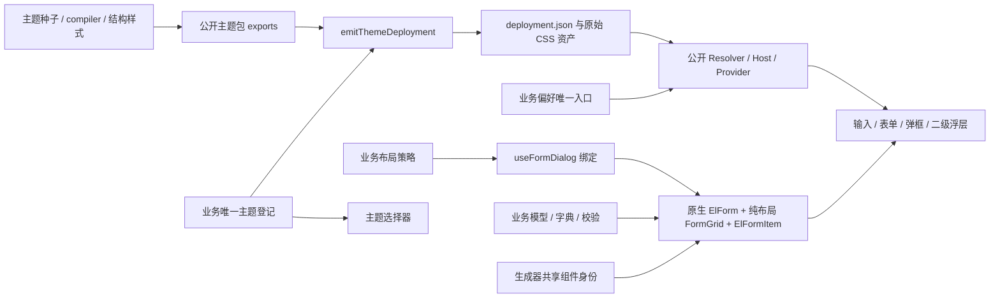
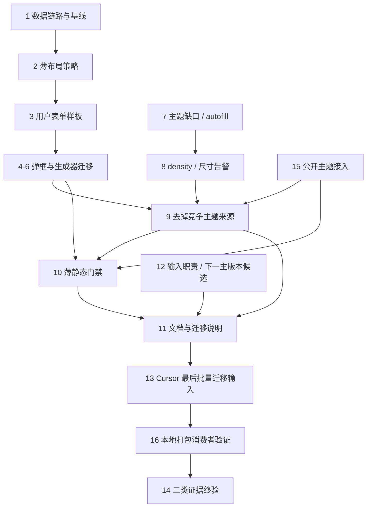

# ZXUI 表单弹框统一技术设计

## 架构概述

2026-09-22 长期收益优化：在现有 ZXUI 能力上收敛公开契约，让通用修复能被其他业务安装使用；业务只持有产品布局策略和数据。仿真及专用组件仍排除，共享组件仅覆盖非仿真消费者。范围内迁移完成时无 baseline/allowlist 或长期双栈。

本次不是新增一套表单/主题平台。选型比较如下：

| 方案 | 当前代价 | 后续维护与跨业务收益 | 决策 |
| --- | --- | --- | --- |
| 业务逐页补 CSS、保留私有主题路径、机械替换标签 | 低 | 其他业务重复踩坑，库升级仍需逐页追查 | 不采用 |
| **修 ZXUI 公开契约，业务保留原生表单与薄布局策略，补可安装消费验证** | **中** | **通用问题修一次，接入方式可复制，业务代理面最小** | **采用** |
| 全部布局放 ZXUI，新增 schema 表单引擎和通用代码分析平台 | 高 | 产品布局绑定进库，新增大量接口与维护责任 | 不采用 |

| 所有者 | 唯一负责的内容 | 明确不承担 |
| --- | --- | --- |
| ZXUI tokens/compiler/结构样式 | 主题值、EP adapter、density、autofill | 某业务的标签宽度、字段顺序和字典 |
| ZXUI 组件与公开入口 | input/dialog 行为、类型、slots、scope/浮层 | RuoYi 特判、私有补丁、未经说明的 API 变更 |
| 业务主题入口 | 已安装主题登记、用户偏好、Host 绑定 | 自己生成颜色、猜 generated 路径、复制 Runtime |
| 业务布局策略与 FormGrid | 列数→尺寸、label-width、横向 gap、响应式跨列 | 复制表单模型、代理 ElForm/ElFormItem |
| 页面与生成器 | 字段内容、校验规则、业务数据、提交 | 重写主题来源与通用布局策略 |

收益验收：改一处库能力，库公开样板与真实业务同时生效；改一处布局策略，样板与生成结果同时生效；新增主题只增加一处登记和正常依赖；禁用源码 alias 后，本地包仍可安装并兑现同样的公开能力。

## 数据流图



库源码改动仍通过 `VITE_ZXUI_LOCAL=true`、`VITE_ZXIO_REPO_ROOT=/Users/hqz/Downloads/element-plus` 直接进入业务。源码联调是开发手段，可安装包是交付证据，正式 npm 发布不是前置。

## 组件与接口定义

### 1. 业务布局：保留原生表单，减少代理

上一版要求 FormGrid 包 el-form、FormField 包 el-form-item，进而代理实例、props、events、slots。这会为简单布局引入一整套兼容责任。本版改为：

- `src/components/ui/FormDialog/` 内只有布局策略、`useFormDialog` 与纯布局 `FormGrid.vue`；不强制新增 FormField。
- 保留原生 `el-form ref`、el-form-item、校验规则与命令接口。useDialog 继续直接消费真实 FormInstance，无需 unwrap 内层 ref、any 强转或新表单适配器。
- `useFormDialog` 只在现有 useDialog 上增加产品布局决策，不复制 visible/model/dirty/loading、关闭重开、提交或字典逻辑。
- options 中 columns 显式必填且只声明一次，由其生成 dialogSize、formProps 与 layoutProps。其余文档化 useDialog 选项维持原语义。
- formProps 统一 label-width（初值 100px），layoutProps 统一列数和横向 gap（初值 20px，单列不产生列间隙）。这些是业务策略，不进入 ZXUI 通用默认值。
- FormGrid 只有响应式网格责任，内容仍是原生 el-form-item；`data-form-full` 表达整行意图，不假设 el-form-item 支持 full prop。不提供 validate/expose 或模型镜像。
- grid 不再增加独立 row-gap，纵向节奏继续由表单项主题/density 控制，避免与 margin 叠加。
- columns 是正常容器下的目标列数，窄容器按统一规则降列，full 始终跨当前全部列；标签换行统一处理，不重新给每个字段补宽度。具体阈值在用户样板的长标签/窄视口中确定并只存一处。

目标用法示意（R11/R10 完成后的最终状态）：

```vue
<script setup lang="ts">
// formRef 是实际 el-form 的实例。字段模型和 rules 由业务维护。
const formRef = ref<FormInstance>();
const { state, dialogProps, dialogEvents, formProps, layoutProps } = useFormDialog({
  columns: 2,
  formRef,
  defaultData: () => ({ nickName: '', remark: '' }),
});
</script>

<template>
  <ZxDialog v-bind="dialogProps" v-on="dialogEvents">
    <el-form ref="formRef" v-bind="formProps" :model="state.data" :rules="rules">
      <FormGrid v-bind="layoutProps">
        <el-form-item label="用户昵称" prop="nickName">
          <zx-input v-model="state.data.nickName" />
        </el-form-item>
        <el-form-item label="备注" prop="remark" data-form-full>
          <zx-input v-model="state.data.remark" type="textarea" />
        </el-form-item>
      </FormGrid>
    </el-form>
  </ZxDialog>
</template>
```

示意省略 imports/rules，实际生成模板必须包含完整 imports、注册与模型。复杂字段使用原生 slots 和组件组合，不通过追加一串布尔 props 扩张 FormGrid。

源码依据：ZXUI `dialog/src/props.ts:295` 直接接受 FormInstance；`hooks/use-form-modal/index.ts:216–252,295–327` 消费校验/重置；`_shared/use-modal-scroll.ts:69–107` 通过 `.el-form-item.is-error` 寻找滚动与焦点目标。纯布局容器保留这些能力。本轮不需要为了一个新包装而额外新增 FormModalHandle；若后续出现真实非 EP 表单消费者，再单独收窄库的操作接口。

### 2. 尺寸与高度

| columns | dialogSize | 当前 ZXUI 预设参考 |
| --- | --- | --- |
| 1 | md | 640px |
| 2 | lg | 880px |
| 3 | xl | 1120px |

业务保存档位映射，不复制库的像素值。例外仍选合法 dialogSize 并说明理由。非表单弹框直接选预设，不套 FormGrid。窄视口遵循库边界，不坚持 880px 导致溢出。

FormDialog 类型排除 width/height，开发态收到时诊断并剔除，不能只告警后经 spread 继续传入。统一入口负责动态布局选项的运行时校验，不将约束推给每个页面。

普通弹框删除固定 height，沿用库的 `max-height: calc(100dvh - 48px)` 与正文内部滚动；必要时传 `dialogStyle.maxHeight`。useDialog 白名单不接受顶层 maxHeight。不得用 dialogStyle.height 绕过。预设净宽不按固定 body padding 推算，应测量主题/density/视口下的真实空间。

### 3. ZXUI 表单主题与 scope

- 标签通过 `--el-text-color-regular`、星号通过 danger、选中态通过 primary 继承是有效覆盖。先查变量链、实际状态和业务覆盖；只修实证缺口。
- 通用改动在 tokens/compiler/结构样式的源文件完成并重新生成，不手工修 generated 或在 RuoYi 中重写库变量。
- 通用 autofill 负责背景和文字，在库样板与业务均验证；库能力成立后清掉业务重复处理。
- density 接入 EP 度量，不删除核心轴。保留 EP 原有有效 size 解析链：组件显式 size、组件 hook 的既有 fallback（如有）、FormItem、Form、Provider、默认值。density 只调整最终有效 size 下的主题度量，不改变 size prop 或继承关系，度量函数/表由库维护；默认 size 验证三档差异，显式 small/large 及 Form/FormItem 继承做边界核对，不重复双重缩放。
- 最近 Provider 拥有主题；Dialog Portal 与其中 select/tooltip 等二级浮层必须跟随发起 scope。覆盖打开中切换、关闭重开与嵌套 scope。全局 body mirrored 仅是已确认的 EP 兼容路径，不可代替 initiating scope。
- useDialog 开发态对 formRef 存在且未配置 dialogSize/width 的调用告警，不修改全库 small 默认值；业务 wrapper 已推导尺寸则不告警。

复用已有 `ZxThemeProvider`/`ZxConfigProvider`、`dialog/src/use-dialog-portal.ts` 和 `config-provider/__tests__/theme-runtime.test.tsx`，不新增每个弹层手写 document 属性的补丁。

### 4. ZxInput 的长期公开职责与 API 调整

当前 type 同时表示 HTML 输入类型、ElInputNumber 路由和内建搜索 UI，正是“只换标签也变业务行为”的根因。选择清晰职责，不增加永久 native/legacy/inputKind 兼容分支。

| 最终入口 | 所有者与行为 | 旧用法迁移 |
| --- | --- | --- |
| ZxInput | 固定 ElInput，type 保持原生语义，tooltip 为独立增强；转发真实 slots/expose | 原 el-input 可逐项等价迁移；type=number/search 不再触发另一种控件 |
| ZxInputNumber | 只承接已有 ElInputNumber 数值步进能力，公开 props/events/expose | 已知 ZxInput type=number 消费者按原数值语义迁来；不扩展业务 el-input-number 全量迁移 |
| ZxSearch 或显式 append 组合 | 只有确需增强搜索的调用选择 | ZxSearch 有 trim、clear 触发与 `{ value, mode }` 事件，不能机械替换旧 string 事件；行为不合适则用 ZxInput + append 按钮保留原处理函数 |

这是**破坏性的公开 API 调整**，必须随下一主版本或其本地预发布候选交付。不能在现有 2.x 补丁中改变 type。旧 `@search(value: string)` 的增强事件不再属于 ZxInput 的承诺；若支持原生 search 事件，其载荷按原生事件说明，不能冒充旧字符串回调。更新已知消费者与 docs，并给外部业务升级说明；扫描当前仓库不能证明外部无人使用旧行为。业务通过本地候选验证，不等待 npm 正式发布或所有外部业务升级。

实现约束：

1. tooltip 两种路径消费同一套输入属性/事件/slots 契约；prefix/suffix/prepend/append 及参数正常透传，native search 不注入 append。移除旧增强分支时一并清理 ::icon。
2. ZxInput expose 对齐 ElInput 的 focus/blur/select/clear/input/textarea/textareaStyle，不公开任意内部状态包；数值组件发布自己的能力清单。
3. v-model 只有一个所有者，不为普通透传输入维护双 watch 镜像；选择支持当前最低 Vue peer 的实现。声明事件并确保只触发一次，保持组合输入、clear、焦点、禁用及空值语义。
4. attrs 有明确目标，name/id/aria/autocomplete 和用户事件到达正确控件；wrapper 不破坏 flex 和字段宽度。
5. 现有 ZxSearch 不做无关大改，ZxInputNumber 只承接已有能力，不演变成 schema 字段渲染器。库内已知增强消费者在 R11 中迁移，业务 el-input 大批量替换仍最后交 Cursor。

证据：`input/src/input-core.vue:69` 的 number 路由；`docs/zh-CN/component/input.md` 已公开旧语义；`docs/examples/input/types.vue:17,25` 有消费示例；`search/src/props.ts:104` 的 search 载荷与旧 input-search 不同。完整兼容表须根据实施时的实际调用补齐。

### 5. 公开主题接入与可交付资产

当前业务 `src/theme/zx-theme-host.ts` 读取 generated glob、手动转换 export 路径并扩充 portalContainerScope 类型；`vite/zxui-theme-packages.ts` 与 UI 维护另一份主题数组。这些适合作为联调现状，不作为其他业务的标准接入方案。

最终路径复用 ZXUI 已有能力：

1. 一份业务主题登记保存 package/id/展示信息；选择器、Host 与构建列表从它派生，不再独立维护九个 ID 数组。缺失已登记包或 manifest 应诊断，不能静默少注册。
2. 构建端使用 `@zxio/theme-compiler/deployment` 的 `emitThemeDeployment`，从公开 package/manifest/CSS exports 生成独占部署目录。必要的编译工具只作构建依赖，不进入浏览器。
3. 浏览器使用 `@zxio/zxui/theme-host` 的 `createThemeDeploymentResolver` 与现有 Host/Provider；部署清单和 CSS 共同交付，正确处理应用 base 路径。
4. 主题包登记所需依赖全部显式声明。开发源码解析可以保留在 Vite 工具边界，业务运行时不再猜 generated 路径、不手写库类型补丁；公开类型缺失在 ZXUI 修复。
5. 应用保留一个偏好入口，将 themeId/mode/density 请求交给 Host/Provider。document 属性和兼容 class 是其投影，页面不能反向读取 DOM 拼固定 variant 字符串作为第二份状态。新增 density UI 不属于本次必做。
6. 删除 RuoYi 的反向 alias/主色竞争写入后再去掉 clearBusinessPrimaryOverrides。页面壳和生成器直接消费公开 surface/token，不再增加业务主题翻译层。experimental surface 按库文档锁定所依赖的契约身份，不声称永远不变。

来源：ZXUI `docs/zh-CN/guide/theme-tools.md:20` 已给部署契约，`:49` 已有登记单源范式；`packages/theme-default/package.json` 有公开资产 exports。复用这些，不另造资源协议。

## 迁移范围与生成源头

初始 [迁移库存](migration-inventory.md) 中非仿真目录 AST 候选为 el-dialog 18 个/16 文件、el-input 184 个/68 文件；静态 textarea 28 个，17 个 input 带 18 个 slots。分类重叠；库存不是运行时验收。实施时重新扫描并核对目录外专用/共享边界。

保留 `src/views/project/simulation/**` 及仿真专用组件排除；NodeEditDrawer、Dag 和协议模板的非仿真消费仍在范围。孤立源码不能因当前菜单不可达自动豁免；确认属于范围内可执行代码仍受门禁约束，未触达不记页面验收。

生成器是持续新增旧写法的源头，不能只改 html 字符串：

- 现有 `utils/generator/config.ts`、`drawingDefalut.ts`、`html.ts`、`render.ts` 共同决定身份、预览、导出与插槽。将有限组件身份及对应已有渲染/生成配置集中维护，不新建第二个通用组件注册系统。
- 生成的表单弹框采用同一 useFormDialog/formProps/FormGrid 与原生 ElFormItem 组合，字段级全行意图一致；完整生成代码包含正确 imports 与注册。
- 源码 Vue 与生成后 SFC 调用同一个模板检查核心。用一个包含普通输入、textarea、append 与整行字段的代表产物验证生成→解析→预览/打开；不为每个生成配置排列新增测试。

## 门禁设计

`ruoyi-fastapi-frontend/scripts/check-ui-standards.mjs` 是薄入口，复用已有 Vue/TS 解析器；支持 --strict 与 summary/json/markdown，违规 exit 1。记录范围和位置，无 baseline/allowlist。

| 规则族 | 检查边界 |
| --- | --- |
| 弹框入口 | 精确 el-dialog、直接弹框 width/height/style 绕过、缺预设；普通元素宽度不误报 |
| 表单布局 | useFormDialog 统一入口、formProps/layoutProps 来自同一 columns、原生字段不再手写 span/label-width/gap |
| 输入入口 | 最后启用精确 no-raw-el-input；不匹配 el-input-number，包含生成后 SFC |
| 主题写入 | 范围内业务直接写核心 --el-* / --zx-* 主题值、私有 generated 路径或补写公开类型；普通领域色值不一概禁止 |
| 生成一致性 | 输出用同一检查器；配置/预览/导出组件身份相符，旧 slot 语法不得重新生成 |

静态支持边界限定为模板、本地对象/常量以及规定的统一入口。复杂动态 spread/间接配置不能静默通过：报告并将其改写为统一入口，由入口的类型与运行时约束校验。不为此实现跨文件通用数据流分析，不要求脚本理解任意 CSS/JS 行为。视觉、数据正确性、scope/焦点交由相应契约与真实页面验证。

## API 接口设计

不预设新增业务 HTTP API。沿 UserFormDialog.statusOptions → 用户字典请求/缓存 → 响应适配定位零选项；不硬编码字典填充。deptList.filter 是相邻契约线索，不预设同因。ZXUI 的公开输入职责调整及主题类型完善按上文执行，正式导出、生成声明和 docs 同步。

## 数据模型与数据库变更

无计划中的数据库迁移。若证据确认种子缺失，使用现有字典/初始化路径修复，不重建数据库。生成器配置数据需明确旧组件身份到新身份的读取/保存处理，保留既有配置可编辑与重新导出；不能只让新建表单正常而破坏保存的设计稿。

## 安全考量

使用已授权本地业务与 docs 浏览器验证，截图不存 token。UI 回归优先打开、输入、取消；确需提交使用可辨认测试数据并清理。本地 tarball 安装使用独立临时消费目录，不改其他业务 lockfile 或发布 registry，不以测试代替真实用户权限决策。

## 实施顺序

保留 1–14 编号，新增 15（主题公开接入）和 16（打包消费验证）。编号不是线性执行次序；Cursor 仍是最后一个业务批量改造，正式发布不是前置。



7/8/12/15 可在相应样板基线上并行。任务 12 的已知库内消费者迁移、公开契约和真实兼容样板须先通过，才能完成文档并交 Cursor。16 使用前面扩展好的单一样板，仅验证候选产物，不引入一套新测试平台。

## 测试策略

分三类证据，各自证明不同事实：

| 证据 | 证明什么 | 最小场景 |
| --- | --- | --- |
| 库公开样板及聚焦回归 | 能力由 ZXUI 提供，不依赖 RuoYi 补丁 | 一份表单样板，slots/expose/native 类型、明暗、density、嵌套浮层、autofill |
| 真实业务页面 | 数据、布局、交互和产品效果成立 | 用户样板先验，迁移页面逐页复核；九主题明暗在代表表单验证，不做全排列 |
| 本地 tarball 消费 | 其他业务安装得到的实现、类型与资产成立 | 同一样板隔离安装，禁 alias/workspace fallback，记录版本/哈希/解析路径 |

复用 `scripts/contracts/check-zxui-packed-install.mjs` 的安装/公开 import/typecheck/build 能力和 `scripts/theme-consumer-protocol/check-hosted-packed.mts` 的浏览器/scope 能力，只加入本次表单样板；现有 widget 的通过结果不能替代表单验证。构建只覆盖受影响产物及工具要求的依赖，库所有主题样式变动则运行既有相关 compiler 生成/漂移检查，不复制新矩阵。

先核对实际 Vue、Element Plus、ZXUI 解析版本与 peer 契约，不能只看 package.json 推断。包验证不得靠业务本地 declaration merge、私有源码目录或重复运行时通过。正式 npm 发布与外部业务升级另行执行，不纳入本轮完成声明。

不为纯布局常量或每个字段增加测试；仅为 slots/expose/type 变更、生成输出及门禁误报边界增加必要聚焦回归。保留键盘开关/焦点返回、组合输入、校验失败、关闭重开与长内容滚动的实际交互检查。autofill 需浏览器真实行为证据，不能以手改 class 当作已触发。

任务实施后运行相关 lint/type-check/既有测试和 ui:standards；本次文档修订只做结构、追溯、依赖与内容复核。2026-09-22 导航矩阵、登录截图与零 radio 记录为旧基线，不抵扣本 spec 的三类终验。
